# Dokumentasi Gabungan KWH Monitoring

> Arsip gabungan seluruh file Markdown project, disusun dari perubahan paling lama ke terbaru berdasarkan waktu modifikasi file.
> Dibuat pada: 2026-10-29

## Indeks Sumber

1. `KWHMonitoring -  .NET 2.1 - V7\KWHMonitoring\wwwroot\lib\jquery-validation\LICENSE.md` — `2026-07-22 15:25:08`
2. `KWHMonitoring -  .NET 2.1 - V7\KWHMonitoring\scripts\PANDUAN_SETUP.md` — `2026-08-14 15:02:04`
3. `KWHMonitoring -  .NET 2.1 - V7\KWHMonitoring\scripts\README.md` — `2026-08-14 15:02:22`
4. `README.md` — `2026-08-26 14:02:08`
5. `SECURITY_EMAIL_AUTH_IMPLEMENTATION.md` — `2026-09-09 12:01:06`
6. `BEFORE_CHANGE.md` — `2026-09-10 09:13:19`
7. `AFTER_CHANGE.md` — `2026-09-10 09:24:36`
8. `SECURITY_TEST_SCENARIOS.md` — `2026-09-10 09:25:30`
9. `ENVIRONMENT_SETUP.md` — `2026-09-10 11:14:21`
10. `BEFORE_ENERGY_AGGREGATION_REFACTOR.md` — `2026-09-10 15:27:39`
11. `AFTER_ENERGY_AGGREGATION_REFACTOR.md` — `2026-09-10 15:37:54`
12. `ANOMALY_CENTER_PLAN.md` — `2026-09-14 13:47:28`
13. `Dokumentasi_Fitur_Lengkap.md` — `2026-09-18 17:12:54`
14. `Flowchart_Sistem.md` — `2026-09-18 17:17:00`
15. `SECURITY_SETTINGS_SYNC_FIX_RESULT.md` — `2026-09-23 14:39:19`
16. `SECURITY_SETTINGS_SYNC_FIX_PLAN.md` — `2026-09-23 17:31:35`
17. `AFTER_FINANCIAL_USAGE.md` — `2026-09-24 09:18:50`
18. `AUDIT_WEBSITE_KWHMONITORING.md` — `2026-09-30 14:43:38`
19. `BUG_HUNTING_AUDIT_REPORT.md` — `2026-09-30 15:18:44`
20. `AUDIT_DETEKSI_ANOMALI.md` — `2026-10-01 15:27:10`
21. `KWHMonitoring -  .NET 2.1 - V7\KWHMonitoring\Migrations\README.md` — `2026-10-02 17:41:19`
22. `RENCANA_PERBAIKAN_USAGE_STATISTICS_REALTIME.md` — `2026-10-02 17:53:16`
23. `TODO_IMPLEMENTASI_USAGE_STATISTICS_REALTIME.md` — `2026-10-02 18:07:06`
24. `KWHMonitoring -  .NET 2.1 - V7\KWHMonitoring\SESSION_DATA_FRESHNESS_FIX_2026-10-05.md` — `2026-10-05 14:47:32`
25. `KWHMonitoring -  .NET 2.1 - V7\KWHMonitoring\CHANGELOG_SESSION_2026-10-08.md` — `2026-10-08 15:41:35`
26. `KWHMonitoring -  .NET 2.1 - V7\KWHMonitoring\BILLING_ANOMALY_PLAN.md` — `2026-10-09 14:50:35`
27. `FINANCIAL_CALCULATIONS.md` — `2026-10-12 16:00:02`
28. `KWHMonitoring -  .NET 2.1 - V7\KWHMonitoring\CHANGELOG.md` — `2026-10-12 16:00:03`
29. `RENCANA_CUTOFF_ESTIMASI_BIAYA_PER_DEVICE.md` — `2026-10-12 16:45:41`
30. `TODO_IMPLEMENTASI_CUTOFF_ESTIMASI_BIAYA_PER_DEVICE.md` — `2026-10-12 16:55:38`
31. `RENCANA_MELEBUR_TABEL_PERINGKAT_DENGAN_TABEL_PERBANDINGAN.md` — `2026-10-13 11:41:06`
32. `TODO_IMPLEMENTASI_FILTER_DAN_TABEL_USAGE_STATISTICS.md` — `2026-10-13 14:37:34`
33. `KWHMonitoring -  .NET 2.1 - V7\KWHMonitoring\BILLING_ANOMALY_ACTION_PLAN.md` — `2026-10-19 16:15:10`
34. `USER_GUIDE_LENGKAP.md` — `2026-10-23 14:58:12`
35. `DOKUMENTASI_SISTEM_UTAMA.md` — `2026-10-26 14:23:48`

---

<!-- SOURCE: KWHMonitoring -  .NET 2.1 - V7\KWHMonitoring\wwwroot\lib\jquery-validation\LICENSE.md | MODIFIED: 2026-07-22 15:25:08 -->

## Sumber: `KWHMonitoring -  .NET 2.1 - V7\KWHMonitoring\wwwroot\lib\jquery-validation\LICENSE.md`

The MIT License (MIT)
=====================

Copyright Jörn Zaefferer

Permission is hereby granted, free of charge, to any person obtaining a copy
of this software and associated documentation files (the "Software"), to deal
in the Software without restriction, including without limitation the rights
to use, copy, modify, merge, publish, distribute, sublicense, and/or sell
copies of the Software, and to permit persons to whom the Software is
furnished to do so, subject to the following conditions:

The above copyright notice and this permission notice shall be included in
all copies or substantial portions of the Software.

THE SOFTWARE IS PROVIDED "AS IS", WITHOUT WARRANTY OF ANY KIND, EXPRESS OR
IMPLIED, INCLUDING BUT NOT LIMITED TO THE WARRANTIES OF MERCHANTABILITY,
FITNESS FOR A PARTICULAR PURPOSE AND NONINFRINGEMENT. IN NO EVENT SHALL THE
AUTHORS OR COPYRIGHT HOLDERS BE LIABLE FOR ANY CLAIM, DAMAGES OR OTHER
LIABILITY, WHETHER IN AN ACTION OF CONTRACT, TORT OR OTHERWISE, ARISING FROM,
OUT OF OR IN CONNECTION WITH THE SOFTWARE OR THE USE OR OTHER DEALINGS IN
THE SOFTWARE.

---

<!-- SOURCE: KWHMonitoring -  .NET 2.1 - V7\KWHMonitoring\scripts\PANDUAN_SETUP.md | MODIFIED: 2026-08-14 15:02:04 -->

## Sumber: `KWHMonitoring -  .NET 2.1 - V7\KWHMonitoring\scripts\PANDUAN_SETUP.md`

# Panduan Setup Database KWHMonitoring

## Tujuan
Dokumen ini menjelaskan cara setup database untuk project KWHMonitoring di device baru. Database dan semua tabel akan tergenerate otomatis.

## Opsi Setup

### Opsi 1: Menggunakan Entity Framework Migrations (RECOMMENDED)

#### Prerequisites
- .NET Core SDK 2.1+ sudah terinstall
- SQL Server sudah running
- Connection string sudah dikonfigurasi

#### Langkah-langkah

1. **Buka Command Prompt/PowerShell di folder project**
   ```bash
   cd "KWHMonitoring"
   ```

2. **Restore NuGet packages**
   ```bash
   dotnet restore
   ```

3. **Install EF Core tools** (jika belum)
   ```bash
   dotnet tool install --global dotnet-ef --version 2.1.1
   ```

4. **Verifikasi connection string**
   
   Pastikan file `appsettings.json` sudah benar:
   ```json
   {
     "ConnectionStrings": {
       "DefaultConnection": "Server=NAMA_SERVER;Database=KWHMonitoring;User Id=YOUR_USER;Password=YOUR_PASSWORD;TrustServerCertificate=True;"
     }
   }
   ```

5. **Jalankan migration**
   ```bash
   dotnet ef database update
   ```

   Perintah ini akan:
   - ✅ Membuat database `KWHMonitoring` jika belum ada
   - ✅ Membuat 7 tabel dengan struktur lengkap
   - ✅ Membuat semua indexes untuk performa
   - ✅ Seed default data di AppSettings

6. **Verify database created**
   ```bash
   # Check tables yang sudah dibuat
   dotnet ef database list
   ```

### Opsi 2: Menggunakan SQL Script Manual

Jika tidak menggunakan EF Core, bisa run script SQL langsung.

#### Langkah-langkah

1. **Buka SQL Server Management Studio (SSMS)** atau Azure Data Studio

2. **Connect ke SQL Server instance** Anda

3. **Buka file** `scripts/quickstart.sql` dari project

4. **Execute script** (Ctrl+Shift+E)

   Script ini akan:
   - ✅ Create database `KWHMonitoring`
   - ✅ Create semua tabel
   - ✅ Create semua indexes
   - ✅ Insert default settings

5. **Verifikasi**
   ```sql
   SELECT TABLE_NAME 
   FROM INFORMATION_SCHEMA.TABLES 
   WHERE TABLE_TYPE = 'BASE TABLE' 
   ORDER BY TABLE_NAME;
   ```

   Harus muncul 7 tabel:
   - AnomalyLogs
   - AppSettings
   - DailyEnergy
   - HourlyEnergy
   - KWHData
   - MonthlyEnergy
   - YearlyEnergy

## Struktur Database

### 1. KWHData
Tabel utama untuk menyimpan data mentah dari monitoring device.
- Menyimpan reading voltase, current, power, energy per waktu
- Berisi 18 kolom termasuk ID dan timestamp

### 2. AnomalyLogs
Menyimpan log anomali/alarm yang terdeteksi sistem.
- Tipe anomali, nilai threshold, deviasi
- Status acknowledgment dan catatan

### 3. AppSettings
Konfigurasi aplikasi yang bisa diubah runtime.
- MaxCapacity (default: 100000 Watt)
- NotificationEnabled (default: false)
- CheckIntervalSeconds (default: 30 detik)

### 4. HourlyEnergy
Data agregat energi per jam (kWh).
- Unique constraint per DeviceKey + Hour

### 5. DailyEnergy
Data agregat energi per hari (kWh).
- Unique constraint per DeviceKey + Date

### 6. MonthlyEnergy
Data agregat energi per bulan (kWh).
- Unique constraint per DeviceKey + Year + Month

### 7. YearlyEnergy
Data agregat energi per tahun (kWh).
- Unique constraint per DeviceKey + Year

## Troubleshooting

### Error: "Database cannot be opened"
**Solusi:** Pastikan SQL Server service sedang running dan port 1433 terbuka di firewall.

### Error: "Login failed for user"
**Solusi:** Cek username/password di appsettings.json, pastikan user SQL Server sudah punya akses ke database.

### Error: "Table already exists"
**Solusi:** Tidak perlu khawatir, script sudah handle conditional create. Tabel akan skip jika sudah ada.

### Migration berulang kali error
**Solusi:** Reset migration dengan cara:
```bash
dotnet ef database drop
dotnet ef database update
```

⚠️ **PERINGATAN:** Command di atas akan menghapus semua data!

## Deploy ke Production

Untuk deployment di environment production:

1. **Backup database sebelum deploy**
   ```sql
   BACKUP DATABASE [KWHMonitoring] TO DISK = 'C:\Backups\KWHMonitoring_PreDeploy.bak'
   ```

2. **Update connection string** sesuai production server

3. **Run migration**
   ```bash
   dotnet ef database update
   ```

4. **Verify application** berjalan normal

## Performance Tips

1. **Index sudah optimal** untuk query time-series
2. **Partition table** KWHData jika volume > 10 juta records
3. **Regular cleanup** data lama di KWHData (archive ke tabel aggregated)
4. **Monitor disk space** untuk database yang besar

## Version Info

- **EF Core Version:** 2.1.14
- **SQL Server:** Compatible dengan SQL Server 2012+
- **Migration Version:** InitialCreate v1.0

## Contacts

Jika ada pertanyaan atau issue, hubungi developer atau buat issue di repository.

---

<!-- SOURCE: KWHMonitoring -  .NET 2.1 - V7\KWHMonitoring\scripts\README.md | MODIFIED: 2026-08-14 15:02:22 -->

## Sumber: `KWHMonitoring -  .NET 2.1 - V7\KWHMonitoring\scripts\README.md`

# Scripts & Database Setup

Folder ini berisi script dan file SQL untuk setup database KWHMonitoring.

## 📁 File-Folder

### Migration Files (Entity Framework)
- `MigrationInitialCreate.cs` - File migration EF Core pertama kali
- `README.md` - Dokumentasi lengkap migration

### SQL Scripts
- `database_schema.sql` - Script SQL lengkap untuk create database + semua tabel
- `quickstart.sql` - Script quick start dengan pesan konfirmasi
- `PANDUAN_SETUP.md` - Panduan dalam Bahasa Indonesia

### Automation Scripts
- `setup-database.bat` - Batch script untuk Windows (klik dua kali!)
- `setup-database.sh` - Shell script untuk Linux/Mac

## 🚀 Cara Cepat Setup

### Opsi 1: Double Click (Windows)
```bash
# Klik kanan -> Run as Administrator
setup-database.bat
```

### Opsi 2: Command Line (Semua Platform)
```bash
cd "KWHMonitoring"
dotnet ef database update
```

### Opsi 3: SQL Server Management Studio
```bash
# Copy isi file quickstart.sql
# Paste ke SSMS dan Execute
```

## ✅ Yang Terjadi Setelah Setup

Database akan dibuat otomatis dengan struktur lengkap:

1. **7 Tabel** dibuat
   - KWHData (data mentah)
   - AnomalyLogs (log alarm)
   - AppSettings (konfigurasi)
   - HourlyEnergy (agregat jam)
   - DailyEnergy (agregat hari)
   - MonthlyEnergy (agregat bulan)
   - YearlyEnergy (agregat tahun)

2. **Indexes** ditambahkan untuk performa optimal

3. **Default Data** diseed
   - MaxCapacity = 100000
   - NotificationEnabled = false
   - CheckIntervalSeconds = 30

## 📋 Prerequisites

- .NET Core SDK 2.1+ (untuk EF migrations)
- SQL Server (local/remote/cloud)
- Connection string yang benar di appsettings.json

## 🔧 Troubleshooting

| Error | Solusi |
|-------|--------|
| `.NET Core not found` | Install .NET Core SDK 2.1+ |
| `Login failed` | Cek user/password di appsettings.json |
| `Connection refused` | Pastikan SQL Server running, port 1433 terbuka |
| `Table already exists` | Normal, script skip jika tabel sudah ada |

## 📖 Dokumentasi Lengkap

Lihat file `Migrations/README.md` untuk dokumentasi detail struktur database.

---

<!-- SOURCE: README.md | MODIFIED: 2026-08-26 14:02:08 -->

## Sumber: `README.md`

# MQTT-to-SQLServer

---

<!-- SOURCE: SECURITY_EMAIL_AUTH_IMPLEMENTATION.md | MODIFIED: 2026-09-09 12:01:06 -->

## Sumber: `SECURITY_EMAIL_AUTH_IMPLEMENTATION.md`

# Implementasi Keamanan Berbasis Email - Task #1 s/d #4

## Ringkasan
Implementasi fitur keamanan email-based authentication, email verification, dan approval workflow untuk aplikasi KWH Monitoring ASP.NET Core 2.1.

## Task Selesai
- ✅ Task #1: Setup database models (`ApplicationUser`, `EmailVerificationToken`, `SecurityAuditLog`) dan migration
- ✅ Task #2: Implement `EmailService`
- ✅ Task #3: Implementasi autentikasi (Register, Login, Logout, Email Verification, Forgot Password)
- ✅ Task #4: Implementasi approval workflow (new user → master admin email → approval link → role assignment)

## Perubahan File

### 1. Models
- `Models/ApplicationUser.cs` - Model user dengan email, password hash, role
- `Models/EmailVerificationToken.cs` - Token verifikasi dan approval
- `Models/SecurityAuditLog.cs` - Log audit keamanan
- `Models/ApplicationDbContext.cs` - Update DbContext untuk tabel baru
- `Models/AccountViewModels.cs` - ViewModels untuk Login, Register, Forgot/Reset Password

### 2. Services
- `Services/EmailService.cs` - Layanan pengirim email SMTP
- `Services/IEmailService.cs` - Interface email service
- `Services/PasswordHasher.cs` - Utility hashing password dengan PBKDF2
- `Services/DbInitializer.cs` - Seed admin default saat startup

### 3. Controllers
- `Controllers/AccountController.cs` - Register, login, logout, verify email, forgot password
- `Controllers/AdminApprovalController.cs` - Handle approval link dari email master admin

### 4. Views
- `Views/Account/Login.cshtml`
- `Views/Account/Register.cshtml`
- `Views/Account/RegistrationSuccess.cshtml`
- `Views/Account/VerificationSuccess.cshtml`
- `Views/Account/ForgotPassword.cshtml`
- `Views/Account/ForgotPasswordConfirmation.cshtml`
- `Views/Account/ResetPassword.cshtml`
- `Views/Account/ResetPasswordSuccess.cshtml`
- `Views/Account/AccessDenied.cshtml`
- `Views/AdminApproval/Approve.cshtml`
- `Views/AdminApproval/Reject.cshtml`

### 5. Configuration & Startup
- `Startup.cs` - Registrasi authentication cookie dan authorization policy, registrasi `NotificationService` untuk digunakan oleh `EmailService`
- `appsettings.json` - Konfigurasi umum aplikasi (tanpa hardcoded SMTP)
- `global.json` (root dan project) - Update SDK ke 2.1.818 agar kompatibel dengan .NET Core 2.1

### 6. UI Shared
- `Views/Shared/_Layout.cshtml` - Menampilkan status login/logout di topbar

### 7. Database Migration & Deployment Note
- Migration pertama (`20260909032743_AddEmailAuthentication`) yang dihasilkan dengan `--no-build` ternyata kosong karena masih mereferensi assembly lama. Oleh karena itu tabel dibuat langsung via SQL script manual ke database `HaiwellElectrical`.
- Tabel yang dibuat: `ApplicationUsers`, `EmailVerificationTokens`, `SecurityAuditLogs`
- Admin default dimasukkan langsung ke tabel `ApplicationUsers`.

## Alur Kerja
1. User register dengan email dan password
2. Sistem kirim email verifikasi dengan token unik
3. User klik link verifikasi → akun aktif, role masih "None"
4. Sistem kirim email request akses ke master admin email
5. Master admin klik link approval dan pilih role (Viewer/Operator)
6. User mendapat email konfirmasi persetujuan
7. User dapat login sesuai role

## Akun Default
- Email: `sattvikoramdhani@gmail.com`
- Password: `MasterAdmin2024!`
- Role: `Admin`

**Note:** Password harus segera diganti setelah login pertama kali.

## Kenapa Email Verifikasi Belum Terkirim?
Email belum terkirim karena konfigurasi SMTP belum tersimpan di tabel `AppSettingsRecords`. Sistem akan tetap mencoba mengirim email, tapi akan gagal karena tidak ada SMTP host yang dikonfigurasi. Silakan isi konfigurasi SMTP melalui halaman Settings > Notifications.

## Konfigurasi yang Perlu Diisi
Buka halaman **Settings > Notifications** dan isi:

- **SMTP Server**: `smtp.gmail.com`
- **SMTP Port**: `587`
- **Sender Email**: email pengirim (contoh: `your-email@gmail.com`)
- **App Password**: App Password dari email pengirim
- **Master Admin Email**: `sattvikoramdhani@gmail.com` (atau email admin master lainnya)
- **Recipient Email**: email penerima notifikasi anomali (bisa dipisah koma)

Konfigurasi akan tersimpan di tabel `AppSettingsRecords` dengan key berikut:
- `Notification.SmtpServer`
- `Notification.SmtpPort`
- `Notification.SenderEmail`
- `Notification.SenderPassword`
- `Notification.MasterAdminEmail`
- `Notification.RecipientEmail`
- `Notification.EnableEmail`

## Catatan Keamanan
- Token menggunakan RandomNumberGenerator (bukan Guid.NewGuid)
- Password hash menggunakan PBKDF2 (Rfc2898DeriveBytes) dengan 100.000 iterasi
- Cookie authentication dengan HttpOnly, Secure, SameSite=Lax
- Role-based authorization policy sudah didefinisikan di Startup
- Audit logging untuk setiap aksi autentikasi dan perubahan role
- Lockout account setelah 5 kali percobaan gagal
- Token verifikasi dan approval expired dalam 24 jam
- Password reset token expired dalam 1 jam

## Arsitektur SMTP Refactor
SMTP untuk verifikasi email dan notifikasi anomali sekarang menggunakan satu sumber konfigurasi: tabel `AppSettingsRecords`.

### Alur
1. User/admin mengisi konfigurasi SMTP di halaman **Settings > Notifications**
2. `ApiController.SaveNotificationSettings()` menyimpan ke `AppSettingsRecords`
3. `NotificationService` membaca konfigurasi dari `AppSettingsRecords` saat mengirim email notifikasi anomali
4. `EmailService` menerima `NotificationService` melalui constructor dan menggunakan overload `SendEmailAsync(string to, string subject, string body)` untuk mengirim email verifikasi/approval
5. `AccountController.GetMasterAdminEmailAsync()` membaca `Notification.MasterAdminEmail` dari `AppSettingsRecords`

### Keuntungan
- Tidak ada lagi hardcoded SMTP di `appsettings.json` atau kode
- Satu tempat konfigurasi untuk semua kebutuhan email (anomali dan autentikasi)
- Mudah diubah melalui UI tanpa redeploy aplikasi

## Bug Fix
- `_AnomalyService.cshtml` dipindahkan dari `Views/Monitoring/` ke `Views/Shared/` karena `_Layout.cshtml` memanggil partial tersebut, tetapi partial hanya tersedia di folder Monitoring. Akibatnya halaman Account (Login, Register, dll) yang menggunakan `_Layout` gagal render. Sekarang partial bisa ditemukan dari semua view.

## Next Steps (Task #5 - #9)
- Task #5: Proteksi halaman Settings dengan `[Authorize(Roles = "Admin")]` dan audit log
- Task #6: Proteksi tombol ON/OFF dengan `[Authorize(Roles = "Operator/Admin")]` + audit log + rate limiting
- Task #7: Email notifikasi untuk aksi kritis (ON/OFF, Settings change, role change)
- Task #8: Update UI/UX: sembunyikan tombol sesuai role, modal konfirmasi
- Task #9: Testing end-to-end

---

<!-- SOURCE: BEFORE_CHANGE.md | MODIFIED: 2026-09-10 09:13:19 -->

## Sumber: `BEFORE_CHANGE.md`

# Laporan Kondisi Sebelum Perubahan (Task #5 - #9)

## Ringkasan
Dokumen ini merekam kondisi codebase sebelum implementasi Task #5 sampai #9 dari rencana keamanan berbasis email. Task #1 - #4 sudah selesai dan stabil.

## Status Task #1 - #4

| Task | Status | Catatan |
|------|--------|---------|
| #1 Database models & migration | ✅ Selesai | `ApplicationUser`, `EmailVerificationToken`, `SecurityAuditLog`, tabel dibuat manual via SQL |
| #2 EmailService | ✅ Selesai | `NotificationService` + `EmailService` + `IEmailService` |
| #3 Autentikasi | ✅ Selesai | Register, Login, Logout, Verify Email, Forgot/Reset Password |
| #4 Approval workflow | ✅ Selesai | New user → master admin email → approval link → role assignment |

## Kondisi Keamanan Saat Ini

### 1. Autentikasi & Otorisasi
- Cookie authentication sudah aktif dengan `HttpOnly`, `SecurePolicy=SameAsRequest`, `SameSite=Lax`.
- Authorization policies di `Startup.cs`: `RequireAdmin`, `RequireOperator`, `RequireViewer`.
- Controller `MonitoringController.Settings()`, `UpdateSettings()`, `GetSettings()` sudah memiliki `[Authorize(Roles = "Admin")]`.
- Controller `UserManagementController` sudah memiliki `[Authorize(Roles = "Admin")]` dan proteksi master admin.

### 2. Audit Logging
- Tabel `SecurityAuditLogs` tersedia.
- Audit log saat ini tercatat untuk: `Register`, `Login`, `LoginFailed`, `Lockout`, `Logout`, `EmailVerificationSent`, `EmailVerified`, `AccessRequestSent`, `PasswordResetRequested`, `PasswordReset`.
- **Belum tercatat**: `SettingsViewed`, `SettingsUpdated`, `RelayOn`, `RelayOff`, `RelayPulse`, `RoleChanged`.

### 3. Kontrol Relay / Tombol ON/OFF
- Endpoint: `POST /api/Api/publish-relay` di `ApiController.cs`.
- **Tidak memiliki atribut `[Authorize]`** — siapa saja yang login dapat mengakses.
- **Tidak ada audit log** untuk aksi ON/OFF.
- **Tidak ada rate limiting** — dapat dipanggil berulang kali tanpa batas.
- Tombol ON/OFF di `_PanelCard.cshtml` selalu ditampilkan tanpa memeriksa role pengguna.

### 4. Email Notifikasi Kritis
- Email saat ini h digunakan untuk: verifikasi email, approval request, approval confirmation, rejection, reset password, dan laporan/anomali otomatis.
- **Belum ada email notifikasi untuk**: aksi ON/OFF perangkat, perubahan settings, perubahan role user.

### 5. UI/UX
- Halaman `Settings.cshtml` menampilkan tab "User Management" hanya untuk master admin (`ViewBag.IsMasterAdmin`).
- Tombol kontrol relay di `_PanelCard.cshtml` tidak disembunyikan berdasarkan role.
- Tidak ada modal konfirmasi sebelum aksi ON/OFF.

## File yang Akan Dimodifikasi

| File | Alasan Perubahan |
|------|------------------|
| `Controllers/ApiController.cs` | Proteksi `publish-relay`, audit log, rate limiting, email notifikasi kritis |
| `Controllers/MonitoringController.cs` | Audit log `SettingsViewed` dan `SettingsUpdated` |
| `Controllers/UserManagementController.cs` | Audit log `RoleChanged`, email notifikasi perubahan role |
| `Views/Monitoring/_PanelCard.cshtml` | Sembunyikan tombol ON/OFF sesuai role |
| `Views/Monitoring/Index.cshtml` | Tambahkan modal konfirmasi aksi relay |
| `Views/Monitoring/Settings.cshtml` | Tambahkan modal konfirmasi perubahan settings |
| `Services/NotificationService.cs` atau `Services/EmailService.cs` | Tambahkan helper email notifikasi kritis |
| `Models/SecurityAuditLog.cs` | (jika diperlukan) tambahkan nilai enum |

## Risiko Utama yang Perlu Diatasi

1. **Endpoint relay tanpa otorisasi** — user Viewer dapat mematikan/menyalakan perangkat.
2. **Tidak ada audit trail** untuk aksi kritis (ON/OFF, settings, role).
3. **Tidak ada rate limiting** pada tombol ON/OFF — risiko abuse/flood.
4. **UI tidak menyembunyikan tombol** sesuai role — UX dan keamanan lemah.
5. **Tidak ada notifikasi email** saat aksi kritis dilakukan.

---

*Dokumen ini dibuat sebelum implementasi Task #5 - #9.*

---

<!-- SOURCE: AFTER_CHANGE.md | MODIFIED: 2026-09-10 09:24:36 -->

## Sumber: `AFTER_CHANGE.md`

# Laporan Kondisi Setelah Perubahan (Task #5 - #9)

## Ringkasan
Implementasi Task #5 - #9 telah selesai. Semua perubahan berhasil dikompilasi tanpa error.

| Task | Status | Implementasi |
|------|--------|--------------|
| #5 Proteksi Settings + audit log | ✅ Selesai | `[Authorize(Roles = "Admin")]` sudah ada, audit log `SettingsViewed` & `SettingsUpdated` ditambahkan, email notifikasi ke master admin |
| #6 Proteksi tombol ON/OFF + audit log + rate limiting | ✅ Selesai | `[Authorize(Roles = "Operator,Admin")]` di `publish-relay`, rate limit 10 req/60 detik/user, audit log `RelayOn/Off/Pulse` |
| #7 Email notifikasi aksi kritis | ✅ Selesai | Email ke master admin untuk ON/OFF, settings change, role change |
| #8 UI/UX: sembunyikan tombol + modal konfirmasi | ✅ Selesai | Tombol kontrol hanya untuk Operator/Admin, modal konfirmasi Bootstrap sebelum ON/OFF dan save settings |
| #9 Testing end-to-end + verifikasi build | ✅ Selesai | `dotnet build` berhasil (0 warning, 0 error) |

## Perubahan File

### Backend

1. **`Controllers/ApiController.cs`**
   - Ditambahkan `using Microsoft.AspNetCore.Authorization`, `System.Security.Claims`.
   - Ditambahkan `_emailService` (IEmailService) melalui constructor injection.
   - `[Authorize(Roles = "Operator,Admin")]` pada `POST /api/Api/publish-relay`.
   - `[Authorize(Roles = "Admin")]` pada `POST /api/Api/save-system-settings` dan `POST /api/Api/save-notification-settings`.
   - Ditambahkan `LogSecurityActionAsync` dan `IsRelayControlRateLimited`.
   - Audit log `RelayOn`, `RelayOff`, `RelayPulse`, `UnauthorizedAttempt`.
   - Rate limiting: maksimal 10 perintah relay per 60 detik per user.
   - Email notifikasi kritis setelah perintah relay berhasil.

2. **`Controllers/MonitoringController.cs`**
   - Ditambahkan `_emailService` melalui constructor injection.
   - Audit log `SettingsViewed` saat mengakses halaman Settings.
   - Audit log `SettingsUpdated` saat update settings berhasil/gagal.
   - Email notifikasi kritis setelah update settings.

3. **`Controllers/UserManagementController.cs`**
   - Ditambahkan `_emailService` melalui constructor injection.
   - Audit log `RoleChanged` saat role user diubah.
   - Email notifikasi kritis saat role user diubah.

4. **`Services/IEmailService.cs`**
   - Ditambahkan `SendCriticalActionNotificationAsync`.

5. **`Services/EmailService.cs`**
   - Implementasi `SendCriticalActionNotificationAsync` yang mengirim email ke master admin.

6. **`Services/NotificationService.cs`**
   - Ditambahkan `GetMasterAdminEmailAsync` untuk digunakan oleh EmailService.

### Frontend

7. **`Views/Monitoring/_PanelCard.cshtml`**
   - Tombol kontrol relay hanya ditampilkan jika user memiliki role `Operator` atau `Admin`.
   - User lain melihat pesan informasi bahwa kontrol memerlukan role Operator/Admin.

8. **`Views/Monitoring/Index.cshtml`**
   - Modal konfirmasi Bootstrap sebelum mengirim perintah relay (ON/OFF/Pulse/Toggle).
   - Pesan konfirmasi mencakup device ID dan aksi yang akan dilakukan.

9. **`Views/Monitoring/Settings.cshtml`**
   - Modal konfirmasi Bootstrap sebelum menyimpan System Settings dan Control Mode.

## Hasil Verifikasi Build

```
Microsoft (R) Build Engine version 16.2.37902+b5aaefc9f for .NET Core
dotnet build "KWHMonitoring -  .NET 2.1 - V7/KWHMonitoring/KWHMonitoring.csproj" -o "build_temp"

Build succeeded.
    0 Warning(s)
    0 Error(s)
```

Catatan: Build pertama gagal karena `KWHMonitoring.dll` sedang di-lock oleh proses lain (aplikasi sedang berjalan). Build ulang ke folder `build_temp` berhasil tanpa error.

## Audit Log yang Tercatat

| Aksi | Enum | Controller |
|------|------|------------|
| Mengakses halaman Settings | `SettingsViewed` | `MonitoringController` |
| Update System Settings | `SettingsUpdated` | `MonitoringController` |
| Relay ON | `RelayOn` | `ApiController` |
| Relay OFF | `RelayOff` | `ApiController` |
| Relay Pulse | `RelayPulse` | `ApiController` |
| Percobaan tanpa otorisasi / rate limit | `UnauthorizedAttempt` | `ApiController` |
| Perubahan role user | `RoleChanged` | `UserManagementController` |

## Otorisasi Endpoint Kritis

| Endpoint | Method | Role yang Diizinkan |
|----------|--------|---------------------|
| `/api/Api/publish-relay` | POST | Operator, Admin |
| `/api/Api/save-system-settings` | POST | Admin |
| `/api/Api/save-notification-settings` | POST | Admin |
| `/Monitoring/Settings` | GET | Admin |
| `/Monitoring/UpdateSettings` | POST | Admin |
| `/UserManagement/*` | ALL | Admin |

## Email Notifikasi Kritis

Email otomatis dikirim ke `Notification.MasterAdminEmail` untuk:
- Setiap perintah relay (ON/OFF/Pulse) berhasil.
- Setiap perubahan System Settings.
- Setiap perubahan role user.

## Catatan Keamanan

- Rate limiting relay menggunakan `IMemoryCache` berbasis user identifier.
- Tombol relay disembunyikan di UI untuk user dengan role `Viewer`, sehingga tidak dapat melakukan aksi walaupun mencoba memanggil API secara manual (akan ditolak).
- Modal konfirmasi mencegah klik tidak sengaja pada tombol kritis.
- Audit log mencatat IP address, user agent, dan timestamp untuk setiap aksi kritis.

## Potensi Pengujian Manual End-to-End

1. Login sebagai Admin/Operator → tombol ON/OFF muncul.
2. Login sebagai Viewer → tombol ON/OFF disembunyikan dan pesan lock muncul.
3. Coba POST ke `/api/Api/publish-relay` tanpa login atau sebagai Viewer → 403 Forbidden / redirect login.
4. Coba klik ON/OFF → modal konfirmasi muncul.
5. Ubah System Settings → modal konfirmasi muncul dan email notifikasi dikirim.
6. Periksa tabel `SecurityAuditLogs` untuk memastikan aksi tercatat.

---

*Dokumen ini dibuat setelah implementasi Task #5 - #9.*

---

<!-- SOURCE: SECURITY_TEST_SCENARIOS.md | MODIFIED: 2026-09-10 09:25:30 -->

## Sumber: `SECURITY_TEST_SCENARIOS.md`

# Skenario Testing End-to-End Security (Task #5 - #9)

Dokumen ini berisi skenario test manual untuk memverifikasi fitur keamanan yang baru diimplementasikan.

## Prasyarat

- Aplikasi berjalan dan dapat diakses.
- SMTP sudah dikonfigurasi di halaman Settings > Notifications.
- Tersedia 3 akun test:
  - Admin: `sattvikoramdhani@gmail.com`
  - Operator: (dengan role Operator)
  - Viewer: (dengan role Viewer)

---

## Skenario 1: Akses Halaman Settings

### 1.1 Admin mengakses Settings
1. Login sebagai Admin.
2. Buka `/Monitoring/Settings`.
3. **Expected**: Halaman Settings terbuka dan audit log `SettingsViewed` tercatat di tabel `SecurityAuditLogs`.

### 1.2 Viewer mengakses Settings
1. Login sebagai Viewer.
2. Coba buka `/Monitoring/Settings`.
3. **Expected**: Redirect ke `/Account/AccessDenied` atau halaman login.

---

## Skenario 2: Tombol ON/OFF Berdasarkan Role

### 2.1 Admin/Operator melihat tombol ON/OFF
1. Login sebagai Admin atau Operator.
2. Buka halaman Dashboard (`/Monitoring/Index`).
3. Expand panel device.
4. **Expected**: Tombol ON/OFF/Pulse/Toggle terlihat.

### 2.2 Viewer tidak melihat tombol ON/OFF
1. Login sebagai Viewer.
2. Buka halaman Dashboard.
3. Expand panel device.
4. **Expected**: Tombol kontrol tidak terlihat, muncul pesan: "Kontrol perangkat memerlukan role Operator atau Admin."

---

## Skenario 3: API publish-relay Terproteksi

### 3.1 Viewer tidak bisa memanggil publish-relay
1. Login sebagai Viewer.
2. Buka browser console.
3. Jalankan:
```javascript
fetch('/api/Api/publish-relay', {
    method: 'POST',
    headers: { 'Content-Type': 'application/json' },
    body: JSON.stringify({ DeviceId: 'TEST-001', RCValue: '1', Pulse: false })
});
```
4. **Expected**: HTTP 401 atau 403.

### 3.2 Operator dapat memanggil publish-relay
1. Login sebagai Operator.
2. Klik tombol ON pada panel device.
3. Klik "Ya, Lanjutkan" di modal konfirmasi.
4. **Expected**: Perintah terkirim, audit log `RelayOn` tercatat, email notifikasi dikirim ke master admin.

---

## Skenario 4: Rate Limiting Relay

1. Login sebagai Operator.
2. Klik tombol ON/OFF lebih dari 10 kali dalam 60 detik.
3. **Expected**: Setelah 10 kali, muncul pesan error "Terlalu banyak perintah relay. Silakan tunggu 60 detik." dan audit log `UnauthorizedAttempt` tercatat.

---

## Skenario 5: Audit Log

1. Lakukan berbagai aksi: login, logout, ON/OFF device, ubah settings, ubah role user.
2. Jalankan query SQL:
```sql
SELECT Action, Email, TargetDevice, Details, Success, Timestamp
FROM SecurityAuditLogs
ORDER BY Timestamp DESC;
```
3. **Expected**: Semua aksi kritis tercatat lengkap dengan email, device target, dan status sukses/gagal.

---

## Skenario 6: Email Notifikasi Kritis

1. Pastikan SMTP terkonfigurasi dan `Notification.MasterAdminEmail` terisi.
2. Lakukan aksi berikut:
   - ON/OFF device
   - Simpan System Settings
   - Ubah role user melalui User Management
3. **Expected**: Master admin menerima email notifikasi untuk setiap aksi di atas.

---

## Skenario 7: Modal Konfirmasi

### 7.1 Konfirmasi Relay
1. Login sebagai Operator.
2. Klik tombol ON pada panel device.
3. **Expected**: Muncul modal konfirmasi dengan detail device dan aksi.
4. Klik "Batal" → tidak terjadi apa-apa.
5. Klik "Ya, Lanjutkan" → perintah dikirim.

### 7.2 Konfirmasi Settings
1. Login sebagai Admin.
2. Buka Settings > System.
3. Ubah nilai setting.
4. Klik "Save Settings".
5. **Expected**: Muncul modal konfirmasi sebelum data dikirim ke server.

---

## Skenario 8: API save-system-settings dan save-notification-settings

### 8.1 Admin dapat menyimpan settings
1. Login sebagai Admin.
2. Jalankan dari console:
```javascript
fetch('/api/Api/save-system-settings', {
    method: 'POST',
    headers: { 'Content-Type': 'application/json' },
    body: JSON.stringify({ 'Test.Key': 'TestValue' })
});
```
3. **Expected**: HTTP 200 OK.

### 8.2 Viewer tidak dapat menyimpan settings
1. Login sebagai Viewer.
2. Jalankan request yang sama seperti 8.1.
3. **Expected**: HTTP 401 atau 403.

---

## Catatan Hasil Test

| Skenario | Tester | Tanggal | Hasil | Catatan |
|----------|--------|---------|-------|---------|
| 1.1 | | | | |
| 1.2 | | | | |
| 2.1 | | | | |
| 2.2 | | | | |
| 3.1 | | | | |
| 3.2 | | | | |
| 4 | | | | |
| 5 | | | | |
| 6 | | | | |
| 7.1 | | | | |
| 7.2 | | | | |
| 8.1 | | | | |
| 8.2 | | | | |

---

<!-- SOURCE: ENVIRONMENT_SETUP.md | MODIFIED: 2026-09-10 11:14:21 -->

## Sumber: `ENVIRONMENT_SETUP.md`

# Environment Variables Setup Guide

Dokumen ini menjelaskan cara mengkonfigurasi environment variables untuk aplikasi KWH Monitoring agar data sensitif tidak lagi disimpan di dalam kode atau `appsettings.json`.

---

## ⚠️ Penting

File `appsettings.json` sekarang hanya berisi placeholder untuk data sensitif. Aplikasi **tidak akan berjalan** jika environment variables yang diperlukan tidak diatur.

---

## Daftar Environment Variables

| Variable | Keterangan | Contoh |
|---|---|---|
| `ConnectionStrings__DefaultConnection` | Connection string SQL Server | `Server=192.168.1.10,1433;Database=HaiwellElectrical;User Id=kwhapp;Password=Str0ngP@ssw0rd!;TrustServerCertificate=True;` |
| `Encryption__Key` | Kunci AES-256 untuk enkripsi data | `KWH-Monitoring-2024-AES256-SecureKey!` |
| `Qwen__ApiKey` | API Key untuk AI Chatbot Qwen | `sk-...` |
| `Qwen__Model` | Model Qwen yang digunakan | `qwen-plus-2025-04-28` |
| `Wablas__Token` | Token WhatsApp Gateway Wablas | `...` |
| `Wablas__SecretKey` | Secret Key Wablas | `...` |
| `Admin__Email` | Email master admin default | `admin@example.com` |
| `Admin__Password` | Password master admin default | `Str0ngP@ssw0rd!` |

---

## Cara Mengatur Environment Variables

### 1. Windows PowerShell (Development)

Buka PowerShell dan jalankan:

```powershell
$env:ConnectionStrings__DefaultConnection = "Server=YOUR_SERVER,1433;Database=HaiwellElectrical;User Id=YOUR_USER;Password=YOUR_PASSWORD;TrustServerCertificate=True;"
$env:Encryption__Key = "YOUR_ENCRYPTION_KEY"
$env:Qwen__ApiKey = "YOUR_QWEN_API_KEY"
$env:Qwen__Model = "qwen-plus-2025-04-28"
$env:Wablas__Token = "YOUR_WABLAS_TOKEN"
$env:Wablas__SecretKey = "YOUR_WABLAS_SECRET_KEY"
$env:Admin__Email = "admin@example.com"
$env:Admin__Password = "YOUR_STRONG_PASSWORD"

dotnet run --project "KWHMonitoring -  .NET 2.1 - V7/KWHMonitoring/KWHMonitoring.csproj"
```

### 2. Windows Command Prompt (CMD)

```cmd
set ConnectionStrings__DefaultConnection=Server=YOUR_SERVER,1433;Database=HaiwellElectrical;User Id=YOUR_USER;Password=YOUR_PASSWORD;TrustServerCertificate=True;
set Encryption__Key=YOUR_ENCRYPTION_KEY
set Qwen__ApiKey=YOUR_QWEN_API_KEY
set Qwen__Model=qwen-plus-2025-04-28
set Wablas__Token=YOUR_WABLAS_TOKEN
set Wablas__SecretKey=YOUR_WABLAS_SECRET_KEY
set Admin__Email=admin@example.com
set Admin__Password=YOUR_STRONG_PASSWORD

dotnet run --project "KWHMonitoring -  .NET 2.1 - V7/KWHMonitoring/KWHMonitoring.csproj"
```

### 3. Windows (System Environment Variables)

Untuk produksi, atur environment variables secara permanen melalui System Properties:

1. Buka `System Properties` → `Advanced` → `Environment Variables`
2. Klik `New` pada bagian System variables
3. Tambahkan satu per satu variable di atas
4. Restart aplikasi / IIS

### 4. Linux / macOS

```bash
export ConnectionStrings__DefaultConnection="Server=YOUR_SERVER,1433;Database=HaiwellElectrical;User Id=YOUR_USER;Password=YOUR_PASSWORD;TrustServerCertificate=True;"
export Encryption__Key="YOUR_ENCRYPTION_KEY"
export Qwen__ApiKey="YOUR_QWEN_API_KEY"
export Qwen__Model="qwen-plus-2025-04-28"
export Wablas__Token="YOUR_WABLAS_TOKEN"
export Wablas__SecretKey="YOUR_WABLAS_SECRET_KEY"
export Admin__Email="admin@example.com"
export Admin__Password="YOUR_STRONG_PASSWORD"

dotnet run --project "KWHMonitoring -  .NET 2.1 - V7/KWHMonitoring/KWHMonitoring.csproj"
```

### 5. IIS (Internet Information Services)

1. Buka IIS Manager
2. Pilih Application Pool yang digunakan aplikasi
3. Klik kanan → `Advanced Settings`
4. Cari bagian `Environment Variables` dan tambahkan variable yang diperlukan
5. Atau gunakan `web.config` dengan `<environmentVariables>` di dalam `<system.webServer><aspNetCore>`

Contoh `web.config`:

```xml
<configuration>
  <system.webServer>
    <aspNetCore processPath="dotnet" arguments="KWHMonitoring.dll">
      <environmentVariables>
        <environmentVariable name="ConnectionStrings__DefaultConnection" value="Server=YOUR_SERVER,1433;Database=HaiwellElectrical;User Id=YOUR_USER;Password=YOUR_PASSWORD;TrustServerCertificate=True;" />
        <environmentVariable name="Encryption__Key" value="YOUR_ENCRYPTION_KEY" />
        <environmentVariable name="Qwen__ApiKey" value="YOUR_QWEN_API_KEY" />
        <environmentVariable name="Qwen__Model" value="qwen-plus-2025-04-28" />
        <environmentVariable name="Admin__Email" value="admin@example.com" />
        <environmentVariable name="Admin__Password" value="YOUR_STRONG_PASSWORD" />
      </environmentVariables>
    </aspNetCore>
  </system.webServer>
</configuration>
```

### 6. Docker

Tambahkan di `docker run`:

```bash
docker run -e ConnectionStrings__DefaultConnection="Server=..." \
           -e Encryption__Key="..." \
           -e Qwen__ApiKey="..." \
           -e Admin__Email="..." \
           -e Admin__Password="..." \
           kwhmonitoring:latest
```

Atau di `docker-compose.yml`:

```yaml
services:
  kwhmonitoring:
    image: kwhmonitoring:latest
    environment:
      - ConnectionStrings__DefaultConnection=Server=YOUR_SERVER,1433;Database=HaiwellElectrical;User Id=YOUR_USER;Password=YOUR_PASSWORD;TrustServerCertificate=True;
      - Encryption__Key=YOUR_ENCRYPTION_KEY
      - Qwen__ApiKey=YOUR_QWEN_API_KEY
      - Qwen__Model=qwen-plus-2025-04-28
      - Wablas__Token=YOUR_WABLAS_TOKEN
      - Wablas__SecretKey=YOUR_WABLAS_SECRET_KEY
      - Admin__Email=admin@example.com
      - Admin__Password=YOUR_STRONG_PASSWORD
```

---

## User Secrets (Development Only)

ASP.NET Core mendukung User Secrets untuk development agar secret tidak tertulis di `appsettings.json`:

```bash
cd "KWHMonitoring -  .NET 2.1 - V7/KWHMonitoring"
dotnet user-secrets init
dotnet user-secrets set "ConnectionStrings:DefaultConnection" "Server=..."
dotnet user-secrets set "Encryption:Key" "..."
dotnet user-secrets set "Qwen:ApiKey" "..."
```

---

## Verifikasi

Setelah mengatur environment variables, jalankan aplikasi dan periksa log startup. Jika ada data sensitif yang belum dikonfigurasi, aplikasi akan menampilkan error yang jelas.

---

<!-- SOURCE: BEFORE_ENERGY_AGGREGATION_REFACTOR.md | MODIFIED: 2026-09-10 15:27:39 -->

## Sumber: `BEFORE_ENERGY_AGGREGATION_REFACTOR.md`

# Checkpoint Sebelum Refactor Energy Aggregation

**Tanggal:** 2026-09-10  
**Git Commit:** `48ef77a`  
**Git Tag:** `before-energy-aggregation-refactor`

## Arsitektur Sebelum Refactor

### Web App (KWHMonitoring - .NET 2.1 - V7)

`EnergyAggregationBackgroundService` berjalan di web app sebagai `IHostedService`.

**File terkait:**
- `KWHMonitoring - .NET 2.1 - V7/KWHMonitoring/Services/EnergyAggregationBackgroundService.cs`
- `KWHMonitoring - .NET 2.1 - V7/KWHMonitoring/Startup.cs` (registrasi service)
- `KWHMonitoring - .NET 2.1 - V7/KWHMonitoring/Controllers/ApiController.cs` (endpoint `trigger-aggregation`)

**Logika:**
- Berjalan setiap 1 menit
- Mengagregasi jam sebelumnya saja
- Menggunakan Entity Framework Core 2.1 (`ApplicationDbContext`)
- Metode: `AggregateHourlyAsync`, `AggregateDailyAsync`, `AggregateMonthlyAsync`, `AggregateYearlyAsync`, `BackfillAllAsync`

### Listener (KWHMonitoringListener)

- Hanya menerima data MQTT dan menyimpan ke `KWHData`/`RelayControl`
- Belum memiliki logika agregasi energi

## Tujuan Refactor

Memindahkan agregasi energi dari web app ke listener dengan pendekatan **Hybrid**:
1. Real-time tracking saat data MQTT masuk
2. Flush ke database setiap 30 detik
3. Finalisasi jam yang sudah lewat
4. Backfill otomatis saat startup

## Catatan Keamanan

File `token.txt` sudah dihapus dan `.gitignore` sudah di-update di commit sebelumnya.

---

<!-- SOURCE: AFTER_ENERGY_AGGREGATION_REFACTOR.md | MODIFIED: 2026-09-10 15:37:54 -->

## Sumber: `AFTER_ENERGY_AGGREGATION_REFACTOR.md`

# Setelah Refactor Energy Aggregation

**Tanggal:** 2026-09-10

## Arsitektur Baru

Agregasi energi telah dipindahkan dari **KWHMonitoring Web App** ke **KWHMonitoringListener**.

```text
[Perangkat IoT] --MQTT--> [KWHMonitoringListener]
                              |
                              |-- Simpan ke KWHData
                              |-- Track energy real-time (in-memory)
                              |-- Flush tiap 30 detik ke HourlyEnergy
                              |-- Agregasi Daily/Monthly/Yearly
                              v
                           [SQL Server]
```

## File Baru

### Listener
- `KWHMonitoringListener/KWHMonitoring/Services/IEnergyAggregationTracker.cs`
- `KWHMonitoringListener/KWHMonitoring/Services/EnergyAggregationTracker.cs`
- `KWHMonitoringListener/KWHMonitoring/Services/EnergyAggregationService.cs`
- `KWHMonitoringListener/KWHMonitoring/Models/EnergyAggregationModels.cs`
- `KWHMonitoringListener/global.json`

## File yang Dihapus

### Web App
- `KWHMonitoring - .NET 2.1 - V7/KWHMonitoring/Services/EnergyAggregationBackgroundService.cs`

## File yang Dimodifikasi

### Listener
- `KWHMonitoringListener/KWHMonitoring/Program.cs` — registrasi tracker dan service
- `KWHMonitoringListener/KWHMonitoring/Services/KwhMonitoringService.cs` — integrasi tracker saat data MQTT masuk
- `KWHMonitoringListener/KWHMonitoring/Services/KwhMonitoringService.cs` — tambahan UNIQUE INDEX untuk HourlyEnergy, DailyEnergy, MonthlyEnergy, YearlyEnergy

### Web App
- `KWHMonitoring - .NET 2.1 - V7/KWHMonitoring/Startup.cs` — hapus registrasi EnergyAggregationBackgroundService
- `KWHMonitoring - .NET 2.1 - V7/KWHMonitoring/Controllers/ApiController.cs` — hapus endpoint trigger-aggregation dan AggregationRequest

## Cara Kerja Hybrid

1. **Saat data MQTT masuk**: `KwhMonitoringService` menyimpan ke `KWHData` lalu memanggil `IEnergyAggregationTracker.TrackReading()`
2. **In-memory state**: `EnergyAggregationTracker` menyimpan state per device per jam, mengakumulasi energi dengan trapezoidal rule
3. **Flush tiap 30 detik**: `EnergyAggregationService` memanggil `FlushAsync()` untuk menyimpan state ke `HourlyEnergy`
4. **Finalisasi jam**: State jam yang sudah lewat difinalisasi dan dihapus dari memory
5. **Agregasi Daily/Monthly/Yearly**: Dijalankan pada jadwal yang ditentukan
6. **Backfill saat startup**: Menghitung ulang data historis untuk memastikan tidak ada gap

## Keunggulan

- ✅ Real-time (delay max 30 detik)
- ✅ Hemat storage dan bandwidth DB
- ✅ Akurasi tinggi dengan trapezoidal rule
- ✅ Web app fokus ke UI/API, listener fokus ke data pipeline

## Verifikasi

- Build listener: `dotnet build KWHMonitoring/KWHMonitoring.csproj` ✅
- Build web app: `dotnet build "KWHMonitoring - .NET 2.1 - V7/KWHMonitoring/KWHMonitoring.csproj"` ✅

---

<!-- SOURCE: ANOMALY_CENTER_PLAN.md | MODIFIED: 2026-09-14 13:47:28 -->

## Sumber: `ANOMALY_CENTER_PLAN.md`

# Rencana Transformasi: Anomaly Information Center

> Dokumen ini mencatat kondisi **sekarang** sistem anomaly detection dan merancang perubahan menjadikan halaman **Anomaly Logs** sebagai pusat informasi anomali yang lengkap, real-time, dan dapat dianalisis — termasuk saran tindakan otomatis dan laporan bulanan.

---

## 1. Tujuan

Membuat tab **Anomaly Logs** bukan lagi sekadar tabel log, melainkan menjadi **Anomaly Information Center** yang memberikan:

1. **Detail informasi setiap anomali secara real-time**
2. **Analisis otomatis** untuk setiap anomali
3. **Saran tindakan (action recommendation)** berdasarkan jenis dan konteks anomali
4. **Laporan bulanan** yang merangkum semua analisis anomali per bulan
5. **Akses berbasis peran (Viewer / Operator / Admin)** yang mengatur siapa boleh melihat, bertindak, atau menerima laporan tindakan

---

## 2. Kondisi Saat Ini

### 2.1 File & Komponen Utama

| Komponen | Lokasi | Fungsi |
|----------|--------|--------|
| `AnomalyLogs.cshtml` | `KWHMonitoring/Views/Monitoring/AnomalyLogs.cshtml` | Tampilan utama tab Anomaly Logs (tabel log saja) |
| `AnomalyLog.cs` | `KWHMonitoring/Models/AnomalyLog.cs` | Entity model log anomali |
| `ApiController.cs` | `KWHMonitoring/Controllers/ApiController.cs` | Endpoint API anomaly: summary, list, log-anomaly, reset, delete, clear |
| `_AnomalyService.cshtml` | `KWHMonitoring/Views/Shared/_AnomalyService.cshtml` | JavaScript background service deteksi anomali real-time |
| `AnomalyNotificationBackgroundService.cs` | `KWHMonitoring/Services/AnomalyNotificationBackgroundService.cs` | Background service kirim laporan periodik (hourly/daily/monthly) |
| `NotificationService.cs` | `KWHMonitoring/Services/NotificationService.cs` | Pembangun & pengirim email/WhatsApp laporan & alert |
| `ApplicationDbContext.cs` | `KWHMonitoring/Models/ApplicationDbContext.cs` | DbContext, tabel `AnomalyLogs` |
| `KwhMonitoringService.cs` (Listener) | `KWHMonitoringListener/KWHMonitoring/Services/KwhMonitoringService.cs` | Definisi DDL tabel `AnomalyLogs` |

### 2.2 Sistem Role yang Sudah Ada

Project ini sudah memiliki sistem autentikasi dan otorisasi berbasis role melalui **ASP.NET Core Identity/Cookie Authentication** di `Startup.cs`:

```csharp
services.AddAuthorization(options =>
{
    options.AddPolicy("RequireAdmin", policy => policy.RequireRole("Admin"));
    options.AddPolicy("RequireOperator", policy => policy.RequireRole("Operator", "Admin"));
    options.AddPolicy("RequireViewer", policy => policy.RequireRole("Viewer", "Operator", "Admin"));
});
```

Model `ApplicationUser` memiliki properti:

```csharp
public string Role { get; set; } = UserRoles.None;   // None | Viewer | Operator | Admin
```

Policy yang ada sudah bisa langsung dimanfaatkan untuk membatasi akses halaman dan API anomaly. Namun saat ini halaman **Anomaly Logs** dan endpoint anomaly belum menerapkan kebijakan role tersebut secara spesifik.

### 2.3 Skema Data AnomalyLog Saat Ini

```csharp
public class AnomalyLog
{
    public long Id { get; set; }
    public string DeviceKey { get; set; }
    public string DeviceId { get; set; }
    public string AnomalyType { get; set; }      // OVERLOAD | DROP | DEVICE_DROP
    public decimal PowerValue { get; set; }
    public decimal ThresholdValue { get; set; }
    public decimal Deviation { get; set; }
    public DateTime DetectedTime { get; set; }
    public decimal? EMAValue { get; set; }
    public string ThresholdMode { get; set; }   // manual | ema | fibonacci
    public bool? Acknowledged { get; set; }
    public DateTime? AcknowledgedTime { get; set; }
    public string Notes { get; set; }
}
```

> **Catatan**: Kolom `Notes` saat ini hanya digunakan untuk mencatat anomali selama downtime (overload saat jam mati). Belum ada kolom untuk analisis, severity, rekomendasi, ataupun status penanganan.

### 2.3 Alur Deteksi Anomali (Real-Time)

1. `_AnomalyService.cshtml` berjalan di background setiap interval (default mengikuti chart refresh interval).
2. Mengambil data chart per device via `/api/Api/panels/{deviceKey}/chart`.
3. Menghitung EMA dan threshold upper/lower.
4. Deteksi anomali:
   - **OVERLOAD**: daya > upper threshold (atau > EMA saat downtime).
   - **DROP**: daya < lower threshold.
5. Menggunakan **konfirmasi 3 sampel berturut-turut** sebelum log disimpan.
6. Setelah log terkirim, masuk ke kondisi **cooldown** sampai daya kembali normal.
7. Log dikirim ke endpoint `POST /api/Api/log-anomaly` → disimpan ke `AnomalyLogs`.

### 2.4 Endpoint API yang Sudah Ada

| Endpoint | Metode | Keterangan |
|----------|--------|------------|
| `/api/Api/anomaly-logs/summary` | GET | Total log, overload, drop, active devices |
| `/api/Api/anomaly-logs/{deviceKey}` | GET | Daftar log dengan paging (`ALL` untuk semua) |
| `/api/Api/anomaly-status` | GET | Status anomali device dalam 5 menit terakhir |
| `/api/Api/log-anomaly` | POST | Mencatat anomali baru |
| `/api/Api/reset-anomaly-alert` | POST | Reset active alert per device |
| `/api/Api/anomaly-logs/{id}` | DELETE | Hapus log tunggal |
| `/api/Api/anomaly-logs/clear-all` | DELETE | Hapus semua log |
| `/api/Api/get-downtime-settings` | GET | Pengaturan downtime |
| `/api/Api/save-downtime-settings` | POST | Simpan pengaturan downtime |
| `/api/Api/get-ema-settings` | GET | Pengaturan EMA & threshold |
| `/api/Api/save-ema-settings` | POST | Simpan pengaturan EMA |
| `/api/Api/get-notification-settings` | GET | Pengaturan notifikasi & laporan |
| `/api/Api/save-notification-settings` | POST | Simpan pengaturan notifikasi |

### 2.5 Tampilan AnomalyLogs.cshtml Saat Ini

- Breadcrumb + header halaman.
- Tab navigasi (Panel Monitoring, All Charts, Usage Stats, Anomaly Logs).
- Summary cards: Overload, Device Drop, Total Logs, Active Devices.
- DataGrid DevExtreme yang menampilkan kolom:
  - ID
  - DetectedTime
  - DeviceKey
  - AnomalyType
  - Power (W)
  - Threshold (W)
  - Deviation (%)
  - Threshold Mode
  - Acknowledged Status
  - Action Delete
- Modal konfirmasi hapus dan clear all.
- Auto refresh setiap 30 detik.

> **Kelemahan saat ini**: Tidak ada detail per anomali, tidak ada analisis, tidak ada saran tindakan, tidak ada laporan bulanan di UI.

### 2.6 Laporan Bulanan yang Sudah Ada (Tapi Hanya Notifikasi)

`NotificationService.SendRealtimeMonthlyReportAsync()` sudah membuat laporan bulanan via email/WhatsApp yang berisi:

- Periode laporan
- Summary dashboard (active panels, total power, total energy, dll)
- Anomaly Summary (total, overload, drop, affected devices)
- Panel details

Namun laporan ini hanya untuk **dikirim via notifikasi**, tidak ada versi UI/web yang dapat dilihat, di-download, atau diproses lebih lanjut.

---

## 3. Perencanaan Perubahan

### 3.1 Gambaran Umum Arsitektur Baru

```
┌─────────────────────────────────────────────────────────────┐
│                    Anomaly Information Center               │
│                         (AnomalyLogs.cshtml)                │
├─────────────────────────────────────────────────────────────┤
│  Dashboard Ringkasan Anomali (KPI Cards)                      │
│  ├── Total anomaly hari ini / minggu ini / bulan ini          │
│  ├── Tren anomali (grafik)                                    │
│  ├── Device paling sering bermasalah                          │
│  └── Distribusi jenis anomali                                 │
├─────────────────────────────────────────────────────────────┤
│  Daftar Anomali (DataGrid) dengan:                          │
│  ├── Status real-time (New / Acknowledged / Resolved)         │
│  ├── Severity badge                                           │
│  └── Tombol "Detail" untuk membuka panel analisis             │
├─────────────────────────────────────────────────────────────┤
│  Panel Detail Anomali (slide-in / modal / row expand):       │
│  ├── Informasi dasar anomali                                  │
│  ├── Analisis otomatis (rule-based)                           │
│  ├── Saran tindakan                                           │
│  ├── Riwayat anomali device serupa                            │
│  └── Tombol acknowledge, tambah catatan, export              │
├─────────────────────────────────────────────────────────────┤
│  Laporan Bulanan Anomali:                                    │
│  ├── Pilih bulan & tahun                                      │
│  ├── Ringkasan anomali bulanan                                │
│  ├── Tren harian                                              │
│  ├── Analisis per device & kategori                          │
│  ├── Rekomendasi tindakan berdasarkan data                   │
│  └── Export PDF / CSV / Email                                 │
└─────────────────────────────────────────────────────────────┘
```

### 3.2 Perubahan Model Data (Backend)

#### 3.2.1 Perluas Tabel AnomalyLogs

Menambahkan kolom-kolom berikut (dengan migration baru):

```csharp
// Di AnomalyLog.cs
public string Severity { get; set; } = "medium";      // low | medium | high | critical
public string RootCause { get; set; }                 // Analisis otomatis
public string RecommendedAction { get; set; }         // Saran tindakan
public string HandledBy { get; set; }                 // User yang handle
public DateTime? ResolvedTime { get; set; }
public string ResolutionNotes { get; set; }
public bool IsResolved { get; set; }
public int? DurationMinutes { get; set; }             // Durasi anomali (jika bisa dihitung)
```

> **Catatan**: Jika ingin tetap sederhana, beberapa kolom dapat disimpan di tabel terpisah `AnomalyAnalysis` (1-to-1 dengan AnomalyLog) agar tabel utama tetap ringan.

#### 3.2.2 (Opsional) Tabel AnomalyAnalysis

```csharp
public class AnomalyAnalysis
{
    public long Id { get; set; }
    public long AnomalyLogId { get; set; }
    public string Severity { get; set; }
    public string RootCause { get; set; }
    public string RecommendedAction { get; set; }
    public string ImpactAssessment { get; set; }
    public DateTime CreatedAt { get; set; }
    public AnomalyLog AnomalyLog { get; set; }
}
```

#### 3.2.3 Tabel AnomalyMonthlyReport (Untuk Laporan Bulanan)

```csharp
public class AnomalyMonthlyReport
{
    public long Id { get; set; }
    public int Year { get; set; }
    public int Month { get; set; }
    public int TotalAnomalies { get; set; }
    public int OverloadCount { get; set; }
    public int DropCount { get; set; }
    public int AffectedDevices { get; set; }
    public decimal AverageDeviation { get; set; }
    public string TopAffectedDevice { get; set; }
    public string SummaryText { get; set; }
    public string Recommendations { get; set; }
    public DateTime GeneratedAt { get; set; }
}
```

#### 3.2.4 Chart Snapshot pada Saat Anomali

Karena chart di UI tidak disimpan secara utuh di database, maka pada saat anomali terkonfirmasi perlu menyimpan snapshot data chart sebelum dan sesudah titik anomali. Snapshot ini berguna untuk investigasi dan laporan bulanan.

**Pendekatan**: Simpan snapshot sebagai JSON di tabel terpisah agar tabel `AnomalyLogs` tetap ringan.

```csharp
public class AnomalyChartSnapshot
{
    public long Id { get; set; }
    public long AnomalyLogId { get; set; }

    // Waktu terjadinya anomali
    public DateTime DetectedTime { get; set; }

    // Data sebelum anomali (50 titik)
    public string BeforeDataJson { get; set; }

    // Data sesudah anomali (50 titik)
    public string AfterDataJson { get; set; }

    // Metadata interval, unit (Watt), threshold saat itu, nilai EMA
    public decimal UpperThreshold { get; set; }
    public decimal LowerThreshold { get; set; }
    public decimal? EMAValue { get; set; }

    // Navigasi ke AnomalyLog
    public AnomalyLog AnomalyLog { get; set; }
}

// Struktur JSON untuk setiap titik data
public class ChartDataPoint
{
    public DateTime Timestamp { get; set; }
    public decimal Power { get; set; }
    public decimal? Upper { get; set; }
    public decimal? Lower { get; set; }
    public decimal? EMA { get; set; }
}
```

**Catatan**: 50 titik sebelum dan 50 titik sesudah adalah ukuran default. Jumlah ini dapat dikonfigurasi melalui pengaturan EMA/system settings.

### 3.3 Perubahan Backend (C# / API)

#### 3.3.1 Service Anomaly Analysis

Buat `IAnomalyAnalysisService` / `AnomalyAnalysisService` yang menerima data `AnomalyLog` dan menghasilkan analisis otomatis berbasis aturan:

```csharp
public interface IAnomalyAnalysisService
{
    AnomalyAnalysis Analyze(AnomalyLog log, IEnumerable<AnomalyLog> recentHistory);
    string RecommendAction(AnomalyLog log, AnomalyAnalysis analysis);
    string AssessSeverity(AnomalyLog log);
}
```

**Contoh rule analisis**:

| Kondisi | Root Cause | Severity | Recommended Action |
|---------|-----------|----------|---------------------|
| OVERLOAD + deviation > 50% + downtime | Daya menyala saat jam mati — kemungkinan relay tidak mati / beban tetap aktif | Critical | Periksa relay/jadwal downtime; verifikasi beban yang tetap aktif |
| OVERLOAD + deviation 30-50% | Beban melebihi threshold EMA/manual | High | Kurangi beban; tinjau kapasitas MCB / panel |
| OVERLOAD + deviation 10-30% | Peningkatan beban ringan | Medium | Pantau tren; lakukan audit perangkat |
| DROP saat downtime | Diharapkan (listrik sengaja dimatikan) | Low | Tidak perlu tindakan; tetap catat |
| DROP di luar downtime | Device offline / mati listrik / gangguan komunikasi | High | Periksa koneksi MQTT / power supply / MCB panel |
| Device yang sama > 3 anomaly dalam 24 jam | Pola berulang — perlu investigasi mendalam | Critical | Audit panel; periksa kualitas relay/beban/kabel |

#### 3.3.2 Endpoint API Baru

| Endpoint | Metode | Fungsi |
|----------|--------|--------|
| `/api/Api/anomaly-logs/{id}/analysis` | GET | Ambil detail + analisis satu anomali |
| `/api/Api/anomaly-logs/{id}/acknowledge` | POST | Tandai anomali sebagai acknowledged & catat user |
| `/api/Api/anomaly-logs/{id}/resolve` | POST | Tandai anomali sebagai resolved dengan catatan |
| `/api/Api/anomaly-logs/{id}/notes` | PUT | Update catatan/resolution notes |
| `/api/Api/anomaly-dashboard` | GET | Data ringkasan dashboard anomaly center |
| `/api/Api/anomaly-trends` | GET | Data tren anomali (hari/minggu/bulan) |
| `/api/Api/anomaly-monthly-report` | GET | Laporan bulanan berdasarkan query year/month |
| `/api/Api/anomaly-monthly-report/generate` | POST | Generate/refresh laporan bulanan |
| `/api/Api/anomaly-monthly-report/export/pdf` | GET | Export laporan ke PDF |

#### 3.3.3 Modifikasi LogAnomaly Endpoint

Saat menyimpan log baru, otomatis jalankan analisis dan simpan hasilnya:

```csharp
// Di ApiController.LogAnomaly
var analysis = _analysisService.Analyze(log, recentHistory);
var recommendation = _analysisService.RecommendAction(log, analysis);

log.Severity = analysis.Severity;
log.RootCause = analysis.RootCause;
log.RecommendedAction = recommendation;
```

#### 3.3.4 Chart Capture saat Anomali Terdeteksi

Saat anomali terkonfirmasi dan disimpan, sistem harus mengambil snapshot 50 titik data sebelum dan sesudah waktu deteksi. Alur lengkapnya:

1. **Trigger**: JavaScript di `_AnomalyService.cshtml` mendeteksi anomali setelah 3 sampel berturut-turut.
2. **Ambil data chart**: Lakukan request ke endpoint chart dengan `points=100` (atau nilai yang cukup untuk 50 sebelum + 50 sesudah + titik saat ini):
   ```
   GET /api/Api/panels/{deviceKey}/chart?points=100
   ```
3. **Kirim ke server**: Payload `LogAnomaly` ditambah field `chartSnapshot` yang berisi data sebelum dan sesudah anomali, plus nilai upper/lower threshold & EMA saat itu.
4. **Simpan snapshot**: Di server, simpan ke tabel `AnomalyChartSnapshot` dengan FK ke `AnomalyLog`.

**Contoh payload tambahan di `AnomalyLogRequest`**:

```csharp
public class AnomalyLogRequest
{
    public string DeviceKey { get; set; }
    public string DeviceId { get; set; }
    public string AnomalyType { get; set; }
    public decimal PowerValue { get; set; }
    public decimal ThresholdValue { get; set; }
    public decimal Deviation { get; set; }
    public decimal? EMAValue { get; set; }
    public string ThresholdMode { get; set; }

    // Chart snapshot data
    public ChartSnapshotData ChartSnapshot { get; set; }
}

public class ChartSnapshotData
{
    public List<ChartDataPoint> Before { get; set; }   // 50 titik sebelum anomali
    public List<ChartDataPoint> After { get; set; }    // 50 titik sesudah anomali
    public decimal UpperThreshold { get; set; }
    public decimal LowerThreshold { get; set; }
    public decimal? EMAValue { get; set; }
}
```

**Endpoint API tambahan**:

| Endpoint | Metode | Fungsi |
|----------|--------|--------|
| `/api/Api/anomaly-logs/{id}/chart-snapshot` | GET | Ambil snapshot chart milik satu anomali |

**Tantangan Teknis**: Pada saat anomali terdeteksi, browser baru memiliki 50 titik **sebelum** anomali, tetapi belum memiliki 50 titik **sesudah**. Solusinya:

1. Saat anomali terkonfirmasi, simpan dulu 50 titik sebelum anomali di memori (`anomalyChartBuffer`).
2. Lanjutkan pantauan dan kumpulkan 50 titik sesudah anomali.
3. Setelah 50 titik sesudah terkumpul (atau saat daya kembali normal / cooldown selesai), kirim snapshot lengkap ke server dengan PATCH/POST update.
4. Server mengupdate record `AnomalyChartSnapshot` yang sebelumnya hanya berisi `BeforeDataJson`.

**Fallback**: Jika browser di-reload sebelum 50 titik sesudah terkumpul, snapshot akan tetap menyimpan data sebelum saja; sistem tidak boleh menghalangi logging anomali.

**Catatan Penting**:
- Capture chart dilakukan di **client-side** karena data chart sudah tersedia di browser dan tidak selalu tersistensikan.
- Jika browser ter-closing atau network gagal saat pengiriman, sistem tetap menyimpan log anomali tanpa snapshot (fallback).
- Pastikan ukuran JSON tidak terlalu besar; gunakan kompresi atau batasi 50+50 titik.
- Untuk laporan bulanan, snapshot dapat digunakan untuk menampilkan mini chart per anomali.

### 3.4 Perubahan Frontend (AnomalyLogs.cshtml)

#### 3.4.1 Layout Baru

Ubah layout menjadi multi-section:

1. **Header & Controls**
   - Judul "Anomaly Information Center"
   - Filter tanggal, device, jenis anomali, severity
   - Tombol "Generate Monthly Report"
   - Toggle auto-refresh

2. **KPI Dashboard Cards**
   - Today's Anomalies
   - Critical Anomalies
   - Most Affected Device
   - Unresolved Anomalies

3. **Grafik Tren**
   - Grafik anomali per jam/hari (DevExtreme Chart)
   - Pie chart distribusi jenis anomali
   - Bar chart top affected devices

4. **Tabel Anomali**
   - Kolom baru: Severity, Status, Aksi (Detail / Acknowledge / Resolve)
   - Row expansion atau modal detail

5. **Panel Detail Anomali**
   - Info dasar (device, waktu, nilai daya, threshold, deviasi)
   - **Chart Snapshot: grafik 50 titik sebelum & sesudah anomali**
   - Analisis & Root Cause
   - Recommended Action
   - Riwayat anomali device yang sama
   - Form acknowledge / resolve / notes

6. **Tab Laporan Bulanan**
   - Selector bulan/tahun
   - Ringkasan bulanan
   - Grafik tren harian
   - Tabel rekomendasi
   - Tombol export/email

#### 3.4.2 Komponen UI yang Diperlukan

- DevExtreme DataGrid (sudah ada)
- DevExtreme Chart / PieChart / BarChart
- **Chart Snapshot di detail anomali**: render line chart dari `AnomalyChartSnapshot.BeforeDataJson` dan `AfterDataJson`
- Modal detail anomali
- Date picker untuk filter & laporan
- Badges severity dengan warna:
  - `critical` → merah gelap
  - `high` → merah
  - `medium` → kuning
  - `low` → biru/hijau

### 3.5 Laporan Bulanan Anomali

#### 3.5.1 Data yang Ditampilkan

- **Header**: Periode laporan (bulan/tahun), tanggal generate, total hari
- **Ringkasan**:
  - Total anomali
  - Overload vs Drop
  - Device terdampak
  - Device dengan anomali terbanyak
  - Rata-rata deviasi
  - Jumlah anomali critical/high/medium/low
- **Tren Harian**: grafik jumlah anomali per hari
- **Analisis per Kategori / Device**:
  - Tabel device dengan jumlah anomali
  - Jenis anomali dominan per device
  - Rekomendasi per device
- **Rekomendasi Umum**: 3-5 saran tindakan prioritas utama
- **Aksi**: Download PDF, Download CSV, Kirim Email

#### 3.5.2 Proses Generate Laporan

1. User memilih bulan & tahun.
2. Frontend memanggil `POST /api/Api/anomaly-monthly-report/generate`.
3. Backend mengambil semua `AnomalyLogs` dalam periode tersebut.
4. Backend menghitung statistik dan menghasilkan rekomendasi.
5. Hasil disimpan/dikembalikan sebagai DTO.
6. Frontend menampilkan laporan.
7. User dapat export/email.

### 3.6 Integrasi dengan Sistem yang Ada

#### 3.6.1 Deteksi Real-Time

- `_AnomalyService.cshtml` sudah mengirim data ke `log-anomaly`.
- Tidak perlu ubah logika deteksi, hanya perlu tambahkan payload opsional jika perlu.
- Endpoint `log-anomaly` otomatis menjalankan analisis setelah menyimpan log.

#### 3.6.2 Notifikasi Email/WhatsApp

- Laporan bulanan yang sudah ada di `NotificationService.SendRealtimeMonthlyReportAsync` dapat dimodifikasi agar menyertakan:
  - Ringkasan analisis anomali
  - Rekomendasi tindakan
  - Link ke Anomaly Information Center (jika aplikasi dapat diakses)
- Tombol "Kirim Laporan via Email" di UI dapat memanggil endpoint test/report yang sudah ada atau endpoint baru khusus laporan anomaly.

#### 3.6.3 Background Service

- `AnomalyNotificationBackgroundService` tetap mengirim laporan periodik.
- Pertimbangkan menambahkan laporan anomaly bulanan otomatis pada jadwal yang sama atau terpisah.

### 3.7 Keamanan & Audit

- Setiap aksi acknowledge/resolve harus dicatat ke `SecurityAuditLog`.
- Hanya user dengan role tertentu yang boleh menghapus log.
- Validasi input untuk ID dan deviceKey.

### 3.8 Role-Based Access Control (RBAC) untuk Anomaly Center

Berdasarkan role yang sudah ada, alokasikan hak akses anomaly center sebagai berikut:

#### 3.8.1 Hak Akses per Role

| Role | Hak Akses di Anomaly Information Center |
|------|----------------------------------------|
| **Viewer** | Melihat dashboard ringkasan anomali, tabel log, detail anomali, analisis, dan saran tindakan. Tidak boleh melakukan aksi (acknowledge, resolve, edit, hapus, generate laporan). |
| **Operator** | Semua hak Viewer, **plus** dapat: acknowledge anomali, menambahkan catatan tindakan, menandai resolved, membuat laporan bulanan, dan mengambil tindakan perbaikan. |
| **Admin** | Semua hak Operator, **plus** dapat: menghapus log anomali, mengelola pengaturan anomaly, menerima laporan tindakan Operator, melihat audit trail tindakan, dan mengelola user. |

#### 3.8.2 Penerapan Role di Backend (API Authorization)

Gunakan policy yang sudah ada di `Startup.cs` dengan `[Authorize(Policy = "...")]` pada controller atau action.

Contoh penerapan pada `ApiController` untuk endpoint anomaly:

```csharp
[Authorize(Policy = "RequireViewer")]
[HttpGet("anomaly-logs/summary")]
public async Task<IActionResult> GetAnomalyLogsSummary() { ... }

[Authorize(Policy = "RequireViewer")]
[HttpGet("anomaly-logs/{deviceKey}")]
public async Task<IActionResult> GetAnomalyLogs(...) { ... }

[Authorize(Policy = "RequireViewer")]
[HttpGet("anomaly-logs/{id}/analysis")]
public async Task<IActionResult> GetAnomalyAnalysis(long id) { ... }

[Authorize(Policy = "RequireOperator")]
[HttpPost("anomaly-logs/{id}/acknowledge")]
public async Task<IActionResult> AcknowledgeAnomaly(long id, [FromBody] AcknowledgeRequest request) { ... }

[Authorize(Policy = "RequireOperator")]
[HttpPost("anomaly-logs/{id}/resolve")]
public async Task<IActionResult> ResolveAnomaly(long id, [FromBody] ResolveRequest request) { ... }

[Authorize(Policy = "RequireOperator")]
[HttpPost("anomaly-monthly-report/generate")]
public async Task<IActionResult> GenerateMonthlyReport(...) { ... }

[Authorize(Policy = "RequireAdmin")]
[HttpDelete("anomaly-logs/{id}")]
public async Task<IActionResult> DeleteAnomalyLog(long id) { ... }

[Authorize(Policy = "RequireAdmin")]
[HttpDelete("anomaly-logs/clear-all")]
public async Task<IActionResult> ClearAllAnomalyLogs() { ... }
```

#### 3.8.3 Penerapan Role di Frontend (AnomalyLogs.cshtml)

Role user harus tersedia di view, misalnya melalui `ViewBag.CurrentUserRole` atau model:

```csharp
// Di MonitoringController.AnomalyLogs
ViewBag.CurrentUserRole = User.IsInRole(UserRoles.Admin) ? "Admin" :
                          User.IsInRole(UserRoles.Operator) ? "Operator" : "Viewer";
```

Kemudian di view/JS:

```javascript
var currentUserRole = '@ViewBag.CurrentUserRole';

function renderActionButtons(data) {
    if (currentUserRole === 'Viewer') {
        // Hanya tombol View Detail
        return '<button class="btn btn-sm btn-info" onclick="viewDetail(' + data.id + ')">View</button>';
    }

    var buttons = '<button class="btn btn-sm btn-info" onclick="viewDetail(' + data.id + ')">Detail</button>';

    if (currentUserRole === 'Operator' || currentUserRole === 'Admin') {
        if (!data.acknowledged) {
            buttons += ' <button class="btn btn-sm btn-warning" onclick="acknowledge(' + data.id + ')">Acknowledge</button>';
        }
        if (!data.isResolved) {
            buttons += ' <button class="btn btn-sm btn-success" onclick="resolve(' + data.id + ')">Resolve</button>';
        }
    }

    if (currentUserRole === 'Admin') {
        buttons += ' <button class="btn btn-sm btn-outline-danger" onclick="deleteLog(' + data.id + ')">Delete</button>';
    }

    return buttons;
}
```

#### 3.8.4 Kolom Tambahan untuk Melacak Tindakan Operator

Perluas `AnomalyLog` agar bisa melacak siapa yang menangani:

```csharp
public string AcknowledgedBy { get; set; }      // Email/Username Operator
public string ResolvedBy { get; set; }          // Email/Username Operator
public string OperatorAction { get; set; }      // Jenis tindakan yang diambil
public string OperatorNotes { get; set; }       // Catatan tindakan perbaikan
```

#### 3.8.5 Audit Trail & Laporan Admin

Setiap aksi Operator harus tercatat:

```csharp
await LogSecurityActionAsync(
    SecurityAction.AnomalyAcknowledged,   // atau AnomalyResolved, AnomalyActionTaken
    deviceKey: anomaly.DeviceKey,
    details: $"User {User.Identity.Name} acknowledged anomaly #{id}",
    success: true);
```

Endpoint khusus Admin untuk melihat laporan tindakan Operator:

| Endpoint | Metode | Fungsi |
|----------|--------|--------|
| `/api/Api/anomaly-operator-actions` | GET | Daftar semua aksi operator (acknowledge, resolve, notes) dalam periode tertentu |
| `/api/Api/anomaly-operator-actions/summary` | GET | Ringkasan jumlah tindakan per operator |
| `/api/Api/anomaly-operator-actions/{id}` | GET | Detail satu aksi operator |

Admin dapat menerima notifikasi/email berisi:
- Ringkasan tindakan operator hari ini/minggu ini/bulan ini
- Anomali yang belum di-resolve
- Anomali critical yang baru saja ditangani operator

#### 3.8.6 Notifikasi Role-Aware

- **Viewer**: hanya menerima notifikasi/informasi anomali (email/WhatsApp alert biasa).
- **Operator**: menerima alert anomali dan reminder jika ada anomali belum di-resolve.
- **Admin**: menerima alert anomali + laporan tindakan operator (daily/weekly summary).

Di `NotificationService`, tambahkan metode:

```csharp
Task SendOperatorActionSummaryAsync(DateTime date);     // Harian ke Admin
Task SendUnassignedAnomaliesReminderAsync();            // Reminder ke Operator
```

---

## 4. Rencana Implementasi (Urutan Langkah)

### Fase 1: Persiapan Model & Database

1. Update model `AnomalyLog` (tambah kolom severity, root cause, recommended action, resolved status, acknowledgedBy, resolvedBy, operatorAction, operatorNotes, dll).
2. Buat model `AnomalyAnalysis` (opsional jika ingin normalisasi).
3. Buat model `AnomalyMonthlyReport`.
4. **Buat model `AnomalyChartSnapshot` untuk menyimpan 50 titik sebelum & sesudah anomali.**
5. Pastikan enum/constant `SecurityAction` memiliki nilai baru: `AnomalyAcknowledged`, `AnomalyResolved`, `AnomalyActionTaken`.
6. Buat migration Entity Framework Core.
7. Update `ApplicationDbContext`.
8. Update DDL di `KwhMonitoringService.cs` (Listener) agar skema tabel konsisten.

### Fase 2: Logika Analisis & API

1. Buat `IAnomalyAnalysisService` dan implementasi `AnomalyAnalysisService`.
2. Modifikasi `ApiController.LogAnomaly` agar otomatis memanggil analysis service.
3. Tambahkan endpoint API baru (detail, acknowledge, resolve, dashboard, trends, monthly report, operator actions).
4. Terapkan `[Authorize(Policy = "RequireViewer/Operator/Admin")]` pada setiap endpoint anomaly sesuai hak akses.
5. Tambahkan validasi dan audit logging.

### Fase 3: Frontend Anomaly Information Center

1. Refactor `AnomalyLogs.cshtml` dengan layout baru (dashboard + grid + detail panel).
2. Integrasikan DevExtreme Chart untuk grafik tren dan distribusi.
3. Implementasi modal/panel detail anomali dengan analisis & rekomendasi.
4. Implementasi tombol aksi acknowledge/resolve dengan pengecekan role (Viewer hanya View, Operator/Admin bisa action).
5. **Tambahkan rendering chart snapshot (50 titik sebelum & sesudah) di panel detail anomali.**
6. Sediakan `ViewBag.CurrentUserRole` di `MonitoringController.AnomalyLogs`.
7. Implementasi tab laporan bulanan dengan selector periode dan export.
8. Tambahkan halaman/section "Operator Actions Audit" khusus Admin.

### Fase 4: Laporan Bulanan & Laporan Operator

1. Buat service pembangun laporan bulanan anomaly.
2. Integrasikan dengan UI (tab laporan bulanan).
3. Implementasi export PDF (gunakan library seperti iTextSharp / DinkToPDF / Rotativa) dan CSV.
4. Integrasikan pengiriman laporan via email/WhatsApp.
5. Buat laporan tindakan Operator untuk Admin (daily/weekly summary).
6. Implementasi notifikasi Admin saat Operator melakukan tindakan pada anomali.

### Fase 5: Testing & Deployment

1. Unit test untuk `AnomalyAnalysisService`.
2. Manual test alur deteksi → log → analisis → detail → acknowledge → resolve.
3. Manual test generate & export laporan bulanan.
4. Manual test skenario role: Viewer tidak bisa action, Operator bisa acknowledge/resolve, Admin bisa hapus log.
5. Update dokumentasi (README, env setup jika perlu).

---

## 5. Jaminan Sistem Berjalan Lancar (Reliability & Safety)

Agar sistem anomaly center berjalan tanpa masalah setelah implementasi, terapkan hal berikut:

### 5.1 Validasi & Error Handling

- Selalu bungkus query database dengan `try-catch` dan return response yang konsisten `{ success, data, error }`.
- Validasi `id`, `deviceKey`, dan input date sebelum diproses.
- Gunakan `CancellationToken` untuk operasi background agar tidak hang saat aplikasi di-stop.
- Tangani kasus null/empty untuk `AcknowledgedBy`, `ResolvedBy`, dan `OperatorNotes`.

### 5.2 Transaksi Database

- Untuk aksi yang melibatkan multiple query (acknowledge + audit log + notifikasi), gunakan `DbContext.Database.BeginTransactionAsync()` agar data tetap konsisten.
- Jika audit log gagal, pertimbangkan apakah aksi utama tetap boleh dilanjutkan (fail-safe: log utama tetap disimpan, audit error dicatat di log file).

### 5.3 Caching untuk Performa

- Gunakan `IMemoryCache` untuk menyimpan summary dashboard anomaly (TTL 30–60 detik) agar load halaman tidak selalu hit database.
- Cache daftar user/role jika diperlukan untuk rendering UI.

### 5.4 Audit & Monitoring

- Setiap aksi Operator (`acknowledge`, `resolve`, `add notes`) harus tercatat di `SecurityAuditLog`.
- Log error background service ke `ILogger` agar bisa ditelusuri.
- Buat health-check sederhana untuk memastikan API anomaly tetap responsif.

### 5.5 Testing Menyeluruh Sebelum Deploy

| Skenario | Ekspektasi |
|----------|------------|
| Viewer membuka Anomaly Logs | Dashboard & tabel tampil, tombol aksi tidak ada |
| Operator acknowledge anomali | Status berubah, `AcknowledgedBy` tercatat, audit log masuk, Admin terima notif |
| Operator resolve dengan catatan | Status resolved, `ResolvedBy` & `OperatorNotes` tersimpan |
| Admin menghapus log | Log terhapus, audit log masuk, summary terrefresh |
| Generate laporan bulanan | Laporan terbentuk, grafik tampil, export PDF/CSV berhasil |
| Background service laporan bulanan berjalan | Tidak ada duplikat pengiriman (cek `LastMonthlyReportSentDate`) |
| Deteksi anomali real-time tetap jalan | `_AnomalyService.cshtml` tetap memicu `log-anomaly` tanpa error |

### 5.6 Backup & Rollback

- Sebelum menerapkan migration baru, **backup database**.
- Jika terjadi error setelah deploy, siapkan rollback script untuk revert kolom baru jika diperlukan.
- Jalankan migration di environment staging sebelum production.

---

## 7. Risiko & Mitigasi

| Risiko | Mitigasi |
|--------|----------|
| Perubahan skema tabel memerlukan migrasi database yang hati-hati | Backup database sebelum migrasi; gunakan EF migrations |
| Analisis rule-based terlalu sederhana | Mulai dengan rule; siapkan ekstensi untuk machine learning di masa depan |
| Performa dashboard berat karena banyak data | Gunakan server-side aggregation; tambahkan caching (IMemoryCache) |
| Kompatibilitas dengan listener project | Update DDL di `KwhMonitoringService.cs` agar konsisten |

---

## 8. Catatan Tambahan

- Semua perubahan UI harus mengikuti **Bootstrap 5** dan **palet warna BS5** yang sudah distandarisasi (merah `#dc3545`, kuning `#ffc107`, hijau `#198754`, biru `#0d6efd`).
- Pertahankan fitur auto-refresh dan real-time yang sudah ada.
- Pertimbangkan untuk memanfaatkan `QwenChatController` atau service AI jika ingin analisis anomali yang lebih cerdas (natural language explanation) di masa depan.

---

## 9. Checklist Penerimaan (Acceptance Criteria)

- [ ] Halaman Anomaly Logs menampilkan dashboard ringkasan dengan KPI.
- [ ] Tabel anomali memiliki kolom Severity dan Status.
- [ ] Klik satu anomali menampilkan detail + analisis + saran tindakan + chart snapshot 50 titik sebelum & sesudah.
- [ ] User dapat acknowledge dan resolve anomali dengan catatan.
- [ ] Sistem otomatis memberikan severity dan rekomendasi saat log baru tercatat.
- [ ] Tab laporan bulanan dapat menampilkan ringkasan, tren, dan rekomendasi.
- [ ] Laporan bulanan dapat di-export ke PDF dan CSV.
- [ ] Notifikasi email/WhatsApp bulanan tetap berfungsi dan dapat menyertakan laporan anomaly.
- [ ] Viewer hanya dapat melihat informasi, tidak bisa melakukan aksi.
- [ ] Operator dapat acknowledge, resolve, dan menambahkan catatan tindakan.
- [ ] Admin dapat menghapus log dan melihat audit tindakan Operator.
- [ ] Setiap aksi Operator tercatat di `SecurityAuditLog`.
- [ ] Admin menerima notifikasi/laporan ringkasan tindakan Operator.
- [ ] Build & migration berhasil tanpa error.

---

*Dokumen ini akan menjadi panduan utama untuk implementasi perubahan sistem anomaly detection menjadi Anomaly Information Center.*

---

<!-- SOURCE: Dokumentasi_Fitur_Lengkap.md | MODIFIED: 2026-09-18 17:12:54 -->

## Sumber: `Dokumentasi_Fitur_Lengkap.md`

# Dokumentasi Fitur dan Fungsi - KWH Monitoring System

## Ringkasan Proyek
**Nama Proyek:** KWH Monitoring - .NET 2.1 - V7  
**Teknologi:** ASP.NET Core MVC 2.1, Entity Framework Core, MQTT, SQL Server  
**Tujuan:** Monitoring konsumsi daya listrik (KWH) secara real-time dengan fitur deteksi anomali, notifikasi, dan kontrol device

---

## 1. FITUR UTAMA

### 1.1 Monitoring Real-Time
- **Dashboard Panel Monitoring** - Menampilkan semua device panel dalam bentuk kartu dengan informasi voltage, current, power, dan energy
- **Grafik Real-Time** - Visualisasi data voltage, current, dan power dengan 20 data points terakhir
- **Statistics Dashboard** - Total daya, total energy, jumlah panel aktif, average power factor
- **Filter dan Pencarian** - Filter berdasarkan status (HIGH/MEDIUM/NORMAL), phase (1-phase/3-phase), dan search text

### 1.2 Manajemen Device
- **Device Registry** - Registrasi dan tracking device MQTT yang terhubung
- **Device Categorization** - Kategorisasi device (Billboard, Videotron, dll) via AppSettings
- **Device Control** - Kontrol ON/OFF device dengan mode OTP (One-Time Password) untuk keamanan
- **Relay Control** - Kontrol relay via MQTT dengan rate limiting (10 request/menit per user)

### 1.3 Anomaly Detection System
- **EMA (Exponential Moving Average) Analysis** - Deteksi anomali berbasis trend analisis
- **Threshold Mode** - Mode threshold manual dan Fibonacci untuk deteksi OVERLOAD dan DROP
- **Anomaly Information Center** - Dashboard khusus untuk monitoring anomali dengan filter dan statistik
- **Auto Acknowledge & Resolve** - Anomali otomatis di-acknowledge saat kondisi kembali normal
- **Anomaly Chart Snapshot** - Menyimpan snapshot grafik saat anomali terdeteksi untuk analisis
- **Monthly Anomaly Report** - Laporan bulanan otomatis dengan summary dan rekomendasi
- **Root Cause Analysis** - Analisis penyebab anomali (downtime, beban berlebih, device offline)
- **Severity Classification** - Klasifikasi severity: Low, Medium, High, Critical
- **Cooldown System** - Mencegah notifikasi berulang untuk anomali yang sama
- **Server-side Deduplication** - Mencegah duplikasi anomali yang sama dalam waktu dekat

### 1.4 Energy Aggregation
- **Hourly Energy Calculation** - Perhitungan energy per jam (kWh)
- **Daily Energy Calculation** - Perhitungan energy per hari
- **Monthly Energy Calculation** - Perhitungan energy per bulan
- **Yearly Energy Calculation** - Perhitungan energy per tahun
- **Usage Statistics Dashboard** - Visualisasi konsumsi energi dengan grafik hourly, daily, monthly
- **Real-time kWh Tracking** - Tracking kWh real-time dengan update per 30 detik
- **Estimated Cost Calculation** - Perhitungan estimasi biaya berdasarkan tarif per kWh

### 1.5 Authentication & Authorization
- **Email-based Registration** - Registrasi dengan verifikasi email
- **Email Verification** - Token-based email verification (24 jam expiry)
- **Login System** - Login dengan remember me (7 hari) dan session-based (30 menit)
- **Password Reset** - Forgot password dengan token reset (1 jam expiry)
- **Account Lockout** - Lockout otomatis setelah 5 percobaan login gagal (15 menit)
- **Role-based Access Control (RBAC)** - 4 role: None (pending), Viewer, Operator, Admin
- **Admin Approval Flow** - Approval request dikirim ke Master Admin setelah email verified
- **Master Admin Protection** - Master admin tidak dapat dihapus atau diubah role-nya
- **User Management** - CRUD user, toggle active/inactive, change role (Master Admin only)

### 1.6 Notification System
- **Email Notifications** - SMTP-based email notification
- **WhatsApp Notifications** - WhatsApp integration via Wablas API
- **Instant Anomaly Alerts** - Alert real-time saat anomali terdeteksi
- **Downtime Power Alert** - Alert khusus saat device masih menyala di jam mati
- **Hourly Reports** - Laporan berkala per jam (opsional)
- **Daily Reports** - Laporan harian pada waktu yang ditentukan
- **Monthly Reports** - Laporan bulanan pada hari yang ditentukan
- **Test Notification** - Fitur test koneksi email dan WhatsApp
- **Configurable Notification** - Enable/disable per channel dan per jenis laporan

### 1.7 Security Features
- **Security Audit Logging** - Log semua aksi security (login, logout, settings change, relay control, dll)
- **IP Address & User Agent Tracking** - Tracking IP dan user agent untuk setiap aksi
- **Rate Limiting** - Rate limiting untuk relay control (10 request/60 detik)
- **AES Encryption** - AES encryption untuk sensitive data
- **Password Hashing** - PBKDF2-based password hashing
- **Secure Token Generation** - Cryptographically secure token untuk email verification
- **Token Hashing** - Token di-hash sebelum disimpan di database
- **OTP for Device Control** - OTP untuk kontrol device OFF (keamanan tambahan)

### 1.8 Data Management
- **Data Archiving** - Archive data lama ke KWHData_History saat melebihi maxCapacity
- **CSV Export** - Export data monitoring ke CSV (max 50,000 records)
- **Data Retention** - Retensi data berdasarkan kapasitas maksimum (default 30,000)
- **Failed Message Queue** - Queue untuk pesan MQTT yang gagal diproses
- **AppLog** - Logging aplikasi untuk debugging dan monitoring

### 1.9 Configuration Management
- **Dynamic Settings** - Pengaturan dapat diubah tanpa restart aplikasi
- **AppSettingsCache** - Singleton cache dengan TTL 5 menit dan auto-refresh
- **MQTT Configuration** - Broker, port, TLS/SSL, certificates, credentials
- **Load Thresholds** - Threshold untuk status HIGH (>20kW), MEDIUM (10-20kW), NORMAL (<10kW)
- **EMA Configuration** - Period, mode (manual/Fibonacci), thresholds, Fib levels
- **Tariff Configuration** - Tarif per kWh untuk perhitungan biaya
- **Device Category Mapping** - Mapping device key ke kategori
- **Dark Mode Toggle** - Mode gelap untuk tampilan UI

### 1.10 Health & Monitoring
- **Health Check Endpoint** - API endpoint untuk monitoring kesehatan sistem
- **Database Connection Resilience** - Retry policy (3x) dan MARS untuk concurrent queries
- **MQTT Connection Management** - Auto-reconnect dengan validasi settings
- **Background Services** - AnomalyNotificationBackgroundService untuk monitoring berkelanjutan

### 1.11 UI/UX Features
- **Responsive Design** - UI responsive dengan Bootstrap 5
- **Dark Mode** - Mode gelap untuk kenyamanan visual
- **Real-time Updates** - Auto-refresh data setiap interval yang ditentukan
- **Interactive Charts** - Chart.js untuk visualisasi interaktif
- **Modal Dialogs** - Modal untuk detail device, settings, dan konfirmasi aksi
- **Toast Notifications** - Notifikasi toast untuk feedback user
- **Loading Indicators** - Spinner loading untuk operasi async
- **Pagination** - Pagination untuk tabel data besar
- **Sorting** - Sorting kolom untuk tabel data

---

## 2. ARSITEKTUR SISTEM

### 2.1 Tech Stack
- **Framework:** ASP.NET Core MVC 2.1
- **Database:** SQL Server
- **ORM:** Entity Framework Core 2.1
- **MQTT Client:** MQTTnet
- **Frontend:** Bootstrap 5, Chart.js, jQuery
- **Authentication:** Cookie-based authentication dengan Claims
- **Email:** System.Net.Mail.SmtpClient
- **WhatsApp:** Wablas API (HTTP REST)
- **Password Hashing:** PBKDF2 (Rfc2898DeriveBytes)
- **Encryption:** AES-256

### 2.2 Database Schema

#### Core Tables
1. **KWHData** - Data monitoring real-time dari device
2. **KWHData_History** - Data monitoring yang di-archive
3. **DeviceRegistry** - Registry device MQTT
4. **HourlyEnergy** - Agregasi energi per jam
5. **DailyEnergy** - Agregasi energi per hari
6. **MonthlyEnergy** - Agregasi energi per bulan
7. **YearlyEnergy** - Agregasi energi per tahun

#### Anomaly Tables
8. **AnomalyLogs** - Log deteksi anomali
9. **AnomalyChartSnapshots** - Snapshot grafik saat anomali
10. **AnomalyMonthlyReports** - Laporan bulanan anomali

#### Security Tables
11. **ApplicationUsers** - User accounts
12. **EmailVerificationTokens** - Token verifikasi email
13. **SecurityAuditLogs** - Audit log aksi security

#### Configuration Tables
14. **AppSettings** - Dynamic application settings
15. **ColumnMapping** - Mapping kolom legacy
16. **ColumnScaleConfig** - Konfigurasi scale faktor kolom
17. **FailedMessages** - Queue pesan gagal
18. **AppLog** - Application logs
19. **RelayControls** - Log kontrol relay

### 2.3 Services Layer

| Service | Fungsi |
|---------|--------|
| **MqttService** | Koneksi MQTT, publish/subscribe, TLS support |
| **AnomalyAnalysisService** | Analisis anomali, severity assessment, root cause |
| **NotificationService** | Email dan WhatsApp notifications |
| **EmailService** | SMTP email sending |
| **AesEncryptionService** | AES encryption/decryption |
| **PasswordHasher** | Password hashing dan verifikasi |
| **AppSettingsCache** | Cache singleton untuk settings |
| **DbInitializer** | Database initialization |
| **AnomalyNotificationBackgroundService** | Background service untuk anomaly monitoring |

### 2.4 Controllers

| Controller | Fungsi |
|------------|--------|
| **MonitoringController** | Dashboard monitoring, charts, history, settings |
| **ApiController** | REST API untuk panels, statistics, relay control |
| **AccountController** | Login, register, forgot password, email verification |
| **UserManagementController** | User management (Admin only) |
| **AdminApprovalController** | Approval request user baru |
| **HomeController** | Home dan error pages |
| **HealthController** | Health check endpoint |
| **QwenChatController** | (Eksperimental) Chat interface |

---

## 3. FLOW SISTEM

### 3.1 Data Flow - MQTT to Dashboard

```
Device (ESP32/Modbus) 
    ↓ (MQTT Publish: data/KWHAPP/{deviceId}/12345678)
MQTT Broker
    ↓ (MQTT Subscribe - MqttService)
ASP.NET Core App
    ↓ (Parse JSON payload)
    ↓ (Validasi device di DeviceRegistry)
    ↓ (Simpan ke KWHData)
    ↓ (Check threshold → update Status: HIGH/MEDIUM/NORMAL)
    ↓ (Check anomaly → AnomalyAnalysisService)
    ↓ (Jika anomali → NotificationService)
    ↓ (Aggregasi → HourlyEnergy/DailyEnergy/MonthlyEnergy)
Database (SQL Server)
    ↓ (EF Core Query)
MonitoringController / ApiController
    ↓ (Return JSON / View)
Dashboard UI (Chart.js + Real-time polling)
```

### 3.2 Flow - Anomaly Detection

```
Data Baru Masuk (KWHData)
    ↓
Ambil EMA Settings dari AppSettingsCache
    ↓
Hitung EMA berdasarkan mode (manual / Fibonacci)
    ↓
Bandingkan daya aktual dengan threshold (EMA ± threshold%)
    ↓
[OVERLOAD] Jika daya > upper threshold
[DROP] Jika daya < lower threshold
[NORMAL] Jika daya dalam threshold
    ↓
[Jika OVERLOAD/DROP]
    ↓
Check cooldown period (mencegah spam)
    ↓
Check server deduplication (cegah duplikasi dalam 5 menit)
    ↓
Simpan AnomalyLog
    ↓
Buat AnomalyChartSnapshot
    ↓
Kirim notifikasi (Email + WhatsApp)
    ↓
Update AnomalyMonthlyReport
    ↓
[Jika kembali NORMAL]
    ↓
Auto-acknowledge anomali aktif
    ↓
Reset counter dan cooldown
```

### 3.3 Flow - Authentication & Authorization

```
[Register]
    ↓
Input email, password, display name
    ↓
Validasi input
    ↓
Hash password (PBKDF2)
    ↓
Simpan user dengan role=None (pending approval)
    ↓
Generate secure token (64 bytes random)
    ↓
Hash token (SHA256)
    ↓
Simpan EmailVerificationToken (expiry 24 jam)
    ↓
Kirim email verifikasi
    ↓
User klik link verifikasi
    ↓
Validasi token hash dan expiry
    ↓
Set EmailConfirmed=true
    ↓
Generate approval token
    ↓
Kirim email approval request ke Master Admin
    ↓
[Admin Approval]
    ↓
Admin klik link approval
    ↓
Validasi token
    ↓
Set role=Viewer (atau Operator/Admin)
    ↓
User dapat login
    ↓
[Login]
    ↓
Input email + password
    ↓
Lookup user by normalized email
    ↓
Check lockout status
    ↓
Check email confirmed
    ↓
Check active status
    ↓
Check role != None
    ↓
Verify password
    ↓
Increment AccessFailedCount / reset on success
    ↓
[Jika gagal ≥5] → Lockout 15 menit
    ↓
[Sukses] → SignIn dengan Claims (Name, Email, Role)
    ↓
Redirect ke Dashboard
```

### 3.4 Flow - Relay Control

```
User klik tombol ON/OFF di UI
    ↓
[Jika OFF] → Input OTP (validasi via API)
    ↓
Check rate limit (10 request/60 detik per user)
    ↓
[Rate limited] → Return error
    ↓
[Not limited] → Log security action
    ↓
Build MQTT topic: data/KWHAPP/{deviceId}/12345678
    ↓
Build payload JSON: { _terminalTime, _groupName, RC: "1"/"0" }
    ↓
Publish via MQTTnet (QoS 1)
    ↓
Device terima dan eksekusi relay
    ↓
Log relay control ke RelayControls table
    ↓
Update UI status
```

### 3.5 Flow - Data Archiving

```
Data baru masuk (KWHData)
    ↓
Hitung total records di KWHData
    ↓
Check maxCapacity (default 30,000)
    ↓
[Jika exceed]
    ↓
Ambil data tertua (ORDER BY Waktu_Server ASC, TOP N)
    ↓
Insert ke KWHData_History
    ↓
Delete dari KWHData
    ↓
Log archiving ke AppLog
```

### 3.6 Flow - Energy Aggregation

```
[Hourly Calculation - Trigger setiap 30 detik]
    ↓
Ambil data KWHData device dalam 1 jam terakhir
    ↓
Hitung delta Total_Energy_Wh (first vs last)
    ↓
Konversi ke kWh (÷ 1000)
    ↓
Simpan ke HourlyEnergy
    ↓
[Daily Calculation - Trigger per jam]
    ↓
Sum HourlyEnergy dalam 1 hari
    ↓
Simpan ke DailyEnergy
    ↓
[Monthly Calculation - Trigger per hari]
    ↓
Sum DailyEnergy dalam 1 bulan
    ↓
Simpan ke MonthlyEnergy
    ↓
[Yearly Calculation - Trigger per bulan]
    ↓
Sum MonthlyEnergy dalam 1 tahun
    ↓
Simpan ke YearlyEnergy
```

### 3.7 Flow - Notification

```
[Anomaly Detected]
    ↓
Load NotificationSettings dari AppSettingsCache
    ↓
Check EnableEmail / EnableWhatsApp
    ↓
Check SendInstantAlert
    ↓
[Email]
    ↓
Build HTML email dengan styling gradient
    ↓
Include: alert detail, device status, anomaly summary (24h)
    ↓
Send via SMTP
    ↓
[WhatsApp]
    ↓
Build markdown message
    ↓
Include: alert detail, device status, anomaly summary
    ↓
Send via Wablas API (HTTP POST)
    ↓
Log notification ke AppLog
```

---

## 4. FITUR DETAIL PER MODUL

### 4.1 Monitoring Module

**Views:**
- `Index.cshtml` - Dashboard utama dengan panel cards
- `Charts.cshtml` - Halaman grafik semua device
- `Details.cshtml` - Detail单个 device
- `History.cshtml` - Tabel history dengan pagination
- `UsageStatistics.cshtml` - Statistik penggunaan energi
- `AnomalyLogs.cshtml` - Anomaly Information Center
- `Settings.cshtml` - Halaman pengaturan sistem

**API Endpoints:**
- `GET /api/panels` - List semua panels dengan filter
- `GET /api/panels/{deviceKey}/chart` - Data chart device
- `GET /api/statistics` - Statistik global
- `POST /api/usage-statistics` - Usage statistics (date filter)
- `POST /api/usage-statistics/{deviceKey}` - Per-device usage
- `POST /api/relay-control` - Kontrol relay ON/OFF
- `POST /api/relay-control/otp` - Generate/validasi OTP
- `GET /api/export-csv/{deviceKey}` - Export CSV

### 4.2 Anomaly Module

**Deteksi:**
- EMA-based anomaly detection
- Threshold mode: Manual (±30%) atau Fibonacci (±0.618/1.618)
- Downtime period detection (jam mati otomatis)
- Cooldown period (5 menit)
- Server deduplication (5 menit)

**Severity Levels:**
- **Low:** Deviation <10%
- **Medium:** Deviation 10-30%
- **High:** Deviation 30-50% atau DROP non-downtime
- **Critical:** Deviation >50%, repeated pattern, atau downtime overload

**Operator Actions:**
- Acknowledge anomali
- Resolve dengan root cause
- Add notes
- View chart snapshot

**Reports:**
- Monthly report auto-generated
- Summary: total anomalies, overload/drop count, affected devices
- Top affected device
- Average deviation
- Recommendations

### 4.3 User Management Module

**Roles:**
- **None:** Pending approval (tidak bisa login)
- **Viewer:** Read-only access
- **Operator:** Can control devices, acknowledge anomalies
- **Admin:** Full access except user management
- **Master Admin:** Full access + user management

**Features:**
- User list (excludes Master Admin)
- Change role dropdown
- Toggle active/inactive
- Delete user (with confirmation)
- Protected: Master Admin cannot be modified

### 4.4 Notification Module

**Channels:**
- **Email:** SMTP (Gmail, Office365, custom)
- **WhatsApp:** Wablas API

**Notification Types:**
1. **Instant Anomaly Alert** - Real-time saat anomali terdeteksi
2. **Downtime Power Alert** - Device masih nyala saat jam mati
3. **Hourly Report** - Ringkasan per jam (opsional)
4. **Daily Report** - Ringkasan harian (08:00 default)
5. **Monthly Report** - Ringkasan bulanan (hari 1, 08:00)

**Email Template:**
- Gradient header dengan alert icon
- Alert detail cards (power, threshold, deviation)
- Device status table
- Anomaly summary (24h)
- Footer dengan timestamp

**WhatsApp Message:**
- Markdown formatting
- Emoji untuk visual cue
- Structured sections
- Summary statistics

### 4.5 Security Module

**Audit Actions:**
- Login / LoginFailed
- Logout
- Register
- EmailVerified
- EmailVerificationSent
- PasswordResetRequested
- PasswordReset
- Lockout
- SettingsViewed
- SettingsUpdated
- RelayControl
- OTPGenerated
- OTPValidated
- RoleChanged
- AccessRequestSent
- AnomalyAcknowledged
- AnomalyResolved
- ExportData

**Logged Fields:**
- UserId (nullable)
- Email
- Action (enum)
- TargetDevice (nullable)
- Details
- Success (bool)
- IpAddress
- UserAgent
- Timestamp (UTC)

---

## 5. KONFIGURASI SISTEM

### 5.1 MQTT Settings
- `MQTT.Broker` - Broker hostname/IP
- `MQTT.Port` - Port (default 1883, TLS 8883)
- `MQTT.UseTls` - Enable TLS/SSL
- `MQTT.ClientId` - Client identifier
- `MQTT.Username` / `MQTT.Password` - Credentials
- `MQTT.TlsCaCertFile` - CA certificate filename
- `MQTT.TlsClientCertFile` - Client certificate filename
- `MQTT.TlsClientCertPassword` - Client cert password
- `MQTT.TlsSkipCertValidation` - Skip validation (dev only)

### 5.2 Notification Settings
- `Notification.SmtpServer` - SMTP server
- `Notification.SmtpPort` - SMTP port (587/465)
- `Notification.SenderEmail` - From email
- `Notification.SenderPassword` - Email password
- `Notification.EnableEmail` - Enable email notifications
- `Notification.WablasServerUrl` - Wablas API URL
- `Notification.WablasToken` - Wablas API token
- `Notification.WablasSecretKey` - Wablas secret key
- `Notification.WablasPhoneNumbers` - Comma-separated phone numbers
- `Notification.EnableWhatsApp` - Enable WhatsApp notifications
- `Notification.SendInstantAlert` - Enable instant alerts
- `Notification.SendHourlyReport` - Enable hourly reports
- `Notification.SendDailyReport` - Enable daily reports
- `Notification.SendMonthlyReport` - Enable monthly reports
- `Notification.DailyReportTime` - Daily report time (HH:MM)
- `Notification.MonthlyReportDay` - Day of month (1-31)
- `Notification.MonthlyReportTime` - Monthly report time (HH:MM)
- `Notification.MasterAdminEmail` - Master admin email

### 5.3 Load Thresholds
- `Load.MaxCapacity` - Max capacity (default 30000 Watt)
- `Load.MediumThreshold` - Medium load % (default 70%)
- `Load.NormalThreshold` - Normal load % (default 30%)

### 5.4 EMA Settings
- `emaPeriod` - EMA period (default 20)
- `emaMode` - "manual" atau "fibonacci"
- `emaUpperThreshold` - Upper threshold % (manual mode, default 30)
- `emaLowerThreshold` - Lower threshold % (manual mode, default 50)
- `emaFibUpper` - Fibonacci upper multiplier (default 1.618)
- `emaFibLower` - Fibonacci lower multiplier (default 0.618)
- `emaShowLine` - Show EMA line on chart
- `emaShowThresholds` - Show threshold bands on chart
- `useInitial100ForEma` - Use 100 initial points for EMA init

### 5.5 UI Settings
- `RefreshInterval` - Dashboard refresh interval (seconds, default 10)
- `ChartDataPoints` - Number of chart data points (default 20)
- `Tariff.PerKWh` - Electricity tariff per kWh (default 1500)

### 5.6 Data Retention
- `Data.MaxCapacity` - Max records in KWHData (default 30000)

---

## 6. TABEL DATABASE - FIELD DETAIL

### 6.1 KWHData
| Field | Type | Description |
|-------|------|-------------|
| Id | int | Primary key, identity |
| DeviceKey | varchar(20) | Unique device identifier |
| DeviceId | nvarchar(50) | Device ID dari payload |
| GroupName | nvarchar(100) | Nama group/panel |
| Waktu_Device | datetime | Terminal time dari device |
| Waktu_Server | datetime | Received time di server |
| PHASE_R | decimal(18,2) | Voltage phase R |
| PHASE_S | decimal(18,2) | Voltage phase S (3-phase) |
| PHASE_T | decimal(18,2) | Voltage phase T (3-phase) |
| AMPERE_R | decimal(18,3) | Current phase R |
| AMPERE_S | decimal(18,3) | Current phase S (3-phase) |
| AMPERE_T | decimal(18,3) | Current phase T (3-phase) |
| W | decimal(18,1) | Power in Watt |
| CosPhi | decimal(18,3) | Power factor |
| F | decimal(18,2) | Frequency in Hz |
| Aktif_Power | decimal(18,2) | Active energy Wh |
| TotalW | decimal(18,2) | Total energy Wh |
| TotalW1M | decimal(18,2) | Total energy 1-minute Wh |

### 6.2 AnomalyLog
| Field | Type | Description |
|-------|------|-------------|
| Id | int | Primary key |
| DeviceKey | nvarchar(50) | Device identifier |
| DeviceId | nvarchar(50) | Device ID |
| AnomalyType | nvarchar(20) | OVERLOAD / DROP / DEVICE_DROP |
| PowerValue | decimal(18,2) | Power saat deteksi |
| ThresholdValue | decimal(18,2) | Threshold yang dilanggar |
| Deviation | decimal(5,2) | Deviasi persentase |
| DetectedTime | datetime | Waktu deteksi |
| EMAValue | decimal(18,2) | EMA value saat deteksi |
| ThresholdMode | nvarchar(20) | manual / fibonacci |
| Acknowledged | bit | Sudah di-acknowledge |
| AcknowledgedTime | datetime | Waktu acknowledge |
| AcknowledgedBy | nvarchar(256) | Email yang acknowledge |
| ResolvedBy | nvarchar(256) | Email yang resolve |
| ResolvedTime | datetime | Waktu resolve |
| IsResolved | bit | Sudah di-resolve |
| OperatorAction | nvarchar(100) | Tindakan operator |
| OperatorNotes | nvarchar(1000) | Catatan operator |
| Severity | nvarchar(20) | low/medium/high/critical |
| RootCause | nvarchar(500) | Penyebab anomali |
| RecommendedAction | nvarchar(1000) | Rekomendasi tindakan |
| Notes | nvarchar(500) | Catatan tambahan |

### 6.3 ApplicationUser
| Field | Type | Description |
|-------|------|-------------|
| Id | int | Primary key |
| Email | nvarchar(256) | Email user |
| NormalizedEmail | nvarchar(256) | Email lowercase trimmed |
| DisplayName | nvarchar(256) | Nama tampilan |
| PasswordHash | nvarchar(500) | PBKDF2 hash |
| Role | nvarchar(50) | None/Viewer/Operator/Admin |
| CreatedAt | datetime | Waktu pembuatan |
| LastLoginAt | datetime | Login terakhir |
| LockoutEnd | datetime | End of lockout period |
| EmailConfirmed | bit | Email terverifikasi |
| IsActive | bit | Akun aktif |
| AccessFailedCount | int | Failed login count |

### 6.4 SecurityAuditLog
| Field | Type | Description |
|-------|------|-------------|
| Id | int | Primary key |
| UserId | int? | FK to ApplicationUser |
| Email | nvarchar(256) | Email user |
| Action | nvarchar | Security action enum |
| TargetDevice | nvarchar(100) | Device target (jika ada) |
| Details | nvarchar(500) | Detail aksi |
| Success | bit | Aksi berhasil |
| IpAddress | nvarchar(50) | IP address |
| UserAgent | nvarchar(500) | Browser user agent |
| Timestamp | datetime | Waktu aksi (UTC) |

---

## 7. API REFERENCE LENGKAP

### Monitoring APIs

#### GET /api/panels
**Query Parameters:**
- `search` - Filter by groupName/deviceKey/deviceId
- `status` - HIGH/MEDIUM/NORMAL/all
- `phase` - 3phase/1phase/all

**Response:**
```json
{
  "deviceKey": "PANEL_001",
  "deviceId": "DEV001",
  "groupName": "Videotron Lobby",
  "deviceCategory": "Videotron",
  "isThreePhase": true,
  "r": 220.5,
  "s": 219.8,
  "t": 221.2,
  "ampR": 15.2,
  "ampS": 14.8,
  "ampT": 15.5,
  "cosPhi": 0.95,
  "dayaWatt": 10250,
  "totalW1M": 150000,
  "energiAktif": 145000,
  "totalEnergy": 150000,
  "frekuensi": 50.0,
  "avgVoltage": 220.5,
  "avgAmpere": 15.17,
  "phaseRColor": "#28a745",
  "phaseSColor": "#28a745",
  "phaseTColor": "#28a745",
  "status": "MEDIUM"
}
```

#### GET /api/panels/{deviceKey}/chart
**Query Parameters:**
- `points` - Number of data points (default 20)

**Response:**
```json
{
  "deviceKey": "PANEL_001",
  "labels": ["10:00:00", "10:01:00", ...],
  "isThreePhase": true,
  "voltage": { "r": [220, 221, ...], "s": [...], "t": [...] },
  "current": { "r": [15, 15.2, ...], "s": [...], "t": [...] },
  "power": [10000, 10200, ...]
}
```

#### GET /api/statistics
**Response:**
```json
{
  "totalDaya": 125000,
  "totalEnergy": 1500000,
  "totalW1M": 1450000,
  "totalEnergiAktif": 1480000,
  "activePanels": 12,
  "avgPowerFactor": 0.94,
  "timestamp": "18/09/2026, 14:30:00"
}
```

#### POST /api/usage-statistics
**Body:**
```json
{
  "startDate": "2026-09-18"
}
```

**Response:**
```json
{
  "totalToday": 125.5,
  "avgPerHour": 5.23,
  "peakHour": 15.8,
  "peakHourTime": "14:00",
  "totalThisMonth": 3500.2,
  "avgPerDay": 116.67,
  "peakDay": 145.3,
  "peakDayDate": "15/09",
  "totalThisYear": 42000.5,
  "avgPerMonth": 3500.04,
  "peakMonth": "September",
  "hourlyData": [{ "timeLabel": "00:00", "energy": 3.5, "sortKey": 0 }, ...],
  "dailyData": [{ "dateLabel": "1/9/2026", "energy": 115.2, "sortKey": 1 }, ...],
  "monthlyData": [{ "monthName": "Januari", "energy": 3200.5, "sortKey": 1 }, ...],
  "tariffPerKWh": 1500,
  "estimatedCost": 5250300,
  "realtimeKWh": 5.23,
  "currentHourLabel": "14:00",
  "secondsToNextHour": 1800,
  "isToday": true,
  "serverDate": "2026-09-18",
  "serverHour": 14,
  "serverDay": 18,
  "serverMonth": 9
}
```

#### POST /api/relay-control
**Body:**
```json
{
  "deviceId": "DEV001",
  "value": "1",
  "mode": "OnOff"
}
```

**Response:**
```json
{
  "success": true,
  "message": "Relay control published"
}
```

#### POST /api/relay-control/otp
**Body:**
```json
{
  "deviceKey": "PANEL_001",
  "otpCode": "123456"
}
```

**Response:**
```json
{
  "success": true,
  "message": "OTP validated",
  "isValid": true
}
```

---

## 8. BACKGROUND SERVICES

### AnomalyNotificationBackgroundService
**Fungsi:** Background service yang berjalan terus-menerus untuk monitoring anomali

**Loop:**
1. Wait 30 detik
2. Load semua device aktif dari DeviceRegistry
3. Untuk setiap device:
   - Ambil data terakhir dari KWHData
   - Load anomaly settings (EMA period, mode, thresholds)
   - Hitung EMA
   - Tentukan anomaly type (OVERLOAD/DROP/NORMAL)
   - Handle cooldown dan deduplication
   - Jika anomali baru:
     - Simpan AnomalyLog
     - Buat AnomalyChartSnapshot
     - Kirim notifikasi
     - Update monthly report
   - Jika kembali normal:
     - Auto-acknowledge anomali aktif
     - Reset counters
4. Log error jika ada exception

---

## 9. FITUR KHUSUS

### 9.1 Downtime Detection
- Deteksi otomatis periode jam mati (22:00 - 06:00 default)
- Jika device masih ada daya saat downtime → kirim POWER ALERT
- DROP saat downtime dianggap normal (tidak kirim alert)
- Override downtime hours via AppSettings

### 9.2 Cooldown System
- Cooldown period: 5 menit setelah anomali terdeteksi
- Mencegah notifikasi spam untuk anomali berkelanjutan
- Reset saat tipe anomali berubah (DROP ↔ OVERLOAD)
- Counter per device per anomaly type

### 9.3 Server Deduplication
- Cek anomali serupa dalam 5 menit terakhir
- Cegah duplikasi dari multiple server instances
- Key: DeviceKey + AnomalyType + rounded power value

### 9.4 Auto-Acknowledge
- Saat daya kembali ke zona normal
- Semua anomali aktif otomatis di-acknowledge
- Timestamp acknowledge = waktu kembali normal
- Tidak perlu intervensi operator

### 9.5 Repeated Pattern Detection
- Deteksi anomali berulang (≥3 kali dalam 24 jam)
- Upgrade severity ke "critical"
- Tambahkan ke impact assessment
- Rekomendasi tindakan lebih agresif

### 9.6 Rate Limiting
- Relay control: 10 request per 60 detik per user
- sliding window implementation
- Return error 429 jika exceed
- Log attempt ke security audit

### 9.7 OTP for Device OFF
- Generate OTP 6 digit (random)
- Kirim OTP ke email user
- Validasi OTP sebelum eksekusi OFF
- Expire OTP dalam 5 menit
- Log ke security audit

---

## 10. TROUBLESHOOTING

### Database Connection Issues
**Error:** "MARS TDS header contained errors"  
**Fix:** 
- Enable MARS di connection string: `MultipleActiveResultSets=true`
- Add retry policy: `EnableRetryOnFailure(3, 10s)`
- Use AppSettingsCache singleton

### MQTT Connection Failed
**Error:** "Cannot connect to broker"  
**Check:**
- Broker hostname dan port
- Credentials (username/password)
- TLS settings (certificates, port 8883)
- Firewall rules

### Email Not Sending
**Error:** "SMTP error"  
**Check:**
- SMTP server dan port (587/465)
- Sender email dan password
- Enable less secure apps (Gmail)
- App password (2FA enabled)

### Anomaly Not Detected
**Check:**
- EMA settings (period, mode, thresholds)
- Data masuk ke KWHData
- Background service running
- Cooldown period aktif

### High Memory Usage
**Fix:**
- Reduce maxCapacity (default 30000)
- Reduce ChartDataPoints (default 20)
- Check memory leak di BackgroundService

---

## 11. DEPLOYMENT

### Prerequisites
- .NET Core 2.1 SDK
- SQL Server 2016+
- MQTT Broker (Mosquitto, EMQX, dll)
- SMTP server account
- Wablas API account (optional)

### Steps
1. Clone repository
2. Update `appsettings.json` dengan connection string
3. Run `dotnet ef database update`
4. Setup MQTT broker dan test connection
5. Configure notification settings di database
6. Set MasterAdminEmail di AppSettings
7. Run aplikasi: `dotnet run`
8. Akses `http://localhost:5000`

### Production Considerations
- Use reverse proxy (Nginx/IIS)
- Enable HTTPS
- Setup monitoring (Application Insights, Serilog)
- Configure backup database
- Setup log rotation
- Enable rate limiting di reverse proxy
- Monitor MQTT connection health

---

## 12. FILE STRUKTUR

```
KWHMonitoring - .NET 2.1 - V7/
├── KWHMonitoring/
│   ├── Controllers/
│   │   ├── ApiController.cs              # REST API endpoints
│   │   ├── AccountController.cs          # Auth: login, register, reset password
│   │   ├── AdminApprovalController.cs    # User approval
│   │   ├── HomeController.cs             # Home, error pages
│   │   ├── HealthController.cs           # Health check
│   │   ├── MonitoringController.cs       # Dashboard, charts, settings
│   │   ├── QwenChatController.cs         # (Experimental) chat
│   │   └── UserManagementController.cs   # User CRUD (Admin)
│   ├── Models/
│   │   ├── ApplicationDbContext.cs       # EF Core DbContext
│   │   ├── ApplicationUser.cs            # User entity
│   │   ├── KWHData.cs                    # Monitoring data entity
│   │   ├── AnomalyLog.cs                 # Anomaly log entity
│   │   ├── DeviceRegistry.cs             # Device registry entity
│   │   ├── EmailVerificationToken.cs     # Email token entity
│   │   ├── SecurityAuditLog.cs           # Audit log entity
│   │   ├── AppSettings.cs                # Settings model
│   │   ├── AppSettingsRecord.cs          # Settings DB entity
│   │   ├── DailyEnergy.cs                # Daily aggregation
│   │   ├── HourlyEnergy.cs               # Hourly aggregation
│   │   ├── MonthlyEnergy.cs              # Monthly aggregation
│   │   ├── YearlyEnergy.cs               # Yearly aggregation
│   │   ├── NotificationSettings.cs       # Notification config
│   │   ├── RelayControl.cs               # Relay control log
│   │   └── ... (20+ model files)
│   ├── Services/
│   │   ├── MqttService.cs                # MQTT client wrapper
│   │   ├── AnomalyAnalysisService.cs     # Anomaly analysis logic
│   │   ├── NotificationService.cs        # Email/WhatsApp notifications
│   │   ├── EmailService.cs               # SMTP email sender
│   │   ├── AesEncryptionService.cs       # AES encryption
│   │   ├── PasswordHasher.cs             # PBKDF2 hashing
│   │   ├── AppSettingsCache.cs           # Settings singleton cache
│   │   ├── DbInitializer.cs              # DB initialization
│   │   └── AnomalyNotificationBackgroundService.cs
│   ├── Views/
│   │   ├── Monitoring/
│   │   │   ├── Index.cshtml              # Main dashboard
│   │   │   ├── Charts.cshtml             # All charts page
│   │   │   ├── Details.cshtml            # Device detail
│   │   │   ├── History.cshtml            # Data history
│   │   │   ├── UsageStatistics.cshtml    # Energy stats
│   │   │   ├── AnomalyLogs.cshtml        # Anomaly center
│   │   │   ├── Settings.cshtml           # System settings
│   │   │   └── _PanelCard.cshtml         # Panel card partial
│   │   ├── Account/
│   │   │   ├── Login.cshtml
│   │   │   ├── Register.cshtml
│   │   │   ├── ForgotPassword.cshtml
│   │   │   └── ... (8 views)
│   │   ├── UserManagement/
│   │   │   └── _UserManagementTab.cshtml
│   │   ├── AdminApproval/
│   │   │   ├── Approve.cshtml
│   │   │   └── Reject.cshtml
│   │   └── Shared/
│   │       ├── _Layout.cshtml
│   │       ├── _DashboardHeader.cshtml
│   │       ├── _ValidationScriptsPartial.cshtml
│   │       └── ... (partials)
│   ├── Migrations/
│   │   ├── ApplicationDbContextModelSnapshot.cs
│   │   └── [timestamp]_*.cs             # EF migrations
│   ├── wwwroot/
│   │   ├── css/                          # Stylesheets
│   │   ├── js/                           # JavaScript files
│   │   └── lib/                          # Third-party libs
│   ├── appsettings.json                  # Configuration
│   ├── Startup.cs                        # App startup
│   └── Program.cs                        # Entry point
└── KWHMonitoring.slnx                    # Solution file
```

---

## 13. KONVENSI DAN BEST PRACTICES

### Code Style
- Async/await untuk semua I/O operations
- CancellationToken untuk long-running operations
- Try-catch di controller dengan TempData["Error"]
- Using statement untuk IDisposable resources
- Dependency injection untuk semua services

### Database
- Indexes on frequently queried columns (DeviceKey, Waktu_Server)
- Foreign keys dengan Restrict delete behavior
- Decimal types untuk numeric data (presisi tinggi)
- Datetime2 untuk timestamp (presisi lebih tinggi)
- Soft delete pattern (IsActive flags)

### Security
- Password hashing dengan PBKDF2 (256-bit)
- Token hashing dengan SHA256
- AES encryption untuk sensitive data
- Rate limiting untuk critical endpoints
- Audit logging untuk semua security actions
- OTP untuk device control OFF

### Performance
- Memory caching untuk settings (5-min TTL)
- Pagination untuk large datasets
- Async database operations
- Connection pooling dengan MARS
- Background services untuk heavy operations

---

Dokumentasi ini dibuat pada: **18 September 2026**  
Versi Project: **.NET 2.1 - V7**  
Total Fitur: **11 modul utama, 50+ fitur detail**  
Total Tabel Database: **19 tabel**  
Total API Endpoints: **15+ endpoints**  
Total Views: **20+ views**

---

<!-- SOURCE: Flowchart_Sistem.md | MODIFIED: 2026-09-18 17:17:00 -->

## Sumber: `Flowchart_Sistem.md`

# Flowchart Sistem KWH Monitoring

## 1. Arsitektur Sistem Keseluruhan

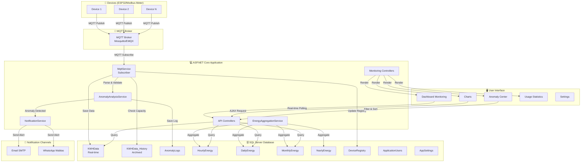

---

## 2. Flow Data MQTT ke Database

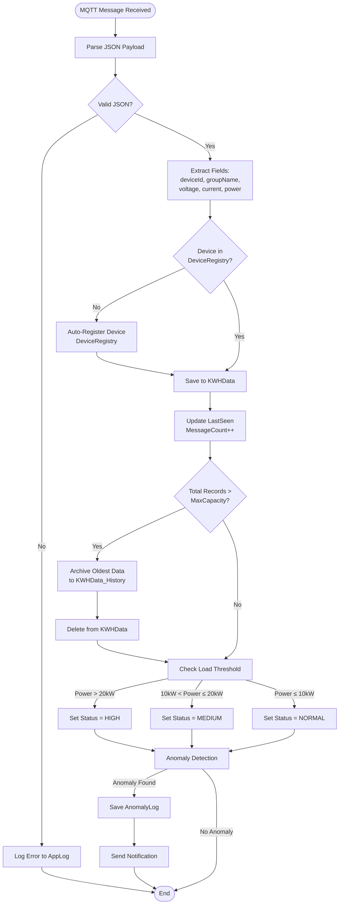

---

## 3. Flow Anomaly Detection

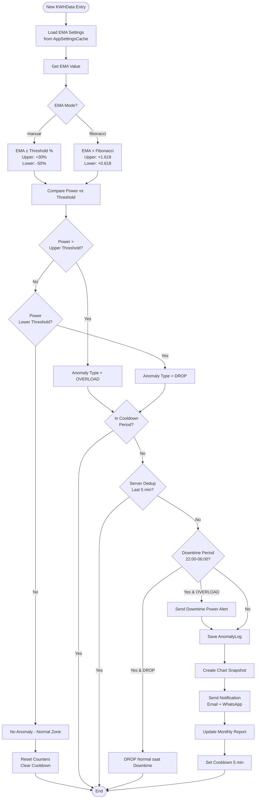

---

## 4. Flow Authentication & Authorization

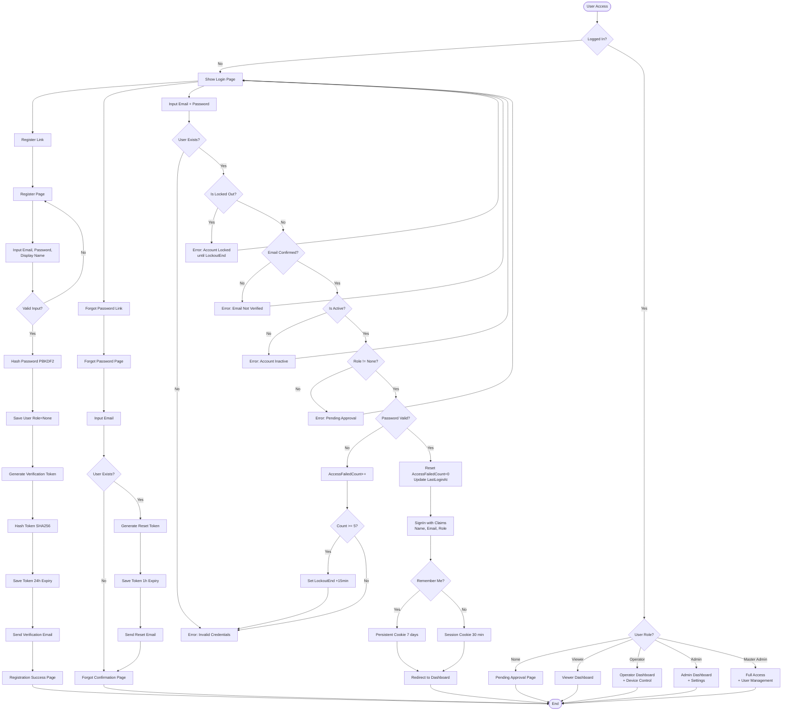

---

## 5. Flow Energy Aggregation

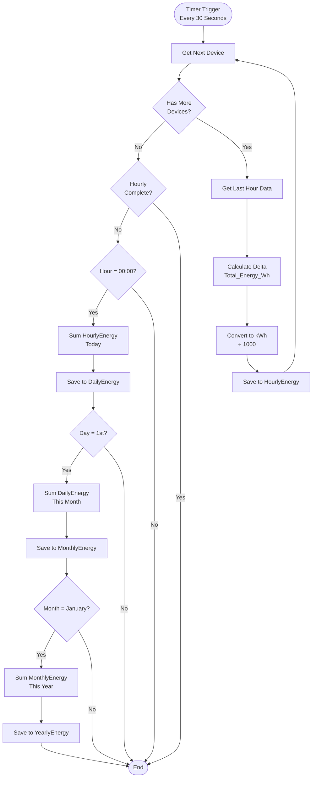

---

## 6. Flow Notification System

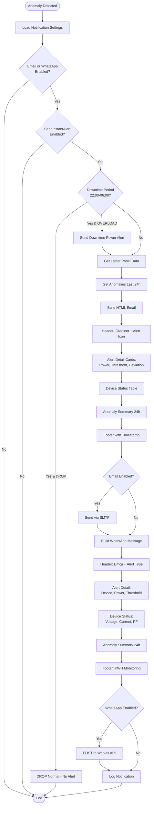

---

## 7. Flow Relay Control dengan OTP

```mermaid
flowchart TD
    Start([User Click ON/OFF]) --> CheckAuth{Authenticated?}
    
    CheckAuth -->|No| LoginRedirect[Redirect to Login]
    LoginRedirect --> End([End])
    
    CheckAuth -->|Yes| IsOff{OFF Button?}
    
    IsOff -->|Yes| ShowOTP[Show OTP Modal]
    ShowOTP --> InputOTP[User Input 6-digit OTP]
    InputOTP --> ValidateOTP{OTP Valid?}
    
    ValidateOTP -->|No| OTPError[Show Error Message]
    OTPError --> ShowOTP
    
    ValidateOTP -->|Yes| RateLimitCheck
    IsOff -->|Yes| RateLimitCheck{Rate Limited?<br/>10 req/60s}
    
    RateLimitCheck -->|Yes| RateError[Return Error 429]
    RateError --> End
    
    RateLimitCheck -->|No| LogSecurity[Log Security Action<br/>RelayControl]
    LogSecurity --> BuildTopic[Build MQTT Topic:<br/>data/KWHAPP/{deviceId}/12345678]
    BuildTopic --> BuildPayload[Build JSON Payload:<br/>{_terminalTime, _groupName, RC}]
    BuildPayload --> CheckConnection{MQTT Connected?}
    
    CheckConnection -->|No| ConnectMQTT[Connect to Broker]
    ConnectMQTT --> Publish
    CheckConnection -->|Yes| Publish[Publish via MQTTnet<br/>QoS 1]
    
    Publish --> Success{Publish Success?}
    Success -->|Yes| LogSuccess[Log Success to RelayControls]
    Success -->|No| LogFail[Log Failure to AppLog]
    
    LogSuccess --> UpdateUI[Update UI Status]
    LogFail --> UpdateUI
    
    UpdateUI --> End
```

---

## 8. Flow User Management (Master Admin)

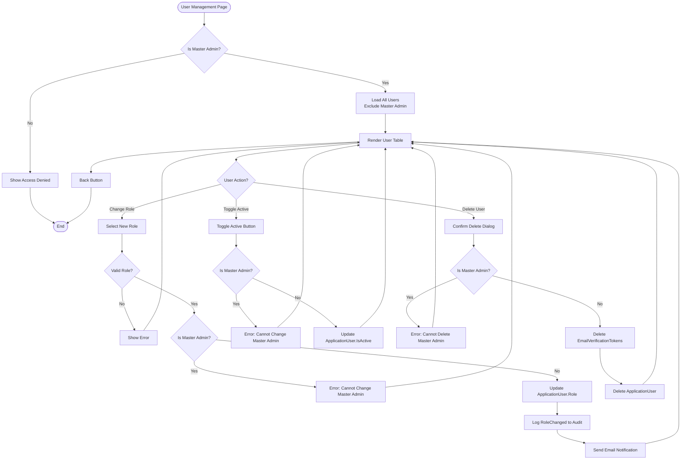

---

## 9. Background Service Loop

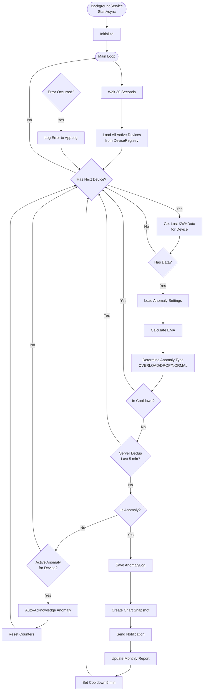

---

## 10. Sequence Diagram - End-to-End Flow

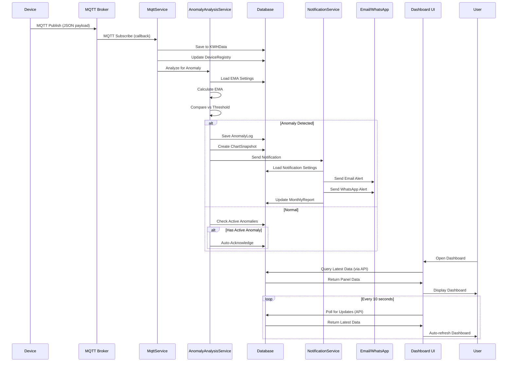

---

## 11. Database Entity Relationship

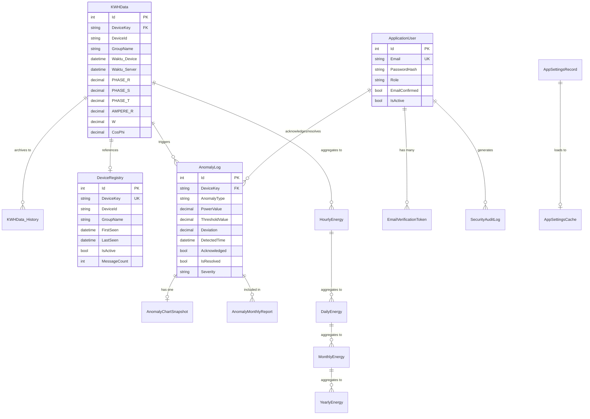

---

## 12. Deployment Architecture

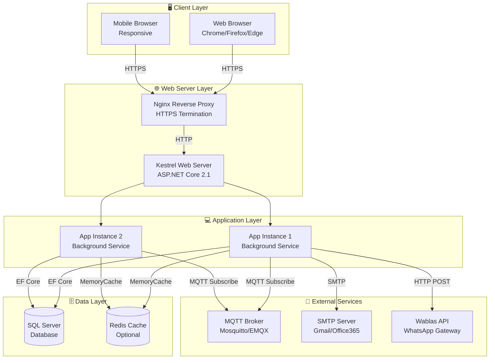

---

## 13. Flow Export CSV

```mermaid
flowchart TD
    Start([User Click Export CSV]) --> CheckAuth{Authenticated?}
    
    CheckAuth -->|No| LoginRedirect[Redirect to Login]
    LoginRedirect --> End([End])
    
    CheckAuth -->|Yes| GetDeviceKey{DeviceKey<br/>Provided?}
    
    GetDeviceKey -->|No| GetAll[Get All Devices Data]
    GetDeviceKey -->|Yes| GetSingle[Get Single Device Data]
    
    GetAll --> QueryDB[Query KWHData<br/>ORDER BY Waktu_Server DESC<br/>TOP 50000]
    GetSingle --> QueryDB
    
    QueryDB --> BuildCSV[Build CSV String]
    BuildCSV --> Header[Add Header Row:<br/>Id,DeviceKey,DeviceId,...]
    Header --> LoopData[Loop Through Records]
    
    LoopData --> EscapeFields[CsvEscape Fields:<br/>DeviceKey, DeviceId, GroupName]
    EscapeFields --> FormatDateTime[Format DateTime:<br/>yyyy-MM-dd HH:mm:ss]
    FormatDateTime --> FormatNumbers[Format Numbers:<br/>CultureInfo.InvariantCulture]
    FormatNumbers --> AppendRow[Append CSV Row]
    AppendRow --> MoreRecords{More Records?}
    
    MoreRecords -->|Yes| LoopData
    MoreRecords -->|No| ConvertBytes[Convert to UTF-8 Bytes]
    ConvertBytes --> GenFilename[Generate Filename:<br/>KWH_Monitoring_{timestamp}.csv]
    GenFilename --> ReturnFile[Return FileResult<br/>text/csv]
    ReturnFile --> End
```

---

## 14. Flow Settings Management

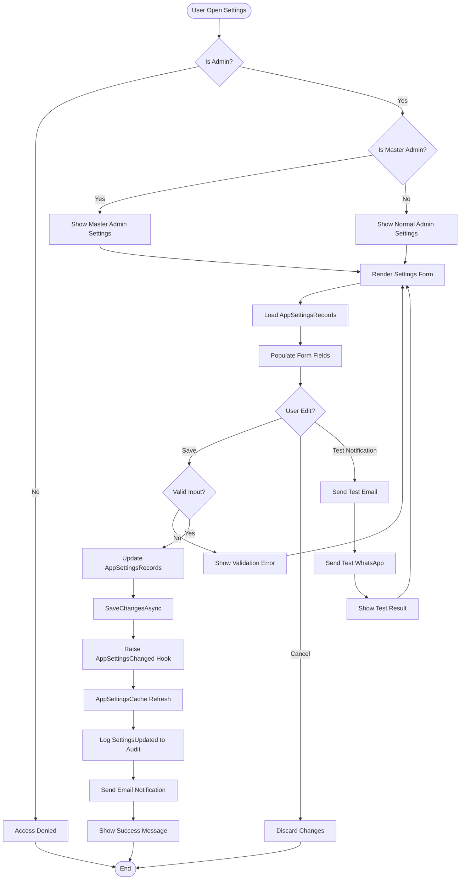

---

Dokumentasi flowchart ini dibuat pada: **18 September 2026**  
Format: **Mermaid.js** (compatible dengan GitHub, GitLab, Notion, Obsidian)  
Total Diagram: **14 flowchart berbeda**  
Coverage: **End-to-end system flow**

---

<!-- SOURCE: SECURITY_SETTINGS_SYNC_FIX_RESULT.md | MODIFIED: 2026-09-23 14:39:19 -->

## Sumber: `SECURITY_SETTINGS_SYNC_FIX_RESULT.md`

# Laporan Hasil Perbaikan: Sinkronisasi Settings Per Device & Keamanan

## Tanggal: 2026-09-23

## Status: ✅ SELESAI — Semua Phase berhasil, 0 error, 0 warning

---

## Ringkasan Eksekusi

| Phase | Status | Task Selesai | Task Total | Build |
|-------|--------|-------------|------------|-------|
| Phase 1: Keamanan Kritis | ✅ Selesai | 4 | 4 | ✅ 0/0 |
| Phase 2: Keamanan Sedang | ✅ Selesai | 4 | 4 | ✅ 0/0 |
| Phase 3: Sinkronisasi Settings | ✅ Selesai | 5 | 5 | ✅ 0/0 |
| Phase 4: Logika Anomaly | ✅ Selesai | 5 | 5 | ✅ 0/0 |
| Phase 5: Penguatan Tambahan | ✅ Selesai | 4 | 4 | ✅ 0/0 |

---

## Ringkasan Perubahan Kritis

| Sebelum | Sesudah |
|---------|---------|
| 63 dari 85 endpoint API tanpa auth | Semua write & credential endpoint memiliki `[Authorize]` |
| SMTP password plaintext di DB & log | SMTP password di-encrypt (`ENC:` prefix) di DB, tidak di-log |
| `ex.Message` dikembalikan ke client (83+ instance) | Generic error message, detail hanya di server log |
| NotificationService baca threshold global | NotificationService baca per-device threshold, fallback global |
| `window._deviceSettings` di-load sekali | Refresh setiap 60 detik |
| Device baru tanpa anomaly detection | Fallback ke global EMA thresholds |
| Dedup flag tidak auto-expire | Auto-expire setelah 30 menit |
| Bulk save tanpa transaction | Transaction scope dengan rollback |
| AES IV deterministik | Random IV per encryption |
| OTP comparison early-exit | Constant-time comparison |
| Password hash early-exit | Constant-time XOR comparison |

---

## Perubahan File Keseluruhan

| # | File | Phase | Deskripsi Perubahan |
|---|------|-------|---------------------|
| 1 | `Controllers/ApiController.cs` | 1-4 | +30 `[Authorize]` attributes, SafeError helper, mask credentials, dedup TTL, transaction scope, sync helpers |
| 2 | `Controllers/QwenChatController.cs` | 1 | Class-level `[Authorize(Policy = "RequireViewer")]` |
| 3 | `Controllers/MonitoringController.cs` | 1 | `RescanPanels` → `[Authorize(Policy = "RequireOperator")]` |
| 4 | `Services/NotificationService.cs` | 2-3 | SMTP decrypt, auto-reload TTL, per-device thresholds/tariff, inject AesEncryption+DeviceSettingsService |
| 5 | `Services/AesEncryptionService.cs` | 5 | Random IV per encryption, backward-compatible decrypt |
| 6 | `Services/PasswordHasher.cs` | 5 | Constant-time verify + ConstantTimeEquals helper |
| 7 | `Startup.cs` | 2 | SameSiteMode.Lax |
| 8 | `Views/Shared/_Layout.cshtml` | 3 | Periodic refresh `_deviceSettings` (60s) |
| 9 | `Views/Shared/_AnomalyService.cshtml` | 4 | EMA threshold fallback ke global settings |

---

## Detail Per Phase

### Phase 1: Keamanan Kritis
- Task 1.1: `GET /api/get-notification-settings` masked (no credentials), new `/get-notification-settings-full` with `[Authorize(Admin)]`; `chatbot-settings`, `get-system-settings`, `wablas/settings` all `[Authorize(Admin)]`
- Task 1.2: `test-database-connection`, `test-mqtt-connection`, `upload-mqtt-certificate`, `remove-mqtt-certificate` → `[Authorize(Admin)]`
- Task 1.3: 26 write endpoints secured with `[Authorize]` (Admin or Operator per function)
- Task 1.4: QwenChatController class-level `[Authorize(Policy = "RequireViewer")]`

### Phase 2: Keamanan Sedang
- Task 2.1: SMTP password encrypted with `ENC:` prefix in DB, decrypted on read; backward-compatible
- Task 2.2: Log statements only log key names, never values (no password/token in logs)
- Task 2.3: `SafeError()` helper — all 83+ `ex.Message`/`ex.InnerException`/`ex.StackTrace` returns replaced with generic message
- Task 2.4: `MinimumSameSitePolicy = SameSiteMode.Lax`

### Phase 3: Sinkronisasi Settings Per Device
- Task 3.1: `LoadThresholdsAsync(string deviceKey)` — per-device MaxCapacity/LoadThresholds prioritas
- Task 3.2: `GetTariffPerKWhAsync(string deviceKey)` — per-device TariffPerKWh prioritas
- Task 3.3: `SyncDeviceSettingsToAppSettingsAsync()` — DeviceCategory + ControlMode sync ke AppSettingsRecord
- Task 3.4: `setInterval(fetchDeviceSettings, 60000)` in _Layout.cshtml
- Task 3.5: `EnsureSettingsLoaded` auto-refresh dengan 5-min TTL, `_settingsLoadedAt` timestamp

### Phase 4: Logika Anomaly & Monitoring
- Task 4.1: Dedup flag auto-expire 30 menit, invalid format auto-clear
- Task 4.2: Covered by Task 3.4 (periodic client refresh)
- Task 4.3: `BulkSaveDeviceSettings` wrap dalam `BeginTransactionAsync()` + `Commit()` / `Rollback()`
- Task 4.4: EMA fallback ke `window.anomalyServiceConfig` jika per-device = 0
- Task 4.5: Skipped — Fibonacci fields low-impact, no UI, backward compat

### Phase 5: Penguatan Tambahan
- Task 5.1: `AesEncryptionService` random IV + backward-compatible decrypt
- Task 5.2: Skipped — SPA JSON API, minimal CSRF risk
- Task 5.3: `PasswordHasher.ConstantTimeEquals()` for OTP comparison
- Task 5.4: `PasswordHasher.VerifyPassword` constant-time XOR, no early exit

---

<!-- SOURCE: SECURITY_SETTINGS_SYNC_FIX_PLAN.md | MODIFIED: 2026-09-23 17:31:35 -->

## Sumber: `SECURITY_SETTINGS_SYNC_FIX_PLAN.md`

# Rencana Perbaikan: Sinkronisasi Settings Per Device & Keamanan

## Tanggal: 2026-09-23

## Status: 🔴 PLANNING — Menunggu Persetujuan

---

## Daftar Isi
1. [Kondisi Saat Ini (BEFORE)](#1-kondisi-saat-ini-before)
2. [Rencana Pengerjaan](#2-rencana-pengerjaan)
3. [Detail Per Phase](#3-detail-per-phase)
4. [File yang Akan Diubah](#4-file-yang-akan-diubah)
5. [Risiko & Mitigasi](#5-risiko--mitigasi)
6. [Target Kondisi (AFTER)](#6-target-kondisi-after)

---

## 1. Kondisi Saat Ini (BEFORE)

### A. Sinkronisasi Settings Per Device

| Masalah | Dampak |
|---------|--------|
| `NotificationService` baca threshold & tarif dari `AppSettingsRecord` (global), bukan `DeviceSettings` (per-device) | Notifikasi anomali pakai threshold lama — bisa false positive/negative |
| Field overlapping (MaxCapacity, LoadThresholds, EMA, Tariff, ControlMode) tidak disinkronkan antara `AppSettingsRecord` ↔ `DeviceSettings` | Perubahan di System Settings tab tidak tercermin di per-device, dan sebaliknya |
| `window._deviceSettings` di-load sekali saat page load, tidak di-refresh | Perubahan EMA threshold di Settings tab tidak langsung efek ke anomaly detection — perlu reload page |
| EMA threshold default = 0 → anomaly detection di-skip untuk device baru | Device baru tidak punya anomaly detection sampai admin konfigurasi manual |
| EMA mode Fibonacci di-hardcode `'manual'` di client — `EmaFibUpper/EmaFibLower` di model tidak digunakan | Field Fibonacci di DeviceSettings menjadi dead code |
| `BulkSaveDeviceSettings` tanpa transaction scope — concurrent bulk-save bisa last-write-wins | Race condition saat multiple admin save bersamaan |
| `NotificationService._settings` di-cache di memory tanpa auto-refresh | Perubahan SMTP/WhatsApp/toggle notifikasi via Settings page tidak langsung efek |

### B. Keamanan

| Masalah | Severity | Dampak |
|---------|----------|--------|
| `GET /api/get-notification-settings` — kembalikan SMTP password tanpa auth | 🔴 KRITIS | Kredensial SMTP bocor ke anonymous |
| `GET /api/chatbot-settings` — kembalikan API key ter-decrypt tanpa auth | 🔴 KRITIS | API key AI bocor ke anonymous |
| `GET /api/get-system-settings` — kembalikan semua settings tanpa auth | 🔴 KRITIS | Config sensitif terekspos |
| `POST /api/test-database-connection` — arbitrary SQL Server connection tanpa auth | 🔴 KRITIS | Network recon, brute-force, data exfiltration |
| ~15 write endpoint tanpa `[Authorize]` (save-tariff, save-ema, save-downtime, dll) | 🟠 TINGGI | Anonymous bisa manipulasi konfigurasi sistem |
| `QwenChatController` tanpa `[Authorize]` | 🟠 TINGGI | Anonymous bisa pakai AI quota, ekstrak data |
| SMTP password disimpan plaintext di DB & ter-log | 🟡 SEDANG | Kredensial terekspos di log & DB |
| Exception messages (`ex.Message`) dikembalikan ke client (~50+ instance) | 🟡 SEDANG | Information disclosure — reveal internal detail |
| `CookiePolicyOptions.MinimumSameSitePolicy = SameSiteMode.None` | 🟡 SEDANG | Melemahkan CSRF protection untuk non-auth cookies |
| AesEncryptionService IV deterministik | 🟢 RENDAH | Identik plaintext → identik ciphertext |
| Mayoritas POST/PUT/DELETE API tanpa `[ValidateAntiForgeryToken]` | 🟢 RENDAH | CSRF risk |

### C. Logika Anomaly & Monitoring

| Masalah | Dampak |
|---------|--------|
| Anomaly detection 100% client-side — jika tidak ada browser terbuka, anomali tidak terdeteksi | Gap arsitektural — tidak ada server-side detection |
| Multi-tab menjalankan deteksi independen — state counter/cooldown bisa drift antar tab | Duplikasi effort, state inconsistency |
| `AnomalyAlert.Active.{deviceKey}` dedup flag tidak auto-expire | Jika tidak ada browser setelah anomali, flag tetap aktif selamanya |
| State anomali (confirmationCounts, cooldownState) disimpan sebagai JSON string di AppSettings — concurrent write = lost-update | State bisa corrupt/overwrite |
| Downtime check client vs server baca dari sumber berbeda — bisa tidak sepakat | Client anggap bukan downtime, server anggap downtime (atau sebaliknya) |

---

## 2. Rencana Pengerjaan

Dibagi menjadi **5 Phase** berdasarkan prioritas dan ketergantungan:

```
Phase 1: KEAMANAN KRITIS
  ├── Task 1.1  Tambah [Authorize] endpoint kredensial
  ├── Task 1.2  Tambah [Authorize] test-database-connection
  ├── Task 1.3  Tambah [Authorize] write endpoints
  └── Task 1.4  Tambah [Authorize] QwenChatController

Phase 2: KEAMANAN SEDANG
  ├── Task 2.1  Encrypt SMTP password di DB
  ├── Task 2.2  Hapus password dari log output
  ├── Task 2.3  Generic error message (bukan ex.Message)
  └── Task 2.4  Fix Cookie SameSite policy

Phase 3: SINKRONISASI SETTINGS PER DEVICE
  ├── Task 3.1  NotificationService baca threshold dari DeviceSettings
  ├── Task 3.2  NotificationService baca tarif dari DeviceSettings
  ├── Task 3.3  Sync field overlapping AppSettingsRecord ↔ DeviceSettings
  ├── Task 3.4  Refresh window._deviceSettings secara periodik
  └── Task 3.5  NotificationService auto-reload settings

Phase 4: LOGIKA ANOMALY & MONITORING
  ├── Task 4.1  Auto-expire AnomalyAlert.Active dedup flag
  ├── Task 4.2  Fix downtime check consistency client vs server
  ├── Task 4.3  Bulk save dengan transaction scope
  ├── Task 4.4  Handle EMA threshold 0 — fallback ke global settings
  └── Task 4.5  Dead code cleanup — Fibonacci fields / mode

Phase 5: PENGUATAN TAMBAHAN
  ├── Task 5.1  AesEncryptionService random IV
  ├── Task 5.2  Tambah ValidateAntiForgeryToken pada write endpoints
  ├── Task 5.3  OTP comparison constant-time
  └── Task 5.4  Password hasher constant-time compare

---

## 3. Detail Per Phase

### Phase 1: KEAMANAN KRITIS 🔴
> Tujuan: Menutup semua endpoint yang mengekspos kredensial atau mengizinkan write tanpa auth

#### Task 1.1 — Tambah `[Authorize]` pada Endpoint Kredensial
**File:** `Controllers/ApiController.cs`

| Endpoint | Aksi | Attribute |
|----------|------|-----------|
| `GET /api/get-notification-settings` | Tambah auth, mask password di response | `[Authorize(Roles = "Admin")]` + filter `senderPassword` dari response |
| `GET /api/chatbot-settings` | Tambah auth | `[Authorize(Roles = "Admin")]` |
| `GET /api/get-system-settings` | Tambah auth | `[Authorize(Roles = "Admin")]` |
| `GET /api/debug/notification-settings-db` | Sudah ada auth? Verifikasi | Verifikasi `[Authorize(Policy = "RequireAdmin")]` |

**Catatan:** Endpoint `get-notification-settings` dipanggil oleh `_AnomalyService.cshtml` (client-side) saat load settings anomaly. Jika ditambah auth, client-side perlu adjustment — anomaly service harus handle 401 gracefully. Alternatif: buat endpoint baru `/api/notification-settings-public` yang hanya return field non-sensitif (`checkInterval`, `maxConfirmations`, `cooldownTime`, dll) tanpa `senderPassword`.

#### Task 1.2 — Tambah `[Authorize]` pada test-database-connection
**File:** `Controllers/ApiController.cs`
- Tambah `[Authorize(Roles = "Admin")]` pada `TestDatabaseConnection`
- Pertimbangkan juga rate limiting (mis. 3 request per menit)

#### Task 1.3 — Tambah `[Authorize]` pada Write Endpoints
**File:** `Controllers/ApiController.cs`

| Endpoint | Attribute |
|----------|-----------|
| `POST /api/save-tariff` | `[Authorize(Roles = "Admin")]` |
| `POST /api/save-ema-settings` | `[Authorize(Roles = "Admin")]` |
| `POST /api/save-downtime-settings` | `[Authorize(Roles = "Admin")]` |
| `POST /api/save-anomaly-settings` | `[Authorize(Roles = "Admin")]` |
| `POST /api/save-anomaly-state` | `[Authorize(Roles = "Operator,Admin")]` |
| `POST /api/log-anomaly` | `[Authorize(Roles = "Operator,Admin")]` |
| `POST /api/reset-anomaly-alert` | `[Authorize(Roles = "Operator,Admin")]` |
| `POST /api/anomaly-logs/{id}/chart-snapshot` | `[Authorize(Roles = "Operator,Admin")]` |
| `POST /api/device-category` | `[Authorize(Roles = "Admin")]` |
| `POST /api/categories` | `[Authorize(Roles = "Admin")]` |
| `PUT /api/categories/{name}` | `[Authorize(Roles = "Admin")]` |
| `DELETE /api/categories/{name}` | `[Authorize(Roles = "Admin")]` |

**Catatan:** `log-anomaly`, `save-anomaly-state`, `reset-anomaly-alert` dipanggil oleh client-side anomaly service. Perlu pastikan user login dengan role Operator/Admin. Jika ada skenario anonymous monitoring, perlu diskusi.

#### Task 1.4 — Tambah `[Authorize]` pada QwenChatController
**File:** `Controllers/QwenChatController.cs`
- Tambah `[Authorize]` class-level
- `POST /api/qwenchat/send` → `[Authorize(Roles = "Operator,Admin")]`
- `GET /api/qwenchat/current-dashboard-data` → `[Authorize(Roles = "Operator,Admin")]`

---

### Phase 2: KEAMANAN SEDANG 🟡
> Tujuan: Menghentikan kebocoran kredensial di storage & log, menutup information disclosure

#### Task 2.1 — Encrypt SMTP Password di DB
**File:** `Services/NotificationService.cs`, `Controllers/ApiController.cs`, `Services/AesEncryptionService.cs`
- Saat save notification settings: encrypt `senderPassword` via `AesEncryptionService.Encrypt()`
- Saat read notification settings: decrypt via `AesEncryptionService.Decrypt()`
- Simpan encrypted value di `AppSettingsRecord` dengan prefix marker (mis. `ENC:`) untuk backward compat
- Handle migrasi: jika value tidak diawali `ENC:`, anggap plaintext (baca langsung), lalu re-encrypt saat next save

#### Task 2.2 — Hapus Password dari Log Output
**File:** `Controllers/ApiController.cs`
- Cari semua `_logger.LogInformation` yang log value settings
- Filter key sensitif (`SenderPassword`, `ApiKey`, dll) — ganti value dengan `***`
- Contoh: `_logger.LogInformation("[SAVE-NOTIF] Updated key: {0} = {1}", key, IsSensitiveKey(key) ? "***" : value)`

#### Task 2.3 — Generic Error Message ke Client
**File:** `Controllers/ApiController.cs`
- Buat helper method `SafeErrorMessage(ex)` yang return "Terjadi kesalahan internal. Silakan hubungi administrator."
- Log exception detail ke server (`_logger.LogError(ex, ...)`)
- Ganti semua `return StatusCode(500, new { error = ex.Message })` → `return StatusCode(500, new { error = SafeErrorMessage() })`
- Untuk development mode, bisa tetap tampilkan detail via `IHostingEnvironment.IsDevelopment()`

#### Task 2.4 — Fix Cookie SameSite Policy
**File:** `Startup.cs`
- Ubah `MinimumSameSitePolicy = SameSiteMode.None` → `SameSiteMode.Lax`
- Verifikasi tidak ada breakage pada cross-site flows (seharusnya tidak ada karena auth cookie sudah Lax)

---

### Phase 3: SINKRONISASI SETTINGS PER DEVICE 🟠
> Tujuan: Memastikan perubahan settings per device tercermin ke seluruh komponen sistem

#### Task 3.1 — NotificationService Baca Threshold dari DeviceSettings
**File:** `Services/NotificationService.cs`
- Ubah `LoadThresholdsAsync()` untuk membaca per-device threshold dari `DeviceSettingsService`
- Jika device punya `MaxCapacity > 0`, gunakan itu; fallback ke global `Load.MaxCapacity`
- Jika device punya `LoadNormalThreshold > 0` / `LoadMediumThreshold > 0`, gunakan itu; fallback ke global
- Signature mungkin perlu berubah dari global → per-device: `LoadThresholdsAsync(string deviceKey)`

#### Task 3.2 — NotificationService Baca Tarif dari DeviceSettings
**File:** `Services/NotificationService.cs`
- Ubah `GetTariffPerKWhAsync()` untuk menerima `deviceKey` parameter
- Jika device punya `TariffPerKWh > 0`, gunakan itu; fallback ke global `Tariff.PerKWh`

#### Task 3.3 — Sync Field Overlapping AppSettingsRecord ↔ DeviceSettings
**File:** `Controllers/ApiController.cs` (SaveDeviceSettings), `Services/DeviceSettingsService.cs`
- Saat save per-device settings, sync bidirectional untuk field overlapping:
  - `MaxCapacity` → sync ke `Load.MaxCapacity` (global fallback)
  - `LoadNormalThreshold` → sync ke `Load.NormalThreshold`
  - `LoadMediumThreshold` → sync ke `Load.MediumThreshold`
  - `EmaUpperThreshold` → sync ke `EMA.UpperThreshold`
  - `EmaLowerThreshold` → sync ke `EMA.LowerThreshold`
  - `TariffPerKWh` → sync ke `Tariff.PerKWh`
  - `ControlMode` → sync ke `Control.Mode`
- **Atau alternatif:** deprecate field global, semua baca dari DeviceSettings. Pilih salah satu pendekatan.
- Perlu diskusi: mana yang menjadi source of truth?

#### Task 3.4 — Refresh `window._deviceSettings` Secara Periodik
**File:** `Views/Shared/_Layout.cshtml`, `Views/Shared/_AnomalyService.cshtml`
- Di `_Layout.cshtml`, tambah interval refresh `window._deviceSettings` setiap 60 detik (sama dengan settingsReloadTimer)
- Di `_AnomalyService.cshtml`, pastikan `processAnomalyCheck()` selalu baca dari `window.getDeviceSettings()` yang sudah di-refresh
- Handle race condition: jika refresh sedang berjalan, jangan overwrite sampai selesai

#### Task 3.5 — NotificationService Auto-Reload Settings
**File:** `Services/NotificationService.cs`
- Subscribe ke `ApplicationDbContext.AppSettingsChanged` hook
- Atau inject `IOptionsMonitor<AppSettings>` pattern
- Atau sederhana: cek timestamp terakhir load, reload jika > 5 menit (sama seperti AppSettingsCache TTL)
- Prioritas: SMTP, WhatsApp, toggle notifikasi harus langsung efek setelah admin save

---

### Phase 4: LOGIKA ANOMALY & MONITORING 🔵
> Tujuan: Memperkuat konsistensi dan reliability anomaly detection

#### Task 4.1 — Auto-Expire AnomalyAlert.Active Dedup Flag
**File:** `Controllers/ApiController.cs` (LogAnomaly, ResetAnomalyAlert)
- Tambah timestamp saat set `AnomalyAlert.Active.{deviceKey}`
- Saat cek dedup, jika flag > 30 menit (atau configurable), anggap expired → clear & lanjutkan
- Atau: di `AppSettingsCache` refresh, cek dan bersihkan flag stale
- Simpan sebagai JSON: `{ "type": "OVERLOAD", "loggedAt": "2026-09-23T10:00:00" }`

#### Task 4.2 — Fix Downtime Check Consistency Client vs Server
**File:** `Views/Shared/_AnomalyService.cshtml`, `Controllers/ApiController.cs`
- Client: refresh downtime settings bersama dengan `window._deviceSettings` refresh (Task 3.4)
- Server: `CheckDowntimePeriodAsync` sudah baca dari DB — ini benar
- Tambahkan: jika server mendeteksi inconsistency (client kirim anomali yang menurut server harus suppressed), return info supaya client bisa update state

#### Task 4.3 — Bulk Save dengan Transaction Scope
**File:** `Controllers/ApiController.cs` (BulkSaveDeviceSettings)
- Wrap iterasi save dalam `using var transaction = await _context.Database.BeginTransactionAsync()`
- Commit di akhir jika semua berhasil, rollback jika ada error
- Tangkap `DbUpdateConcurrencyException` untuk handle concurrent modification

#### Task 4.4 — Handle EMA Threshold 0 — Fallback ke Global Settings
**File:** `Views/Shared/_AnomalyService.cshtml`
- Saat ini: jika `emaUpperThreshold == 0 && emaLowerThreshold == 0`, skip anomaly detection
- Ubah: fallback ke global EMA settings (dari `EMA.UpperThreshold` / `EMA.LowerThreshold` di AppSettings)
- Logika: per-device override jika > 0, global default jika 0
- Ini memastikan device baru tetap punya anomaly detection pakai global threshold

#### Task 4.5 — Dead Code Cleanup — Fibonacci Fields / Mode
**File:** `Models/DeviceSettings.cs`, `Views/Monitoring/_DeviceSettingsTab.cshtml`
- Opsi A: Hapus `EmaFibUpper`, `EmaFibLower` dari DeviceSettings model jika tidak digunakan
- Opsi B: Implementasikan Fibonacci mode di client-side anomaly service (connect ke per-device FibUpper/FibLower)
- **Rekomendasi:** Opsi A — hapus dead code, simplify. Fibonacci mode bisa di-add later jika dibutuhkan.

---

### Phase 5: PENGUATAN TAMBAHAN 🟢
> Tujuan: Hardening security & crypto best practices

#### Task 5.1 — AesEncryptionService Random IV
**File:** `Services/AesEncryptionService.cs`
- Generate random IV per encryption menggunakan `RandomNumberGenerator.GetBytes(16)`
- Simpan IV bersama ciphertext (prepend atau separate field)
- Update decrypt logic untuk extract IV dari ciphertext
- Handle backward compat: jika ciphertext length == tanpa IV, gunakan IV lama (deterministic)

#### Task 5.2 — Tambah `[ValidateAntiForgeryToken]` pada Write Endpoints
**File:** `Controllers/ApiController.cs`
- Tambah pada semua POST/PUT/DELETE yang menerima form data
- Untuk JSON API endpoints, pertimbangkan: custom header `X-Requested-With` check sebagai alternatif
- Atau: tambah anti-forgery token di AJAX request header secara global di `_Layout.cshtml`

#### Task 5.3 — OTP Comparison Constant-Time
**File:** `Controllers/ApiController.cs` (PublishRelay)
- Ganti `request.OtpCode.Trim() != storedCode.Trim()` dengan constant-time string compare
- Implementasi sederhana: loop semua karakter, XOR accumulator, return false hanya di akhir
- Atau pakai `CryptographicOperations.FixedTimeEquals` dari `Microsoft.AspNetCore.Cryptography.Internal`

#### Task 5.4 — Password Hasher Constant-Time Compare
**File:** `Services/PasswordHasher.cs`
- Ganti early-exit byte comparison dengan `CryptographicOperations.FixedTimeEquals`
- Minor: timing leak saat password salah, tapi PBKDF2 cost membuat eksploitasi tidak praktis

---

## 4. File yang Akan Diubah

| File | Phase | Perubahan |
|------|-------|-----------|
| `Controllers/ApiController.cs` | 1, 2, 3, 4 | Tambah `[Authorize]`, mask kredensial, generic error, transaction scope, dedup expiry |
| `Controllers/QwenChatController.cs` | 1 | Tambah `[Authorize]` class-level |
| `Controllers/MonitoringController.cs` | 3 | Inject `DeviceSettingsService` untuk settings sync |
| `Services/NotificationService.cs` | 3, 4 | Baca threshold/tarif dari DeviceSettings, auto-reload |
| `Services/AesEncryptionService.cs` | 2, 5 | Random IV, encrypt SMTP password |
| `Services/PasswordHasher.cs` | 5 | Constant-time compare |
| `Services/DeviceSettingsService.cs` | 3 | Sync logic bidirectional |
| `Startup.cs` | 2 | Fix SameSite policy |
| `Views/Shared/_Layout.cshtml` | 3 | Periodic refresh `_deviceSettings` |
| `Views/Shared/_AnomalyService.cshtml` | 3, 4 | EMA fallback, downtime consistency |
| `Views/Monitoring/_DeviceSettingsTab.cshtml` | 4 | Cleanup Fibonacci fields |
| `Models/DeviceSettings.cs` | 4 | Cleanup Fibonacci properties |

---

## 5. Risiko & Mitigasi

| Risiko | Mitigasi |
|--------|----------|
| Tambah `[Authorize]` di endpoint anomaly → client-side anomaly service 401 | Buat public endpoint untuk non-sensitif fields, atau pastikan semua user login sebagai Operator minimum |
| Encrypt SMTP password → breaking change baca existing data | Prefix marker `ENC:` + backward compat read (plaintext → encrypt on next save) |
| Sync bidirectional AppSettingsRecord ↔ DeviceSettings → infinite loop | Satu arah sync: DeviceSettings sebagai source of truth → push ke AppSettingsRecord |
| Generic error message → debugging production sulit | Log full exception di server, return generic ke client. Dev mode tetap verbose |
| Refresh `_deviceSettings` periodik → extra DB load | Interval 60s per browser, cached di client. Bisa ditambah ETag/If-Modified-Since |
| Random IV AES → tidak bisa decrypt data lama | Backward compat: deteksi panjang ciphertext, gunakan path lama jika tanpa IV prepended |
| Transaction scope bulk save → deadlock risk | Keep transaction short, retry logic untuk `DbUpdateConcurrencyException` |

---

## 6. Target Kondisi (AFTER)

### A. Sinkronisasi Settings Per Device
- ✅ NotificationService membaca threshold & tarif per-device (fallback ke global jika 0)
- ✅ Field overlapping tersinkronisasi — DeviceSettings sebagai source of truth
- ✅ `window._deviceSettings` di-refresh setiap 60 detik
- ✅ Device baru otomatis menggunakan global EMA threshold sebagai fallback
- ✅ NotificationService auto-reload saat settings berubah
- ✅ Bulk save aman dengan transaction scope

### B. Keamanan
- ✅ Semua endpoint kredensial memerlukan `[Authorize(Roles = "Admin")]`
- ✅ SMTP password ter-encrypt di DB (AES, random IV)
- ✅ Password/API key tidak muncul di log
- ✅ Client menerima generic error, detail hanya di server log
- ✅ Cookie SameSite policy konsisten (Lax)
- ✅ Semua write endpoint memerlukan auth yang sesuai
- ✅ CSRF protection pada form-based endpoints
- ✅ Constant-time comparison untuk OTP & password hash

### C. Logika Anomaly & Monitoring
- ✅ Dedup flag auto-expire (TTL 30 menit)
- ✅ Downtime check konsisten client vs server
- ✅ Dead code Fibonacci dihapus
- ✅ Multi-tab aware (server-side dedup tetap bekerja)

### D. Yang TIDAK Diubah (Out of Scope)
- ❌ Arsitektur anomaly detection tetap client-side (server-side detection = proyek terpisah)
- ❌ Multi-tab state drift (mitigated oleh server-side dedup, full sync = proyek terpisah)
- ❌ Migration state JSON ke tabel terpisah (low priority, bisa nanti)

---

## Checklist Pengerjaan

### Phase 1: Keamanan Kritis
- [ ] Task 1.1 — `[Authorize]` endpoint kredensial + mask password
- [ ] Task 1.2 — `[Authorize]` test-database-connection
- [ ] Task 1.3 — `[Authorize]` write endpoints
- [ ] Task 1.4 — `[Authorize]` QwenChatController
- [ ] Build & verify

### Phase 2: Keamanan Sedang
- [ ] Task 2.1 — Encrypt SMTP password di DB
- [ ] Task 2.2 — Hapus password dari log
- [ ] Task 2.3 — Generic error message
- [ ] Task 2.4 — Fix SameSite policy
- [ ] Build & verify

### Phase 3: Sinkronisasi Settings
- [ ] Task 3.1 — NotificationService threshold per-device
- [ ] Task 3.2 — NotificationService tarif per-device
- [ ] Task 3.3 — Sync bidirectional overlapping fields
- [ ] Task 3.4 — Refresh window._deviceSettings periodik
- [ ] Task 3.5 — NotificationService auto-reload
- [ ] Build & verify

### Phase 4: Logika Anomaly & Monitoring
- [ ] Task 4.1 — Auto-expire dedup flag
- [ ] Task 4.2 — Downtime consistency client vs server
- [ ] Task 4.3 — Bulk save transaction scope
- [ ] Task 4.4 — EMA fallback ke global
- [ ] Task 4.5 — Dead code cleanup Fibonacci
- [ ] Build & verify

### Phase 5: Penguatan Tambahan
- [ ] Task 5.1 — Random IV AES
- [ ] Task 5.2 — ValidateAntiForgeryToken
- [ ] Task 5.3 — OTP constant-time
- [ ] Task 5.4 — Password constant-time
- [ ] Build & verify

---

<!-- SOURCE: AFTER_FINANCIAL_USAGE.md | MODIFIED: 2026-09-24 09:18:50 -->

## Sumber: `AFTER_FINANCIAL_USAGE.md`

# Financial-Grade Usage Statistics — Implementation Record

**Date:** 2026-09-23
**Scope:** Upgrade Usage Statistics dari dashboard operasional ke dashboard finansial

---

## Summary

Mengimplementasikan 10 fitur finansial (P1/P2/P3) di Usage Statistics tanpa mengubah fitur dan fungsi yang sudah running. Semua perubahan bersifat **additive only** — tidak ada existing field/response yang diubah.

---

## Files Changed

| File | Change Type |
|---|---|
| `Models/DeviceSettings.cs` | Added 6 new fields |
| `Models/ApplicationDbContext.cs` | Added EF Core mapping for 6 new fields |
| `Services/DeviceSettingsService.cs` | Added defaults + SaveAsync for new fields |
| `Controllers/ApiController.cs` | Added financial helpers + extended 2 endpoints + extended request models |
| `Views/Monitoring/_DeviceSettingsTab.cshtml` | Added 6 new form fields per device |
| `Views/Monitoring/UsageStatistics.cshtml` | Redesigned financial UI: 2 doughnut charts + compact metric grid + anomaly card |
| `Views/Monitoring/Details.cshtml` | Redesigned financial UI (same pattern with device-prefixed IDs) |
| `wwwroot/css/site.css` | Added `.fin-chart-body`, `.fin-metric-grid`, `.fin-metric` etc. + responsive rules |
| `Migrations/20260923120000_AddFinancialFieldsToDeviceSettings.cs` | New migration |

---

## New DeviceSettings Fields

| Field | Type | Default | Purpose |
|---|---|---|---|
| `TariffWBP` | decimal(18,2) | 0 | Tarif Waktu Beban Puncak (Rp/kWh). 0 = tidak dikonfigurasi |
| `TariffLWBP` | decimal(18,2) | 0 | Tarif Luar Waktu Beban Puncak (Rp/kWh). 0 = tidak dikonfigurasi |
| `WbpStartHour` | int | 18 | Jam mulai WBP (0-23) |
| `WbpEndHour` | int | 22 | Jam selesai WBP (0-23) |
| `BudgetKWh` | decimal(18,2) | 0 | Budget kWh bulanan. 0 = tidak di-set |
| `SurfaceArea` | decimal(18,2) | 0 | Luas permukaan media (m²). 0 = N/A |

---

## New API Response Fields

Both `POST /api/Api/usage-statistics` and `POST /api/Api/usage-statistics/{deviceKey}` now return 8 additional objects:

### 1. `wbpLwbp` — WBP/LWBP Tariff Split
```json
{
  "configured": true/false,
  "wbpKWh": 12.5, "lwbpKWh": 38.2,
  "wbpCost": 29375, "lwbpCost": 57300,
  "totalCostWBP": 86675, "wbpRatio": 24.6,
  "tariffWBP": 2350, "tariffLWBP": 1500,
  "wbpStart": 18, "wbpEnd": 22
}
```
- Jika `configured = false`: tarif flat digunakan untuk kedua slot
- WBP/LWBP split menggunakan `HourlyEnergy` data per jam

### 2. `waste` — Waste Detection (Downtime Consumption)
```json
{
  "configured": true/false,
  "wasteKWh": 3.2, "wasteCost": 4800,
  "wastePercent": 6.4,
  "downtimeStart": "22:00", "downtimeEnd": "06:00"
}
```
- Cross-reference `HourlyEnergy` + `DeviceSettings.DowntimeStart/End`
- Jika downtime tidak aktif: `configured = false`

### 3. `budget` — Budget vs Actual
```json
{
  "configured": true/false,
  "budgetKWh": 500, "actualKWh": 480.5,
  "variance": -19.5, "variancePercent": -3.9,
  "budgetCost": 750000, "actualCost": 720750
}
```
- Variance negatif = hemat, positif = over-budget
- Jika `BudgetKWh = 0`: `configured = false`

### 4. `periodComparison` — MoM/YoY
```json
{
  "lastMonthKWh": 450, "momChange": 30.5, "momChangePercent": 6.8,
  "lastYearSameMonthKWh": 420, "yoyChange": 60.5, "yoyChangePercent": 14.4
}
```
- Data dari `MonthlyEnergy` table

### 5. `billProjection` — End of Month Projection
```json
{
  "projectedMonthKWh": 520.3, "projectedCost": 780450,
  "daysElapsed": 15, "daysRemaining": 15
}
```
- Formula: `projectedMonthKWh = (currentMonthKWh / daysElapsed) × totalDaysInMonth`

### 6. `anomalyCostImpact` — Anomaly Cost Impact
```json
{
  "totalAnomalies": 5, "estimatedExcessKWh": 2.8,
  "estimatedCostImpact": 4200,
  "topAnomalies": [
    { "deviceKey": "...", "anomalyType": "OVERLOAD", "powerValue": 25000, "thresholdValue": 20000, "deviation": 25, "severity": "high", "detectedTime": "...", "estimatedCost": 1875 }
  ]
}
```
- Estimasi: `(PowerValue - ThresholdValue) × 0.25h / 1000 × tarif`
- 0.25 jam = asumsi rata-rata durasi anomali ~15 menit

### 7. `loadFactorInfo` — Load Factor
```json
{
  "configured": true/false,
  "loadFactor": 45.2, "maxCapacity": 30000, "status": "Optimal"
}
```
- Formula: `Load Factor = Actual kWh / (MaxCapacity kW × operating hours) × 100%`
- Status: <30% Under-utilized, 30-80% Optimal, >80% High Risk

### 8. `unitEconomics` — Unit Economics
```json
{
  "configured": true/false,
  "costPerM2": 85000, "costPerHour": 3125,
  "surfaceArea": 12.5, "totalCost": 720750
}
```
- `costPerM2` = totalCost / surfaceArea (jika surfaceArea > 0)
- `costPerHour` = totalCost / (daysElapsed × 24)

---

## New Settings UI Fields

Di Per-Device Settings tab (Settings → Per-Device):

| Label | Field | Type | Placeholder |
|---|---|---|---|
| Tarif WBP (Rp) | TariffWBP | number | 0 = flat |
| Tarif LWBP (Rp) | TariffLWBP | number | 0 = flat |
| WBP Start | WbpStartHour | select 0-23 | — |
| WBP End | WbpEndHour | select 0-23 | — |
| Budget kWh/bln | BudgetKWh | number | 0 = nonaktif |
| Luas (m²) | SurfaceArea | number | 0 = N/A |

---

## Financial UI Sections (UsageStatistics & Details)

Redesigned dari 11 card (6 section) menjadi 3 compact section dengan chart:

1. **🍩 Financial Charts Row** (2 card sejajar) — Doughnut chart WBP/LWBP Split + Doughnut chart Budget vs Actual
   - WBP/LWBP: doughnut 2 segment (indigo/green) dengan center text total kWh + rasio
   - Budget: doughnut 2 segment (terpakai/sisa) dengan center text persentase, warna adaptif (hijau <80%, kuning 80-100%, merah >100%)
   - Jika belum dikonfigurasi: canvas hidden, tampil pesan "Belum dikonfigurasi"
2. **📊 Financial Summary** (1 card, 6 metric compact grid 3×2) — Waste, MoM, YoY, Bill Projection, Load Factor, Unit Economics
   - Masing-masing metric: label icon, value (color-coded), sub-line detail
   - "Belum dikonfigurasi" ditampilkan inline di sub-line (bukan card terpisah)
3. **⚠️ Dampak Biaya Anomali** (1 card) — Total dampak + daftar top 5 anomali

Chart.js center-text plugin (id: `centerText`) didaftarkan sekali per halaman menggunakan `window._centerTextPluginRegistered` guard untuk mencegah duplikasi.

### Client-Side Financial Aggregation (UsageStatistics)

Dashboard utama (UsageStatistics) **tidak menggunakan financial data dari endpoint aggregate**. Sebaliknya, ia menghitung financial data secara dinamis dari perhitungan setiap device:

1. **Saat "Semua Panel" dipilih**: `fetchAndAggregateDeviceFinancialData()` memanggil per-device endpoint untuk setiap device secara paralel, lalu `aggregateFinancialData()` menggabungkan hasilnya:
   - **WBP/LWBP**: Sum kWh & cost dari devices yang dikonfigurasi. WBP ratio dihitung ulang dari total.
   - **Waste**: Sum kWh & cost. Waste percent dihitung ulang dari total konsumsi.
   - **Budget**: Sum budgetKWh, actualKWh, budgetCost, actualCost. Variance & percent dihitung ulang.
   - **Period Comparison**: Sum lastMonthKWh, momChange, lastYearSameMonthKWh, yoyChange. Percent dihitung ulang.
   - **Bill Projection**: Sum projectedMonthKWh & projectedCost per device (masing-masing pakai tarif sendiri).
   - **Anomaly Cost Impact**: Sum total & merge top anomalies, sort by cost, ambil top 5.
   - **Load Factor**: Dihitung ulang dari total kWh / (total maxCapacity kVA × hours). Bukan rata-rata.
   - **Unit Economics**: costPerM2 = totalCost / totalSurfaceArea, costPerHour = totalCost / (days × 24).
2. **Saat device tertentu dipilih**: Langsung gunakan financial data dari per-device response.
3. **Throttle**: Agregasi financial hanya di-refresh setiap 60 detik saat auto-refresh (10 detik). Manual interactions (filter, date change, refresh button) selalu trigger financial refresh.

### CSS Classes Baru
- `.fin-chart-body` — container doughnut chart (height: 220px)
- `.fin-metric-grid` — 3-column CSS grid untuk compact metrics
- `.fin-metric` — individual metric block (centered, bordered)
- `.fin-metric-label`, `.fin-metric-value`, `.fin-metric-sub` — metric typography
- Responsive: `.fin-metric-grid` → 2-column pada ≤768px

---

## Backward Compatibility

- Semua field baru default ke 0/off — jika tidak dikonfigurasi, sistem tetap berfungsi seperti sebelumnya
- Response API **100% backward compatible** — semua existing field tetap ada
- WBP/LWBP: jika kedua tarif = 0, sistem menggunakan flat tariff (sama seperti sebelumnya)
- Budget: jika BudgetKWh = 0, section budget menampilkan "Belum dikonfigurasi"
- SurfaceArea: jika = 0, unit economics menampilkan "N/A"
- Frontend gracefully handles missing/undefined data

---

## Migration

File: `Migrations/20260923120000_AddFinancialFieldsToDeviceSettings.cs`

Menambahkan 6 kolom ke tabel `DeviceSettings`:
- `TariffWBP` decimal(18,2) DEFAULT 0
- `TariffLWBP` decimal(18,2) DEFAULT 0
- `WbpStartHour` int DEFAULT 18
- `WbpEndHour` int DEFAULT 22
- `BudgetKWh` decimal(18,2) DEFAULT 0
- `SurfaceArea` decimal(18,2) DEFAULT 0

**Migration harus dijalankan manual** setelah restart server.

---

## Build Status

✅ C# compilation: 0 errors (DLL lock MSB3027 hanya karena server running)
⚠️ Server perlu restart untuk apply perubahan biner
⚠️ Migration perlu dijalankan: `dotnet ef database update`

---

<!-- SOURCE: AUDIT_WEBSITE_KWHMONITORING.md | MODIFIED: 2026-09-30 14:43:38 -->

## Sumber: `AUDIT_WEBSITE_KWHMONITORING.md`

# Laporan Audit Teknis Website KWHMonitoring

**Tanggal pemeriksaan:** 30 September 2026  
**Cakupan utama:** `KWHMonitoring - .NET 2.1 - V7/KWHMonitoring` (kode aplikasi aktif yang dibuka pada IDE)  
**Metode:** inspeksi statis kode, konfigurasi, model, view, dan skrip database. Aplikasi tidak dijalankan; tidak ada perubahan pada kode proyek.

> Laporan ini menggambarkan implementasi yang ditemukan di source. Nilai konfigurasi runtime, keadaan database, ketersediaan broker dan layanan eksternal tidak diverifikasi.

## Ringkasan

KWHMonitoring adalah aplikasi web ASP.NET Core MVC 2.1 untuk pemantauan pemakaian listrik dan pengendalian relay perangkat. Aplikasi menyajikan halaman dashboard MVC/Razor dan API JSON di bawah `/api`. Backend memakai Entity Framework Core dengan SQL Server, berkomunikasi ke broker MQTT untuk instruksi relay, dan menyediakan notifikasi melalui SMTP serta gateway WhatsApp Wablas/Fonnte. Ada analisis anomali, ringkasan energi, pelaporan terjadwal, manajemen pengguna berbasis role, dan chatbot Qwen.

Secara umum alur pemantauan membaca rekaman terbaru per `DeviceKey` dari tabel `KWH_Monitoring`; rekaman tersebut berasal dari sistem/perangkat eksternal. Di source yang diaudit, `MqttService` tampak mengirim kontrol relay, bukan sebagai consumer telemetry. Karena itu jalur ingest telemetry tidak dapat dipastikan hanya dari kode web ini.

## Topologi

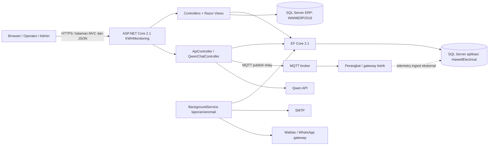

**Batas yang perlu diketahui:** koneksi SQL aplikasi dan ERP adalah dua sumber yang berbeda di konfigurasi. `TitikLokasiService` mengambil master lokasi dari ERP untuk melengkapi tampilan panel. Penyimpanan telemetry memakai database aplikasi. Arah panah perangkat menuju database merupakan interpretasi kebutuhan sistem; mekanisme ingest tidak tampak pada `MqttService` yang diperiksa dan perlu diverifikasi pada layanan/perangkat eksternal.

## Arsitektur dan cara kerja

1. `Program.cs` membangun host ASP.NET Core dan memuat `Startup`.
2. `Startup.ConfigureServices` mendaftarkan EF Core SQL Server, cache memory, layanan aplikasi, autentikasi cookie, policy role, HTTP client Qwen, dan background notification service (kecuali `KWH_DISABLE_NOTIFICATION_BG` mematikannya).
3. Saat startup, aplikasi menguji koneksi database dengan timeout singkat. Bila siap, migrasi dijalankan, admin dan konfigurasi perangkat di-seed, lalu cache pengaturan dihangatkan. Jika DB tidak tersedia, web tetap dapat start dan menampilkan penanganan error DB.
4. Middleware mengaktifkan HTTPS redirect, file statis, cookie policy, kompresi respons, autentikasi, security headers, dan routing MVC. Route default: `/{controller=Monitoring}/{action=Index}/{id?}`.
5. Browser meminta halaman melalui controller MVC atau data/aksi melalui API. Controller menggunakan `ApplicationDbContext` dan service; Razor menampilkan hasilnya. Dashboard memuat data secara bertahap melalui JavaScript/fetch.
6. Perintah relay diterbitkan ke MQTT setelah otorisasi dan validasi. Laporan/anomali dapat memicu email atau pesan WhatsApp.

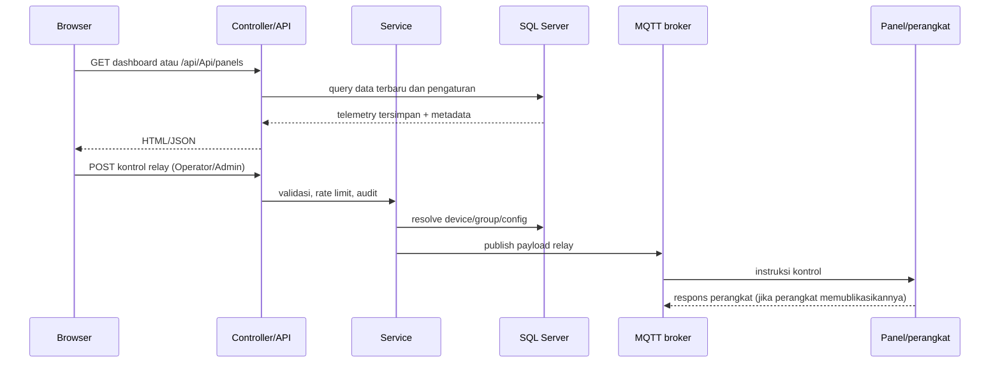

## Fitur dan fungsi utama

| Area | Fungsi yang ditemukan |
|---|---|
| Dashboard monitoring | Daftar panel/perangkat, status, pencarian/filter fase, kartu panel, data realtime terakhir, grafik, detail, histori dan ekspor CSV. Halaman utama dan feed panel ditandai publik/read-only. |
| Energi dan statistik | API statistik pemakaian umum/perangkat serta tabel agregat harian, per jam, bulanan, tahunan. Terdapat peringkat penggunaan berdasarkan periode. |
| Pengaturan perangkat | Skala/mapping kolom, konfigurasi per-device, kategori perangkat, pengaturan status/downtime dan rescan panel. Konfigurasi efektif dibaca melalui `DeviceSettingsService`. |
| Kontrol relay | Publish ON/OFF/pulse ke broker MQTT; endpoint memeriksa akses Operator/Admin, ada batas laju lokal 10 request per 60 detik per pengguna dan pencatatan aksi. Detail validasi OTP/otorisasi per request harus dirujuk ke implementasi endpoint. |
| Anomali | Analisis dan log anomali, status/acknowledge/resolve/catatan, reset, dashboard tren/distribusi, snapshot grafik, laporan bulanan, pengaturan EMA dan downtime. |
| Notifikasi | Notifikasi instan dan laporan per jam/hari/bulan. Service latar belakang memeriksa jadwal setiap menit. Jadwal jam berjalan pada menit `:00`; tanggal kirim harian/bulanan disimpan dalam pengaturan. SMTP dan provider WhatsApp dikonfigurasi dari settings. |
| Akun dan keamanan | Registrasi, verifikasi email, login/logout cookie, reset kata sandi, approval admin, role Admin/Operator/Viewer, status aktif/lockout, audit keamanan. |
| Administrasi | Pengelolaan user/role/status (admin), pengaturan sistem, database, MQTT, sertifikat MQTT, notifikasi, chatbot, kategori dan transfer master admin. |
| Chatbot | Qwen chat untuk pengguna policy `RequireViewer`, log aktivitas dan data dashboard. Koneksi eksternal menggunakan named `HttpClient` `QwenClient`. |
| Lokasi panel | Tooltip/header panel dilengkapi data master lokasi yang dibaca dari database ERP melalui `TitikLokasiService`. |

## Sumber data dan model penyimpanan

### Sumber

- **Database aplikasi SQL Server (`DefaultConnection`):** telemetry, histori, pengguna, settings, log, kategori, energi agregat, konfigurasi perangkat, dan data anomali.
- **Database ERP (`WWMERPConnection` atau nama database/tabel konfigurasi):** master `TitikLokasi`, digunakan untuk nama/info lokasi perangkat. Service membatasi nama database/tabel melalui validasi identifier sebelum menyusun query.
- **Broker MQTT:** endpoint kontrol relay keluar. Broker, port, kredensial, TLS dan sertifikat dibaca dari konfigurasi aplikasi/settings database.
- **Provider eksternal:** SMTP, Wablas, gateway WhatsApp legacy, serta API Qwen. Data/API key disuplai konfigurasi atau settings.
- **Telemetry perangkat:** dashboard membaca tabel SQL yang sudah terisi. Source web yang ditinjau tidak membuktikan siapa/apa yang memasukkan data tersebut.

### Entitas penting (`ApplicationDbContext`)

| Tabel/DbSet (nama kode) | Peran |
|---|---|
| `KWH_Monitoring`, `KWHData_History` | Pengukuran terbaru dan histori perangkat. `DeviceKey`, `Waktu_Server` dipakai dalam query memilih rekaman terbaru. |
| `DailyEnergy`, `HourlyEnergy`, `MonthlyEnergy`, `YearlyEnergy` | Agregasi konsumsi energi. |
| `DeviceRegistry`, `DeviceSettings`, `ColumnMappings`, `ColumnScaleConfigs` | Identitas/grup perangkat dan aturan tampilan/penskalaan. |
| `AppSettingsRecords` | Key-value settings sistem, MQTT, notifikasi, kategori, status jadwal dan konfigurasi. |
| `AnomalyLogs`, `AnomalyChartSnapshots`, `AnomalyMonthlyReports` | Temuan, snapshot visual, laporan anomali. |
| `ApplicationUsers`, `EmailVerificationTokens` | Identitas login, role/status dan token verifikasi/reset/approval. |
| `SecurityAuditLogs`, `AppLogs`, `FailedMessages`, `RelayControls` | Audit keamanan, diagnostik, kegagalan pesan, dan aksi kontrol. |

Skema lengkap dan constraint ada di `scripts/database_schema.sql`; konfigurasi EF dan indeks ada di `Models/ApplicationDbContext.cs`. Migrasi juga digunakan saat startup. Jangan menganggap skrip SQL dan migrasi selalu identik tanpa membandingkannya pada database target.

### Alur data

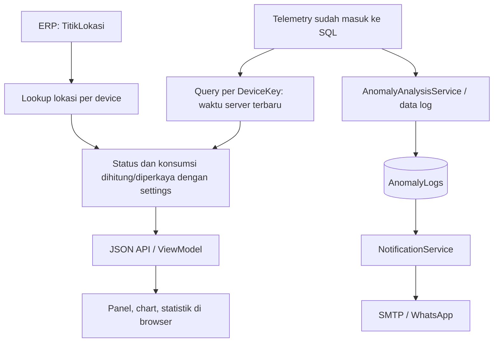

## API dan endpoint

### Pola route

- `ApiController` memakai `[Route("api/[controller]")]`, sehingga prefiks aktual adalah **`/api/Api`** (perhatikan nama controller), dengan subroute yang dideklarasikan per action.
- `QwenChatController` memakai prefiks **`/api/qwenchat`**.
- Controller MVC menggunakan pola `/Monitoring/{Action}` dan `/Account/{Action}`; route default juga menyediakan URL berbasis controller/action.
- `HealthController` menyediakan pemeriksaan database; lihat action `Db` untuk detail respons.

### Endpoint API utama

Daftar di bawah dikelompokkan menurut operasi. Seluruh pola subroute merujuk ke `/api/Api`; parameter path/query mengikuti signature action. Hak akses yang dicantumkan eksplisit pada source; action tanpa atribut role tidak otomatis berarti akses publik karena akses akhirnya juga bergantung pada middleware/atribut di controller atau konfigurasi.

| Method | Subroute | Fungsi | Akses eksplisit |
|---|---|---|---|
| GET | `/panels` | Daftar panel terbaru, filter pencarian/status/fase | Publik (`AllowAnonymous`) |
| GET | `/panels/{deviceKey}/chart` | Titik data grafik perangkat | sesuai atribut/action |
| GET | `/statistics`; POST `/usage-statistics`, `/usage-statistics/{deviceKey}` | Statistik energi umum dan per perangkat | sesuai atribut/action |
| GET | `/realtime-kwh`, `/energy-tables`, `/get-tariff`; POST `/save-tariff` | Nilai KWh, tabel agregat, tarif | sesuai atribut/action |
| GET | `/history`, `/history-grid`, `/history-archive`; GET `/history-export`, `/history-archive-export` | Histori, arsip, ekspor | sesuai atribut/action |
| POST | `/save-system-settings` | Simpan konfigurasi sistem | admin |
| GET | `/get-system-settings`, `/get-ema-settings`; POST `/test-database-connection`, `/test-mqtt-connection`, `/save-ema-settings` | Baca setting dan uji koneksi/config | sesuai atribut/action; operasi sensitif dibatasi |
| POST | `/upload-mqtt-certificate`, `/remove-mqtt-certificate` | Upload/hapus sertifikat MQTT | admin |
| POST | `/publish-relay`, `/request-relay-otp` | Kontrol relay dan permintaan OTP | Operator/Admin pada kontrol |
| GET/POST | `/relay-states`, `/device-control-mode` | Status relay/mode kontrol | sesuai atribut/action |
| GET/POST | `/get-downtime-settings`, `/save-downtime-settings`, `/downtime-status`, `/downtime-settings/{category}`, `/all-downtime-settings` | Konfigurasi dan status downtime | admin pada penyimpanan |
| GET | `/anomaly-logs/summary`, `/anomaly-logs/{deviceKey}`, `/anomaly-status`, `/get-initial-ema/{deviceKey}` | Daftar/status/parameter anomali | sesuai atribut/action |
| POST | `/log-anomaly`, `/reset-anomaly-alert` | Catat/reset notifikasi anomali | sesuai atribut/action |
| GET | `/anomaly-logs/detail/{id}` | Detail log | sesuai atribut/action |
| POST/PUT | `/anomaly-logs/{id}/acknowledge`, `/resolve`, `/notes` | Proses log anomali | sesuai atribut/action |
| DELETE | `/anomaly-logs/{id}`, `/anomaly-logs/clear-all`, `/anomaly-logs/clear/{deviceKey}`, `/reset-chart-data/{deviceKey}` | Hapus/reset data anomali/grafik | admin pada operasi sensitif |
| GET | `/anomaly-dashboard`, `/anomaly-trends`, `/anomaly-device-distribution` | Agregat dashboard anomali | sesuai atribut/action |
| POST `/anomaly-monthly-report/generate`; GET `/anomaly-monthly-report` | Generate dan ambil laporan bulan | sesuai atribut/action |
| GET | `/anomaly-operator-actions`, `/anomaly-operator-actions/summary` | Audit aksi operator | sesuai atribut/action |
| POST/GET | `/anomaly-logs/{id}/chart-snapshot` | Update/ambil snapshot grafik | sesuai atribut/action |
| GET/POST | `/device-category/{deviceKey}`, `/device-category`, `/categories`, `/categories/{name}`, `/device-categories` | Mapping, daftar, tambah/ubah/hapus kategori | sesuai atribut/action |
| GET | `/get-notification-settings`, `/get-notification-settings-full` | Baca pengaturan notifikasi | admin untuk data sensitif |
| POST | `/save-notification-settings`, `/save-anomaly-settings`, `/save-anomaly-state` | Simpan notifikasi dan status analisis | admin |
| POST | `/transfer-master-admin` | Transfer admin utama | admin |
| POST | `/test-email-notification`, `/test-whatsapp-notification`, `/test-instant-alert`, `/test-hourly-report`, `/test-daily-report`, `/test-monthly-report` | Uji notifikasi/laporan | Admin |
| GET/POST | `/wablas/settings`, `/wablas/test`, `/wablas/device-status` | Pengaturan/uji/status Wablas | Admin untuk pengaturan/uji |
| GET/POST | `/chatbot-settings`, `/test-chatbot-connection` | Konfigurasi/uji chatbot | Admin |
| GET | `/device-settings`, `/device-settings/{deviceKey}` | Baca konfigurasi efektif perangkat | daftar efektif publik; detail lihat atribut |
| POST | `/device-settings/{deviceKey}`, `/device-settings/bulk` | Simpan konfigurasi perangkat tunggal/banyak | Admin |
| POST | `/rescan-panels` | Pindai ulang panel | Operator/Admin |

**Catatan kelengkapan:** controller berisi banyak action dan variasi route; tabel ini adalah indeks fungsi route tingkat tinggi berdasarkan source, bukan spesifikasi kontrak OpenAPI. Untuk nama parameter/format request, validasi, status code dan otorisasi tepat per endpoint, rujuk atribut dan body action di `Controllers/ApiController.cs`. Route khusus Qwen tercantum berikut.

### Qwen Chat

Seluruh endpoint memerlukan policy `RequireViewer` (Viewer, Operator, Admin):

| Method | Route | Fungsi |
|---|---|---|
| POST | `/api/qwenchat/send` | Kirim pertanyaan/data konteks ke Qwen |
| GET | `/api/qwenchat/activity-log` | Ambil log aktivitas chatbot |
| GET | `/api/qwenchat/current-dashboard-data` | Data dashboard untuk konteks chatbot |
| GET | `/api/qwenchat/test` | Uji koneksi Qwen |

### MVC dan akun

Action penting yang ditemukan: `/Monitoring` (dashboard publik), `/Monitoring/Charts`, `/Monitoring/AnomalyLogs`, `/Monitoring/UsageStatistics`, `/Monitoring/UsageRanking`, `/Monitoring/UsageStatisticsDocs`, `/Monitoring/Settings` (Admin), `/Monitoring/Details/{deviceKey}`, `/Monitoring/History/{deviceKey}`, `/Monitoring/ExportCSV/{deviceKey}`, `/Monitoring/UpdateSettings` (Admin), `/Monitoring/GetSettings` (Admin), `/Monitoring/RescanPanels` (Operator/Admin).

Alur akun ada di `/Account/Login`, `/Register`, `/RegistrationSuccess`, `/VerifyEmail`, `/ResendVerification`, `/ForgotPassword`, `/ForgotPasswordConfirmation`, `/ResetPassword`, `/ResetPasswordSuccess`, `/Logout` (POST), dan `/AccessDenied`. Approval akses admin memakai `/AdminApproval/Approve` (GET konfirmasi dan POST keputusan) serta `/AdminApproval/Reject`. Manajemen user admin memakai `/UserManagement` beserta action ubah role, aktif/nonaktif, dan hapus. `/Health/Db` merupakan endpoint diagnostik database.

## Integrasi MQTT dan kontrol relay

`MqttService` merupakan singleton dan mengelola koneksi broker, TLS opsional, kredensial dan sertifikat. Untuk perintah, service mencari `GroupName` pada `DeviceRegistry` (fallback `RELAY_CONTROL`), kemudian mengirim JSON ke topic berbentuk `data/KWHAPP/{deviceId}/12345678` dengan QoS AtLeastOnce dan retain false. Payload memuat waktu terminal, group dan nilai `RC`. Pulse mengirim nilai aktif lalu nilai `0` setelah durasi yang ditentukan.

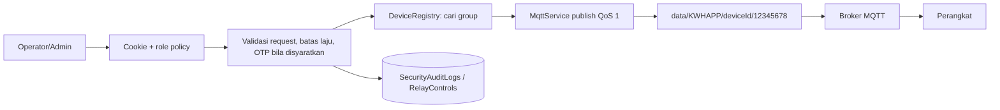

Publikasi bukan bukti bahwa relay berhasil berubah secara fisik; hal itu bergantung pada konektivitas, protokol perangkat dan telemetry/ack yang tidak dapat dibuktikan oleh pemanggilan publish saja.

## Keamanan dan kontrol akses

- Login memakai cookie `HttpOnly`, `SameSite=Lax`, masa berlaku 30 menit dengan sliding expiration. `SecurePolicy` adalah `SameAsRequest`; TLS di edge/deployment perlu dipastikan agar cookie produksi selalu secure.
- Policy `RequireAdmin`, `RequireOperator` (Operator/Admin), `RequireViewer` (Viewer/Operator/Admin) didefinisikan. Sejumlah feed dashboard secara sengaja publik; endpoint mutasi sensitif memiliki role attribute.
- Token email disimpan pada entitas token dengan hash/purpose/expiry menurut model dan indeks EF. Password melalui `PasswordHasher`; pengaturan sensitif tertentu memakai `AesEncryptionService`.
- Security headers disetel di middleware; CSP masih mengizinkan inline script dan `unsafe-eval`, sesuai kebutuhan frontend saat ini namun mengurangi ketatnya mitigasi XSS.
- Rate limit relay berbasis `IMemoryCache` lokal per instance, sehingga tidak terdistribusi lintas server/restart.
- Filter `DatabaseExceptionFilter` menangani error DB agar pengguna mendapat halaman diagnostik yang sesuai.

## Temuan audit dan risiko penting

### Tinggi: kredensial database tampak tersimpan langsung dalam konfigurasi

`appsettings.json` V7 berisi connection string SQL dengan username/password dalam teks biasa, termasuk akun database ERP. Nilai sengaja tidak disalin ke laporan. File konfigurasi masuk dalam source tree; perlakukan kredensial tersebut sebagai terekspos: rotasi password/credential pada kedua database dan pindahkan rahasia ke environment/secret store di luar repo. Periksa juga salinan/build/publish historis. Hindari menaruh rahasia baru dalam dokumen ini.

### Sedang: runtime .NET Core 2.1 sudah tua

Project menargetkan `netcoreapp2.1` dan paket EF Core 2.1.14. Ini generasi runtime lama; perencanaan upgrade framework dan dependensi diperlukan untuk memperoleh dukungan keamanan modern. Versi dukungan saat ini tidak diverifikasi eksternal dalam audit ini.

### Sedang: jalur masuk telemetry tidak tampak pada service MQTT web

Web membaca data telemetry dari SQL dan `MqttService` yang ditinjau menerbitkan kontrol relay. Pemilik proses ingest, validasi payload, retry dan rekonsiliasi data perlu didokumentasikan pada komponen eksternal yang mengisi SQL.

### Sedang: kontrak dan otorisasi API sulit ditinjau dari dokumentasi

Tidak ditemukan spesifikasi OpenAPI yang menjadi sumber kontrak. API sangat luas dalam satu `ApiController`; role atribut bervariasi. Dokumentasi endpoint/otorisasi perlu dipelihara bersama source, dan evaluasi kebijakan harus memeriksa setiap action terutama operasi ubah/hapus, pengaturan provider, upload sertifikat, serta feed anonim.

### Operasional

- Saat DB mati, aplikasi dapat tetap listen tetapi fitur yang perlu DB tetap gagal; pantau critical log dan `/Health/Db`.
- Pengiriman jadwal memakai timer dan jam lokal proses (`DateTime.Now`), bukan scheduler terdistribusi. Lebih dari satu instance dapat mengirim laporan ganda karena guard pengiriman berada di memori, meskipun tanggal harian/bulanan disimpan ke DB.
- Kredensial, certificate file dan kunci enkripsi harus dilindungi dan dikelola konsisten dengan backup serta pemulihan.
- Folder output `bin`, `obj`, `.vs` dan dokumen historis ada di workspace; bedakan artefak build dari source saat distribusi dan tinjau agar salinan konfigurasi rahasia tidak ikut dipaketkan.

## Visualisasi action pengguna

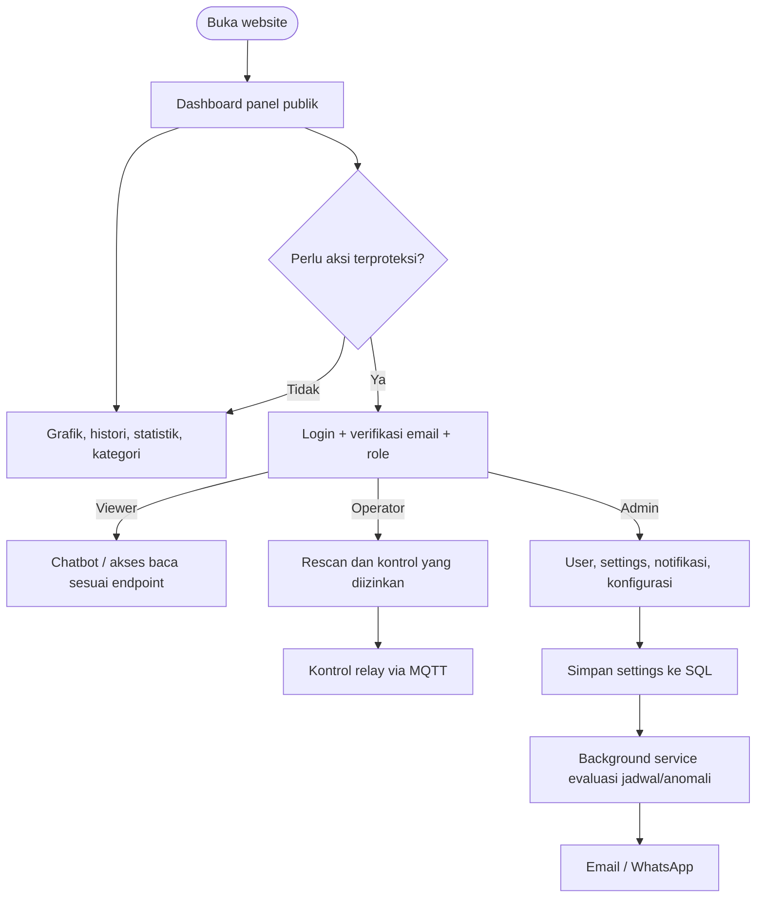

## Struktur kode untuk orientasi

| Lokasi | Isi |
|---|---|
| `Program.cs`, `Startup.cs` | Bootstrap, DI, middleware, route, migrasi dan seeding |
| `Controllers/MonitoringController.cs` | Halaman dashboard, grafik, histori, pengaturan |
| `Controllers/ApiController.cs` | API monitoring, setting, relay, anomali, notifikasi dan laporan |
| `Controllers/AccountController.cs`, `AdminApprovalController.cs`, `UserManagementController.cs` | Autentikasi dan administrasi user |
| `Controllers/QwenChatController.cs` | Integrasi chatbot Qwen |
| `Models/ApplicationDbContext.cs` dan `Models/*.cs` | Skema ORM dan domain |
| `Services/MqttService.cs` | Koneksi/publish MQTT dan TLS |
| `Services/AnomalyAnalysisService.cs`, `AnomalyNotificationBackgroundService.cs`, `NotificationService.cs` | Analisis dan notifikasi terjadwal |
| `Services/TitikLokasiService.cs` | Lookup master lokasi ERP |
| `Services/DeviceSettingsService.cs`, `AppSettingsCache.cs` | Pengaturan efektif dan cache |
| `Views/`, `wwwroot/` | Razor UI, JavaScript, CSS, chart/vendor assets |
| `scripts/database_schema.sql`, migrasi | Skema dan inisialisasi database |

## Batas audit

Audit ini statis. Tidak ada pengujian endpoint, verifikasi hak akses lewat HTTP, validasi database aktual, penangkapan trafik MQTT, pemeriksaan konfigurasi server produksi, atau pengujian kerentanan dinamis. Sebagian perilaku yang bergantung deployment/provider ditandai sebagai belum terverifikasi. File laporan ini adalah satu-satunya file baru yang dimaksudkan oleh tugas ini.

---

<!-- SOURCE: BUG_HUNTING_AUDIT_REPORT.md | MODIFIED: 2026-09-30 15:18:44 -->

## Sumber: `BUG_HUNTING_AUDIT_REPORT.md`

# 🐛 BUG HUNTING & AUDIT REPORT — KWH Monitoring (.NET Core 2.1)

**Tanggal audit:** 30 September 2026
**Branch/Commit:** `main` @ `c4c5b6c2babf0a1dd2bc98872207c3bdaad91a0e`
**Scope:** Seluruh project `KWHMonitoring -  .NET 2.1 - Final 5` (Controllers, Services, Models, Views, Filters, Migrations, konfigurasi, dependensi).
**Metode:** Static code review menyeluruh (seluruh source utama dibaca), secret scanning, pola bug umum (injection, otorisasi, race condition, logika terbalik, resource leak), pemeriksaan rantai migrasi EF, dan **compile test (Rebuild penuh)**.
**Status:** ⚠️ **TIDAK ADA source code yang diubah.** File ini satu-satunya tambahan. `git status` bersih (tidak ada file tracked yang berubah).

---

## Hasil Testing / Build

| Test | Hasil |
|---|---|
| `dotnet build` full Rebuild (SDK 2.1.818) | ✅ **SUKSES — 0 Error, 0 Warning** |
| Artefak compile (KWHMonitoring.dll 1,49 MB + Views.dll 2,56 MB) | ✅ Ter-generate bersih |
| `git status --short` setelah audit | ✅ Tidak ada file berubah (hanya laporan ini yang baru) |
| Secret scanning `git show HEAD:...appsettings.json` | ❌ **Secret ter-commit ke Git** |
| Pemeriksaan rantai migrasi EF (urutan `Migrate()`) | ❌ **Konflik 2 migration awal** |
| Scan `@Html.Raw` di seluruh Razor views | ⚠️ 3 lokasi berisiko XSS |
| Endpoint API tanpa `[Authorize]` (ApiController 7.111 baris) | ❌ **2 endpoint sensitif terbuka** |

**Ringkasan: 3 KRITIS, 8 TINGGI, 15 SEDANG, 20 RENDAH.**

---

## 🔴 KRITIS (CRITICAL)

### C1. Secret sensitif ter-commit ke repository Git (publik)
**File:** `KWHMonitoring -  .NET 2.1 - V7/KWHMonitoring/appsettings.json` (baris 3, 4, 23, 37) — **file TRACKED di git** (remote `github.com/Sattviko31/Project-KWH-Monitoring`).

| Baris | Secret | Dampak |
|---|---|---|
| 3 | DB aplikasi: `kwhapp/kwhapp1234` @ `192.168.168.38:1433` | Kunci penuh ke database monitoring |
| 4 | DB ERP: `sa/123456` @ `192.168.168.16\SQLEXPRESS` | Akun **superadmin `sa`** + password lemah |
| 23 | `Encryption:Key = "KWH-Monitoring-2024-AES256-SecureKey!"` | Semua nilai `ENC:` (password SMTP, API key) bisa didekripsi siapa pun |
| 37 | API Key Qwen: `sk-ws-H.DMRLYXX...` | Penyalahgunaan API AI (biaya) |

**Bukti:** `git show HEAD:...appsettings.json` menampilkan semua secret di atas — ada di commit, bukan hanya working tree.
**Rekomendasi:** Rotasi semua secret sekarang (password DB, API key, ganti kunci AES + re-encrypt data `ENC:`), pindah ke env var/user-secrets/Key Vault, tambahkan `appsettings.json` ke `.gitignore`, bersihkan history Git.

### C2. Endpoint publik `GET /api/Api/get-system-settings` membocorkan SELURUH settings termasuk kredensial
**File:** `Controllers/ApiController.cs:2894-2912` — `[HttpGet("get-system-settings")]` **TANPA `[Authorize]`**, mengembalikan semua baris `AppSettingsRecords` (key + value) apa adalah, termasuk:
- `MQTT.Username` / `MQTT.Password` (plaintext — `MqttService.cs:85-86`) → penyerang anonim dapat kontrol broker & data IoT
- `Notification.WhatsAppToken`, `WablasToken`, `WablasSecretKey` (plaintext — `NotificationService.cs:2137-2138`)
- `Notification.SenderPassword` (`ENC:...`; terdekripsi karena kunci AES ada di repo, lihat C1)
- `Chatbot.ApiKey` (ter-encrypt tetapi ikut bocor)

Dokumentasi `SECURITY_SETTINGS_SYNC_FIX_RESULT.md` mengklaim endpoint ini sudah `[Authorize(Admin)]` — **klaim itu tidak terimplementasi di kode**.

### C3. Endpoint debug publik `GET /api/Api/debug/notification-settings-db` (tanpa auth)
**File:** `Controllers/ApiController.cs:5557-5574` — tanpa `[Authorize]`, mengembalikan **nilai mentah** semua `Notification.*` (password SMTP ter-encrypt + token WhatsApp/Wablas plaintext). Endpoint debug harus dihapus atau dikunci Admin + dinonaktifkan di produksi.

---

## 🟠 TINGGI (HIGH)

### H1. Kredensial disimpan plaintext & perlindungan enkripsi tidak konsisten
Password SMTP di-encrypt (`ENC:`) di `SaveNotificationSettings` (`ApiController.cs:5701-5706`), tetapi `Notification.WhatsAppToken` (**plaintext**, `ApiController.cs:5715`), `Notification.WablasToken` & `WablasSecretKey` (**plaintext**, `NotificationService.cs:2137-2138`), serta `MQTT.Password` & `MQTT.TlsClientCertPassword` (**plaintext**, `MqttService.cs:85-91`) tidak. Ketiganya ikut bocor lewat C2/C3.

### H2. Bug fungsi: logika dekripsi SMTP TERBALIK di API admin
**File:** `Controllers/ApiController.cs:5379-5381` (`GetNotificationSettingsFull`):
```csharp
if (!string.IsNullOrEmpty(senderPassword) && !senderPassword.StartsWith("ENC:"))
    senderPassword = _encryption.Decrypt(senderPassword) ?? senderPassword;
```
Syarat dibalik: nilai yang benar (`ENC:...`) **tidak** didekripsi, nilai legacy dipaksa didekripsi (gagal → mentah). Halaman Settings Admin menampilkan string `ENC:<base64>` alih-alih password asli. Logika benar ada di `NotificationService.LoadSettings` (`NotificationService.cs:67-72`, pakai `StartsWith("ENC:")` + `Substring(4)`).

### H3. Rantai migrasi EF rusak — 2 "migration awal" saling menimpa tabel
- `Migrations/20260826064232_initialMigration.cs` membuat 13 tabel (termasuk `AnomalyLogs`, `AppLog`).
- `Migrations/20260916092238_InitialCreate.cs` **membuat ulang tabel yang sama** (`AnomalyLogs`, `AppLog`, `KWHData`, `ApplicationUsers`, ...).

Pada database **baru**, `context.Database.Migrate()` (`Startup.cs:138-148`) gagal di migration kedua: *"There is already an object named ... in the database"*. `Startup` fallback ke `EnsureCreated()` yang **no-op bila database sudah ada** → skema setengah jangan (kolom dari migration berikutnya tak pernah dibuat) dan `__EFMigrationsHistory` tidak sinkron. Kehadiran `fix_efmigrationshistory.sql` + `apply_anomaly_center_phase1.sql` di root membuktikan masalah ini terjadi di lapangan dan diperbaiki manual.

### H4. Data publik tanpa batas → DoS & eksploitasi ekspor
- `GET /api/Api/history` (`ApiController.cs:1283`): `page`/`pageSize` **tanpa validasi** — `pageSize=1000000` memaksa muat jutaan baris; `page<=0` → `Skip(negatif)` → error SQL OFFSET; `pageSize=0` → `DivideByZeroException`. Publik (tanpa `[Authorize]`).
- `GET /api/Api/history-grid` (`ApiController.cs:1378-1381`): `request.Take` tanpa batas.
- `Monitoring/ExportCSV` (`MonitoringController.cs:542-554`): publik, ekspor hingga **50.000 baris** tanpa autentikasi.
- `GET /api/Api/history-export` & `history-archive-export` (`ApiController.cs:1432`, `1719`): publik.

### H5. CSV Formula Injection + XML Injection pada ekspor
**File:** `ApiController.cs:1519-1524` (history-export), `1814-1820` (archive-export), `MonitoringController.cs:556-580`.
- Kolom teks (`DeviceKey`, `DeviceId`, `GroupName`) ditulis **tanpa kutip/escape** di CSV → field berkoma merusak kolom; karakter awal `=` `+` `-` `@` dari data perangkat (MQTT) dieksekusi sebagai formula oleh Excel (CWE-1236).
- Ekspor "Excel" (SpreadsheetML XML) menyisipkan `GroupName`/`DeviceId` **tanpa XML-encoding** (`ApiController.cs:1489`, `1783`) → file rusak / injeksi markup.
- `MonitoringController.CsvEscape` (baris 738-742) hanya melipat ganda kutip, tidak menetralkan karakter formula.

### H6. Potensi Stored XSS via `@Html.Raw(Json.Serialize(...))` di dalam `<script>`
**Lokasi:** `Views/Monitoring/Index.cshtml:596`, `Index.cshtml:925`, `Charts.cshtml:193`.
`Json.Serialize` (Newtonsoft) **tidak meng-escape `</script>`** maupun `<`/`>`. Nilai `deviceKey`/`groupName` berasal dari data perangkat (MQTT/DB). `GroupName` = `</script><script>alert(1)</script>` (muat di `nvarchar(50)`) akan dieksekusi di browser semua pengunjung dashboard publik. Attack surface: siapa pun yang bisa publish topic MQTT / menulis DB.

### H7. Framework End-of-Life tanpa patch keamanan
`KWHMonitoring.csproj:4` — `netcoreapp2.1` (EOL sejak **21 Agustus 2021**). Dependensi: `EF Core 2.1.14`, `MQTTnet 3.1.2` (2020), `Microsoft.AspNetCore.App` 2.1.x — tidak akan pernah menerima perbaikan CVE lagi.

### H8. Lockout akun bermasalah & reset password tidak mencabut sesi
**File:** `Controllers/AccountController.cs`
- **Lockout permanen-per-sesi:** saat lockout berakhir, `AccessFailedCount` **tidak pernah di-reset** (hanya di-reset pada login sukses, baris 119). Karena masih ≥ 5, **1 kali salah password saja** langsung mengunci lagi 15 menit → terkunci berulang tanpa henti (baris 104-117).
- **Reset password tidak mengakhiri sesi lama** (baris 306-345): cookie yang beredar tetap valid (tidak ada security stamp) → penyerang yang sudah login tetap masuk meski korban ganti password; `LockoutEnd`/`AccessFailedCount` juga tidak dibersihkan.
- **Tidak ada rate-limit per-IP** pada `Login`, `Register`, `ResendVerification` (baris 239-251) → brute-force multi-IP dan **email bombing** (siapa pun bisa POST `ResendVerification` berkali-kali untuk alamat korban).

---

## 🟡 SEDANG (MEDIUM)

### M1. Exception detail bocor ke pengguna (bertentangan dengan pola `SafeError`)
`SafeError` (`ApiController.cs:115-121`) sudah bagus (pesan generik + log server), tetapi masih ada sisa:
- `MonitoringController.cs:153, 224, 301, 486, 534` → `TempData["Error"] = "Error: " + ex.Message;` (detail SQL/internal tampil ke user).
- `MonitoringController.cs:646, 682, 704` → `Json(new { ..., message = ex.Message })`.
- `QwenChatController.cs:357` → `detail = ex.Message`; `:341, 349, 933` → memantulkan `responseString` upstream; `:939` → `message = ex.Message`.
Klaim dokumentasi "83+ ex.Message diganti" belum tuntas.

### M2. `AdminApproval/Reject` mengubah state lewat GET
**File:** `Controllers/AdminApprovalController.cs:131-173`. `Reject` GET langsung menonaktifkan akun (`user.IsActive = false`) + memakai token. Link yang diklik otomatis oleh **email security scanner / link prefetcher** dapat menonaktifkan akun tanpa niat admin. `Approve` GET hanya menampilkan konfirmasi (benar) — `Reject` seharusnya juga POST-only.

### M3. Tabel agregat energi TANPA index & tanpa unique constraint
`ApplicationDbContext.OnModelCreating` (baris 332-396) tidak mendeklarasikan index untuk `DailyEnergy`, `HourlyEnergy`, `MonthlyEnergy`, `YearlyEnergy`; grep seluruh `Migrations/` juga **tidak menemukan** `IX_DailyEnergy`/`IX_HourlyEnergy`/dst., padahal `Migrations/README.md` **mengklaim** unique composite index ada (dokumen vs kenyataan tidak cocok). Akibat:
- Query rentang (`WHERE Date >= ...`, `WHERE Hour >= ...`) dijalankan di **hampir setiap request dashboard** (`MonitoringController.cs:330-353`, `ApiController.cs:351-384`) → full scan yang makin lambat.
- Tanpa pengaman DB terhadap **baris duplikat** → job agregat dobel/konkuren membuat angka kWh (tagihan) terdouble-count.

### M4. Kinerja buruk: memuat tabel penuh ke memori
- `QwenChatController.cs:427` → `_context.KWH_Monitoring.ToListAsync()` memuat **SELURUH tabel riwayat** hanya untuk mengambil baris terakhir per device (harusnya GroupBy di SQL).
- `QwenChatController.cs:492` → memuat seluruh `AppSettingsRecords` (termasuk kredensial) hanya untuk membaca tarif.
- Pola dashboard di-**copy-paste 3×** di `Index`/`Charts`/`AnomalyLogs` (`MonitoringController.cs:56-59`, `171-174`, `238-241`) → duplikasi ±250 baris.

### M5. Race condition pada rate-limit & OTP (IMemoryCache tidak atomik)
- `ApiController.cs:115-141` `IsRelayControlRateLimited`: baca-modify-tulis list tanpa lock → request paralel menembus limit 10/60 dtk.
- `ApiController.cs:2586-2598` & `2679-2720`: penghitung gagal-OTP & limit OTP juga non-atomik.
- `DeviceSettingsService.SaveAsync` (`DeviceSettingsService.cs:146-187`): baca-lalu-tulis tanpa transaksi → update konkuren saling menimpa.

### M6. Logika parsing jam downtime salah (pakai `Contains`)
**File:** `Services/AnomalyAnalysisService.cs:66-69` — `log.Notes.Contains("22") ? 22 : 0, log.Notes.Contains("6") ? 6 : 0`. "Jam mati" disimpulkan dari substring bebas pada `Notes`. Contoh salah: notes `"downtime period 16:00-23:00"` mengandung `"6"` → menampilkan jam **6**; notes `"2200 W"` dianggap jam 22. Harusnya parse dari kolom terstruktur `DowntimeStart`/`DowntimeEnd`.

### M7. Filter `OR` pada DevExtreme grid diabaikan diam-diam
**File:** `Controllers/ApiController.cs:1872-1873` — komentar `// For "or", we'd need more complex expression trees` → hanya `and` yang diterapkan. Filter OR dari UI **diproses seolah tidak ada filter** → hasil grid salah tanpa error.

### M8. Cookie "Remember Me" 7 hari vs `ExpireTimeSpan` 30 menit
`Startup.cs:76-77` menetapkan `ExpireTimeSpan = 30 menit` + sliding, sedangkan `SignInUserAsync` (`AccountController.cs:481-485`) menyetel `ExpiresUtc = +7 hari`. Pada ASP.NET Core 2.1 sliding renewal memakai `ExpireTimeSpan` → cookie persistent bisa diterbitkan ulang dengan masa berlaku 30 menit (**"Ingat saya" tidak berfungsi**). Perlu verifikasi runtime; idealnya `ExpireTimeSpan` diatur per-signin.

### M9. CSP memuat `unsafe-inline` + `unsafe-eval`
`Startup.cs:243` — meski header CSP dipasang, `script-src 'self' 'unsafe-inline' 'unsafe-eval' ...` membuat perlindungan XSS dari CSP praktis **tidak berarti**.

### M10. CSRF tidak konsisten
Hanya sebagian POST yang memakai `[ValidateAntiForgeryToken]` (Login/Logout/relay). `[HttpPost] UpdateSettings` (`MonitoringController.cs:586-588`), `save-notification-settings`, `save-ema-settings`, `save-system-settings`, `device-settings`, dst. **tidak**. `SameSite=Lax` memberi mitigasi parsial, tetapi tetap rentan pada skenario tertentu (subdomain, redirect).

### M11. Status HTTP 200 untuk error database di halaman browser
`Filters/DatabaseExceptionFilter.cs:46-51` — untuk request non-API dikembalikan `ViewResult "DatabaseError"` **tanpa men-set status 500/503** → uptime checker melihat HTTP 200 padahal DB mati.

### M12. Seed admin gagal hanya tercatat di `Debug.WriteLine`
`Services/DbInitializer.cs:31, 37, 51, 57, 95` — kegagalan konfigurasi admin awal tidak pernah masuk log aplikasi (hilang di Release). `IsStrongPassword` (baris 113-118) juga hanya cek panjang ≥ 12 tanpa kompleksitas.

### M13. Log berlebihan berisi pesan user & payload besar (QwenChat)
`QwenChatController.cs:155` (pesan user mentah di-log), `:170-171` (seluruh payload `RealTimeData` di-serialize ke log) → risiko PII di log + **log flooding** (payload tanpa batas ukuran).

### M14. Chatbot: biaya API & SSRF
`QwenChatController.cs:147-359` — `[HttpPost("send")]` tidak membatasi panjang pesan/`History` → token (biaya) & memori terkuras. `Chatbot.ApiUrl` diambil dari DB (baris 83-84) lalu server kirim `Bearer <apikey>` ke URL itu → **SSRF** bila admin terkompromi. `[HttpGet("test")]` (baris 877) bisa dipanggil Viewer → memicu panggilan API berbayar.

### M15. Campur `DateTime.Now` vs `DateTime.UtcNow` di seluruh codebase
Audit log `UtcNow` (`AccountController.cs:500`), tetapi `AppSettingsRecord.UpdatedAt`, statistik (`MonitoringController.cs:323`), `HealthController`, background service memakai lokal/campur → batas laporan harian/bulanan bisa meleset dan timestamp audit tidak konsisten untuk investigasi.

---

## 🔵 RENDAH (LOW) / INFO

| # | Temuan | Lokasi |
|---|---|---|
| L1 | `Math.Abs(BitConverter.ToInt32(...))` untuk OTP bisa melempar `OverflowException` bila `int.MinValue` (sangat jarang); sedikit modulo bias | `ApiController.cs:2709` |
| L2 | `Skip((page-1)*pageSize)` tanpa validasi `page` (≤0) → exception | `MonitoringController.cs:514`, `ApiController.cs:1312` |
| L3 | `toDate.AddDays(1)` pada filter tanggal (input berjam → rentang kelebihan s.d. 24 jam; `<=` vs `<` tidak konsisten antar endpoint) | `MonitoringController.cs:507` vs `ApiController.cs:1305` (`<`) |
| L4 | `ValidateServerCertificate` mengabaikan return value `chain.Build(...)` — validasi rantai tidak dipastikan | `MqttService.cs:318` |
| L5 | Upload sertifikat: file temp `GetTempFileName()` bocor bila validasi melempar exception; allowlist ekstensi memuat `""` (file tanpa ekstensi diterima) | `ApiController.cs:2352-2420` |
| L6 | `GetRelayStates` catch mengembalikan `success: true` (dengan field error) → kegagalan ditandai sukses | `ApiController.cs:2826` |
| L7 | `deviceId` pada `publish-relay` tidak divalidasi bentuknya → potensi injeksi karakter topic MQTT (`/`, `#`) oleh user Operator+ | `MqttService.cs:360`, `ApiController.cs:2563` |
| L8 | Audit log pada exception relay selalu mencatat action `RelayOn` meski perintahnya OFF/Pulse | `ApiController.cs:2652` |
| L9 | `SendEmailAsync` men-set `mailMessage.Body` **dan** `AlternateView` berisi body sama → duplikasi konten di sebagian client email | `NotificationService.cs:1616-1621` |
| L10 | `lock (this)` pada service (lock objek publik — code smell); `_appSettings` static mutable pada controller | `NotificationService.cs:51`, `MonitoringController.cs:24` |
| L11 | `ApplicationDbContext.AppSettingsChanged` berupa field `static Action` (bukan event) yang di-assign dari konstructor singleton | `ApplicationDbContext.cs:15`, `AppSettingsCache.cs:33` |
| L12 | `UserManagementController.Delete` menghapus user tetapi `SecurityAuditLogs` miliknya dibiarkan jadi orphan (tanpa FK) | `UserManagementController.cs:126-159` |
| L13 | `Register` tanpa CAPTCHA/rate-limit → pendaftaran massal; `NormalizeEmail` membuang karakter aneh sehingga normalisasi bisa beda dari alamat asli | `AccountController.cs:145-179, 506-514` |
| L14 | `HealthController.Db` `[AllowAnonymous]` mengungkap status DB (wajar untuk health-check, tetap info disclosure) | `HealthController.cs:22` |
| L15 | Legacy AES decrypt memakai **IV deterministik** (16 byte pertama key) dan heuristic `Length > 32` untuk pilih format — data legacy > 32 byte selalu dicoba sebagai format baru dulu | `AesEncryptionService.cs:65, 89-99` |
| L16 | Komentar mengandung karakter asing (`maksimal на 1000 data` — Cyrillic) — indikasi copy-paste/generate | `ApiController.cs:1739` |
| L17 | Repo hygiene: `obj/hash_password.csproj.*` sisa project terhapus; `bin/` kosong di root; `.qwen/build-temp*` | root project |
| L18 | Duplikasi kode dashboard ±250 baris di `Index`/`Charts`/`AnomalyLogs` (copy-paste) → rawan perbaikan tidak konsisten | `MonitoringController.cs` |
| L19 | `GetHistory` tidak memvalidasi input tanggal (`DateTime.TryParse` gagal → diabaikan diam-diam, filter bocor) | `ApiController.cs:1290-1294` |
| L20 | Tidak ada `AutoValidateAntiforgeryToken` global; keamanan antiforgery mengandalkan atribut per-endpoint yang belum lengkap | `Startup.cs:104-107` |

---

## ✅ YANG SUDAH BAIK (konteks positif)

- **Build bersih**: 0 error/0 warning pada SDK 2.1.818.
- `PasswordHasher`: PBKDF2-HMAC-SHA256, 100k iterasi, salt acak, perbandingan constant-time.
- `SafeError()` generik + logging server-side untuk mayoritas endpoint API.
- Token email di-hash SHA-256, sekali pakai + kadaluarsa; `returnUrl` divalidasi `Url.IsLocalUrl` (anti open-redirect).
- Endpoint relay: `[Authorize(Roles="Operator,Admin")]` + antiforgery + rate-limit 10/60 dtk + OTP email untuk perintah OFF (3 percobaan, 5 menit).
- Header keamanan (X-Frame-Options, nosniff, dll.) dipasang; cookie `HttpOnly` + `SameSite=Lax`; response compression aktif.
- `TitikLokasiService` memvalidasi nama DB/tabel via regex (anti SQL-injection) + cache + fail-cooldown ke DB ERP.
- **Tidak ditemukan SQL injection** (semua query lewat EF LINQ/parameterized; SQL statis di `GetRelayStates`).
- Filter DevExtreme memakai **whitelist** kolom (bukan reflection bebas) → aman dari injeksi ekspresi.
- Background service notifikasi ditulis hati-hati (guard `async void`, anti-reentrancy, persist jadwal kirim agar tidak dobel setelah restart).
- Tidak ditemukan `@Html.Raw` pada data user-input selain pola `Json.Serialize` (lihat H6).

---

## 🎯 Prioritas Perbaikan yang Disarankan

1. **Segera (hari ini):** Rotasi semua secret (C1) → tutup/otentikasi `get-system-settings` & hapus endpoint `debug/*` (C2, C3).
2. **Minggu ini:** Perbaiki logika dekripsi ENC terbalik (H2); bungkus sisa `ex.Message` dengan `SafeError` (M1); validasi `page/pageSize/Take` (H4); netralisasi CSV formula + XML-escape (H5); pindahkan `AdminApproval/Reject` ke POST (M2).
3. **Sprint berikutnya:** Perbaiki rantai migrasi (H3 — hilangkan migration duplikat + transaksi); reset `AccessFailedCount` saat lockout berakhir & tambah rate-limit per-IP (H8); tambah unique index + index rentang pada tabel agregat (M3); ganti `@Html.Raw(Json.Serialize)` dengan escape `</script>` aman (H6).
4. **Rencana jangka panjang:** Upgrade ke .NET LTS yang masih didukung (H7); konsolidasi semua kredensial ke penyimpanan ter-encrypt (H1); optimasi query dashboard (M4).

---

*Catatan: Audit ini berupa static analysis + build verification. Pengujian runtime terhadap database produksi (migration end-to-end, perilaku cookie sliding, eksekusi SQL aktual) belum dilakukan karena memerlukan akses environment — poin tersebut ditandai "perlu verifikasi runtime". Tidak ada source code yang diubah selama audit ini.*

---

<!-- SOURCE: AUDIT_DETEKSI_ANOMALI.md | MODIFIED: 2026-10-01 15:27:10 -->

## Sumber: `AUDIT_DETEKSI_ANOMALI.md`

# Audit Mekanisme Deteksi Anomali KWHMonitoring

**Tanggal audit:** 1 Oktober 2026  
**Ruang lingkup:** kode aplikasi pada subfolder KWHMonitoring -  .NET 2.1 - V7/KWHMonitoring. Catatan ini menggambarkan implementasi yang ditelusuri; aplikasi dan database produksi tidak dijalankan/diverifikasi.

> **Pembaruan implementasi:** bagian “Tindak lanjut yang sudah diterapkan” merangkum perubahan setelah audit. Risiko yang belum tertutup dicatat terpisah.

## Ringkasan

Deteksi operasional terutama dijalankan oleh JavaScript pada Views/Shared/_AnomalyService.cshtml, yang dimuat dari _Layout.cshtml. Browser berkala mengambil daftar panel dan sampel grafik, menghitung EMA serta batas atas/bawah, lalu menunggu sejumlah sampel valid berturut-turut sebelum mengirim temuan ke POST /api/Api/log-anomaly. Server menyimpan temuan di AnomalyLogs, mengisi analisis tekstual/severity, dapat menyimpan snapshot grafik, mengirim notifikasi, dan menandai alert aktif untuk deduplikasi.

Dengan demikian, deteksi bukan worker server mandiri: ia bergantung pada halaman/layout yang aktif, browser yang berjalan, akses API, data chart, pengaturan per device, serta state konfirmasi yang dipersistenkan. AnomalyNotificationBackgroundService menangani laporan/notifikasi terjadwal; ia bukan loop deteksi sampel.

## Komponen

| Komponen | Peran |
|---|---|
| Views/Shared/_Layout.cshtml | Memuat _AnomalyService pada layout umum. |
| Views/Shared/_AnomalyService.cshtml | Loop client-side, sampling, EMA, threshold, downtime, konfirmasi, cooldown, pengiriman log/snapshot. |
| Controllers/ApiController.cs | Endpoint pengaturan, data chart, pencatatan, deduplikasi, downtime, state, analitik dan snapshot. |
| Services/AnomalyAnalysisService.cs | Menentukan severity, dugaan root cause, tindakan yang disarankan, dan pola berulang setelah log dibuat. |
| Models/AnomalyLog.cs, Models/AnomalyChartSnapshot.cs | Model persistensi temuan dan snapshot sebelum/sesudah. |
| Services/NotificationService.cs | Mengirim notifikasi realtime/downtime setelah log dibuat. |
| Services/AnomalyNotificationBackgroundService.cs | Menjalankan laporan berkala; bukan mesin deteksi telemetry. |
| wwwroot/js/realtime-refresh.js | Memicu refresh konsumen UI; bukan algoritme pendeteksi. |

## Alur deteksi

1. Partial mengambil pengaturan EMA, interval/anomaly, pengaturan sistem, status downtime kategori, daftar device, serta state konfirmasi/cooldown yang disimpan server.
2. Setelah dependensi awal selesai, pemeriksaan pertama dijadwalkan sekitar 2 detik kemudian. Berikutnya memakai Anomaly.CheckInterval (default 30 detik). Pengaturan dimuat ulang setiap 60 detik.
3. GET /api/Api/panels memberikan daftar device. Untuk setiap deviceKey, proses meminta /api/Api/panels/{deviceKey}/chart?points=N, dengan N = max(chartDataPoints, 50).
4. Sampel dilewati bila seri daya kosong, sampel terakhir invalid (powerValid[last] !== true), timestamp hilang, atau timestamp sama dengan sampel terakhir yang diproses pada browser ini. Flag in-flight mencegah request bersamaan per device.
5. Nilai EMA dihitung dari seri chart. Jika useInitial100ForEma aktif, baseline diambil dari get-initial-ema/{deviceKey}: rata-rata daya 100 baris tertua (atau semua baris bila kurang dari 100). Client memakai baseline konstan untuk semua titik, bukan EMA bergerak. Jika baseline gagal didapat, dipakai EMA biasa.
6. Ambang dihitung hanya bila sedikitnya satu emaUpperThreshold/emaLowerThreshold per device positif. Angka upper/lower berasal dari window.getDeviceSettings(deviceKey); mode dan nilai persentase/multiplier global dari pengaturan EMA. Jika keduanya nol/tidak tersedia, device dilewati.
7. Saat kondisi terdeteksi, penghitung per deviceKey + anomalyType dinaikkan. Sampel normal mereset counter device; perpindahan tipe membersihkan counter lawan. Ketika batas konfirmasi terpenuhi (default 3), client mengirim payload anomaly dan snapshot awal.
8. Bila server menerima log, client mulai mengumpulkan titik setelah kejadian lalu mengirimkannya bertahap melalui chart-snapshot. Buffer dibatasi 50 titik.
9. Setelah log berhasil, state cooldown client menunggu kondisi normal sebelum anomaly yang sama dicoba lagi. Server juga memiliki key alert aktif per device untuk menekan log bertipe sama.

## Rumus dan klasifikasi

### EMA

Mode biasa memakai:

- k = 2 / (period + 1)
- EMA[0] = power[0]
- EMA[i] = power[i] * k + EMA[i-1] * (1-k)

Nilai null di tengah seri diganti EMA sebelumnya. Periode default 20. Mode baseline awal berbeda: server menghitung SMA dari 100 data paling awal berdasarkan waktu naik, lalu client memakai nilai tetap itu untuk setiap titik chart. Ini bukan EMA yang bergerak.

### Ambang

Mode manual:

- upper = EMA * (1 + upperPercent / 100)
- lower = EMA * (1 - lowerPercent / 100)

Mode fibonacci:

- upper = EMA * fibUpper
- lower = EMA * fibLower

Implementasi mengalikan nilai langsung; konfigurasi harus memastikan makna multiplier (fraksi atau faktor) konsisten. Batas untuk chart dan deteksi dihitung dengan fungsi yang sama.

### Aturan deteksi

| Kondisi | Aturan | Threshold/deviation yang dicatat |
|---|---|---|
| Operasi normal, overload | power > upper | threshold = upper; (power - upper) / upper * 100 |
| Operasi normal, drop | power < lower | threshold = lower; (lower - power) / lower * 100 |
| Downtime, overload | power > EMA | threshold = EMA; (power - EMA) / EMA * 100 |
| Downtime, drop | Tidak dideteksi client; jika request masuk, server menekan DROP saat downtime. | — |

Perbandingan ketat berarti nilai tepat sama dengan batas tidak terdeteksi. Pada implementasi awal, status telemetry senyap belum menjadi keluaran client. `DROP` berarti daya terukur di bawah lower threshold, bukan timeout/offline akibat hilangnya sampel; sampel invalid/tanpa timestamp dilewati.

## Konfirmasi, deduplikasi, dan state

- Konfirmasi default 3 sampel, configurable lewat Anomaly.MaxConfirmations. Dengan loop default 30 detik, nominalnya perlu tiga sampel berbeda; waktu aktual tergantung ketersediaan sampel dan browser. maxConfirmations <= 0 menghentikan pemeriksaan.
- Counter/cooldown disimpan sebagai JSON per device dan per tab di AppSettingsRecords; scope tab bertahan di sessionStorage saat navigasi/reload. State yang tidak diperbarui 30 hari dibersihkan.
- Cooldown utama berbasis kondisi, bukan timer. Operasi normal menunggu daya kembali di antara lower dan upper. Downtime menunggu daya <= EMA. State yang direstore dibuang jika loggedAt lebih tua 24 jam.
- Server memiliki AppSettingsRecords key AnomalyAlert.Active.{deviceKey}, berisi tipe dan waktu. Tipe sama yang masih aktif disupresi; setelah 30 menit entri kedaluwarsa otomatis. Tipe berbeda tidak ditekan oleh pemeriksaan tipe sama dan dapat mengganti state aktif saat disimpan.
- Reset server dipanggil client ketika kondisi normal terdeteksi. Server menyimpan state aktif per device, bukan per tipe; client cooldown juga menyimpan satu tipe per device.
- Anomaly.CooldownTime tetap dibaca/dikirim ke client, tetapi jalur aktif memakai cooldown berbasis kondisi. Timer cooldown lama tidak digunakan, sehingga setting ini berpotensi menyesatkan.

## Perbedaan client dan server

Client menghitung kandidat anomaly untuk tampilan. Sebelum menyimpan, server memverifikasi telemetry terbaru, menghitung ulang EMA/threshold/jenis anomaly dari telemetry dan pengaturan tersimpan, serta memakai waktu sampel sebagai referensi downtime. Nilai pengukuran dalam payload client tidak lagi menjadi sumber log. Status tampilan client masih dapat berbeda dari hasil server bila jam atau zona waktu berbeda.

Counter/cooldown kini disimpan per tab dan per device di AppSettings; lastProcessedSampleByDevice dan in-flight tetap berada di memori browser. Penghentian browser mendadak masih dapat menghilangkan counter debounce yang belum tersimpan.

## Payload dan data tersimpan

AnomalyLogs menyimpan device key/id, jenis, watt, threshold, deviation (%), waktu sampel yang diverifikasi, EMA, mode, acknowledgement, status resolve, severity, root cause, rekomendasi, dan notes. Server menyalin DetectedTime dari timestamp telemetry terbaru yang diverifikasi.

Snapshot menyimpan hingga 50 titik sebelum kejadian, upper/lower threshold dan EMA saat log, kemudian hingga 50 titik sesudahnya. Data sesudah dikirim bertahap; status snapshot menjadi complete bila 50 titik terkumpul. Snapshot tidak menentukan anomaly.

## Analisis otomatis setelah log

AnomalyAnalysisService memakai log baru dan riwayat device 24 jam untuk menentukan pola berulang, severity dan teks bantuan:

- Pola berulang bertipe sama pada device dalam 24 jam mendapat critical bila hitungan riwayat mencapai tiga. Riwayat API mencakup log baru yang sudah disimpan.
- OVERLOAD downtime selalu critical.
- OVERLOAD normal: deviation >50 critical, >30 high, >10 medium, selebihnya low.
- DROP normal selalu high. Cabang severity DROP downtime tidak dicapai oleh alur normal karena DROP downtime disupresi.
- Root cause/rekomendasi adalah template berbasis tipe/deviation, bukan diagnosis dari model statistik atau pemeriksaan fisik.
- Untuk OVERLOAD downtime, BuildRootCause menebak jam dari pencarian substring “22” dan “6” di notes. Jam lain dapat tampil sebagai 00:00; angka itu juga dapat muncul di bagian lain teks.
- ImpactAssessment dan HasRepeatedPattern dihasilkan analisis, tetapi model AnomalyLog tidak terlihat mempunyai properti untuk menyimpannya. Perlu periksa detail response bila ingin memastikan perilakunya pada API.

## Notifikasi dan fitur terkait

Setelah insert dasar, server mengirim realtime instant alert atau alert khusus daya saat downtime melalui NotificationService. Kegagalan analisis tidak membatalkan pencatatan dasar.

AnomalyNotificationBackgroundService menangani jadwal ringkasan/laporan. Dashboard, tren, distribusi, ringkasan, dan laporan bulanan membaca AnomalyLogs; semuanya bukan pendeteksi telemetry. realtime-refresh.js memperbarui UI saat log berubah.

## API dan akses

| Endpoint | Fungsi | Otorisasi pada action yang diperiksa |
|---|---|---|
| GET /api/Api/get-ema-settings | Baca periode/mode/threshold global EMA dan baseline | Tidak terlihat atribut Authorize |
| GET /api/Api/get-notification-settings | Interval, konfirmasi, cooldown dan notifikasi | Tidak terlihat atribut Authorize |
| GET /api/Api/panels dan /api/Api/panels/{key}/chart | Daftar panel dan seri sampel | Verifikasi action masing-masing |
| GET /api/Api/get-initial-ema/{key} | Hitung baseline SMA data awal | Tidak terlihat atribut Authorize |
| GET /api/Api/get-anomaly-state | Baca state konfirmasi/cooldown bersama | Tidak terlihat atribut Authorize |
| POST /api/Api/save-anomaly-state | Simpan state konfirmasi/cooldown | RequireOperator |
| POST /api/Api/log-anomaly | Insert, analisis, snapshot awal, notifikasi, deduplikasi | RequireOperator |
| POST /api/Api/reset-anomaly-alert | Reset alert aktif | RequireOperator |
| POST /api/Api/anomaly-logs/{id}/chart-snapshot | Update snapshot sesudah kejadian | RequireOperator |
| GET /api/Api/anomaly-logs/summary, .../{deviceKey}, detail, trends/distribution/report | Baca log/analitik | Umumnya RequireViewer |

Client sengaja tidak mengirim log-anomaly untuk tamu karena action memerlukan Operator. Perhitungan client tetap dapat berjalan di halaman publik, tetapi tidak menghasilkan log/notifikasi. Endpoint baca/data chart yang dipakai loop perlu ditinjau bersama-sama; tidak semuanya terlihat dibatasi pada action.

## Temuan dan risiko

1. **Ketergantungan browser/layout.** Tidak tampak hosted service deteksi telemetry terdaftar; tanpa halaman yang menjalankan partial, deteksi berhenti. Browser tidur/ditutup, timer throttling, JS gagal, atau API gagal mengurangi sampling.
2. **Threshold per device dapat mematikan deteksi diam-diam.** Jika kedua nilai per-device nol, device dilewati meskipun threshold global tersedia. Pastikan panel baru mendapat konfigurasi.
3. **State dipisah per tab/device.** Scope tab memakai sessionStorage dan state lama dibersihkan setelah 30 hari. Tab yang diduplikasi browser mungkin mewarisi sessionStorage; request serentak dalam scope salinan masih dapat berlomba.
4. **Konfirmasi memeriksa jeda telemetry.** Counter direset setelah jeda lebih dari dua interval (minimum 2 menit), juga pada sampel pertama setelah pemuatan ulang halaman.
5. **Server memvalidasi kandidat.** log-anomaly memakai telemetry terbaru dan menghitung ulang nilai log. Deduplikasi active-alert masih read-then-write; request serentak dari beberapa proses aplikasi dapat berlomba.
6. **Deduplikasi berarti log episode, bukan setiap kejadian.** Selama alert aktif, tipe sama disupresi sampai reset/expiry.
7. **Waktu log berbeda dari waktu pengukuran.** Simpan timestamp sampel terpisah dari waktu pemrosesan untuk kronologi yang akurat.
8. **Zona waktu tampilan dan server.** Server memutuskan downtime pada waktu sampel; status tampilan client tetap memakai jam lokal.
9. **Pembagian nol pada deviation.** Guard client dan server mencegah kandidat saat EMA/threshold pembagi nol.
10. **Severity/root cause heuristik.** DROP normal selalu high; pengulangan membuat critical. Ini aturan tetap, bukan ukuran risiko terkalibrasi atau kausalitas.
11. **CooldownTime konfigurasi tidak berpengaruh sebagai timer.** Setting tetap diekspos meski cooldown aktif menunggu normal.
12. **Client/server punya masa aktif alert berbeda.** Client menunggu normal; server auto-expire 30 menit. State dapat menjadi tidak sinkron.
13. **Snapshot sesudah dapat tidak lengkap.** Browser berhenti atau request gagal sebelum 50 titik, snapshot tetap belum complete.
14. **Estimasi biaya memakai asumsi.** Statistik memakai faktor durasi 0,25 jam di beberapa perhitungan; itu bukan durasi anomali terukur.

## Tindak lanjut yang sudah diterapkan

- Endpoint pencatatan memverifikasi device, timestamp, freshness, kecocokan dengan sampel telemetry terbaru, threshold perangkat, dan tipe anomaly. Nilai log serta waktu deteksi berasal dari telemetry yang diverifikasi.
- Server menghitung ulang EMA/threshold dengan mode, periode, baseline, dan jumlah titik yang sama seperti loop client. Client mengirim waktu sampel, bukan hanya waktu request.
- Pemeriksaan downtime menerima waktu referensi sampel; client menggunakan cache downtime kategori bila downtime per-device tidak aktif.
- Counter/cooldown disimpan per tab dan per device, menghindari satu JSON besar yang terbatas 500 karakter. State yang tidak diperbarui 30 hari dibersihkan; reset data device menghapus state per-device.
- Client mereset counter saat jeda sampel melewati ambang, dan mencegah perhitungan deviation dengan pembagi nol/non-finite.
- Root cause downtime mengambil jam dari format notes terstruktur dengan fallback teks umum.
- Deteksi `DEVICE_OFFLINE` memantau perangkat yang pernah mengirim telemetry. Ambang dihitung per perangkat dari median jarak hingga 30 interval terakhir, dengan fallback `Anomaly.CheckInterval` bila hanya ada satu sampel. Alarm aktif bila umur sampel mencapai nilai terbesar dari 120 detik, 3× median cadence, atau 2× interval pemeriksaan. Server memverifikasi ulang sampel terakhir dan umur telemetry saat menerima kandidat; nilai watt terakhir hanya konteks dan tidak dipakai untuk menyimpulkan offline.
- Alarm `DEVICE_OFFLINE` bertahan sampai timestamp telemetry terbaru lebih baru daripada waktu alarm, lalu status aktif dipulihkan agar episode berikutnya dapat dicatat. Jenis ini tidak kedaluwarsa setelah 30 menit; notification dan tampilan log menandainya terpisah dari anomali daya. `DEVICE_DROP` lama tetap dikenali hanya untuk membaca log lama dan ditampilkan sebagai offline.
- Loop deteksi dan endpoint baca log anomaly dapat berjalan tanpa login. Endpoint pencatatan tetap memverifikasi telemetry terbaru, threshold, jenis anomaly, dan deduplikasi di server sebelum membuat log; reset active alert publik juga hanya membersihkan alert daya setelah sampel terbaru valid menunjukkan jenis anomaly tersebut sudah tidak aktif. Acknowledge, resolve, catatan operator, generate report, dan delete tetap memerlukan role sesuai kebijakan.
- Build berhasil dengan `dotnet build --no-restore` ke output terpisah; test suite tidak dijalankan.

### Batas deteksi perangkat diam

- Pemeriksaan dipicu oleh loop browser yang memuat `_AnomalyService`; tab yang tertutup/tertidur atau tanpa halaman monitoring aktif dapat menunda deteksi. Ambang ini mengurangi false alarm akibat jitter, tetapi waktu deteksi juga bergantung pada interval polling browser dan respons API.
- Hanya device yang memiliki setidaknya satu baris telemetry yang dapat dinilai. Device baru yang belum pernah mengirim data belum dapat terdeteksi dengan pendekatan ini karena sumber daftar panel berasal dari telemetry.
- Ambang minimum 120 detik berlaku walaupun cadence historis lebih cepat. Cadence tidak dapat dipelajari dengan baik dari satu sampel, sehingga interval pemeriksaan konfigurasi dipakai sebagai estimasi awal.

## Saran prioritas yang masih tersisa

1. Pindahkan loop sampling dan konfirmasi ke worker server yang mengonsumsi telemetry agar deteksi tetap berjalan tanpa halaman browser.
2. Gunakan klaim alert atomik lintas proses dan sepakati apakah log merepresentasikan awal episode atau tiap kejadian.
3. Sertakan timestamp sampel, validasi freshness/jarak antar sampel, dan simpan waktu sampel serta waktu proses terpisah.
4. Pertimbangkan pengecekan hak akses operator terhadap device yang dikirim dan kendali request paralel lintas instance.
5. Satukan aturan downtime dan zona waktu di server dengan zona waktu eksplisit.
6. Buat fallback threshold per-device yang tegas dan terlihat; jangan diam-diam lewati device.
7. Validasi baseline nol dan format multiplier Fibonacci.
8. Nyatakan bahwa severity/root-cause berupa rekomendasi heuristik, bukan diagnosis aktual.
9. Pisahkan cooldown aktual dari setting usang dan dokumentasikan timeout 30 menit server.
10. Tambahkan metrik health: device diperiksa, sampel stale/invalid, threshold kosong, request gagal, log tersupresi, keterlambatan deteksi.

## File utama

- KWHMonitoring -  .NET 2.1 - V7/KWHMonitoring/Views/Shared/_AnomalyService.cshtml
- KWHMonitoring -  .NET 2.1 - V7/KWHMonitoring/Controllers/ApiController.cs
- KWHMonitoring -  .NET 2.1 - V7/KWHMonitoring/Services/AnomalyAnalysisService.cs
- KWHMonitoring -  .NET 2.1 - V7/KWHMonitoring/Services/AnomalyNotificationBackgroundService.cs
- KWHMonitoring -  .NET 2.1 - V7/KWHMonitoring/Models/AnomalyLog.cs
- KWHMonitoring -  .NET 2.1 - V7/KWHMonitoring/Models/DeviceSettings.cs
- KWHMonitoring -  .NET 2.1 - V7/KWHMonitoring/Services/DeviceSettingsService.cs
- KWHMonitoring -  .NET 2.1 - V7/KWHMonitoring/Views/Shared/_Layout.cshtml
- KWHMonitoring -  .NET 2.1 - V7/KWHMonitoring/wwwroot/js/realtime-refresh.js

---

<!-- SOURCE: KWHMonitoring -  .NET 2.1 - V7\KWHMonitoring\Migrations\README.md | MODIFIED: 2026-10-02 17:41:19 -->

## Sumber: `KWHMonitoring -  .NET 2.1 - V7\KWHMonitoring\Migrations\README.md`

# Database Migration Guide - KWHMonitoring

## Overview
Dokumentasi lengkap untuk database migration pada project KWHMonitoring menggunakan Entity Framework Core 2.1 dengan SQL Server.

## Tables Created

### 1. KWHData (Tabel Utama)
Menyimpan data mentah konsumsi energi dari device monitoring.

| Column | Type | Constraints | Description |
|--------|------|-------------|-------------|
| Id | bigint | PK, Identity | Primary Key |
| DeviceKey | nvarchar(50) | NOT NULL | Identifier device |
| DeviceId | nvarchar(50) | NOT NULL | ID device human-readable |
| GroupName | nvarchar(100) | NOT NULL | Nama group device |
| TerminalTime | datetime2 | NOT NULL | Timestamp dari device |
| ReceivedTime | datetime2 | NOT NULL | Timestamp diterima server |
| PHASE_R | decimal(18,4) | NOT NULL | Voltage phase R |
| PHASE_S | decimal(18,4) | Nullable | Voltage phase S |
| PHASE_T | decimal(18,4) | Nullable | Voltage phase T |
| AMPERE_R | decimal(18,4) | NOT NULL | Current phase R |
| AMPERE_S | decimal(18,4) | Nullable | Current phase S |
| AMPERE_T | decimal(18,4) | Nullable | Current phase T |
| CosPhi | decimal(18,4) | NOT NULL | Power factor |
| W | decimal(18,4) | NOT NULL | Daya dalam Watt |
| TotalW1M | decimal(18,4) | NOT NULL | Total energy Wh (W1M) |
| Aktif_Power | decimal(18,4) | NOT NULL | Active energy Wh |
| TotalW | decimal(18,4) | NOT NULL | Total energy Wh |
| F | decimal(18,4) | NOT NULL | Frequency Hz |

**Indexes:**
- `PK_KWHData` (Id) - Primary Key
- `IX_KWHData_DeviceKey_TerminalTime` - Composite index untuk query berdasarkan device dan waktu
- `IX_KWHData_ReceivedTime` - Index untuk filter berdasarkan waktu penerimaan

### 2. AnomalyLogs
Menyimpan log anomali/penyimpangan yang terdeteksi.

| Column | Type | Constraints | Description |
|--------|------|-------------|-------------|
| Id | bigint | PK, Identity | Primary Key |
| DeviceKey | nvarchar(100) | NOT NULL | Identifier device |
| DeviceId | nvarchar(100) | NOT NULL | ID device |
| AnomalyType | nvarchar(500) | NOT NULL | Tipe anomali |
| PowerValue | decimal(18,4) | NOT NULL | Nilai daya saat anomaly |
| ThresholdValue | decimal(18,4) | NOT NULL | Nilai threshold |
| Deviation | decimal(18,4) | NOT NULL | Besarnya deviasi |
| DetectedTime | datetime2 | NOT NULL | Waktu terdeteksi |
| EMAValue | decimal(18,4) | Nullable | Exponential Moving Average |
| ThresholdMode | nvarchar(50) | NOT NULL | Mode threshold (manual/auto) |
| Acknowledged | bit | NOT NULL, Default: false | Status acknowledgment |
| AcknowledgedTime | datetime2 | Nullable | Waktu acknowledged |
| Notes | nvarchar(500) | NOT NULL | Catatan |

**Indexes:**
- `PK_AnomalyLogs` (Id) - Primary Key
- `IX_AnomalyLogs_DeviceKey` and `IX_AnomalyLogs_DetectedTime` - Separate indexes used by device and time filters; no composite index is defined here
- `IX_AnomalyLogs_Acknowledged` - Filter acknowledged status

### 3. AppSettings
Menyimpan konfigurasi aplikasi.

| Column | Type | Constraints | Description |
|--------|------|-------------|-------------|
| Id | int | PK, Identity | Primary Key |
| SettingKey | nvarchar(100) | NOT NULL, Unique | Key setting |
| SettingValue | nvarchar(500) | NOT NULL | Value setting |
| UpdatedAt | datetime2 | NOT NULL | Last update timestamp |

**Indexes:**
- `PK_AppSettings` (Id) - Primary Key
- `IX_AppSettings_SettingKey` - Unique index untuk key setting

**Default Settings (seeds):**
- `MaxCapacity` = '100000' - Kapasitas max device (Watt)
- `NotificationEnabled` = 'false' - Status notifikasi
- `CheckIntervalSeconds` = '30' - Interval pengecekan (detik)

### 4. HourlyEnergy
Data agregat energi per jam.

| Column | Type | Constraints | Description |
|--------|------|-------------|-------------|
| Id | bigint | PK, Identity | Primary Key |
| DeviceKey | nvarchar(100) | NOT NULL | Identifier device |
| Hour | datetime2 | NOT NULL | Jam agregat |
| EnergyKWh | decimal(18,4) | NOT NULL | Energi kWh |
| CalculatedAt | datetime2 | NOT NULL | Waktu perhitungan |

**Indexes:**
- `PK_HourlyEnergy` (Id) - Primary Key
- `IX_HourlyEnergy_DeviceKey_Hour` - Unique composite index

### 5. DailyEnergy
Data agregat energi per hari.

| Column | Type | Constraints | Description |
|--------|------|-------------|-------------|
| Id | bigint | PK, Identity | Primary Key |
| DeviceKey | nvarchar(100) | NOT NULL | Identifier device |
| Date | date | NOT NULL | Tanggal agregat |
| EnergyKWh | decimal(18,4) | NOT NULL | Energi kWh |
| CalculatedAt | datetime2 | NOT NULL | Waktu perhitungan |

**Indexes:**
- `PK_DailyEnergy` (Id) - Primary Key
- `IX_DailyEnergy_DeviceKey_Date` - Unique composite index

### 6. MonthlyEnergy
Data agregat energi per bulan.

| Column | Type | Constraints | Description |
|--------|------|-------------|-------------|
| Id | bigint | PK, Identity | Primary Key |
| DeviceKey | nvarchar(100) | NOT NULL | Identifier device |
| Year | int | NOT NULL | Tahun |
| Month | int | NOT NULL | Bulan |
| EnergyKWh | decimal(18,4) | NOT NULL | Energi kWh |
| CalculatedAt | datetime2 | NOT NULL | Waktu perhitungan |

**Indexes:**
- `PK_MonthlyEnergy` (Id) - Primary Key
- `IX_MonthlyEnergy_DeviceKey_Year_Month` - Unique composite index

### 7. YearlyEnergy
Data agregat energi per tahun.

| Column | Type | Constraints | Description |
|--------|------|-------------|-------------|
| Id | bigint | PK, Identity | Primary Key |
| DeviceKey | nvarchar(100) | NOT NULL | Identifier device |
| Year | int | NOT NULL | Tahun |
| EnergyKWh | decimal(18,4) | NOT NULL | Energi kWh |
| CalculatedAt | datetime2 | NOT NULL | Waktu perhitungan |

**Indexes:**
- `PK_YearlyEnergy` (Id) - Primary Key
- `IX_YearlyEnergy_DeviceKey_Year` - Unique composite index

## Setup Instructions

### Prerequisites
- .NET Core SDK 2.1 atau lebih tinggi
- SQL Server (local atau remote)
- Connection string yang sesuai di appsettings.json

### Menggunakan Entity Framework Migrations

#### 1. Pastikan connection string sudah dikonfigurasi
File: `KWHMonitoring/appsettings.json`

```json
{
  "ConnectionStrings": {
    "DefaultConnection": "Server=YOUR_SERVER;Database=KWHMonitoring;User Id=YOUR_USER;Password=YOUR_PASSWORD;TrustServerCertificate=True;"
  }
}
```

#### 2. Install NuGet packages (jika belum)
```bash
dotnet restore
dotnet tool install --global dotnet-ef --version 2.1.1
```

#### 3. Generate migration pertama kali
```bash
cd "KWHMonitoring"
dotnet ef migrations add MigrationInitialCreate
```

Jika sudah ada file migration, hapus folder `Migrations` dan buat ulang.

#### 4. Apply migration ke database
```bash
dotnet ef database update
```

Ini akan:
- Membuat database jika belum ada
- Membuat semua tabel dengan struktur lengkap
- Membuat indexes untuk performa
- Seed default data di AppSettings

### Deploy ke Device Baru

Untuk deployment ke device baru:

1. **Pastikan project sudah ter-copy** ke device
2. **Konfigurasi connection string** sesuai SQL Server di device tersebut
3. **Run migration**:
   ```bash
   cd "KWHMonitoring"
   dotnet ef database update
   ```
4. **Start application**:
   ```bash
   dotnet run
   ```

### Manual SQL Script (Alternative Method)

Jika tidak menggunakan EF Core migrations, bisa menggunakan script SQL berikut (lihat file `scripts/database_schema.sql`).

## Troubleshooting

### Error: Database already exists
Migration akan otomatis attach ke database yang sudah ada. Tidak perlu create database manual.

### Error: Connection refused
Pastikan:
- SQL Server sudah running
- TCP/IP enabled di SQL Server Configuration Manager
- Firewall mengizinkan koneksi port 1433
- Connection string benar (server, database, user, password)

### Error: Table already exists
Jika migration gagal karena tabel sudah ada:
1. Cek database apakah tabel sudah ada
2. Jika iya, skip migration dengan: `dotnet ef database update` berulang sampai selesai
3. Atau drop database dan recreate: `dotnet ef database drop && dotnet ef database update`

## Backup & Restore

### Backup Database
```sql
BACKUP DATABASE [KWHMonitoring] TO DISK = 'C:\Backups\KWHMonitoring_Backup.bak'
```

### Restore Database
```sql
RESTORE DATABASE [KWHMonitoring] FROM DISK = 'C:\Backups\KWHMonitoring_Backup.bak'
```

## Performance Notes

- Semua tabel aggregated (Hourly/Daily/Monthly/Yearly) memiliki unique constraint pada combination key untuk mencegah duplikasi
- Indexes pada DeviceKey + Time field optimal untuk query time-series
- Consider partitioning KWHData table if volume exceeds millions of records

## Version History

- **v1.0** (Initial) - Complete database schema with all tables and indexes

---

<!-- SOURCE: RENCANA_PERBAIKAN_USAGE_STATISTICS_REALTIME.md | MODIFIED: 2026-10-02 17:53:16 -->

## Sumber: `RENCANA_PERBAIKAN_USAGE_STATISTICS_REALTIME.md`

# Rencana Perbaikan Usage Statistics untuk Banyak Perangkat

## Tujuan

Mempercepat halaman Usage Statistics ketika jumlah perangkat bertambah, mempertahankan kesegaran data real-time, dan menjaga perilaku filter yang sudah ada. Implementasi dicatat bertahap di [TODO implementasi](TODO_IMPLEMENTASI_USAGE_STATISTICS_REALTIME.md).

## Persyaratan kesegaran real-time

Data yang ditampilkan harus mencerminkan data terbaru yang sudah diterima dan diagregasi server. Optimasi tidak boleh mengubah halaman menjadi laporan berkala yang tertinggal.

- Respons server menyertakan waktu data/agregasi terakhir dan versi data untuk cakupan filter yang diminta.
- Cache hanya boleh menjadi tampilan sementara saat request terbaru berjalan. Cache tidak boleh dianggap sebagai hasil terbaru setelah versi data berubah atau batas kesegaran terlampaui.
- Setiap perubahan versi data yang relevan memicu pembaruan untuk tanggal dan perangkat aktif. Data jam berjalan mengikuti frekuensi flush listener yang berlaku; versi baru diproses sesegera mungkin setelah agregasi tersedia.
- Bila request terbaru gagal, pertahankan nilai valid terakhir agar layar tidak kosong, tetapi tandai waktu pembaruannya dan status bahwa data terbaru belum berhasil dimuat. Jangan menyamarkan data lama sebagai data real-time.
- Respons dengan versi lebih lama atau filter yang sudah tidak aktif tidak boleh menimpa tampilan terbaru.
- Refresh harus dikoaleskan agar perubahan yang datang beruntun tidak membuat request bertumpuk. Setelah request aktif selesai, proses versi terbaru yang belum sempat dimuat.
- Target keterlambatan maksimum dari data diterima listener sampai tampil di halaman harus ditetapkan dan dipantau. Target tersebut harus sesuai dengan interval flush nyata; jangan menetapkan TTL cache yang melebihi target ini.

## Perilaku yang wajib dipertahankan

- Filter tanggal tetap mengubah tanggal grafik per jam, grafik harian dalam bulan terpilih, grafik bulanan dalam tahun terpilih, ringkasan energi, puncak, dan biaya.
- Filter perangkat tetap menampilkan nilai perangkat terpilih. Pilihan “Semua Panel” tetap menjumlahkan seluruh perangkat yang masuk cakupan.
- Pilihan tanggal dan perangkat harus dapat dipakai bersamaan. Mengganti salah satu filter tidak boleh mengembalikan filter yang lain ke nilai default.
- Perhitungan tarif per perangkat, WBP/LWBP, anggaran, anomali, proyeksi, dan nilai kosong/tidak terkonfigurasi harus tetap mengikuti rumus yang berlaku sekarang.
- Tombol periode peringkat (hari ini/bulan ini/tahun ini) tetap memiliki cakupan waktunya sendiri dan tidak diam-diam berubah mengikuti filter tanggal grafik.
- Pembaruan real-time tidak boleh menimpa hasil untuk filter terbaru dengan respons lama.

## Permasalahan yang ditemukan

1. Mode semua perangkat memanggil endpoint statistik finansial satu kali per perangkat dari browser. Jumlah request dan beban query tumbuh seiring jumlah perangkat.
2. Semua request perangkat dikirim serentak dengan timeout 15 detik. Endpoint menjalankan beberapa query database berurutan; lonjakan konkurensi dapat membuat sebagian request terlambat atau gagal.
3. Agregasi finansial bersifat all-or-nothing: satu perangkat gagal menyebabkan seluruh hasil finansial dianggap tidak tersedia.
4. Penguncian hanya melindungi request statistik utama, bukan rangkaian request finansial per perangkat. Refresh real-time baru dapat memulai pekerjaan lain sementara fan-out sebelumnya masih berjalan.
5. Daftar panel dan statistik utama dimuat terpisah. Jika daftar perangkat belum tersedia, pemuatan finansial menunggu dan mencoba lagi; kegagalan daftar kurang terlihat.
6. Statistik dasar menunggu endpoint agregat, lalu analisis finansial baru dimulai. Karena itu bagian halaman dapat terlihat selesai pada waktu yang berbeda.
7. Endpoint daftar panel dan peringkat mencari rekaman terbaru dari tabel telemetry. Pada tabel besar, pencarian ini berpotensi ikut membebani halaman awal.

## Rencana solusi

### Tahap 1 — Respons UI dan konsistensi filter

- Perlakukan tanggal dan kunci perangkat sebagai satu identitas permintaan. Setiap permintaan dan hasil cache harus memakai pasangan `(tanggal, deviceKey atau semua)`.
- Saat filter berubah, perbarui label/tanggal yang dipilih langsung. Pertahankan data terakhir yang valid sambil menandainya sedang diperbarui; jangan kosongkan seluruh grafik dan kartu lebih dulu.
- Batalkan request lama bila memungkinkan dan selalu gunakan nomor urut/generasi permintaan untuk menolak respons yang bukan milik filter terbaru.
- Terapkan debounce singkat hanya pada input yang dapat berubah cepat, seperti pencarian teks perangkat. Klik chip, tombol tanggal, dan pemilihan tanggal tetap terasa langsung.
- Satukan pengendalian refresh real-time dan filter: satu alur pemuatan aktif per kombinasi filter, dengan refresh terbaru dijadwalkan setelah alur aktif selesai. Hindari tumpukan request.
- Jika kombinasi filter yang sama baru saja dimuat, tampilkan hasil cache langsung lalu perbarui di latar belakang sesuai aturan kesegaran data.

### Tahap 2 — Endpoint batch sebagai jalur utama

- Tambahkan endpoint batch yang menerima tanggal mulai/akhir serta kunci perangkat opsional. Tanpa kunci, endpoint menghasilkan data seluruh perangkat; dengan kunci, endpoint hanya mengembalikan perangkat tersebut.
- Lakukan agregasi di server dengan query yang dikelompokkan per perangkat dan periode, bukan satu rangkaian query finansial per perangkat dari browser.
- Pertahankan response contract atau buat pemetaan eksplisit di sisi browser agar nama properti dan satuan yang dipakai grafik/kartu tidak berubah.
- Hitung jumlah energi, biaya, dan metrik finansial per perangkat sebelum menjumlahkannya. Ini penting karena tarif dan pengaturan WBP/LWBP dapat berbeda untuk tiap perangkat.
- Untuk permintaan satu perangkat, gunakan filter perangkat pada query batch agar tidak memproses semua perangkat.
- Satu kegagalan data perangkat tidak boleh menggagalkan seluruh batch. Kembalikan hasil valid beserta daftar/status perangkat yang gagal atau belum memiliki data.

### Tahap 3 — Query dan sumber data real-time

- Jadikan tabel agregat per jam/hari/bulan/tahun sebagai sumber grafik dan total historis, dengan cakupan tanggal dan batas waktu yang sama seperti sekarang.
- Untuk jam/hari berjalan, gabungkan agregat terakhir dari listener sesuai semantik saat ini; jangan memakai cache yang membuat pembacaan real-time basi tanpa batas.
- Periksa execution plan dan indeks untuk filter perangkat/tanggal pada tabel agregat serta pencarian rekaman telemetry terbaru. Jangan menambah indeks sebelum memeriksa indeks yang sudah ada dan dampaknya pada proses tulis.
- Jika volume representatif menunjukkan clustered scan menjadi mahal, uji indeks covering dengan leading key waktu: `HourlyEnergy(Hour) INCLUDE (DeviceKey, EnergyKWh, CalculatedAt)`, `DailyEnergy(Date) INCLUDE (DeviceKey, EnergyKWh, CalculatedAt)`, dan `MonthlyEnergy(Year, Month) INCLUDE (DeviceKey, EnergyKWh, CalculatedAt)`. Untuk anomali, uji filtered index khusus `AnomalyType='OVERLOAD'` dengan `DetectedTime` sebagai key awal dan kolom ranking/proyeksi sebagai key/include sesuai actual plan. Jangan menerapkan kandidat ini hanya berdasarkan estimated plan pada tabel kecil.
- Pindahkan pembacaan pengaturan/tarif bersama ke satu pembacaan batch per request, bukan pembacaan berulang per perangkat.
- Kelompokkan pembacaan data anomali per periode/perangkat, lalu hitung dampak biaya di server dari hasil terbatas yang relevan.

### Tahap 4 — Pembaruan dan cache yang aman

- Cache respons berdasarkan tanggal dan cakupan perangkat, dengan masa berlaku pendek yang sesuai SLA kesegaran real-time. Cache hanya mempercepat tampilan awal dan tidak menggantikan validasi versi terbaru.
- Invalidasi atau perbarui cache ketika versi data agregat berubah; perubahan pengaturan tarif/perangkat juga harus menginvalidasi nilai finansial terkait.
- Jangan cache error sebagai hasil kosong. Kegagalan sementara harus dapat dicoba ulang tanpa menghapus data valid yang sedang terlihat.
- Gunakan versi/timestamp agregasi untuk mengetahui apakah ada data baru. Jika versi berubah, kirim pembaruan segera; jika belum berubah, hindari payload besar berulang. Push (misalnya SignalR) dapat dipertimbangkan kemudian jika pengukuran menunjukkan polling tetap membebani sistem, dengan syarat tidak memperlambat tampilan versi terbaru.

## Cara UI tetap responsif tanpa hasil salah

1. Pengguna memilih tanggal/perangkat; label dan state filter langsung berubah.
2. UI segera menampilkan hasil cache untuk kombinasi filter itu jika tersedia, disertai indikator pembaruan ringan dan waktu data terakhir.
3. Browser meminta satu batch untuk kombinasi filter terbaru dan versi data terbaru. Request lama dibatalkan atau hasilnya diabaikan.
4. Hasil batch yang sukses mengganti tampilan secara atomik hanya jika filter dan versinya masih terbaru. Perangkat gagal ditandai parsial tanpa menghapus hasil perangkat lain.
5. Peristiwa real-time yang datang selama request aktif dikoaleskan; setelah request selesai, versi paling baru yang belum tampil langsung diminta.

Dengan pola ini, respons interaksi tidak menunggu seluruh perangkat untuk memberikan umpan balik visual, sementara angka yang ditampilkan tetap terkait dengan filter yang dipilih.

## Tahapan implementasi dan pengamanan

1. Catat baseline waktu respons, jumlah perangkat, jumlah query, timeout, dan freshness sebelum perubahan.
2. Implementasikan endpoint batch di balik jalur baru atau feature flag; biarkan endpoint lama tersedia selama perbandingan.
3. Bandingkan hasil lama dan batch untuk tanggal historis, hari berjalan, semua perangkat, satu perangkat, tarif berbeda, WBP/LWBP, data kosong, dan anomali.
4. Uji pergantian filter cepat, respons datang tidak berurutan, refresh saat request aktif, dan kegagalan satu perangkat.
5. Aktifkan bertahap dan pantau latensi, error per perangkat, jumlah query, penggunaan koneksi database, dan keterlambatan data.
6. Hentikan jalur lama hanya setelah kesetaraan hasil dan kestabilan batch terbukti.

Sakelar rollback tersedia melalui konfigurasi `UsageStatistics:UseBatchEndpoint=false` (atau environment variable `UsageStatistics__UseBatchEndpoint=false`). Nilai default mengaktifkan batch; perubahan environment diterapkan setelah aplikasi dimulai ulang. Ini menyediakan rollback operasional, tetapi bukan pengganti aktivasi bertahap dan pembuktian hasil.

## Kriteria keberhasilan

- Jumlah request finansial browser tidak bertambah mengikuti jumlah perangkat; mode semua perangkat memakai satu request batch per pembaruan.
- Filter tanggal dan perangkat tunggal menghasilkan metrik yang sama dengan perhitungan saat ini.
- Kegagalan satu perangkat tidak menghilangkan data perangkat lain.
- Respons lama tidak dapat menimpa hasil filter terbaru.
- Refresh real-time tidak membuat rangkaian request finansial bertumpuk.
- UI menampilkan waktu/versi data terakhir dan menandai secara jelas ketika refresh terbaru gagal.
- Setiap versi agregasi baru untuk filter aktif akhirnya tampil; tidak ada cache yang menahan versi terbaru melewati batas kesegaran.
- Latensi p95 dan tingkat timeout membaik terhadap baseline, sementara usia data tetap dalam target real-time yang disepakati.

## Batasan dan keputusan sebelum implementasi

- Tetapkan target kesegaran data yang eksplisit: interval flush listener, batas waktu agregasi, dan batas maksimum dari data diterima hingga tampil di UI. Pantau keterlambatan pada tiap tahap.
- Definisikan bagaimana UI menampilkan perangkat yang offline, belum memiliki agregat, atau gagal dihitung agar tidak disamakan dengan konsumsi nol.
- Pastikan pembulatan dan aturan periode historis/tahun kabisat identik dengan sistem sekarang sebelum mengganti endpoint.
- Jalur filter/request lifecycle, endpoint batch, timestamp sumber, dan cache 1 detik berbasis versi telah diimplementasikan. Kesetaraan angka/runtime, baseline performa, pemeriksaan indeks, dan rollout masih perlu diselesaikan sesuai checklist.

---

<!-- SOURCE: TODO_IMPLEMENTASI_USAGE_STATISTICS_REALTIME.md | MODIFIED: 2026-10-02 18:07:06 -->

## Sumber: `TODO_IMPLEMENTASI_USAGE_STATISTICS_REALTIME.md`

# TODO Implementasi Usage Statistics Real-time

Checklist ini mengikuti [rencana perbaikan](RENCANA_PERBAIKAN_USAGE_STATISTICS_REALTIME.md). Item dikerjakan berurutan; jangan menghapus jalur lama sampai kesetaraan hasil dan keselamatan perubahan sudah dipastikan.

## Tahap 0 — Baseline dan ruang lingkup

- [x] Tinjau alur filter, refresh, endpoint, dan aturan perhitungan yang ada.
- [x] Catat durasi request batch di log aplikasi tanpa mencatat kunci perangkat.
- [ ] Lengkapi baseline runtime UI: p50/p95 siklus lengkap, query count/duration, timeout, dan umur data yang benar-benar tampil.
- [x] Ambil sampel awal endpoint energi lama serta snapshot freshness tabel agregat dari runtime lokal.
- [x] Ambil snapshot jumlah perangkat/baris tabel agregat pada database terkonfigurasi.
- [x] Daftarkan kontrak hasil yang harus dibandingkan untuk tanggal hari ini/historis, semua perangkat/perangkat tunggal, tarif/WBP, metrik finansial, data kosong, dan ranking.

## Tahap 1 — Konsistensi filter dan siklus request UI

- [x] Jadikan filter tanggal + perangkat terbaru sebagai pemicu request; perubahan filter tetap diproses meski request sebelumnya aktif.
- [x] Batalkan request lama yang tidak relevan dan lindungi tampilan dari hasil lama yang selesai belakangan.
- [x] Coalesce event refresh realtime selama siklus data dasar dan finansial aktif.
- [x] Pertahankan tampilan data terakhir selama refresh dan tampilkan status/waktu ketika memuat atau request data dasar gagal.
- [x] Pencarian teks chip tidak memicu query statistik; filter kategori dan pilihan perangkat tetap mengikuti perilaku sebelumnya.

## Tahap 2 — Jalur batch server

- [x] Rancang response contract batch dengan versi/waktu agregasi dan status data agregat per perangkat.
- [x] Implementasikan endpoint batch dengan query kelompok per periode/perangkat serta filter perangkat opsional.
- [x] Pertahankan tarif dan hitung WBP/LWBP, pemborosan, anggaran, pembanding, proyeksi, anomali, load factor, dan unit economics per perangkat sebelum agregasi lintas perangkat.
- [x] Isolasi exception pada kalkulasi finansial per perangkat; hasil perangkat lain tetap dikembalikan dan respons menandai baris perangkat yang gagal.
- [ ] Pulihkan kegagalan query database berkelompok secara parsial. Query bersama yang gagal masih menggagalkan seluruh batch; fallback endpoint lama berusaha memulihkan grafik dan finansial, tetapi belum mengisolasi sumber data/tabel mana yang gagal.
- [x] Pertahankan endpoint lama sebagai fallback selama perbandingan dan pulihkan grafik serta finansial per perangkat saat batch mengembalikan error non-timeout/response tidak valid (maksimum enam request fallback bersamaan; hasil parsial ditampilkan).
- [x] Alihkan mode semua perangkat ke batch dan kirim `deviceKey` untuk filter satu perangkat; endpoint lama tetap menjadi fallback dan kill switch.

## Tahap 3 — Query dan kesegaran data

- [x] Gunakan tabel agregat yang ada untuk data per jam/hari/bulan/tahun dengan batas periode yang sama.
- [x] Ambil waktu pembaruan agregat dan versi sumber data; jam berjalan membaca agregat jam terbaru yang sudah di-flush listener.
- [x] Periksa indeks fisik dan estimated execution plan query batch pada database terkonfigurasi sebelum mengubah indeks.
- [ ] Validasi calon indeks pada volume representatif dan ukur dampak tulis sebelum menambahkannya; tabel aktif saat pemeriksaan masih kecil.
- [x] Ambil pengaturan/tarif dan top anomali secara berkelompok; hitung metrik finansial memakai pengaturan masing-masing perangkat.

## Tahap 4 — Cache dan update realtime

- [x] Tambahkan cache sangat pendek (1 detik) per tanggal/cakupan, hanya jika token `/data-version` tersedia.
- [x] Ikat cache ke versi energi, versi anomali, dan timestamp setiap pengaturan perangkat/tarif agar perubahan satu perangkat membentuk cache key baru.
- [x] Coalesce perubahan realtime dan pastikan refresh terbaru yang datang selama request aktif dijalankan setelah request selesai.
- [x] Tampilkan waktu agregasi terbaru dan status saat pembaruan gagal atau perangkat belum memiliki agregat.

## Tahap 5 — Pembuktian dan rollout

- [ ] Bandingkan hasil lama dan batch untuk seluruh kasus kontrak; toleransi pembulatan harus sama.
- [ ] Uji filter cepat, response out-of-order, kegagalan parsial, perangkat offline, dan update realtime saat request aktif.
- [ ] Ukur kriteria p95, timeout, query/load database, serta umur data terhadap baseline.
- [x] Sediakan sakelar rollback konfigurasi `UsageStatistics:UseBatchEndpoint=false`; nilai default tetap mengaktifkan batch, dan mode lama memakai endpoint grafik + finansial perangkat dengan batas enam request bersamaan.
- [ ] Aktifkan bertahap dan pertahankan rollback ke endpoint lama sampai stabil.
- [ ] Hapus jalur lama hanya setelah semua kriteria keberhasilan terpenuhi.

## Catatan pelaksanaan

- Tahap 1–4 memiliki implementasi awal pada `Views/Monitoring/UsageStatistics.cshtml`, `Controllers/ApiController.cs`, dan dokumentasi halaman Usage Statistics. Mode Semua Panel dan filter satu perangkat menggunakan endpoint batch (satu `deviceKey` untuk filter tunggal); endpoint lama dipertahankan untuk rollback/pemulihan. Filter tunggal memetakan hasil finansial per perangkat langsung, tidak melewati agregator Semua Panel, untuk menjaga pembulatan lama.
- Build .NET berhasil setelah kompilasi ke output sementara. Endpoint lama telah diukur read-only pada runtime, tetapi belum ada pembandingan kesetaraan angka atau pengukuran endpoint batch dari build workspace saat ini.
- Snapshot runtime 2026-10-02: 22 DeviceSettings, 10 panel pada endpoint `/panels`, 11 device key di tabel energi. `HourlyEnergy` memiliki 3.555 baris, `DailyEnergy` 158, `MonthlyEnergy` 21, dan `AnomalyLogs` 153. Timestamp terbaru saat sampel: HourlyEnergy berumur 3 detik; DailyEnergy dan MonthlyEnergy masing-masing sekitar 24.173 detik. Umur tabel berbeda karena tabel harian/bulanan merepresentasikan agregat periode yang tidak berubah sesering agregat jam; freshness UI seharusnya dinilai dari sumber yang digunakan untuk metrik aktif. Indeks unik `(DeviceKey, Hour/Date/Year,Month)` pada tabel agregat ditemukan. `AnomalyLogs` memiliki indeks terpisah `DeviceKey` dan `DetectedTime`, bukan indeks komposit.
- Baseline awal endpoint energi lama, 10 request serial pada tanggal yang sama: sukses 10/10; p50 194 ms, p95 832.2 ms, mean 269.2 ms, rentang 72.1–832.2 ms. Sampel kecil ini hanya endpoint energi, bukan siklus UI lengkap atau batch baru. Tidak ada bukti timeout pada sampel ini.
- Baseline awal endpoint finansial lama, satu request serial untuk masing-masing dari 10 panel: sukses 10/10; p50 154.2 ms, p95 420.8 ms, maksimum 420.8 ms, total serial 2.044 s. Siklus lama memerlukan 1 request statistik energi + 10 request finansial per refresh (di luar request daftar panel); sampel ini serial, bukan simulasi fan-out browser konkuren. Tidak ada timeout pada sampel ini.
- Proses web lokal dimulai sebelum build workspace saat ini. Request ke path `/usage-statistics/batch` pada proses tersebut menghasilkan kontrak endpoint dinamis lama (`deviceKey=batch`, tanpa `summary`), sehingga hasil itu tidak dapat dipakai untuk mengukur handler batch terbaru; UI memicu fallback karena response contract tidak valid.
- Baseline p50/p95 siklus UI lengkap, query count/duration, audit kesetaraan semua rumus dan kasus batas, validasi indeks pada volume besar/dampak tulis, dan rollout masih tertunda.
- Kontrak pembanding yang sudah didaftarkan: hari berjalan dan tanggal historis; semua panel dan satu panel; tarif berbeda/default serta konfigurasi WBP/LWBP; energi dan biaya hari/bulan/tahun; pembanding/proyeksi/load factor/unit economics; top-20 anomali dan ranking; perangkat tanpa agregat/offline; perubahan filter dan versi realtime. Hasil numerik belum dinyatakan setara sampai dibandingkan memakai data runtime.
- Batas toleransi kegagalan yang teridentifikasi: exception kalkulasi per perangkat kini dikembalikan sebagai status `calculation-error` tanpa menggugurkan perangkat lain. Exception saat pembacaan kelompok (termasuk tabel anomali) belum dapat dipulihkan secara parsial; jangan mengklaim seluruh kriteria partial failure sebelum jalur itu ditangani.
- Estimated plan query batch tanggal/periode pada ukuran itu memilih clustered index scan pada HourlyEnergy, DailyEnergy, MonthlyEnergy, dan AnomalyLogs; query hourly/daily juga melakukan sort sebelum agregasi. Estimasi biaya SQL rendah pada ukuran saat ini, sehingga ini bukti bentuk plan saat ini, bukan urgensi indeks untuk deployment sekarang. Tambah indeks hanya jika manfaat di volume representatif terbukti melebihi dampak tulis dan storage.
- Kandidat untuk benchmark volume besar dicatat di rencana: index covering berawalan `Hour`, `Date`, serta `(Year, Month)` untuk filter tabel agregat; filtered index OVERLOAD berawalan `DetectedTime` untuk query anomali. Belum dibuat/applied karena tabel saat ini kecil dan dampak write belum terukur.
- Cache settings menggunakan daftar timestamp efektif per perangkat yang diurutkan; tidak lagi bergantung pada timestamp maksimum global yang dapat melewatkan perubahan perangkat lain.
- Log endpoint batch kini mencatat durasi total serta durasi pembacaan settings, hourly, daily, monthly, dan anomaly, beserta jumlah group/row. Cache hit dan exception juga mencatat durasi; log tidak merekam device key. Angka ini dapat dipakai menganalisis query dan p50/p95 setelah build baru dijalankan.
- Endpoint agregat lama kini mengembalikan `latestAggregateAt`/`dataVersion` dari `CalculatedAt`; UI mode rollback memakai timestamp sumber ini dan tidak memberi kesan waktu browser sebagai waktu data.
- Fallback batch error non-timeout/response tidak valid mempertahankan metrik finansial lama dengan batas enam request aktif dan ikut dibatalkan saat identitas filter berubah. Timeout batch masih mempertahankan data lama yang sedang tampil dan belum memulai fan-out pemulihan. Dokumentasi endpoint dibersihkan dari dua rute `device-financial` yang tidak ditemukan di controller.
- Batch memiliki kill switch runtime melalui konfigurasi `UsageStatistics:UseBatchEndpoint`; setel `false` per environment dan restart aplikasi untuk kembali ke endpoint lama. Sakelar tersedia, tetapi rollout bertahap tetap menunggu kesetaraan dan baseline baru.
- Jangan mengubah fitur selain Usage Statistics.
- Jangan menghapus atau merapikan perubahan lokal yang sudah ada di workspace.
- Setelah tiap tahap, catat file yang berubah, dampak perilaku, dan bukti verifikasi yang dijalankan.

---

<!-- SOURCE: KWHMonitoring -  .NET 2.1 - V7\KWHMonitoring\SESSION_DATA_FRESHNESS_FIX_2026-10-05.md | MODIFIED: 2026-10-05 14:47:32 -->

## Sumber: `KWHMonitoring -  .NET 2.1 - V7\KWHMonitoring\SESSION_DATA_FRESHNESS_FIX_2026-10-05.md`

# Catatan Sesi: Perbaikan Freshness Data ERP pada Card Monitoring

**Tanggal:** 2026-10-05  
**Status:** ✅ Perbaikan kode selesai; validasi runtime ERP masih diperlukan

## Tujuan

Memastikan data berikut yang ditampilkan pada card monitoring berasal dari record ERP paling baru untuk setiap lokasi:

- ID pelanggan (`IDPelanggan`)
- Catatan (`Catatan`)
- Daya terpasang (`Daya` / `InstalledCapacityVA`)

Perubahan ini tidak menghapus atau mengubah nilai konfigurasi `MaxCapacity` yang tersimpan pada database monitoring.

## Masalah yang Ditemukan

Query lama menggunakan `SELECT DISTINCT`, kemudian mengambil baris pertama yang terbaca untuk setiap `TitikLokasiID`. Karena SQL Server tidak menjamin urutan hasil query tanpa `ORDER BY`, baris yang dipilih tidak selalu merupakan data terbaru.

Selain itu, hasil lookup ERP sebelumnya disimpan dalam memory cache selama 15 menit. Akibatnya, perubahan data ERP dapat terlambat tampil pada dashboard.

## Perbaikan yang Diterapkan

### 1. Pemilihan record terbaru secara deterministik

File:

`Services/TitikLokasiService.cs`

Query sekarang menggunakan `ROW_NUMBER()`:

```sql
ROW_NUMBER() OVER (
    PARTITION BY l.[TitikLokasiID]
    ORDER BY t.[Periode] DESC, t.[TagihanListrikID] DESC
)
```

Aturan pemilihannya:

1. Untuk setiap `TitikLokasiID`, pilih `TagihanListrik` dengan `Periode` paling baru.
2. Jika terdapat beberapa record dengan periode yang sama, pilih `TagihanListrikID` paling besar sebagai tie-breaker.
3. Hanya record dengan `RowNumber = 1` yang dikembalikan ke aplikasi.

Dengan demikian, field berikut diambil dari record tagihan terbaru yang terpilih:

```csharp
IDPelanggan = Normalize(Convert.ToString(reader["IDPelanggan"])),
Catatan = Normalize(Convert.ToString(reader["Catatan"])),
DayaVA = ReadDecimal(reader["Daya"])
```

### 2. Cache ERP dinonaktifkan secara default

File:

`appsettings.json`

Konfigurasi diubah menjadi:

```json
"CacheMinutes": 0
```

Saat nilainya `0`:

- service tidak membaca cache ERP lama;
- service tidak menyimpan hasil lookup ERP baru ke cache;
- setiap pemuatan dashboard mencoba membaca data terbaru dari ERP;
- cache kegagalan (`FailCooldownSeconds`) tetap digunakan untuk mencegah percobaan koneksi berulang ketika ERP sedang bermasalah.

Cache positif masih dapat diaktifkan kembali bila diperlukan dengan mengubah `WwmErp:CacheMinutes` menjadi nilai lebih besar dari `0`.

### 3. Alur data ke card monitoring

`MonitoringController` mengambil hasil dari `TitikLokasiService`, kemudian meneruskan:

```csharp
InstalledCapacityVA = installedCapacityVA
```

Nilai tersebut digunakan untuk menghitung `MaxCapacity` tampilan berdasarkan daya terpasang dan `Cos_Phi`. Nilai konfigurasi `MaxCapacity` perangkat tidak dihapus dan tidak ditimpa oleh perubahan ini.

## File yang Berubah dalam Perbaikan Ini

- `Services/TitikLokasiService.cs`
- `appsettings.json`
- `Views/Monitoring/_PanelCard.cshtml` hanya dirapikan pada akhir file saat validasi whitespace; tidak ada perubahan kontrak data.

## Validasi yang Dilakukan

- Struktur query dan relasi `TagihanListrik -> RekListrik -> TitikLokasi` diperiksa.
- Pemetaan `IDPelanggan`, `Catatan`, dan `Daya` diperiksa.
- Jalur penerusan `DayaVA` ke `InstalledCapacityVA` pada controller diperiksa.
- Konfigurasi `CacheMinutes = 0` diperiksa.
- Pemeriksaan whitespace/diff dilakukan selama verifikasi.

## Keterbatasan Validasi

Query langsung ke database ERP produksi belum dapat dijalankan dari lingkungan pengembangan ini karena tool `sqlcmd` tidak tersedia dan koneksi runtime ERP belum dapat diverifikasi secara langsung.

Oleh karena itu, perbaikan ini telah memvalidasi logika pemilihan record terbaru pada kode, tetapi tetap perlu diuji di lingkungan yang memiliki akses ke SQL Server ERP dengan skenario berikut:

1. Satu lokasi dengan beberapa record `TagihanListrik` berbeda periode.
2. Dua record dengan `Periode` sama tetapi `TagihanListrikID` berbeda.
3. Perubahan `IDPelanggan` pada record terbaru.
4. Perubahan `Catatan` pada record terbaru, termasuk catatan kosong dan multiline.
5. Perubahan `Daya` pada record terbaru.
6. Reload dashboard setelah perubahan data ERP dan memastikan nilai terbaru tampil.

## Catatan Asumsi

Pemilihan data terbaru menggunakan `TagihanListrik.Periode` sebagai kolom waktu utama dan `TagihanListrikID` sebagai tie-breaker. Jika database ERP memiliki kolom audit yang lebih akurat, misalnya `UpdatedAt` atau `TanggalUpdate`, kolom tersebut sebaiknya diprioritaskan setelah struktur database dikonfirmasi.

---

<!-- SOURCE: KWHMonitoring -  .NET 2.1 - V7\KWHMonitoring\CHANGELOG_SESSION_2026-10-08.md | MODIFIED: 2026-10-08 15:41:35 -->

## Sumber: `KWHMonitoring -  .NET 2.1 - V7\KWHMonitoring\CHANGELOG_SESSION_2026-10-08.md`

# Catatan Perubahan Sesi — Monitoring Panel dan Perbandingan Tagihan

**Tanggal:** 2026-10-08  
**Status:** ✅ Perubahan kode selesai dan build berhasil  
**Proyek:** KWHMonitoring — .NET Core 2.1

## Ringkasan

Perubahan pada sesi ini mencakup dua kelompok utama:

1. Penataan ulang panel monitoring agar lebih proporsional, ringkas, dan mendekati layout referensi.
2. Penyesuaian perbandingan tagihan ERP, validasi tegangan, serta penyempurnaan label dan tampilan pada halaman monitoring.

## Daftar File yang Berubah

- `Controllers/ApiController.cs`
- `Models/KWHData.cs`
- `Views/Monitoring/Details.cshtml`
- `Views/Monitoring/Index.cshtml`
- `Views/Monitoring/UsageStatistics.cshtml`
- `Views/Monitoring/_PanelCard.cshtml`
- `wwwroot/css/site.css`

## Perubahan Backend/API

### `Controllers/ApiController.cs`

- Periode pembayaran ERP diselaraskan dengan periode konsumsi/tagihan monitoring.
- Saat mengambil riwayat billing ERP, rentang periode digeser satu bulan menggunakan `AddMonths(1)`.
- Pencocokan setiap periode monitoring sekarang menggunakan `expectedPaymentPeriod`, yaitu periode konsumsi ditambah satu bulan.
- Pencocokan tetap menggunakan tahun dan bulan serta pemilihan record terakhir berdasarkan `TagihanListrikID` terbesar jika terdapat lebih dari satu record.

### `Models/KWHData.cs`

- Validasi status tegangan diperketat untuk mendeteksi tegangan terlalu tinggi maupun terlalu rendah.
- Status `danger` berlaku jika:
  - tegangan di bawah 200 V;
  - tegangan di atas 240 V; atau
  - arus di atas 80 A.
- Status `warning` berlaku jika:
  - tegangan di bawah 210 V;
  - tegangan di atas 230 V; atau
  - arus di atas 70 A.
- Nilai di luar kondisi tersebut tetap menghasilkan status `success`.

## Perubahan Panel Monitoring

### `Views/Monitoring/_PanelCard.cshtml`

- Markup metrik panel disusun ulang menjadi kelompok:
  - `.panel-primary-metrics` untuk metrik realtime utama yang selalu terlihat;
  - `.panel-secondary-metrics` untuk metrik tambahan di dalam area collapse.
- Kartu daya utama dan matriks fase dibuat lebih seimbang secara horizontal.
- Layout bagian atas menggunakan `.panel-reference-topline`.
- Nilai beban dihitung dengan perlindungan ketika `MaxCapacity` bernilai nol.
- Warna gauge beban mengikuti threshold normal dan medium perangkat.
- Matriks fase dipisahkan secara jelas menjadi pasangan tegangan dan arus:
  - `VR / AR`;
  - `VS / AS`;
  - `VT / AT`.
- Penanganan 1-fase dan 3-fase tetap dipertahankan.
- Badge rata-rata tegangan dan arus diringkas menggunakan `.panel-average-row`.
- Energi aktif dan energi satu bulan ditempatkan dalam `.panel-energy-row`.
- Frekuensi ditempatkan pada `.frequency-highlight`.
- Metrik berikut tetap berada di dalam area collapse:
  - Cos φ / power factor;
  - energi aktif;
  - energi satu bulan;
  - frekuensi;
  - kontrol perangkat.
- Selector realtime dipertahankan, termasuk:
  - `data-value`;
  - `data-label`;
  - `data-gauge`;
  - `data-volt-badge`;
  - `data-amp-badge`.
- Selector realtime `data-value="energi-bulanan"` dipertahankan/ditambahkan untuk pembaruan energi bulanan.
- Kontras teks pada badge warning dan elemen berwarna diperbaiki agar tetap terbaca.
- Empty spacer `<div>` dan whitespace yang tidak diperlukan dihapus.
- Struktur tag `<div>` diverifikasi seimbang.

### `Views/Monitoring/Index.cshtml`

- Perubahan kecil pada halaman panel monitoring untuk mendukung layout dan struktur panel terbaru.
- Integrasi halaman monitoring tetap menggunakan partial `_PanelCard`.

## Perubahan CSS

### `wwwroot/css/site.css`

- Menambahkan aturan layout proporsional untuk panel monitoring.
- Tinggi dan padding dikurangi pada beberapa komponen agar kartu tidak terlalu tinggi:
  - power highlight;
  - phase pill/matrix;
  - average badge;
  - progress gauge;
  - kartu energi;
  - kartu frekuensi.
- Menambahkan aturan grid/flex untuk:
  - `.panel-reference-topline`;
  - `.phase-matrix`;
  - `.panel-average-row`;
  - `.panel-secondary-metrics`;
  - `.panel-energy-row`.
- Menambahkan gaya khusus untuk pasangan metrik fase, termasuk label, nilai, unit, dan overflow text.
- Menambahkan kontras teks khusus pada:
  - phase matrix;
  - average badge;
  - label/nilai frequency highlight.
- Menambahkan media query `max-width: 575.98px` untuk layar kecil:
  - mengubah bagian referensi menjadi satu kolom;
  - mengurangi tinggi kartu utama;
  - mengecilkan font label/nilai;
  - menyesuaikan tinggi phase cell, average badge, energy card, dan frequency card.
- Warna teks pada elemen `bg-warning` disesuaikan agar tetap kontras.

## Perubahan Halaman Detail

### `Views/Monitoring/Details.cshtml`

- Penyempurnaan tampilan dan keterangan pada bagian perbandingan billing ERP.
- Penyesuaian markup agar istilah dan informasi tagihan lebih konsisten dengan perubahan periode pembayaran.

## Perubahan Usage Statistics

### `Views/Monitoring/UsageStatistics.cshtml`

- Label tampilan `Perbandingan ERP` diubah menjadi `Perbandingan Tagihan`.
- Indikator loading ranking diberi ikon spinner Font Awesome.
- Label tabel diubah agar lebih jelas:
  - `Tagihan ERP` menjadi `Tagihan Aktual`;
  - `Bukti Periode ERP` menjadi `Tanggal Pembayaran`;
  - `Perubahan Biaya` menjadi `Selisih Tagihan`.
- Elemen ringkasan rata-rata yang tidak lagi digunakan dihapus.
- Cache key perbandingan diubah dengan versi `comparison.v2` agar hasil lama tidak tercampur dengan format data baru.
- Logika pembuatan ringkasan rata-rata lama dihapus karena tidak lagi sesuai dengan tampilan tabel yang baru.

## Validasi yang Dilakukan

### Pemeriksaan Struktur

- `_PanelCard.cshtml`:
  - pembukaan `<div>`: 53;
  - penutupan `</div>`: 53.
- `site.css`:
  - jumlah `{`: 1212;
  - jumlah `}`: 1212.
- Empty `<div>` dan whitespace yang tidak diperlukan pada bagian yang diperiksa telah dibersihkan.
- `git diff --check` tidak menemukan whitespace error.

### Pemeriksaan Selector Realtime

Selector berikut masih tersedia pada `_PanelCard.cshtml`:

- `data-value="power"`;
- `data-value="cosphi"`;
- `data-value="energi-aktif"`;
- `data-value="energi-bulanan"`;
- `data-value="freq"`;
- `data-label="voltage-avg"`;
- `data-label="current-avg"`;
- `data-label="load-value"`;
- `data-gauge="load"`;
- `data-gauge="power-factor"`;
- `data-volt-badge`;
- `data-amp-badge`.

### Build

Build dilakukan ke output alternatif untuk menghindari konflik dengan DLL aplikasi yang sedang berjalan.

Log build:

`C:\Users\viko\AppData\Local\Temp\kwh-proportional-build4.log`

Hasil:

```text
Build succeeded.
    0 Warning(s)
    0 Error(s)
Time Elapsed: 00:00:08.42
```

## Catatan Validasi Visual

- Validasi kode dan build telah selesai.
- Render visual langsung pada browser desktop dan mobile belum dijalankan secara otomatis pada sesi ini.
- Pemeriksaan lanjutan yang disarankan:
  1. buka panel pada lebar desktop;
  2. buka panel pada lebar mobile/narrow;
  3. periksa kartu 1-fase dan 3-fase;
  4. buka/tutup collapse pada beberapa device;
  5. pastikan pembaruan realtime daya, energi bulanan, gauge, badge tegangan, dan badge arus tetap berjalan;
  6. pastikan warna teks pada status warning tetap terbaca.

## Ringkasan Status Git Saat Dokumentasi Dibuat

Perubahan yang terdokumentasi pada sesi ini terdapat pada tujuh file kode di atas. File catatan ini ditambahkan sebagai dokumentasi perubahan sesi dan tidak menggantikan `CHANGELOG.md` atau catatan sesi sebelumnya.

---

<!-- SOURCE: KWHMonitoring -  .NET 2.1 - V7\KWHMonitoring\BILLING_ANOMALY_PLAN.md | MODIFIED: 2026-10-09 14:50:35 -->

## Sumber: `KWHMonitoring -  .NET 2.1 - V7\KWHMonitoring\BILLING_ANOMALY_PLAN.md`

# Rencana Implementasi Anomali Perbandingan Estimasi dan Aktual Tagihan

> Status diperbarui pada 9 Oktober 2026. Implementasi source code, konfigurasi, migration, integrasi Usage Statistics, dan threshold per-device sudah ditambahkan. Migration belum diterapkan ke database production.

## 1. Ruang Lingkup

Fitur ini menambahkan deteksi anomali pada halaman **Usage Statistics**, khususnya perbandingan antara estimasi tagihan sistem dan tagihan aktual dari ERP.

Anomali dibuat apabila:

1. Estimasi sistem untuk suatu periode sudah tersedia atau selesai dibuat.
2. Tagihan sudah di-input ke ERP. Tagihan yang sudah di-input ke ERP dianggap sudah payment dan langsung valid untuk dibandingkan.
3. Selisih antara estimasi dan aktual melebihi nilai ambang yang telah ditentukan.

Contoh:

```text
Periode konsumsi : September 2026
Estimasi sistem  : Rp10.000.000
Tagihan ERP      : Rp13.500.000
Ambang selisih   : Rp2.000.000
Selisih          : Rp3.500.000
Hasil            : ANOMALI
```

Jika kondisi tersebut terpenuhi, sistem harus:

- Menampilkan penanda anomali pada perbandingan Usage Statistics.
- Menyimpan log ke Anomaly Center.
- Mengirim notifikasi sesuai konfigurasi notifikasi aplikasi.
- Mencegah log dan notifikasi ganda untuk tagihan yang sama.

## 2. Kondisi Sistem Saat Ini

Repository aplikasi:

```text
D:\File Project\Projects\KWHMonitoring -  .NET 2.1 - Final 5\KWHMonitoring -  .NET 2.1 - V7\KWHMonitoring
```

Teknologi utama:

- ASP.NET Core `netcoreapp2.1`.
- Entity Framework Core SQL Server.
- Model anomaly berada pada `Models\AnomalyLog.cs`.
- DbContext berada pada `Models\ApplicationDbContext.cs`.
- Endpoint API utama berada pada `Controllers\ApiController.cs`.
- Notifikasi ditangani oleh `Services\NotificationService.cs`.
- Tampilan Usage Statistics berada pada `Views\Monitoring\UsageStatistics.cshtml`.
- Anomaly Center ditampilkan pada `Views\Monitoring\AnomalyLogs.cshtml`.

Pada Usage Statistics saat ini sudah tersedia kolom:

- Perangkat.
- Periode.
- Energi terukur.
- Perkiraan tagihan.
- Tagihan aktual.
- Keterangan.
- Tanggal pembayaran.
- Selisih tagihan.

Model ERP yang ditemukan pada `Models\ErpBillingComparison.cs` memiliki data:

```text
DeviceKey
KodeLokasi
Periode
JumlahTagihan
TagihanListrikID
```

Pencocokan periode yang sudah digunakan sistem menggeser periode konsumsi satu bulan untuk mencari periode pembayaran:

```text
expectedPaymentPeriod = consumptionPeriod + 1 bulan
```

Jika terdapat lebih dari satu record pada periode yang sama, record dengan `TagihanListrikID` terbesar digunakan sebagai record terbaru.

## 3. Aturan Bisnis

### 3.1 Syarat evaluasi anomali

Anomali hanya dievaluasi apabila data berikut tersedia:

- Device atau lokasi dapat diidentifikasi.
- Periode estimasi tersedia.
- Nilai estimasi tersedia.
- Data aktual dari ERP tersedia.
- `TagihanListrikID` valid.
- Periode ERP cocok dengan periode estimasi berdasarkan aturan periode pembayaran.

Apabila tagihan belum tersedia di ERP, sistem tidak membuat anomaly selisih.

Status yang disarankan:

```text
Estimasi saja
Tersedia di ERP
Sudah dibayar
Normal
Anomali
```

### 3.2 Definisi tagihan valid

Aturan bisnis final:

> Tagihan yang sudah di-input ke ERP berarti sudah payment dan langsung valid untuk dibandingkan dengan estimasi sistem.

Indikator bahwa tagihan sudah di-input dan valid adalah:

```text
TagihanListrikID > 0
```

Tidak diperlukan pemeriksaan tambahan terhadap field `Paid`, `IsPaid`, `PaymentStatus`, atau `TanggalPembayaran` untuk menentukan apakah data boleh dibandingkan. Jika record ERP sudah ditemukan dan memiliki `TagihanListrikID` valid, record tersebut langsung diproses sebagai tagihan aktual.

Status yang digunakan:

```text
Tagihan ERP belum ditemukan : Belum tersedia
Tagihan ERP ditemukan       : Valid / sudah payment
```

Dengan aturan ini, istilah `Sudah dibayar` pada tampilan dapat digunakan sebagai representasi bisnis bahwa tagihan ERP sudah valid, meskipun sistem tidak perlu melakukan validasi status pembayaran terpisah.

### 3.3 Rumus selisih

Rumus yang disarankan:

```text
difference = actualBilling - estimatedBilling
absoluteDifference = abs(difference)
```

Kondisi anomali:

```text
absoluteDifference > configuredThreshold
```

Nilai absolut digunakan supaya selisih yang terlalu besar dapat terdeteksi baik ketika tagihan aktual lebih tinggi maupun lebih rendah daripada estimasi.

Contoh tagihan aktual lebih tinggi:

```text
Estimasi : Rp10.000.000
Aktual   : Rp13.500.000
Selisih  : Rp3.500.000
```

Contoh tagihan aktual lebih rendah:

```text
Estimasi : Rp10.000.000
Aktual   : Rp6.000.000
Selisih  : Rp4.000.000
```

### 3.4 Estimasi nol

Jika estimasi sama dengan nol:

```text
Estimasi = Rp0
Aktual   = Rp2.000.000
```

Sistem tetap dapat membuat anomaly apabila nilai aktual lebih besar dari threshold. Persentase selisih tidak dihitung karena pembagian dengan nol dan ditampilkan sebagai `Tidak tersedia`.

### 4. Konfigurasi Nilai Ambang

Nilai threshold tidak ditanam langsung sebagai satu nilai tetap di kode. Threshold dapat diatur per device melalui menu **Settings → Pengaturan Perangkat**.

Urutan prioritas konfigurasi:

1. `DeviceSettings.BillingAnomalyThreshold` untuk device terkait jika nilainya diisi.
2. `AppSettingsRecords` dengan key `UsageStatistics.BillingAnomalyThreshold`.
3. `appsettings.json` pada `UsageStatistics:BillingAnomalyThreshold`.
4. Fallback kode Rp2.000.000 jika seluruh konfigurasi tidak tersedia.

Nilai kosong pada Settings per device berarti mengikuti threshold global, bukan bernilai nol.

Nama konfigurasi yang disarankan:

```text
UsageStatistics.BillingAnomalyThreshold
```

Karena aplikasi telah menggunakan `AppSettingsRecords` dan `AppSettingsCache`, konfigurasi utama sebaiknya disimpan di database agar dapat diubah tanpa deployment.

Fallback pada `appsettings.json` dapat digunakan apabila konfigurasi database belum tersedia:

```json
{
  "UsageStatistics": {
    "BillingAnomalyThreshold": 2000000
  }
}
```

Nilai awal contoh di atas adalah Rp2.000.000 dan perlu dikonfirmasi sebelum implementasi.

## 5. Tipe Anomaly Baru

Tipe anomaly yang direkomendasikan:

```text
BILLING_VARIANCE
```

Nama alternatif:

```text
ERP_BILLING_VARIANCE
ESTIMATE_ACTUAL_BILLING
```

`BILLING_VARIANCE` direkomendasikan karena singkat dan mudah digunakan oleh API, UI, filter, serta laporan.

## 6. Data yang Disimpan di Anomaly Center

### 6.1 Pilihan minimal: menggunakan field yang ada

Tanpa perubahan schema, field lama dapat dipetakan sementara sebagai berikut:

```text
PowerValue     = nilai tagihan aktual
ThresholdValue = nilai threshold selisih
Deviation      = nilai selisih
Notes          = estimasi, aktual, periode, status, dan ID ERP
```

Kelebihan:

- Tidak membutuhkan migration baru.
- Risiko perubahan database lebih kecil.
- Implementasi lebih cepat.

Kekurangan:

- Nama field tidak sesuai konteks billing.
- Filtering dan laporan billing menjadi kurang rapi.
- Data perlu ditafsirkan berdasarkan `AnomalyType`.

### 6.2 Pilihan yang direkomendasikan: field khusus billing

Jika fitur ini akan menjadi bagian permanen dari Anomaly Center, tambahkan field khusus pada `AnomalyLog`:

```text
EstimatedBilling
ActualBilling
BillingDifference
BillingDifferencePercent
BillingPeriod
ErpBillingId
PaymentStatus
```

Kelebihan:

- Data lebih jelas.
- Mudah ditampilkan dan difilter.
- Mendukung audit dan laporan bulanan.
- Tidak perlu mem-parsing isi `Notes`.

Kekurangan:

- Membutuhkan perubahan model dan migration.
- Membutuhkan penyesuaian API dan Anomaly Center.

Rekomendasi akhir: gunakan field khusus billing apabila tidak ada batasan perubahan database.

## 7. Alur Proses

### Tahap 1 — Mengambil data Usage Statistics

Endpoint Usage Statistics mengambil:

- Data energi.
- Tarif.
- Estimasi tagihan.
- Data aktual dari ERP.
- Status atau keterangan tagihan.

### Tahap 2 — Mencocokkan periode

Untuk setiap estimasi:

```text
expectedPaymentPeriod = consumptionPeriod + 1 bulan
```

Tagihan ERP dicari berdasarkan:

- `DeviceKey` atau `KodeLokasi`.
- Tahun periode.
- Bulan periode.

Jika terdapat beberapa record yang cocok, gunakan `TagihanListrikID` terbesar.

### Tahap 3 — Memvalidasi ketersediaan tagihan

Jika tidak ditemukan tagihan ERP:

```text
status = Belum tersedia
```

Tidak ada anomaly dan tidak ada notifikasi.

Jika ditemukan tagihan ERP:

```text
status = Valid / sudah payment
```

Tidak diperlukan pengecekan status pembayaran tambahan. Keberadaan record ERP dengan `TagihanListrikID` valid sudah cukup untuk menjalankan perbandingan.

### Tahap 4 — Membandingkan nilai

```text
difference = actualBilling - estimatedBilling
absoluteDifference = abs(difference)
```

Jika:

```text
absoluteDifference > threshold
```

maka buat anomaly `BILLING_VARIANCE`.

Jika tidak melewati threshold, statusnya `Normal`.

### Tahap 5 — Deduplication

Sebelum membuat anomaly baru, lakukan pengecekan menggunakan identitas:

```text
AnomalyType
DeviceKey
BillingPeriod
TagihanListrikID
```

Tujuannya agar pembukaan halaman atau pemanggilan endpoint berulang tidak menghasilkan log dan notifikasi ganda.

Jika menggunakan field khusus, sebaiknya tambahkan unique index atau mekanisme idempotency untuk anomaly billing.

## 8. Lokasi Logika Deteksi

### Opsi A — Di endpoint Usage Statistics

Logika anomaly dijalankan ketika endpoint menyusun response perbandingan.

Kelebihan:

- Data estimasi dan ERP sudah tersedia di lokasi yang sama.
- Implementasi awal lebih sederhana.

Kekurangan:

- Endpoint baca memiliki efek samping insert database.
- Pemanggilan halaman dapat mengirim notifikasi.
- Risiko duplicate process lebih tinggi.

### Opsi B — Service khusus

Buat service:

```text
IBillingAnomalyDetectionService
BillingAnomalyDetectionService
```

Service menangani:

- Validasi data.
- Perhitungan selisih.
- Pembacaan threshold.
- Deduplication.
- Penyimpanan anomaly.
- Pemanggilan notifikasi.

Service dapat dipanggil oleh background service, proses sinkronisasi ERP, atau endpoint dengan mekanisme idempotent.

### Rekomendasi

Gunakan service khusus. Endpoint Usage Statistics sebaiknya menampilkan status dan detail anomaly, sedangkan proses penyimpanan anomaly dilakukan oleh service yang idempotent.

## 9. Notifikasi

Notifikasi menggunakan service yang sudah ada:

```text
Services\NotificationService.cs
```

Contoh isi notifikasi:

```text
Anomali Selisih Tagihan Terdeteksi

Perangkat       : Panel A
Periode         : September 2026
Estimasi        : Rp10.000.000
Tagihan ERP     : Rp13.500.000
Selisih         : Rp3.500.000
Ambang          : Rp2.000.000
Persentase      : 35%
Tagihan ERP ID  : 123456
Status          : Tersedia di ERP / Sudah dibayar

Rekomendasi:
Verifikasi pembacaan energi, tarif, periode pencatatan, dan komponen tambahan pada tagihan ERP.
```

Notifikasi hanya dikirim apabila anomaly baru berhasil dibuat. Jika anomaly yang sama sudah ada, notifikasi tidak dikirim ulang.

## 10. Detail di Anomaly Center

Anomaly Center perlu menampilkan:

- Tipe anomaly `BILLING_VARIANCE`.
- Perangkat atau lokasi.
- Periode tagihan.
- Nilai estimasi.
- Nilai aktual.
- Selisih nominal.
- Persentase selisih.
- Nilai threshold.
- ID tagihan ERP.
- Status ERP atau pembayaran.
- Waktu anomaly dibuat.
- Root cause.
- Rekomendasi tindakan.
- Status acknowledged atau resolved.

Filter tambahan yang disarankan:

```text
Billing Variance
```

## 11. Root Cause dan Rekomendasi

Contoh root cause:

```text
Nilai tagihan aktual berbeda signifikan dari estimasi sistem pada periode yang sama.
Kemungkinan penyebab meliputi perubahan tarif, perbedaan periode pencatatan, konsumsi energi yang tidak normal, komponen biaya tambahan, atau ketidaksesuaian data ERP.
```

Contoh rekomendasi:

```text
Verifikasi periode tagihan, nilai meter, tarif WBP/LWBP, komponen biaya tambahan, dan kecocokan lokasi antara sistem monitoring dengan ERP.
```

## 12. File yang Kemungkinan Berubah

Perubahan belum dilakukan. File yang kemungkinan terdampak:

```text
D:\File Project\Projects\KWHMonitoring -  .NET 2.1 - Final 5\KWHMonitoring -  .NET 2.1 - V7\KWHMonitoring\Models\AnomalyLog.cs
D:\File Project\Projects\KWHMonitoring -  .NET 2.1 - Final 5\KWHMonitoring -  .NET 2.1 - V7\KWHMonitoring\Models\ErpBillingComparison.cs
D:\File Project\Projects\KWHMonitoring -  .NET 2.1 - Final 5\KWHMonitoring -  .NET 2.1 - V7\KWHMonitoring\Models\ApplicationDbContext.cs
D:\File Project\Projects\KWHMonitoring -  .NET 2.1 - Final 5\KWHMonitoring -  .NET 2.1 - V7\KWHMonitoring\Controllers\ApiController.cs
D:\File Project\Projects\KWHMonitoring -  .NET 2.1 - Final 5\KWHMonitoring -  .NET 2.1 - V7\KWHMonitoring\Services\NotificationService.cs
D:\File Project\Projects\KWHMonitoring -  .NET 2.1 - Final 5\KWHMonitoring -  .NET 2.1 - V7\KWHMonitoring\Views\Monitoring\UsageStatistics.cshtml
D:\File Project\Projects\KWHMonitoring -  .NET 2.1 - Final 5\KWHMonitoring -  .NET 2.1 - V7\KWHMonitoring\Views\Monitoring\AnomalyLogs.cshtml
D:\File Project\Projects\KWHMonitoring -  .NET 2.1 - Final 5\KWHMonitoring -  .NET 2.1 - V7\KWHMonitoring\appsettings.json
```

File service baru yang direkomendasikan:

```text
D:\File Project\Projects\KWHMonitoring -  .NET 2.1 - Final 5\KWHMonitoring -  .NET 2.1 - V7\KWHMonitoring\Services\IBillingAnomalyDetectionService.cs
D:\File Project\Projects\KWHMonitoring -  .NET 2.1 - Final 5\KWHMonitoring -  .NET 2.1 - V7\KWHMonitoring\Services\BillingAnomalyDetectionService.cs
```

Jika field khusus ditambahkan ke `AnomalyLog`, migration EF Core baru juga diperlukan pada:

```text
D:\File Project\Projects\KWHMonitoring -  .NET 2.1 - Final 5\KWHMonitoring -  .NET 2.1 - V7\KWHMonitoring\Migrations
```

## 13. Skenario Pengujian

### 13.1 Kondisi normal

```text
Estimasi tersedia
Tagihan ERP tersedia
Selisih <= threshold
```

Hasil:

- Tidak ada anomaly.
- Status normal.
- Tidak ada notifikasi.

### 13.2 Selisih melewati threshold

```text
Estimasi = Rp10.000.000
Aktual   = Rp13.000.000
Ambang   = Rp2.000.000
```

Hasil:

- Anomaly dibuat.
- Anomaly muncul di Anomaly Center.
- Notifikasi dikirim.
- Baris Usage Statistics diberi penanda anomaly.

### 13.3 Tagihan belum tersedia

```text
Estimasi tersedia
Tagihan ERP tidak ditemukan
```

Hasil:

- Status `Belum tersedia`.
- Tidak ada anomaly.
- Tidak ada notifikasi.

### 13.4 Tagihan baru tersedia setelah sebelumnya belum ada

Pemanggilan pertama:

```text
Estimasi tersedia
ERP belum tersedia
```

Pemanggilan berikutnya:

```text
Estimasi tersedia
ERP sudah tersedia
Selisih melewati threshold
```

Hasil:

- Anomaly dibuat pada pemanggilan kedua.
- Notifikasi dikirim satu kali.

### 13.5 Pemanggilan berulang

Endpoint dipanggil berkali-kali dengan data yang sama.

Hasil:

- Hanya satu anomaly untuk kombinasi periode, perangkat, dan `TagihanListrikID`.
- Notifikasi tidak dikirim berulang.

### 13.6 Aktual lebih kecil dari estimasi

```text
Estimasi = Rp10.000.000
Aktual   = Rp6.000.000
Ambang   = Rp2.000.000
```

Hasil:

- Anomaly dibuat karena selisih absolut Rp4.000.000 melebihi threshold.

### 13.7 Estimasi nol

```text
Estimasi = Rp0
Aktual   = Rp2.000.000
```

Hasil:

- Anomaly dibuat jika aktual melebihi threshold.
- Persentase selisih ditampilkan sebagai `Tidak tersedia`.

## 14. Keputusan yang Sudah Ditetapkan

Aturan berikut menjadi dasar implementasi:

1. Nilai threshold awal, misalnya Rp2.000.000.
2. Tagihan yang sudah di-input ke ERP dianggap sudah payment dan langsung valid untuk dibandingkan.
3. `TagihanListrikID > 0` digunakan sebagai indikator validitas tagihan ERP.
4. Tidak perlu menambahkan validasi status pembayaran terpisah.
5. Field lama atau field khusus pada `AnomalyLog` dipilih berdasarkan hasil pemeriksaan dampak database, dengan preferensi field khusus billing.
6. Deteksi dilakukan melalui service khusus yang idempotent.

## 15. TODO List Penerapan Sistem Anomaly Tagihan

Checklist berikut harus dikerjakan secara berurutan. Setiap tahap wajib divalidasi sebelum melanjutkan ke tahap berikutnya.

### A. Persiapan dan baseline

- [ ] Simpan commit atau buat branch khusus untuk fitur anomaly tagihan.
- [ ] Pastikan working tree bersih sebelum implementasi.
- [ ] Dokumentasikan perilaku endpoint Usage Statistics sebelum perubahan.
- [ ] Dokumentasikan perilaku anomaly perangkat yang sudah berjalan, khususnya `OVERLOAD`, `DROP`, `DEVICE_DROP`, dan `DEVICE_OFFLINE`.
- [ ] Catat response API Usage Statistics saat kondisi normal, ERP belum tersedia, dan ERP sudah tersedia.
- [ ] Catat struktur tabel `AnomalyLogs` dan migration terakhir.
- [x] Pastikan perubahan baru hanya menggunakan `AnomalyType = BILLING_VARIANCE`.
- [x] Pastikan tidak ada perubahan terhadap rumus anomaly daya, threshold EMA, cooldown, confirmation count, dan deduplication anomaly perangkat.

### B. Finalisasi aturan bisnis

- [x] Tetapkan `UsageStatistics.BillingAnomalyThreshold` sebagai nama konfigurasi threshold global.
- [x] Tetapkan nilai default threshold global Rp2.000.000.
- [x] Tambahkan `DeviceSettings.BillingAnomalyThreshold` nullable untuk override per device dari menu Settings.
- [x] Tetapkan urutan fallback: per-device → AppSettingsRecords → appsettings.json → Rp2.000.000.
- [x] Dokumentasikan bahwa `TagihanListrikID > 0` berarti tagihan sudah di-input ke ERP, sudah payment, dan langsung valid.
- [x] Dokumentasikan bahwa ERP yang belum memiliki record tagihan tidak boleh diproses sebagai anomaly selisih.
- [x] Tetapkan bahwa perbandingan menggunakan `absoluteDifference > threshold`.
- [x] Tetapkan bahwa perbandingan periode tetap mengikuti aturan existing: periode pembayaran ERP adalah periode konsumsi ditambah satu bulan.
- [x] Tetapkan bahwa record ERP dengan `TagihanListrikID` terbesar digunakan jika terdapat lebih dari satu record pada periode dan lokasi yang sama.
- [x] Tetapkan kunci deduplication: `AnomalyType + DeviceKey + BillingPeriod + TagihanListrikID`.

### C. Pemeriksaan sumber data ERP

- [ ] Verifikasi query atau service yang mengambil `ErpBillingRecord`.
- [ ] Pastikan pemetaan `DeviceKey` dan `KodeLokasi` tidak berubah untuk kebutuhan fitur baru.
- [ ] Pastikan `Periode`, `JumlahTagihan`, dan `TagihanListrikID` diambil tanpa mengubah query yang dipakai fitur lain.
- [ ] Pastikan record dengan `TagihanListrikID <= 0` diperlakukan sebagai tidak valid.
- [ ] Pastikan nilai `JumlahTagihan` yang null, negatif, atau tidak wajar memiliki aturan penanganan yang jelas.
- [ ] Pastikan data ERP yang sudah valid tetap dapat dipakai oleh tampilan Usage Statistics tanpa menunggu field status pembayaran tambahan.
- [ ] Tambahkan logging diagnostik hanya pada alur billing anomaly dan jangan mengubah logging ERP existing.

### D. Desain service terisolasi

- [x] Buat interface `IBillingAnomalyDetectionService`.
- [x] Buat implementasi `BillingAnomalyDetectionService`.
- [x] Service hanya menerima data perbandingan estimasi dan ERP yang sudah tersedia.
- [x] Service hanya memproses `BILLING_VARIANCE`.
- [x] Pisahkan fungsi validasi, perhitungan, deduplication, penyimpanan log, dan notifikasi.
- [x] Pastikan service tidak memanggil atau mengubah algoritma `AnomalyAnalysisService` untuk anomaly perangkat secara sembarangan.
- [x] Pastikan kegagalan notifikasi tidak membatalkan data perbandingan Usage Statistics.
- [x] Pastikan kegagalan pencatatan anomaly tidak membuat endpoint Usage Statistics gagal menampilkan data utama.
- [x] Tambahkan error handling sesuai pola service yang sudah digunakan aplikasi.

### E. Perubahan model dan database

- [x] Tentukan bahwa `AnomalyLog` memakai field khusus billing.
- [x] Tambahkan field `EstimatedBilling`, `ActualBilling`, `BillingDifference`, `BillingDifferencePercent`, `BillingPeriod`, dan `ErpBillingId`.
- [x] Tidak menggunakan pemetaan field existing sebagai pengganti field billing khusus.
- [x] Tambahkan konfigurasi kolom di `ApplicationDbContext` hanya untuk field baru yang diperlukan.
- [x] Tambahkan field threshold nullable dan mapping pada `DeviceSettings`.
- [x] Tambahkan migration `20261009150000_AddBillingAnomalyThresholdToDeviceSettings`.
- [x] Perbarui `ApplicationDbContextModelSnapshot.cs` untuk field threshold per-device.
- [x] Tambahkan migration EF Core baru jika ada perubahan schema.
- [x] Pastikan migration bersifat additive dan tidak menghapus atau mengubah data anomaly lama.
- [x] Tambahkan index untuk pencarian deduplication billing.
- [x] Hindari unique index global yang dapat memengaruhi anomaly perangkat lama.
- [ ] Uji migration pada database salinan sebelum diterapkan ke database utama.
- [ ] Siapkan script rollback migration jika deployment gagal.

### F. Integrasi ke API Usage Statistics

- [x] Integrasikan endpoint batch dan single-device Usage Statistics.
- [x] Tambahkan data status anomaly billing ke response tanpa menghapus field response existing.
- [x] Pertahankan nama dan tipe field existing agar frontend lain tidak rusak.
- [x] Jalankan deteksi hanya ketika estimasi dan tagihan ERP valid.
- [x] Jangan membuat anomaly hanya karena tagihan ERP belum ditemukan.
- [x] Pastikan record ERP valid langsung dianggap `sudah payment` dan dibandingkan.
- [x] Pastikan pemanggilan API berulang tidak membuat log ganda.
- [x] Naikkan cache key Usage Statistics ke versi billing anomaly.
- [x] Pertahankan response dan performa endpoint untuk perangkat yang tidak memiliki data billing.

### G. Deduplication dan konsistensi transaksi

- [x] Buat pengecekan anomaly existing berdasarkan device, periode, tipe anomaly, dan `TagihanListrikID`.
- [x] Pastikan dua request bersamaan tidak membuat dua log untuk tagihan yang sama.
- [x] Gunakan mekanisme idempotency database yang sesuai dengan pola database aplikasi.
- [x] Jika unique constraint digunakan, batasi constraint hanya untuk data `BILLING_VARIANCE`.
- [x] Tangani duplicate key sebagai kondisi aman, bukan sebagai error fatal ke pengguna.
- [ ] Pastikan perubahan nilai tagihan ERP pada ID yang sama memiliki aturan update atau re-evaluation yang jelas.
- [ ] Jangan mengubah atau menghapus anomaly perangkat lama saat proses deduplication billing.

### H. Integrasi Anomaly Center

- [ ] Tambahkan `BILLING_VARIANCE` sebagai tipe anomaly yang dapat ditampilkan.
- [ ] Tambahkan label yang ramah pengguna, misalnya `Selisih Tagihan`.
- [ ] Tampilkan periode, estimasi, aktual, selisih, threshold, dan `TagihanListrikID`.
- [ ] Tampilkan status `Belum tersedia` jika record ERP belum ditemukan.
- [ ] Tampilkan status `Valid / sudah payment` jika record ERP memiliki `TagihanListrikID > 0`.
- [ ] Pastikan filter anomaly perangkat lama tetap bekerja seperti sebelumnya.
- [ ] Pastikan sorting dan summary anomaly lama tidak berubah akibat tipe baru.
- [ ] Tambahkan root cause khusus billing.
- [ ] Tambahkan recommended action khusus billing.
- [ ] Pastikan acknowledgement dan resolve tetap dapat digunakan tanpa mengubah alur anomaly lama.

### I. Integrasi notifikasi

- [x] Tambahkan template email atau WhatsApp khusus `BILLING_VARIANCE`.
- [x] Sertakan device, periode, estimasi, aktual, selisih, threshold, dan ID ERP.
- [x] Gunakan `NotificationService` existing tanpa mengubah format notifikasi anomaly perangkat yang sudah ada.
- [x] Kirim notifikasi hanya setelah anomaly baru berhasil tersimpan.
- [x] Jangan mengirim notifikasi untuk tagihan ERP yang belum ditemukan.
- [x] Jangan mengirim notifikasi ulang untuk anomaly dengan kunci deduplication yang sama.
- [x] Pastikan konfigurasi email/WhatsApp yang disabled tetap dihormati.
- [x] Jika notifikasi gagal, catat warning dan jangan menggagalkan response Usage Statistics.
- [ ] Uji notifikasi menggunakan mode test atau recipient terbatas sebelum production.

### J. Perubahan frontend Usage Statistics

- [x] Tambahkan badge atau label anomaly pada baris perbandingan yang melewati threshold.
- [ ] Gunakan warna dan class CSS baru yang tidak menimpa style anomaly existing.
- [ ] Tampilkan keterangan ERP belum tersedia secara terpisah dari anomaly.
- [x] Tampilkan status valid atau sudah payment ketika record ERP ditemukan.
- [x] Tampilkan nominal selisih dan persentase secara konsisten dengan format currency existing.
- [x] Tambahkan input threshold billing per device pada menu Settings.
- [x] Simpan nilai threshold per device melalui endpoint single-save dan bulk-save.
- [ ] Pastikan data null tidak menyebabkan error JavaScript.
- [ ] Pastikan filter device, kategori, periode, dan mode single/all device tetap berfungsi.
- [ ] Pastikan tampilan mobile tetap terbaca.
- [ ] Jangan mengubah rumus biaya dan grafik finansial lain yang tidak berkaitan langsung dengan anomaly billing.

### K. Pengujian unit dan integrasi

- [ ] Uji estimasi dan aktual sama: tidak anomaly.
- [ ] Uji selisih tepat sama dengan threshold: tidak anomaly karena operator yang digunakan adalah `>`.
- [ ] Uji selisih lebih besar dari threshold global: anomaly dibuat.
- [ ] Uji threshold per-device lebih kecil dari global: device memakai nilai per-device.
- [ ] Uji threshold per-device lebih besar dari global: device memakai nilai per-device.
- [ ] Uji threshold per-device dikosongkan: device kembali memakai nilai global.
- [ ] Uji aktual lebih kecil dari estimasi dengan selisih absolut melewati threshold.
- [ ] Uji estimasi nol.
- [ ] Uji tagihan ERP tidak ditemukan.
- [ ] Uji `TagihanListrikID <= 0`.
- [ ] Uji tagihan ERP dengan `TagihanListrikID > 0`: langsung valid dan dianggap sudah payment.
- [ ] Uji periode konsumsi September 2026 dengan periode pembayaran Oktober 2026 sesuai aturan existing.
- [ ] Uji beberapa record ERP pada periode sama dan pastikan ID terbesar dipilih.
- [ ] Uji request berulang.
- [ ] Uji dua request bersamaan.
- [ ] Uji notifikasi hanya dikirim satu kali.
- [ ] Uji kegagalan notifikasi tidak merusak response utama.
- [ ] Uji anomaly `OVERLOAD`, `DROP`, `DEVICE_DROP`, dan `DEVICE_OFFLINE` sebelum dan sesudah perubahan.
- [ ] Uji halaman Usage Statistics tanpa data ERP.
- [ ] Uji halaman Usage Statistics dengan data ERP valid.
- [ ] Uji Anomaly Center dengan data anomaly lama dan anomaly billing secara bersamaan.

### L. Validasi regresi sistem lain

- [ ] Jalankan build project setelah proses aplikasi/debugger yang mengunci DLL dihentikan.
- [ ] Jalankan seluruh test yang tersedia.
- [ ] Verifikasi endpoint panel, chart, history, dashboard, dan anomaly perangkat.
- [ ] Verifikasi background service anomaly dan notification existing.
- [ ] Verifikasi migration database pada database uji.
- [ ] Verifikasi query Usage Statistics tidak mengalami peningkatan query yang tidak terkendali.
- [ ] Verifikasi cache hit dan cache miss tetap aman.
- [ ] Verifikasi tidak ada perubahan pada autentikasi dan authorization.
- [ ] Verifikasi tidak ada perubahan pada MQTT, relay control, device monitoring, atau kalkulasi energi.
- [ ] Verifikasi response API existing tetap backward compatible.

### M. Deployment dan rollback

- [ ] Backup database sebelum migration.
- [ ] Deploy migration terlebih dahulu jika diperlukan.
- [ ] Deploy aplikasi setelah migration berhasil.
- [x] Sediakan threshold global melalui konfigurasi resmi dan dokumentasikan nilainya.
- [ ] Atur dan verifikasi threshold per-device pada environment deployment.
- [ ] Aktifkan notifikasi secara bertahap atau menggunakan recipient terbatas.
- [ ] Pantau error log, jumlah anomaly billing, dan jumlah notifikasi setelah deployment.
- [ ] Bandingkan jumlah anomaly perangkat sebelum dan sesudah deployment.
- [ ] Siapkan rollback aplikasi tanpa menghapus log anomaly yang sudah tersimpan.
- [ ] Jika fitur harus dinonaktifkan, sediakan feature flag atau threshold disable yang tidak memengaruhi anomaly perangkat.
- [ ] Dokumentasikan hasil deployment dan keputusan perubahan threshold.

### N. Kriteria penerimaan

- [ ] Tagihan yang sudah di-input ke ERP dengan `TagihanListrikID > 0` langsung dianggap sudah payment dan valid.
- [ ] Tagihan ERP yang belum ada tidak menghasilkan anomaly.
- [ ] Selisih di atas threshold menghasilkan satu log anomaly.
- [ ] Log anomaly tampil di Anomaly Center.
- [ ] Notifikasi dikirim satu kali untuk anomaly baru.
- [ ] Request berulang tidak membuat duplicate log atau duplicate notification.
- [ ] Perhitungan Usage Statistics existing tetap sama.
- [ ] Anomaly perangkat existing tetap bekerja sama seperti sebelum perubahan.
- [ ] Migration dapat diterapkan dan di-rollback dengan aman.
- [ ] Build dan seluruh pengujian regresi berhasil.

## 16. Rekomendasi Implementasi Akhir

Rekomendasi desain yang paling aman:

1. Buat `BillingAnomalyDetectionService`.
2. Gunakan rumus `absoluteDifference > threshold`.
3. Simpan threshold pada `AppSettingsRecords` dengan key `UsageStatistics.BillingAnomalyThreshold`.
4. Gunakan tipe anomaly `BILLING_VARIANCE`.
5. Tambahkan field billing khusus pada `AnomalyLog` jika database boleh diubah.
6. Gunakan `TagihanListrikID` sebagai identitas deduplication.
7. Jangan membuat anomaly jika tagihan ERP belum tersedia.
8. Kirim notifikasi hanya ketika anomaly baru berhasil dibuat.
9. Tambahkan badge dan detail anomaly pada Usage Statistics.
10. Tambahkan tipe billing variance dan detail finansial pada Anomaly Center.
11. Buat migration jika field baru ditambahkan.
12. Uji seluruh skenario normal, anomaly, ERP belum tersedia, tagihan ERP valid, duplicate request, aktual lebih kecil, estimasi nol, dan regresi anomaly perangkat.

## 17. Status Dokumen

```text
Status: Implementasi selesai, validasi deployment tersisa
Implementasi kode: Selesai
Perubahan database: Migration additive tersedia, belum diterapkan ke production
Perubahan konfigurasi: Selesai; global fallback Rp2.000.000 dan threshold per-device tersedia
```

---

<!-- SOURCE: FINANCIAL_CALCULATIONS.md | MODIFIED: 2026-10-12 16:00:02 -->

## Sumber: `FINANCIAL_CALCULATIONS.md`

# Financial Calculations — Reference Document

**Project:** KWHMonitoring v7  
**Last Updated:** 2025-07-13  
**Scope:** Semua perhitungan financial di Usage Statistics (server-side + client-side)

---

## Daftar Isi

1. [Konstanta & Threshold](#1-konstanta--threshold)
2. [DeviceSettings — Field Financial](#2-devicesettings--field-financial)
3. [Helper Methods (Server-Side)](#3-helper-methods-server-side)
4. [Perhitungan Per-Device (Server-Side)](#4-perhitungan-per-device-server-side)
5. [Perhitungan Aggregate (Server-Side)](#5-perhitungan-aggregate-server-side)
6. [Agregasi Client-Side (Dashboard Utama)](#6-agregasi-client-side-dashboard-utama)
7. [Threshold Highlight (UI)](#7-threshold-highlight-ui)
8. [Perbandingan 3 Sumber Perhitungan](#8-perbandingan-3-sumber-perhitungan)

---

## 1. Konstanta & Threshold

### Konstanta Server-Side (C#)

| Konstanta | Nilai | Digunakan Di |
|---|---|---|
| Default Tariff | `1500m` Rp/kWh | `GetTariffPerKWh()` fallback, `CalculateWbpLwbp` flatTariff, `CalculateWaste` tariff |
| Durasi Anomali | `0.25m` jam (15 menit) | Estimasi excess kWh per anomali |
| Watt → kWh | `/ 1000m` | Anomali excess kWh, Load Factor (W → kW) |
| Load Factor cap | `100m` (%) | Dibatasi maks 100% |

### Threshold UI (Client-Side)

| Metric | Threshold | Klasifikasi | CSS Class |
|---|---|---|---|
| Waste | `> 5%` | Bahaya | `fin-critical` + `text-danger` |
| | `≤ 5%` | Aman | `fin-ok` + `text-success` |
| MoM Change | `|x| > 20%` | Kritis | `fin-critical` |
| | `|x| > 10%` | Perhatian | `fin-warning` |
| | Penurunan | Baik | `fin-ok` |
| YoY Change | `|x| > 50%` | Kritis | `fin-critical` |
| | `|x| > 20%` | Perhatian | `fin-warning` |
| | Penurunan | Baik | `fin-ok` |
| Load Factor | `< 30%` | Under-utilized | `fin-warning` + `text-warning` |
| | `30% – 80%` | Optimal | `fin-ok` + `text-success` |
| | `> 80%` | Risiko Tinggi | `fin-critical` + `text-danger` |
| Budget | `> 100%` | Over Budget | Header `bg-danger`, warna merah |
| | `80% – 100%` | Mendekati | Header amber `#e0a800`, warna kuning |
| | `< 80%` | Aman | Header `bg-success`, warna hijau |
| Bill Projection | `daysRemaining ≤ 5` | Mendekati akhir bulan | `fin-warning` |

---

## 2. DeviceSettings — Field Financial

| Field | Tipe | Default | Keterangan |
|---|---|---|---|
| `TariffPerKWh` | `decimal(18,2)` | `0` → fallback 1500 | Tarif flat Rp/kWh |
| `TariffWBP` | `decimal(18,2)` | `0` | Tarif Waktu Beban Puncak Rp/kWh |
| `TariffLWBP` | `decimal(18,2)` | `0` | Tarif Luar Waktu Beban Puncak Rp/kWh |
| `WbpStartHour` | `int` | `18` | Jam mulai WBP (0-23) |
| `WbpEndHour` | `int` | `22` | Jam selesai WBP (0-23) |
| `BudgetKWh` | `decimal(18,2)` | `0` | Budget kWh bulanan. 0 = nonaktif |
| `SurfaceArea` | `decimal(18,2)` | `0` | Luas permukaan media (m²). 0 = N/A |
| `MaxCapacity` | `decimal(18,2)` | `0` | Kapasitas maksimal (Watt). 0 = N/A |
| `DowntimeEnabled` | `bool` | `false` | Aktifkan deteksi waste |
| `DowntimeStart` | `TimeSpan` | `22:00` | Jam mulai downtime |
| `DowntimeEnd` | `TimeSpan` | `06:00` | Jam selesai downtime |

---

## 3. Helper Methods (Server-Side)

### 3a. GetTariffPerKWh

```
GetTariffPerKWh(string deviceKey = null) → decimal
```

```
JIKA deviceKey tidak null/empty:
    Cari DeviceSettings WHERE DeviceKey == deviceKey
    JIKA ditemukan DAN TariffPerKWh > 0:
        RETURN DeviceSettings.TariffPerKWh
RETURN 1500m
```

**Catatan penting:**
- Dipanggil **tanpa deviceKey** oleh endpoint aggregate → selalu return `1500m`
- Dipanggil **dengan deviceKey** oleh endpoint per-device → return tarif spesifik device

---

### 3b. CalculateWbpLwbp

```
CalculateWbpLwbp(decimal[] hourlyKwhByHour, DeviceSettings ds)
    → (wbpKWh, lwbpKWh, wbpCost, lwbpCost, totalCostWBP, wbpRatio, configured, tariffWBP, tariffLWBP)
```

**Step 1 — Resolve tarif:**

```
tariffWBP     = ds.TariffWBP > 0  ? ds.TariffWBP  : 0m
tariffLWBP    = ds.TariffLWBP > 0 ? ds.TariffLWBP : 0m
flatTariff    = ds.TariffPerKWh > 0 ? ds.TariffPerKWh : 1500m
useWbpSplit   = (tariffWBP > 0) AND (tariffLWBP > 0)
```

**Step 2 — Klasifikasi jam:**

```
UNTUK h = 0..23:
    JIKA wbpStart < wbpEnd (window hari sama, mis. 18-22):
        isWbp = (h >= wbpStart) AND (h < wbpEnd)
    LAINNYA (window overnight, mis. 22-06):
        isWbp = (h >= wbpStart) OR (h < wbpEnd)

    JIKA isWbp: wbpKWh += hourlyKwhByHour[h]
    LAINNYA:    lwbpKWh += hourlyKwhByHour[h]
```

**Step 3 — Hitung rasio:**

```
wbpKWh = Round(wbpKWh, 2)
lwbpKWh = Round(lwbpKWh, 2)
total  = Round(wbpKWh + lwbpKWh, 2)
ratio  = total > 0 ? Round(wbpKWh / total * 100, 1) : 0
```

**Step 4 — Hitung biaya (2 jalur):**

```
JIKA TIDAK useWbpSplit (tarif flat):
    wbpCost     = Round(wbpKWh  × flatTariff, 0)
    lwbpCost    = Round(lwbpKWh × flatTariff, 0)
    totalCostWBP = Round(total  × flatTariff, 0)
    configured  = false
    tariffWBP   = flatTariff
    tariffLWBP  = flatTariff

JIKA useWbpSplit (tarif differential):
    wbpCost     = Round(wbpKWh  × tariffWBP, 0)
    lwbpCost    = Round(lwbpKWh × tariffLWBP, 0)
    totalCostWBP = Round(wbpKWh × tariffWBP + lwbpKWh × tariffLWBP, 0)
    configured  = true
```

---

### 3c. CalculateWaste

```
CalculateWaste(decimal[] hourlyKwhByHour, DeviceSettings ds)
    → (wasteKWh, wasteCost, wastePercent, configured, dtStart, dtEnd)
```

**Early exit:**

```
JIKA BUKAN ds.DowntimeEnabled:
    RETURN (0, 0, 0, false, "", "")
```

**Step 1 — Resolve downtime & tarif:**

```
startH  = ds.DowntimeStart.Hours   // mis. 22
endH    = ds.DowntimeEnd.Hours     // mis. 6
tariff  = ds.TariffPerKWh > 0 ? ds.TariffPerKWh : 1500m
```

**Step 2 — Klasifikasi jam:**

```
UNTUK h = 0..23:
    JIKA startH < endH (window hari sama):
        isDt = (h >= startH) AND (h < endH)
    LAINNYA (window overnight):
        isDt = (h >= startH) OR (h < endH)

    totalKWh += hourlyKwhByHour[h]
    JIKA isDt DAN hourlyKwhByHour[h] > 0:
        wasteKWh += hourlyKwhByHour[h]
```

**Step 3 — Hitung hasil:**

```
wasteKWh     = Round(wasteKWh, 2)
wastePercent = totalKWh > 0 ? Round(wasteKWh / totalKWh × 100, 1) : 0
wasteCost    = Round(wasteKWh × tariff, 0)
dtStart      = Format("{0:D2}:00", startH)
dtEnd        = Format("{0:D2}:00", endH)
```

**Catatan:** Waste menggunakan tarif **flat** (`TariffPerKWh`), BUKAN tarif WBP/LWBP split.

---

## 4. Perhitungan Per-Device (Server-Side)

Endpoint: `POST /api/Api/usage-statistics/{deviceKey}`

**Sumber data:** Semua query menggunakan `DeviceKey == deviceKey`  
**Sumber tarif:** `GetTariffPerKWh(deviceKey)` → tarif per-device atau 1500  
**Sumber settings:** `GetEffectiveAsync(deviceKey)` → settings device ini

### 4a. WBP/LWBP Split

```
hourlyKwhByHour[24] ← hourlyData (data jam device ini)
wbpResult = CalculateWbpLwbp(hourlyKwhByHour, devSettings)
```

### 4b. Waste Detection

```
wasteResult = CalculateWaste(hourlyKwhByHour, devSettings)
```

### 4c. Budget vs Actual

```
budgetKWh       = devSettings.BudgetKWh
variance        = budgetKWh > 0 ? Round(monthKWh − budgetKWh, 2)     : 0
variancePercent = budgetKWh > 0 ? Round((monthKWh − budgetKWh) / budgetKWh × 100, 1) : 0
budgetCost      = budgetKWh > 0 ? Round(budgetKWh × tariffPerKWh, 0) : 0
actualCost      = Round(monthKWh × tariffPerKWh, 0)
```

**Konvensi variance:** `variance = actualKWh − budgetKWh`
- Positif = over-budget (melebihi batas)
- Negatif = hemat (di bawah budget)

### 4d. Period Comparison — MoM

```
lastMonthKWh     = MonthlyEnergy WHERE DeviceKey=deviceKey, Year=lastMonth.Year, Month=lastMonth.Month, Sum(EnergyKWh)
lastMonthKWh     = Round(lastMonthKWh, 2)
momChange        = Round(monthKWh − lastMonthKWh, 2)
momChangePercent = lastMonthKWh > 0 ? Round((monthKWh − lastMonthKWh) / lastMonthKWh × 100, 1)
                   : (monthKWh > 0 ? 100m : 0m)
```

### 4e. Period Comparison — YoY

```
lastYearSameMonthKWh = MonthlyEnergy WHERE DeviceKey=deviceKey, Year=(year−1), Month=sameMonth, Sum(EnergyKWh)
lastYearSameMonthKWh = Round(lastYearSameMonthKWh, 2)
yoyChange            = Round(monthKWh − lastYearSameMonthKWh, 2)
yoyChangePercent     = lastYearSameMonthKWh > 0 ? Round((monthKWh − lastYearSameMonthKWh) / lastYearSameMonthKWh × 100, 1)
                       : (monthKWh > 0 ? 100m : 0m)
```

**Edge case:** Jika periode pembanding = 0 dan bulan ini > 0 → return 100% (kenaikan dari nol).

### 4f. Bill Projection

Billing projection menggunakan periode yang diselesaikan oleh `BillingPeriodCalculator`.
Default tetap memakai bulan kalender penuh; mode cutoff hanya berlaku jika
`DeviceSettings.BillingCutoffEnabled = true` dan `BillingCutoffDay` berada pada rentang 25–31.

#### Mode kalender (default/legacy)

```
dayOfMonth        = DateTime.Now.Day
daysInMonth       = DateTime.DaysInMonth(year, month)
projectedMonthKWh = dayOfMonth > 0 ? Round(monthKWh / dayOfMonth × daysInMonth, 2) : monthKWh
projectedCost     = Round(projectedMonthKWh × tariffPerKWh, 0)
daysRemaining     = daysInMonth − dayOfMonth
```

**Formula:** `proyeksi = (konsumsi saat ini / hari berjalan) × total hari bulan`

#### Mode cutoff per-device

Interval billing bersifat setengah terbuka: `[periodStart, periodEnd)`.

```text
periodStart       = hari setelah cutoff periode sebelumnya
periodEnd         = cutoff periode berjalan
periodDays        = (periodEnd - periodStart).Days
elapsedDays       = clamp((asOfDate - periodStart).Days, 0, periodDays)
actualKWh         = sum DailyEnergy dalam interval periode
                    + HourlyEnergy hari berjalan
                      (menggantikan DailyEnergy hari berjalan bila tersedia)
projectedPeriodKWh = elapsedDays > 0
                    ? Round(actualKWh / elapsedDays × periodDays, 2)
                    : actualKWh
projectedPeriodCost = Round(projectedPeriodKWh × tariffPerKWh, 0)
```

`projectedMonthKWh` dan `projectedCost` tetap dikembalikan sebagai field legacy,
tetapi nilainya mengikuti proyeksi periode aktif. Metadata periode dikembalikan
melalui `periodStart`, `periodEnd`, `periodDays`, `daysElapsed`, `daysRemaining`,
`billingPeriodMode`, `configuredCutoffDay`, `effectiveCutoffDate`, dan
`cutoffResolutionStatus`.

Cutoff 29, 30, atau 31 di-clamp ke hari terakhir bulan jika tanggal nominal tidak
tersedia. Device lama dan device tanpa cutoff tetap menggunakan mode kalender.

### 4g. Anomaly Cost Impact

```
overloadAnomalies = AnomalyLogs
    WHERE DeviceKey=deviceKey, DetectedTime dalam bulan ini, AnomalyType="OVERLOAD"
    ORDER BY Deviation DESC, TAKE 20

per anomali:
    excessKWh    = Max(PowerValue − ThresholdValue, 0) × 0.25 / 1000
    estimatedCost = Round(excessKWh × tariffPerKWh, 0)

total:
    anomalyExcessKWh    = Sum(excessKWh per anomali)
    anomalyExcessKWh    = Round(anomalyExcessKWh, 2)
    anomalyCostImpact   = Round(anomalyExcessKWh × tariffPerKWh, 0)
    topAnomalies        = overloadAnomalies.Take(5) dengan estimatedCost
```

**Konstanta:** `0.25` = asumsi durasi anomali 15 menit (0.25 jam)

### 4h. Load Factor

```
maxCap    = devSettings.MaxCapacity   // dalam Watt
JIKA maxCap > 0 DAN dayOfMonth > 0:
    opHours    = dayOfMonth × 24
    maxCap_kW  = maxCap / 1000
    loadFactor = Min(Round(monthKWh / (maxCap_kW × opHours) × 100, 1), 100)
    status     = loadFactor < 30 ? "Under-utilized"
               : loadFactor <= 80 ? "Optimal"
               : "High Risk"
LAINNYA:
    loadFactor = 0, status = "N/A"
```

**Formula:** `Load Factor = monthKWh / (maxCapacity_kW × operatingHours) × 100%`  
**Catatan:** API mengembalikan nilai 0-100 (persentase), BUKAN 0-1 desimal.  
**Dibatasi:** Maksimal 100%.

### 4i. Unit Economics

```
surfaceArea = devSettings.SurfaceArea
costPerM2   = surfaceArea > 0 ? Round(actualCost / surfaceArea, 0)     : 0
costPerHour = dayOfMonth > 0 ? Round(actualCost / (dayOfMonth × 24), 0) : 0
```

---

## 5. Perhitungan Aggregate (Server-Side)

Endpoint: `POST /api/Api/usage-statistics` (tanpa deviceKey)

### ⚠️ Masalah yang Diketahui

| Aspek | Masalah |
|---|---|
| **Tarif** | `GetTariffPerKWh()` tanpa deviceKey → **selalu return 1500m** |
| **Settings** | `representativeSettings` = settings **device pertama** dari dictionary |
| **Budget** | BudgetKWh dari device pertama saja |
| **WBP/LWBP** | Jam & tarif WBP dari device pertama saja |
| **Load Factor** | MaxCapacity dari device pertama saja |
| **Unit Economics** | SurfaceArea dari device pertama saja |

**Akibat:** Semua perhitungan biaya (estimatedCost, budgetCost, actualCost, projectedCost, anomalyCostImpact, costPerM2, costPerHour) menggunakan tarif yang salah jika ada device dengan tarif berbeda dari 1500. WBP/LWBP split menggunakan jam & tarif dari device pertama, bukan agregasi.

### Formula

Formula-nya **identik** dengan per-device (Section 4), dengan perbedaan:
- `tariffPerKWh` = selalu `1500m`
- `representativeSettings` menggantikan `devSettings`
- Query energy tanpa filter `DeviceKey` (aggregate across all devices)
- Query anomaly tanpa filter `DeviceKey`

---

## 6. Agregasi Client-Side (Dashboard Utama)

**Dipakai oleh:** UsageStatistics.cshtml saat "Semua Panel" dipilih  
**Fungsi:** `fetchAndAggregateDeviceFinancialData()` → `aggregateFinancialData()`  
**Sumber data:** Memanggil per-device endpoint untuk **setiap device** secara paralel

### Strategi Agregasi per Metric

| Metric | Strategi | Detail |
|---|---|---|
| **WBP/LWBP kWh & Cost** | **Sum** | Hanya dari device yang `configured=true` |
| **WBP tarif & jam** | **Last overwrite** | Ambil dari device terakhir yang configured (sama untuk semua PLN) |
| **WBP Ratio** | **Recalculate** | `wbpKWh / (wbpKWh + lwbpKWh) × 100` |
| **Waste kWh & Cost** | **Sum** | Hanya dari device yang `configured=true` |
| **Waste Percent** | **Recalculate** | `wasteKWh / totalConsumption × 100` |
| **Budget kWh** | **Sum** | Hanya dari device yang `configured=true` |
| **Actual kWh** | **Sum** | Dari **semua** device (bukan hanya configured) |
| **Budget Cost & Actual Cost** | **Sum** | Dari **semua** device |
| **Variance & Percent** | **Recalculate** | `actualKWh − budgetKWh`, `(actualKWh − budgetKWh) / budgetKWh × 100` |
| **MoM/YoY kWh & Change** | **Sum** | Jumlahkan nilai absolut dari setiap device |
| **MoM/YoY Percent** | **Recalculate** | `momChange / lastMonthKWh × 100`, `yoyChange / lastYearSameMonthKWh × 100` |
| **Bill Projection kWh & Cost** | **Sum** | Masing-masing device pakai tarif sendiri |
| **Anomaly** | **Sum & Merge** | Jumlahkan total; merge semua topAnomalies, sort by cost DESC, ambil top 5 |
| **Load Factor** | **Recalculate** | `lfTotalKWh / (lfTotalMaxCapKVA × daysElapsed × 24) × 100` |
| **Unit Economics** | **Recalculate** | `actualCost / totalSurfaceArea`, `actualCost / (daysElapsed × 24)` |

### Formula Detail — Client-Side Recalculation

```
totalConsumption = wbpKwh + lwbpKwh
JIKA totalConsumption == 0: totalConsumption = actualKWh

// Rasio WBP
wbpRatio = totalConsumption > 0
    ? Round(wbpKwh / totalConsumption × 100 × 10) / 10    // 1 desimal
    : 0

// Persentase Waste
wastePercent = totalConsumption > 0
    ? Round(wasteKwh / totalConsumption × 100 × 10) / 10
    : 0

// Budget Variance
budgetVariance = anyBudgetConfigured
    ? Round((actualKWh − budgetKWh) × 100) / 100          // 2 desimal
    : 0
budgetVariancePct = (anyBudgetConfigured AND budgetKWh > 0)
    ? Round((actualKWh − budgetKWh) / budgetKWh × 100 × 10) / 10
    : 0

// MoM Percent
momChangePercent = lastMonthKWh > 0
    ? Round(momChange / lastMonthKWh × 100 × 10) / 10
    : (actualKWh > 0 ? 100 : 0)

// YoY Percent
yoyChangePercent = lastYearSameMonthKWh > 0
    ? Round(yoyChange / lastYearSameMonthKWh × 100 × 10) / 10
    : (actualKWh > 0 ? 100 : 0)

// Load Factor — dihitung dari total, BUKAN rata-rata
loadFactor = (anyLFConfigured AND lfTotalMaxCapKVA > 0 AND daysElapsed > 0)
    ? Min(Round(lfTotalKWh / (lfTotalMaxCapKVA × daysElapsed × 24) × 100 × 10) / 10, 100)
    : 0
lfStatus = loadFactor > 80 ? "High Risk"
         : loadFactor < 30 ? "Under-utilized"
         : "Optimal"

// Unit Economics
costPerM2   = (anyUEConfigured AND totalSurfaceArea > 0) ? Round(actualCost / totalSurfaceArea) : 0
costPerHour = daysElapsed > 0 ? Round(actualCost / (daysElapsed × 24)) : 0
```

**Throttle:** Agregasi financial hanya di-refresh setiap 60 detik saat auto-refresh (10 detik). Manual interaction selalu trigger refresh.

---

## 7. Threshold Highlight (UI)

### WBP/LWBP Chart

| Kondisi | Tampilan |
|---|---|
| `configured = false` | Pesan "Belum dikonfigurasi" |
| `configured = true` tapi `total = 0` | Pesan "Tidak ada data konsumsi" |
| `configured = true` dan `total > 0` | Doughnut chart dengan center text |

**Warna chart:**
- WBP: `rgba(91,94,166,0.85)` (indigo)
- LWBP: `rgba(25,135,84,0.85)` (hijau)

### Budget Chart

| Kondisi | Header | Chart Color |
|---|---|---|
| `pct > 100` (over budget) | `bg-danger` (merah) | `rgba(220,53,69,0.85)` |
| `pct 80-100` (mendekati) | `#e0a800` (amber) | `rgba(255,193,7,0.85)` |
| `pct < 80` (aman) | `bg-success` (hijau) | `rgba(25,135,84,0.85)` |
| `budgetKWh = 0` (nonaktif) | `bg-success` | Pesan "Belum dikonfigurasi" |

### Financial Metrics Grid

| Metric | Value | Sub-line |
|---|---|---|
| Waste | `wastePercent.toFixed(1) + '%'` | kWh · Rp · downtime jam · batas 5% |
| MoM | `▲/▼ + abs(momChangePercent).toFixed(1) + '%'` | Naik/Turun X kWh (bln lalu: Y kWh) |
| YoY | `▲/▼ + abs(yoyChangePercent).toFixed(1) + '%'` | Naik/Turun X kWh (thn lalu: Y kWh) |
| Proyeksi | `projectedMonthKWh + ' kWh'` | Rp projectedCost · avgDaily kWh/hari · sisa X hari |
| Load Factor | `loadFactor.toFixed(1) + '%'` | Status · Max X kVA · server status |
| Unit Econ | `Rp costPerM2/m²` atau `Rp costPerHour/jam` | Rp/jam · Area: X m² |

### Anomaly Cost Impact

| Kondisi | Tampilan |
|---|---|
| Tidak ada anomali | Total cost + badge jumlah + "Tidak ada anomali aktif" |
| Ada anomali | Total cost + badge merah + daftar top 5 |
| Per baris anomali | Icon ↑/↓ + nama device + severity badge (HIGH/MED) + Rp cost |

---

## 8. Perbandingan 3 Sumber Perhitungan

| Aspek | Aggregate Endpoint | Per-Device Endpoint | Client-Side Aggregation |
|---|---|---|---|
| **Tarif** | Selalu 1500 (hardcoded) | Per-device dari DB | Sum dari per-device (masing-masing pakai tarif sendiri) |
| **Settings** | Device pertama (representative) | Device spesifik | Masing-masing device pakai settings sendiri |
| **WBP/LWBP** | Jam & tarif dari device pertama | Jam & tarif device ini | Sum kWh/cost dari device yang configured |
| **Budget** | BudgetKWh device pertama | BudgetKWh device ini | Sum budget dari device yang configured; sum actual dari semua |
| **Load Factor** | 1 MaxCapacity dari device pertama | 1 MaxCapacity dari device ini | Recalculate: totalKWh / (totalMaxCap_kVA × hours) |
| **Unit Economics** | 1 SurfaceArea dari device pertama | 1 SurfaceArea device ini | Recalculate: totalCost / totalSurfaceArea |
| **Anomaly** | Semua device, top 20 → 5 | 1 device, top 20 → 5 | Merge semua, re-sort, top 5 |
| **Akurasi** | ⚠️ Salah jika device settings berbeda | ✅ Benar | ✅ Benar (derived from per-device) |

---

## Appendix: Quick Reference — Semua Formula

```
// === TARIF ===
flatTariff = TariffPerKWh > 0 ? TariffPerKWh : 1500
wbpSplit   = TariffWBP > 0 AND TariffLWBP > 0

// === WBP/LWBP ===
wbpKWh     = Σ hourlyKwhByHour[h]  WHERE isWbp(h)
lwbpKWh    = Σ hourlyKwhByHour[h]  WHERE NOT isWbp(h)
wbpCost    = wbpKWh  × (wbpSplit ? TariffWBP  : flatTariff)
lwbpCost   = lwbpKWh × (wbpSplit ? TariffLWBP : flatTariff)
wbpRatio   = wbpKWh / (wbpKWh + lwbpKWh) × 100

// === WASTE ===
wasteKWh     = Σ hourlyKwhByHour[h]  WHERE isDowntime(h) AND kWh > 0
wastePercent = wasteKWh / totalKWh × 100
wasteCost    = wasteKWh × flatTariff

// === BUDGET ===
variance        = actualKWh − budgetKWh          // + = over, − = hemat
variancePercent = (actualKWh − budgetKWh) / budgetKWh × 100
budgetCost      = budgetKWh × tariffPerKWh
actualCost      = monthKWh × tariffPerKWh

// === MoM / YoY ===
momChange        = monthKWh − lastMonthKWh
momChangePercent = (monthKWh − lastMonthKWh) / lastMonthKWh × 100
yoyChange        = monthKWh − lastYearSameMonthKWh
yoyChangePercent = (monthKWh − lastYearSameMonthKWh) / lastYearSameMonthKWh × 100

// === BILL PROJECTION ===
projectedMonthKWh = monthKWh / dayOfMonth × daysInMonth
projectedCost     = projectedMonthKWh × tariffPerKWh

// === ANOMALY COST ===
excessKWh per anomaly = Max(PowerValue − ThresholdValue, 0) × 0.25 / 1000
estimatedCost         = excessKWh × tariffPerKWh

// === LOAD FACTOR ===
loadFactor = monthKWh / (maxCapacity_kW × dayOfMonth × 24) × 100
            = monthKWh / (maxCapacity_W / 1000 × dayOfMonth × 24) × 100
            // Capped at 100%

// === UNIT ECONOMICS ===
costPerM2   = actualCost / surfaceArea
costPerHour = actualCost / (dayOfMonth × 24)
```

---

<!-- SOURCE: KWHMonitoring -  .NET 2.1 - V7\KWHMonitoring\CHANGELOG.md | MODIFIED: 2026-10-12 16:00:03 -->

## Sumber: `KWHMonitoring -  .NET 2.1 - V7\KWHMonitoring\CHANGELOG.md`

# KWH Monitoring — Per-Device Settings Architecture

## 2026-10-12 — Optional PLN Billing Cutoff per Device

- Menambahkan `BillingCutoffEnabled` dan `BillingCutoffDay` pada `DeviceSettings`.
- Menambahkan migration `20261012085233_AddBillingCutoffToDeviceSettings` dengan default aman untuk device existing.
- Menambahkan `BillingPeriodCalculator` untuk mode bulan kalender dan cutoff per-device.
- Mempertahankan field response legacy serta menambahkan metadata periode dan field `projectedPeriod*` secara additive.
- Memperbarui settings UI, bulk save, Usage Statistics, dan Details.
- Aggregate existing tetap memakai perilaku kalender; perubahan cutoff diterapkan pada kalkulasi per-device.
- Validasi compile target berhasil; validasi staging/database dan data PLN masih diperlukan sebelum rollout.

## Tanggal: 2025-09-21
## Status: Completed

---

## Daftar Isi

1. [Gambaran Umum](#gambaran-umum)
2. [Fitur Baru](#fitur-baru)
3. [Perubahan Arsitektur](#perubahan-arsitektur)
4. [Perubahan File Backend](#perubahan-file-backend)
5. [Perubahan File Frontend](#perubahan-file-frontend)
6. [Bug Fix](#bug-fix)
7. [Data Flow](#data-flow)
8. [Breaking Changes](#breaking-changes)
9. [Catatan Deployment](#catatan-deployment)

---

## Gambaran Umum

Sistem KWH Monitoring telah direfactor dari **pengaturan global bersama** (shared global settings) menjadi **pengaturan per-device** (per-device settings). Setiap device kini memiliki konfigurasi independen yang disimpan di tabel `DeviceSettings` dan diakses melalui API `/api/Api/device-settings`.

Semua halaman (Panel Monitoring, All Charts, Detail Chart, Usage Statistics, Anomaly Logs, Anomaly Detection) kini menggunakan nilai per-device untuk:
- Max Capacity (kapasitas maksimum daya)
- EMA Upper/Lower Threshold (garis threshold anomali)
- EMA Fibonacci Upper/Lower (mode fibonacci)
- Load Normal/Medium Threshold (indikator load gauge)
- Control Mode (OnOff / Pulse / Toggle / Toggle2Relay / ToggleAll)
- Downtime Settings (jadwal downtime per device)
- Device Category (kategori device: Billboard, Videotron, LED, dll)
- Tariff Per KWh (tarif listrik per device)

---

## Fitur Baru

### 1. Tabel `DeviceSettings` (Database)
- Tabel baru untuk menyimpan pengaturan per device
- Migrasi: `20260921120000_AddDeviceSettings.cs`
- Kolom: `DeviceKey`, `MaxCapacity`, `DeviceCategory`, `DowntimeEnabled`, `DowntimeStart`, `DowntimeEnd`, `TariffPerKWh`, `LoadNormalThreshold`, `LoadMediumThreshold`, `EmaUpperThreshold`, `EmaLowerThreshold`, `EmaFibUpper`, `EmaFibLower`, `ControlMode`, `CreatedAt`, `UpdatedAt`

### 2. Service Layer: `DeviceSettingsService`
- `GetEffectiveAsync(deviceKey)` — ambil pengaturan efektif untuk satu device
- `GetAllEffectiveAsync()` — ambil semua pengaturan device sebagai dictionary
- `GetOrCreateAsync(deviceKey)` — ambil atau buat jika belum ada
- `SaveAsync(deviceKey, settings)` — simpan pengaturan device
- Normalisasi default: hanya untuk field yang memerlukan fallback (kategori, tarif, load threshold, control mode). **MaxCapacity dan EMA threshold tidak di-override — nilai 0 berarti "tidak dikonfigurasi"**

### 3. API Endpoints (ApiController)
- `GET /api/Api/device-settings` — semua device settings
- `GET /api/Api/device-settings/{deviceKey}` — satu device settings
- `POST /api/Api/device-settings/{deviceKey}` — simpan satu device
- `POST /api/Api/device-settings/bulk` — simpan bulk

### 4. Device Settings Tab (`_DeviceSettingsTab.cshtml`)
- Tab baru di halaman Settings untuk mengelola konfigurasi per device
- Form edit per device: MaxCapacity, DeviceCategory, Downtime, Tariff, Load Thresholds, EMA Thresholds, ControlMode
- Simpan per device atau bulk

### 5. Conditional Chart Lines (EMA Threshold & Max Capacity)
- Garis EMA Upper/Lower **hanya ditampilkan** jika nilai > 0 di per-device settings
- Garis Max Capacity **hanya ditampilkan** jika MaxCapacity > 0
- Jika nilai 0: garis disembunyikan (`borderColor: 'transparent'`, data kosong)

### 6. Conditional Load Gauge
- Jika MaxCapacity > 0: tampilkan persentase load dengan warna berdasarkan threshold
- Jika MaxCapacity = 0: tampilkan `"-"` dengan warna abu-abu (`bg-secondary`)

### 7. Anomaly Detection Per-Device
- Anomaly detection menggunakan EMA Upper/Lower Threshold dari per-device settings
- Jika kedua threshold = 0: anomaly detection **dilewati sepenuhnya** untuk device tersebut
- Tidak ada lagi fallback ke default global (30%/50%)

---

## Perubahan Arsitektur

### Sebelum (Global Settings)
```
┌──────────────┐
│  AppSettings │ (global, satu untuk semua device)
│  maxCapacity: 30000W  │
│  emaUpper: 30%        │
│  emaLower: 50%        │
└──────┬───────┘
       │ (shared untuk semua device)
       ▼
┌──────────────────────────────────┐
│  Charts / Details / Index        │
│  Semua device pakai nilai sama   │
└──────────────────────────────────┘
```

### Sesudah (Per-Device Settings)
```
┌──────────────────┐     ┌──────────────────┐
│  DeviceSettings  │     │  AppSettings     │ (global fallback)
│  DeviceKey: 122  │     │  LoadNormal: 30  │
│  MaxCapacity: 40k│     │  LoadMedium: 70  │
│  EmaUpper: 40%   │     │  Tariff: 1500    │
│  EmaLower: 30%   │     │  ControlMode: OnOff
│  ...             │     └──────────────────┘
└────────┬─────────┘
         │ (per-device via API)
         ▼
┌──────────────────────────────────────┐
│  _Layout.cshtml                      │
│  window.getDeviceSettings(deviceKey) │
│  window._deviceSettingsPromise       │
└────────┬─────────────────────────────┘
         │
    ┌────┴────┬──────────┬───────────┬──────────┐
    ▼         ▼          ▼           ▼          ▼
 Index    Charts    Details    UsageStats  AnomalyLogs
```

---

## Perubahan File Backend

### `Models/DeviceSettings.cs` (BARU)
```csharp
// Default values diubah dari hardcoded ke 0 (not configured):
MaxCapacity      = 0m       // was 30000m
EmaUpperThreshold = 0       // was 30
EmaLowerThreshold = 0       // was 50
EmaFibUpper       = 0       // was 1.618
EmaFibLower       = 0       // was 0.618
```

### `Models/AppSettings.cs`
```csharp
// Global EMA defaults diubah ke 0:
EmaUpperThreshold = 0       // was 30
EmaLowerThreshold = 0       // was 50
EmaFibUpper       = 0       // was 1.618
EmaFibLower       = 0       // was 0.618
```

### `Models/PanelViewModel.cs`
```csharp
// Default MaxCapacity diubah:
MaxCapacity = 0m            // was 30000m

// Guard divide-by-zero ditambahkan:
GetStatus()      → if (MaxCapacity <= 0) return "NORMAL";
GetStatusColor() → if (MaxCapacity <= 0) return "success";
GetLoadColor()   → if (MaxCapacity <= 0) return "secondary";
```

### `Models/KWHData.cs`
```csharp
// GetStatus/GetStatusColor diubah menjadi stub (real computation di controller)
// Sebelumnya: const maxCapacity = 30000m (hardcoded)
// Sekarang: return "NORMAL" / "success" sebagai fallback
```

### `Services/DeviceSettingsService.cs` (BARU)
- **Dihapus**: `if (MaxCapacity <= 0) MaxCapacity = 30000m` override
- Nilai 0 untuk MaxCapacity/EMA dipertahankan sebagai "tidak dikonfigurasi"
- Normalisasi tetap ada untuk: `DeviceCategory`, `TariffPerKWh`, `LoadNormalThreshold`, `LoadMediumThreshold`, `ControlMode`

### `Services/DbInitializer.cs`
- **Seed defaults diubah**: MaxCapacity=0, EmaUpper=0, EmaLower=0, EmaFibUpper=0, EmaFibLower=0
- Seed hanya untuk device yang belum punya row di `DeviceSettings`

### `Controllers/ApiController.cs`
- **`GetEmaSettings()`**: Default EMA diubah dari 30/50/1.618/0.618 ke 0
- **`EmaSettingsData`** (request model): Default diubah ke 0
- **`GetPanels()`**: Status panel dihitung menggunakan `GetDeviceStatus()` dengan per-device settings, bukan hardcoded maxCapacity=30000
- **`GetDeviceStatus()`** (helper baru): Hitung status per-device berdasarkan MaxCapacity dan Load Thresholds

### `Controllers/MonitoringController.cs`
- Semua referensi `settings?.MaxCapacity ?? 30000m` diubah ke `settings?.MaxCapacity ?? 0m`
- `GetEmaSettings()` di MonitoringController juga diubah default EMA ke 0

---

## Perubahan File Frontend

### `Views/Shared/_Layout.cshtml`
- **BARU**: `window._deviceSettingsPromise` — Promise untuk memastikan device settings sudah dimuat sebelum chart/render
- **BARU**: `window.getDeviceSettings(deviceKey)` — ambil per-device settings, return `null` jika device tidak punya row
- **BARU**: `window.getDeviceSetting(deviceKey, field, defaultValue)` — ambil single field dengan fallback
- `fetchDeviceSettings()`: Load dari `/api/Api/device-settings`, simpan ke `window._deviceSettings`
- **FIX**: `.catch()` → `.fail()` (jQuery jqXHR tidak punya `.catch()`)

### `Views/Monitoring/Index.cshtml`
- **3 lokasi divide-by-zero fix**: `Math.min((dayaWatt / maxCap) * 100, 100)` → `maxCap > 0 ? Math.min(...) : 0`
- `applyPanelFilter()` (~line 690): Guard status filter saat maxCap=0
- `syncProgressBars()` (~line 1175): Load gauge tampilkan "-" dengan `bg-secondary` saat maxCap=0
- `updatePanelCards()` (~line 1462): Sama seperti syncProgressBars
- Semua `getDeviceSettings()` fallback diubah dari `{ maxCapacity: 30000 }` ke `{ maxCapacity: 0 }`
- **Timing fix**: `Promise.resolve(window._deviceSettingsPromise)` ditambahkan ke `Promise.all()`

### `Views/Monitoring/Charts.cshtml`
- `loadChartData()`: EMA threshold dan Max Capacity line menggunakan per-device settings
- Garis EMA Upper: `borderColor: 'transparent'` + data kosong jika `upperValue <= 0`
- Garis EMA Lower: Sama, plus cek downtime
- Garis Max Capacity: Tampilkan hanya jika `mcValue > 0`, label "Max Capacity (-)" jika 0
- `loadEmaSettings()`: Global EMA defaults diubah ke 0
- Form save: EMA defaults diubah ke 0
- **Timing fix**: `Promise.resolve(window._deviceSettingsPromise)` ditambahkan ke `Promise.all()`

### `Views/Monitoring/Details.cshtml`
- `loadDetailChartData()`: Sama seperti Charts.cshtml untuk EMA dan Max Capacity
- `updatePanelMonitoring()`: Fallback `{ maxCapacity: 0 }`, load gauge "-" saat maxCap=0
- `systemSettings`: Default `maxCapacity: 0`
- Form save: EMA defaults diubah ke 0
- **FIX**: `detailAnomalyGrid.getDataSource()` → `$('#detailAnomalyGrid').dxDataGrid('instance').getDataSource()`
- **Timing fix**: `Promise.resolve(window._deviceSettingsPromise)` ditambahkan

### `Views/Shared/_AnomalyService.cshtml`
- `processAnomalyCheck()`: Early return jika `upperValue <= 0 && lowerValue <= 0` (skip anomaly detection untuk device yang tidak dikonfigurasi)
- Fallback `{ emaUpperThreshold: 30, emaLowerThreshold: 50 }` diubah ke `{}`
- Global EMA defaults diubah ke 0
- **Timing fix**: `Promise.resolve(window._deviceSettingsPromise)` ditambahkan

### `Views/Monitoring/_DeviceSettingsTab.cshtml` (BARU)
- Tab baru untuk manajemen pengaturan per device
- `collectDeviceSettings()`: Semua defaults diubah ke 0
- Simpan per device dan bulk

### `Views/Monitoring/Settings.cshtml`
- Diringkas dari ~959 baris menjadi lebih sederhana
- Fokus pada global settings (EMA period, mode, refresh interval) dan Device Settings tab

### `Views/Monitoring/_PanelCard.cshtml`
- Penyesuaian minor untuk konsistensi

### `wwwroot/css/site.css` & `wwwroot/js/site.js`
- Penyesuaian minor

---

## Bug Fix

### 1. Timing Race Condition
**Masalah**: Charts/Details/Index/AnomalyService diinisialisasi sebelum `window._deviceSettingsPromise` selesai → `getDeviceSettings()` return null → fallback ke hardcoded defaults (30000W, Lower 50%).

**Fix**: `Promise.resolve(window._deviceSettingsPromise)` ditambahkan ke semua `Promise.all()` chain di:
- `Index.cshtml` `$(document).ready()`
- `Charts.cshtml` init
- `Details.cshtml` init
- `_AnomalyService.cshtml` init

### 2. jQuery `.catch()` Error
**Masalah**: `$.ajax().then().catch()` → `catch is not a function` di semua halaman.

**Fix**: `.catch()` diganti `.fail()` di `fetchDeviceSettings()`.

### 3. DevExtreme Instance Error
**Masalah**: `detailAnomalyGrid.getDataSource()` → `getDataSource is not a function` karena `$('#detailAnomalyGrid').dxDataGrid()` return jQuery object, bukan widget instance.

**Fix**: Gunakan `$('#detailAnomalyGrid').dxDataGrid('instance').getDataSource().reload()`.

### 4. Divide-by-Zero (3 lokasi di Index.cshtml)
**Masalah**: `Math.min((dayaWatt / maxCap) * 100, 100)` → `Infinity` saat `maxCap = 0`.

**Fix**: `maxCap > 0 ? Math.min((dayaWatt / maxCap) * 100, 100) : 0`

### 5. Backend Override Nilai 0
**Masalah**: `DeviceSettingsService.GetEffectiveAsync()` dan `GetAllEffectiveAsync()` meng-override `MaxCapacity = 30000m` saat nilai 0, sehingga frontend tidak bisa membedakan "tidak dikonfigurasi" vs "default".

**Fix**: Override dihapus. Nilai 0 dipertahankan sebagai "tidak dikonfigurasi".

### 6. Status Panel Hardcoded
**Masalah**: API `/api/Api/panels` menggunakan `KWHData.GetStatus()` dengan hardcoded `maxCapacity = 30000m`.

**Fix**: API endpoint kini menggunakan `GetDeviceStatus()` helper yang menghitung status berdasarkan per-device settings.

---

## Data Flow

### Load Gauge (Index.cshtml, Details.cshtml)
```
DB DeviceSettings
    ↓
GET /api/Api/device-settings
    ↓
window._deviceSettings[deviceKey]
    ↓
window.getDeviceSettings(deviceKey)
    ↓
maxCap = ds.maxCapacity || 0
    ↓
if maxCap > 0: loadPercent = Math.min((dayaWatt / maxCap) * 100, 100)
if maxCap = 0: tampilkan "-" dengan bg-secondary
```

### Chart EMA Lines (Charts.cshtml, Details.cshtml)
```
DB DeviceSettings
    ↓
GET /api/Api/device-settings
    ↓
window.getDeviceSettings(deviceKey)
    ↓
upperValue = ds.emaUpperThreshold || 0
lowerValue = ds.emaLowerThreshold || 0
    ↓
if upperValue > 0: tampilkan garis upper
if lowerValue > 0 AND not downtime: tampilkan garis lower
if keduanya 0: sembunyikan garis threshold
```

### Chart Max Capacity Line (Charts.cshtml, Details.cshtml)
```
DB DeviceSettings
    ↓
GET /api/Api/device-settings
    ↓
window.getDeviceSettings(deviceKey)
    ↓
mcValue = ds.maxCapacity || 0
    ↓
if mcValue > 0: tampilkan garis horizontal "Max Capacity (X W)"
if mcValue = 0: label "Max Capacity (-)", borderColor transparent
```

### Anomaly Detection (_AnomalyService.cshtml)
```
DB DeviceSettings
    ↓
GET /api/Api/device-settings
    ↓
window.getDeviceSettings(deviceKey)
    ↓
upperValue = ds.emaUpperThreshold || 0
lowerValue = ds.emaLowerThreshold || 0
    ↓
if upperValue <= 0 AND lowerValue <= 0: SKIP anomaly detection
if salah satu > 0: jalankan anomaly detection dengan nilai per-device
```

---

## Breaking Changes

| Item | Sebelum | Sesudah |
|------|---------|---------|
| MaxCapacity default | 30000W | 0 (not configured) |
| EMA Upper default | 30% | 0 (hidden) |
| EMA Lower default | 50% | 0 (hidden) |
| EMA Fib Upper default | 1.618 | 0 (hidden) |
| EMA Fib Lower default | 0.618 | 0 (hidden) |
| Load Gauge (no config) | Tampilkan 30000W | Tampilkan "-" |
| Panel Status (no config) | Hitung vs 30000W | "NORMAL" |
| Anomaly Detection (no config) | Fallback 30%/50% | Skip sepenuhnya |
| Chart Max Capacity | Selalu tampil | Hidden jika 0 |
| Chart EMA Lines | Selalu tampil | Hidden jika 0 |

---

## Catatan Deployment

1. **Database Migration**: Jalankan migrasi `20260921120000_AddDeviceSettings` untuk membuat tabel `DeviceSettings`
2. **Existing Data**: Device yang sudah memiliki row di `DeviceSettings` dengan nilai `MaxCapacity=30000` akan tetap menggunakan nilai tersebut sampai diubah manual. Untuk menerapkan "not configured" (0), ubah nilai MaxCapacity ke 0 di halaman Settings
3. **New Devices**: Device baru akan di-seed dengan MaxCapacity=0 dan EMA thresholds=0 secara otomatis
4. **Restart Required**: Aplikasi harus di-restart agar semua perubahan berlaku (build artifacts dan cache)
5. **Browser Cache**: Clear browser cache (Ctrl+Shift+R) untuk memastikan JS/CSS terbaru dimuat

---

## File yang Diubah (19 modified + 5 new)

### Modified
| File | Perubahan |
|------|-----------|
| `Controllers/ApiController.cs` | +device-settings endpoints, GetDeviceStatus(), EMA defaults |
| `Controllers/MonitoringController.cs` | Per-device MaxCapacity, EMA defaults |
| `Migrations/ApplicationDbContextModelSnapshot.cs` | DeviceSettings table |
| `Models/AppSettings.cs` | EMA defaults → 0 |
| `Models/ApplicationDbContext.cs` | DeviceSettings DbSet |
| `Models/KWHData.cs` | Status fallback → NORMAL/success |
| `Models/PanelViewModel.cs` | MaxCapacity=0, divide-by-zero guard |
| `Services/DbInitializer.cs` | Seed defaults → 0 |
| `Startup.cs` | DeviceSettingsService DI registration |
| `Views/Account/Login.cshtml` | Minor adjustment |
| `Views/Monitoring/Charts.cshtml` | Per-device EMA/MaxCapacity lines |
| `Views/Monitoring/Details.cshtml` | Per-device EMA/MaxCapacity, grid fix |
| `Views/Monitoring/Index.cshtml` | Divide-by-zero fix, timing fix |
| `Views/Monitoring/Settings.cshtml` | Simplified, Device Settings tab |
| `Views/Monitoring/_PanelCard.cshtml` | Minor adjustment |
| `Views/Shared/_AnomalyService.cshtml` | Per-device thresholds, timing fix |
| `Views/Shared/_Layout.cshtml` | fetchDeviceSettings(), getDeviceSettings() |
| `wwwroot/css/site.css` | Minor styles |
| `wwwroot/js/site.js` | Minor scripts |

### New
| File | Deskripsi |
|------|-----------|
| `Migrations/20260921120000_AddDeviceSettings.cs` | Migration untuk tabel DeviceSettings |
| `Migrations/20260921120000_AddDeviceSettings.Designer.cs` | Migration designer |
| `Models/DeviceSettings.cs` | Entity model per-device settings |
| `Services/DeviceSettingsService.cs` | Service layer per-device settings |
| `Views/Monitoring/_DeviceSettingsTab.cshtml` | UI tab pengaturan per device |

---

<!-- SOURCE: RENCANA_CUTOFF_ESTIMASI_BIAYA_PER_DEVICE.md | MODIFIED: 2026-10-12 16:45:41 -->

## Sumber: `RENCANA_CUTOFF_ESTIMASI_BIAYA_PER_DEVICE.md`

# Rencana Penyesuaian Estimasi Biaya Berdasarkan Cutoff Meter per Device

**Status:** Implementasi inti selesai; verifikasi environment dan data PLN masih terbuka  
**Tanggal penyusunan:** 12 Oktober 2026  
**Project:** KWHMonitoring v7  

## 1. Latar Belakang

Saat ini estimasi biaya pada fitur finansial menggunakan periode bulan kalender dan proyeksi berdasarkan jumlah hari yang telah berlalu pada bulan berjalan. Sementara itu, pencatatan meter PLN dilakukan pada rentang tanggal **25–31** setiap bulan. Akibatnya, periode konsumsi aplikasi belum selalu sama dengan periode pencatatan meter PLN.

Perbedaan tersebut dapat menyebabkan:

- konsumsi dan biaya masuk ke bulan yang berbeda dari periode tagihan PLN;
- estimasi biaya terlalu tinggi atau terlalu rendah ketika device belum melewati tanggal pembacaan meter;
- perbandingan bulan-ke-bulan tidak sepenuhnya sebanding;
- dashboard gabungan memakai asumsi periode yang sama, padahal tanggal pencatatan dapat berbeda antar-device.

## 2. Tujuan

1. Menyediakan tanggal cutoff meter yang dapat dikonfigurasi **per device**.
2. Menghitung periode billing dari cutoff device, bukan hanya dari tanggal 1 sampai hari terakhir bulan kalender.
3. Membuat estimasi kWh dan biaya lebih mendekati siklus pencatatan PLN.
4. Mempertahankan perilaku existing untuk device lama dan device yang belum dikonfigurasi, yaitu periode bulan kalender penuh dari tanggal 1 sampai hari terakhir bulan.
5. Menjamin bahwa agregasi “Semua Panel” tetap benar walaupun setiap device memiliki cutoff berbeda.
6. Menampilkan informasi periode yang dipakai agar hasil estimasi dapat dijelaskan dan diaudit.

## 3. Konteks Implementasi Saat Ini

Komponen yang berhubungan dengan perubahan:

| Komponen | Kondisi saat ini | Rencana dampak |
|---|---|---|
| `Models/DeviceSettings.cs` | Menyimpan tarif dan parameter finansial per device | Menambah konfigurasi cutoff per device |
| `Services/DeviceSettingsService.cs` | Menyediakan effective settings dan menyimpan settings | Menambah default, validasi, dan persistensi cutoff |
| `Models/ApplicationDbContext.cs` | Mapping entity EF Core | Menambahkan mapping field baru bila diperlukan |
| `Controllers/ApiController.cs` | Menyediakan endpoint usage statistics dan device settings | Menggunakan periode billing per device saat menghitung proyeksi |
| `Views/Monitoring/_DeviceSettingsTab.cshtml` | Form settings per device | Menambahkan input cutoff |
| `Views/Monitoring/UsageStatistics.cshtml` dan `Details.cshtml` | Menampilkan metrik finansial | Menampilkan cutoff dan periode aktif |
| `MonthlyEnergy` / `HourlyEnergy` | Menyediakan data agregasi energi | Dipakai sesuai batas periode billing yang ditentukan |
| Migration EF Core | Menyimpan perubahan skema | Menambah kolom cutoff dengan default aman |

Referensi perilaku saat ini:

- `DeviceSettings` sudah menjadi sumber konfigurasi per-device untuk tarif dan budget.
- `billProjection` saat ini menggunakan konsep `currentMonthKWh / daysElapsed * totalDaysInMonth`.
- Agregasi dashboard utama menjumlahkan hasil per-device; pendekatan ini perlu dipertahankan untuk cutoff yang berbeda.

## 4. Definisi Bisnis

### 4.1 Cutoff meter

Cutoff meter adalah tanggal nominal dalam bulan ketika pencatatan meter PLN untuk suatu device dianggap dilakukan.

Contoh:

- Device A: cutoff tanggal 25.
- Device B: cutoff tanggal 28.
- Device C: cutoff tanggal 31.

Nilai cutoff disimpan sebagai **angka hari dalam bulan**, bukan tanggal lengkap, karena tanggal tersebut berulang setiap bulan.

### 4.2 Mode periode billing

Sistem memiliki dua mode periode:

1. **Mode default/legacy — bulan kalender penuh**
   - Digunakan jika device belum memiliki cutoff yang dikonfigurasi.
   - `periodStart` adalah tanggal 1 pukul 00:00.
   - `periodEnd` adalah tanggal 1 bulan berikutnya pukul 00:00, dengan interval `[periodStart, periodEnd)`.
   - Perilaku ini mempertahankan perhitungan existing dari awal sampai akhir bulan.

2. **Mode cutoff per-device**
   - Digunakan hanya jika cutoff sudah dikonfigurasi dan diaktifkan untuk device tersebut.
   - Periode dimulai setelah cutoff bulan sebelumnya dan berakhir pada cutoff bulan berjalan.

Default sistem **bukan tanggal 25**. Tanggal 25 hanya menjadi contoh nilai konfigurasi cutoff untuk device tertentu.

### 4.3 Periode billing pada mode cutoff

Untuk cutoff `C`, periode billing berjalan didefinisikan sebagai:

- **Tanggal mulai:** hari setelah cutoff bulan sebelumnya, yaitu `C + 1` pada bulan sebelumnya.
- **Tanggal akhir:** cutoff pada bulan berjalan.

Contoh cutoff tanggal 25 yang dikonfigurasi:

```text
Periode 25 September 2026 – 25 Oktober 2026
atau, jika memakai interval tanpa titik akhir ganda:
26 September 2026 00:00 sampai 25 Oktober 2026 00:00
```

Implementasi harus memilih satu konvensi interval secara konsisten. Rekomendasi: gunakan interval **[periodStart, periodEnd)** pada level timestamp, sehingga satu pembacaan tidak dihitung dua kali.

Contoh hasil resolusi fase pertama:

| `asOfDate` | Cutoff | `periodStart` | `periodEnd` | Mode |
|---|---:|---|---|---|
| 12 Okt 2026 | nonaktif | 1 Okt 2026 | 1 Nov 2026 | `calendar_month` |
| 12 Okt 2026 | 25 | 26 Sep 2026 | 25 Okt 2026 | `device_cutoff` |
| 12 Okt 2026 | 28 | 29 Sep 2026 | 28 Okt 2026 | `device_cutoff` |
| 12 Okt 2026 | 30 | 1 Okt 2026 | 30 Okt 2026 | `device_cutoff` |
| 12 Okt 2026 | 31 | 1 Okt 2026 | 31 Okt 2026 | `device_cutoff` |
| 26 Okt 2026 | 31 | 1 Okt 2026 | 31 Okt 2026 | `device_cutoff` |
| 29 Feb 2024 | 31 | 1 Mar 2024 | 31 Mar 2024 | `device_cutoff` |

### 4.4 Tanggal cutoff aktual

Tanggal konfigurasi adalah cutoff nominal. Data aktual dapat tidak tersedia tepat pada tanggal tersebut karena:

- device offline;
- pencatatan PLN dilakukan pada tanggal lain dalam rentang 25–31;
- tidak ada pembacaan pada jam yang sama;
- keterlambatan ingest data.

Karena itu, desain perlu memisahkan:

- `ConfiguredCutoffDay`: cutoff yang diatur admin;
- `EffectiveCutoffDate`: tanggal batas yang benar-benar dipakai pada perhitungan tertentu;
- `CutoffResolutionStatus`: status apakah cutoff tepat, fallback, atau belum dapat ditentukan.

## 5. Rekomendasi Data dan Konfigurasi

### 5.1 Field minimum pada `DeviceSettings`

Nama final dapat mengikuti konvensi project, tetapi rekomendasi awal:

| Field | Tipe | Default | Keterangan |
|---|---:|---:|---|
| `BillingCutoffDay` | `int?` | `null` | Hari cutoff nominal, rentang 25–31; null berarti mode bulan kalender |
| `BillingCutoffToleranceDays` | `int` | `0` atau `1` | Toleransi pencarian pembacaan aktual di sekitar cutoff |
| `BillingCutoffEnabled` | `bool` | `false` | Mengaktifkan cutoff per-device; false berarti mode bulan kalender |

Rekomendasi minimal untuk fase pertama adalah `BillingCutoffDay` nullable dan/atau `BillingCutoffEnabled`, dengan default **mode bulan kalender penuh**. Toleransi dan status aktual dapat ditambahkan jika kebutuhan audit mengharuskannya.

### 5.2 Aturan validasi

- `BillingCutoffDay` wajib berada pada rentang 25–31 sesuai kebijakan pencatatan PLN.
- Nilai kosong pada data lama berarti mode bulan kalender penuh, bukan cutoff tanggal 25.
- Nilai invalid tidak boleh mengaktifkan cutoff secara diam-diam; sistem harus menolak nilai tersebut atau kembali ke mode bulan kalender dan mencatat peringatannya.
- Bulan yang tidak memiliki tanggal 29, 30, atau 31 harus memiliki aturan eksplisit. Rekomendasi: gunakan hari terakhir bulan tersebut sebagai tanggal cutoff efektif.
- Perubahan cutoff berlaku untuk perhitungan baru; histori lama tidak boleh diam-diam dihitung ulang tanpa mekanisme rekalkulasi yang disetujui.
- Device yang belum memiliki row `DeviceSettings` tetap dihitung menggunakan periode bulan kalender penuh dan tarif fallback yang sudah berlaku.

## 6. Rancangan Perhitungan

### 6.1 Menentukan periode device

Untuk device pada mode default bulan kalender penuh:

```text
periodStart = tanggal 1 bulan berjalan 00:00
periodEnd   = tanggal 1 bulan berikutnya 00:00
```

Untuk device pada mode cutoff, gunakan aturan berikut.

Untuk tanggal referensi `asOfDate` dan cutoff device `C`:

1. Tentukan cutoff bulan berjalan: `min(C, daysInMonth(year, month))`.
2. Jika `asOfDate` sudah mencapai/melewati cutoff bulan berjalan, gunakan cutoff bulan berjalan sebagai `periodEnd`.
3. Jika belum mencapai cutoff, gunakan cutoff bulan sebelumnya sebagai `periodEnd` untuk periode yang sedang berjalan.
4. Tentukan `periodStart` sebagai cutoff periode sebelumnya, dengan interval akhir eksklusif.
5. Hitung durasi periode dari `periodStart` ke `periodEnd`.

Untuk device cutoff 25 pada 12 Oktober 2026, contoh periode berjalan adalah:

```text
periodStart = 26 September 2026 00:00
periodEnd   = 25 Oktober 2026 00:00
```

Jika tanggal referensi sudah 26 Oktober 2026, periode berikutnya dimulai pada 26 Oktober 2026.

### 6.2 Konsumsi berjalan

Konsumsi berjalan harus dihitung dari data energi device yang berada dalam interval:

```text
[periodStart, min(asOfTimestamp, periodEnd))
```

Prioritas sumber data:

1. Gunakan agregasi energi yang resolusinya memadai dan konsisten dengan timestamp.
2. Jika memakai `MonthlyEnergy`, jangan langsung menggunakannya untuk periode yang memotong dua bulan kalender tanpa penyesuaian; gunakan `DailyEnergy`/`HourlyEnergy` atau agregasi timestamp yang setara.
3. Filter wajib berdasarkan `DeviceKey` dan batas waktu periode.
4. Hindari double counting ketika data agregasi dan data mentah dicampur.

### 6.3 Proyeksi sampai cutoff

Jika konsumsi berjalan `actualKWh`, durasi terpakai `elapsedDays`, dan durasi penuh periode `periodDays`:

```text
averageKWhPerDay = actualKWh / elapsedDays
projectedKWh     = averageKWhPerDay × periodDays
projectedCost    = projectedKWh × effectiveTariff
```

Aturan khusus:

- Jika `elapsedDays <= 0`, proyeksi tidak boleh membagi dengan nol; kembalikan status `insufficient_data`.
- Jika sudah melewati `periodEnd`, `projectedKWh` menjadi konsumsi aktual periode yang telah selesai.
- Pembulatan kWh dan biaya harus mengikuti konvensi finansial existing dan dilakukan pada tahap yang konsisten.
- Tarif harus diambil dari settings device, bukan dari settings device pertama atau tarif global ketika menghitung hasil per-device.

### 6.4 Estimasi biaya anomali

Perubahan cutoff tidak mengubah durasi asumsi anomali per kejadian. Namun, total dampak biaya yang ditampilkan pada periode harus menggunakan periode billing device yang sama agar daftar anomali dan proyeksi dapat dibandingkan secara konsisten.

## 7. Kontrak API yang Direncanakan

Endpoint existing tetap dipertahankan dan field baru ditambahkan secara additive.

Contoh objek `billProjection` mode cutoff yang direncanakan:

```json
{
  "projectedMonthKWh": 520.3,
  "projectedCost": 780450,
  "actualKWh": 260.15,
  "periodStart": "2026-09-26T00:00:00",
  "periodEnd": "2026-10-25T00:00:00",
  "asOfDate": "2026-10-12",
  "configuredCutoffDay": 25,
  "billingPeriodMode": "device_cutoff",
  "effectiveCutoffDate": "2026-10-25",
  "periodDays": 29,
  "elapsedDays": 16,
  "daysRemaining": 13,
  "cutoffResolutionStatus": "configured"
}
```

Catatan kompatibilitas:

- Pertahankan field lama selama masa transisi jika frontend existing masih menggunakannya.
- `projectedMonthKWh` tetap dapat digunakan pada mode bulan kalender. Untuk mode cutoff, tambahkan `projectedPeriodKWh` dan `projectedPeriodCost`; tandai field lama sebagai legacy hanya bila dipakai untuk periode non-kalender.
- Endpoint aggregate harus menjumlahkan `projectedPeriodKWh` dan `projectedCost` dari setiap device, bukan menghitung satu proyeksi global menggunakan cutoff device pertama.

## 8. Perubahan UI yang Direncanakan

### 8.1 Settings per device

Tambahkan field:

- Label: `Tanggal Cutoff Meter PLN`.
- Input: angka/select tanggal 25–31.
- Nilai default: cutoff tidak aktif/kosong, sehingga device memakai periode bulan kalender penuh.
- Jika diaktifkan, nilai cutoff dapat dipilih pada rentang 25–31.
- Help text: “Tanggal pencatatan meter PLN untuk device ini.”
- Validasi client dan server.

### 8.2 Usage Statistics dan Details

Pada bagian bill projection tampilkan:

- periode aktif, misalnya `26 Sep 2026 – 25 Okt 2026`;
- cutoff device;
- konsumsi aktual sampai tanggal referensi;
- estimasi sampai cutoff;
- sisa hari menuju cutoff;
- indikator apabila cutoff aktual memakai fallback karena data pembacaan tidak tersedia.

### 8.3 Dashboard aggregate

Untuk “Semua Panel”:

- total biaya tetap merupakan jumlah biaya per-device;
- jangan menampilkan satu cutoff sebagai representasi semua device;
- tampilkan label seperti “Agregasi periode per device”;
- bila diperlukan, sediakan ringkasan jumlah device per cutoff.

## 9. Rencana Perubahan File pada Tahap Implementasi

Perubahan berikut sudah dilakukan pada implementasi fase pertama:

1. `Models/DeviceSettings.cs` — property cutoff.
2. `Models/ApplicationDbContext.cs` — mapping kolom.
3. `Services/DeviceSettingsService.cs` — default, validasi, load/save, dan sanitasi nilai.
4. `Services/BillingPeriodCalculator.cs` dan `Controllers/ApiController.cs` — helper periode dan proyeksi per-device.
5. `Views/Monitoring/_DeviceSettingsTab.cshtml` — input konfigurasi cutoff.
6. `Views/Monitoring/UsageStatistics.cshtml` dan `Details.cshtml` — tampilan periode/cutoff.
7. Migration EF Core — kolom nullable/flag nonaktif dengan default aman.
8. `FINANCIAL_CALCULATIONS.md` — formula mode kalender dan cutoff.
9. Smoke test helper kalender — tervalidasi sebagai langkah verifikasi lokal.

Item berikut masih memerlukan environment/data eksternal dan tidak dapat diklaim selesai hanya dari source repository:

- apply migration pada database staging;
- verifikasi backup database dan rollback aktual;
- perbandingan dengan pencatatan/tagihan PLN nyata;
- smoke test browser pada staging/production;
- rollout bertahap dan pemantauan log production.

Rekomendasi arsitektur: letakkan logika periode pada helper/service khusus, bukan menambah formula tersebar di controller dan view. Dengan begitu, endpoint per-device dan endpoint aggregate memakai sumber kebenaran yang sama.

## 10. Strategi Migrasi dan Backward Compatibility

1. Tambahkan kolom baru nullable atau flag nonaktif; nilai kosong/nonaktif berarti periode bulan kalender penuh.
2. Jangan backfill device existing menjadi tanggal 25 karena akan mengubah perilaku existing.
3. Device baru menggunakan periode bulan kalender penuh sampai admin mengaktifkan cutoff per-device.
4. API lama tetap merespons field existing selama frontend belum selesai dimigrasikan.
5. Jangan mengubah nilai historis `MonthlyEnergy` secara otomatis.
6. Tambahkan logging ketika nilai invalid dikoreksi ke default.
7. Sediakan cara untuk menguji hasil sebelum dan sesudah cutoff di environment non-production.

## 11. Skenario Pengujian

### 11.1 Validasi konfigurasi

- cutoff 25, 26, 27, 28, 29, 30, dan 31 diterima;
- cutoff 1, 24, 32, negatif, dan kosong ditolak atau dikembalikan ke default;
- device lama tanpa settings memakai periode bulan kalender penuh;
- perubahan cutoff tersimpan dan terbaca kembali oleh endpoint settings.

### 11.2 Kalender

- cutoff 25 pada bulan 30 hari;
- cutoff 31 pada bulan 31 hari;
- cutoff 31 ketika bulan berikutnya hanya 30 hari;
- cutoff 31 pada Februari tahun biasa;
- cutoff 31 pada Februari tahun kabisat;
- pergantian periode tepat pada tengah malam cutoff;
- timestamp sebelum, tepat pada, dan sesudah batas periode.

### 11.3 Akurasi konsumsi dan biaya

- data hanya pada satu bulan kalender tetapi periode billing melintasi dua bulan;
- data kosong pada awal periode;
- data berhenti sebelum cutoff;
- data melewati cutoff;
- tarif flat dan tarif WBP/LWBP per device;
- dua device dengan cutoff dan tarif berbeda.

### 11.4 Agregasi

- hasil aggregate sama dengan penjumlahan hasil per-device;
- aggregate tidak menggunakan cutoff, tarif, atau budget device pertama;
- satu device tanpa settings tidak menggagalkan device lain;
- device dengan periodDays berbeda tetap menghasilkan total biaya yang benar.

### 11.5 Regresi

- endpoint existing tetap dapat dipanggil;
- UI device yang belum dikonfigurasi tetap menampilkan nilai yang masuk akal;
- perhitungan budget, waste, WBP/LWBP, anomaly cost impact, MoM, dan YoY tidak mengalami perubahan tidak sengaja;
- build dan migration berjalan pada target framework project.

## 12. Observability dan Audit

Setiap response proyeksi sebaiknya menyediakan atau mencatat:

- `DeviceKey`;
- cutoff configured;
- period start/end;
- as-of timestamp;
- sumber data dan jumlah data yang digunakan;
- status fallback;
- tarif yang digunakan;
- waktu perhitungan.

Log tidak perlu mencatat data mentah berlebihan, tetapi harus cukup untuk menjawab pertanyaan: “Mengapa estimasi device ini memakai periode dan biaya tersebut?”

## 13. Risiko dan Mitigasi

| Risiko | Dampak | Mitigasi |
|---|---|---|
| Data tidak tersedia tepat pada cutoff | Periode tidak memiliki batas aktual | Gunakan cutoff nominal dan status fallback yang eksplisit |
| Data agregasi hanya berbasis bulan kalender | Periode lintas bulan salah hitung | Gunakan daily/hourly atau agregasi timestamp |
| Semantics field lama masih “month” | Salah interpretasi frontend | Tambahkan field `projectedPeriod*`, dokumentasikan legacy |
| Cutoff berbeda antar-device | Aggregate sulit dijelaskan | Sum hasil per-device dan tampilkan “periode per device” |
| Perubahan cutoff mengubah histori | Laporan lama berubah | Terapkan perubahan untuk perhitungan baru atau simpan snapshot periode |
| Tanggal 31 tidak ada pada semua bulan | Off-by-one/error tanggal | Clamp ke hari terakhir bulan dan uji kalender lengkap |
| Cache settings stale | Estimasi belum memakai cutoff terbaru | Invalidasi/refresh cache setelah save settings |

## 14. Urutan Implementasi yang Disarankan

### Fase 1 — Fondasi

1. Finalisasi definisi interval dan aturan tanggal tidak valid.
2. Tambah field cutoff pada model, mapping, migration, service, dan settings API.
3. Tambah validasi cutoff dan pertahankan default mode bulan kalender penuh.

### Fase 2 — Kalkulasi

1. Buat helper/service periode billing per device.
2. Ubah proyeksi per-device untuk memakai periode tersebut.
3. Pastikan tarif tetap berasal dari device terkait.
4. Tambahkan status dan metadata periode ke response.

### Fase 3 — UI dan Agregasi

1. Tambah input cutoff pada settings.
2. Tampilkan periode/cutoff pada detail dan usage statistics.
3. Sesuaikan aggregate agar menjumlahkan hasil per-device.
4. Tambah tooltip/help text dan status fallback.

### Fase 4 — Verifikasi dan Rilis

1. Jalankan unit test kalender dan formula.
2. Jalankan integration test endpoint.
3. Bandingkan hasil dengan contoh tagihan PLN pada beberapa device.
4. Deploy migration pada staging.
5. Lakukan dual-check antara estimasi lama dan estimasi berbasis cutoff.
6. Rilis bertahap setelah hasil disetujui pemilik bisnis.

## 15. Keputusan yang Perlu Disetujui Sebelum Coding

1. Apakah cutoff hanya tanggal nominal per device, atau harus mencari tanggal pembacaan aktual dari data meter?
2. Apakah rentang valid selalu 25–31, atau boleh tanggal lain untuk kebutuhan khusus?
3. Saat tanggal cutoff tidak tersedia, apakah sistem memakai cutoff nominal, pembacaan terdekat, atau menandai estimasi tidak tersedia?
4. Apakah perubahan cutoff berlaku langsung untuk periode berjalan atau mulai periode berikutnya?
5. Apakah API akan mempertahankan `projectedMonthKWh` sementara, atau langsung menggantinya dengan nama berbasis period?
6. Apakah diperlukan penyimpanan snapshot periode/tagihan agar histori tidak berubah ketika settings diubah?

## 16. Kriteria Selesai

Implementasi dapat dianggap selesai apabila:

- setiap device memiliki cutoff efektif yang dapat ditelusuri;
- default device lama tetap menggunakan periode bulan kalender penuh;
- proyeksi menggunakan periode cutoff hanya untuk device yang mengaktifkannya; device lain tetap memakai bulan kalender penuh;
- aggregate memakai hasil per-device dan benar untuk cutoff berbeda;
- UI menampilkan periode dan status fallback;
- validasi kalender lengkap lulus;
- migration, build, test, dan regression check lulus;
- hasil minimal beberapa device telah dibandingkan dengan pencatatan PLN nyata.

---

<!-- SOURCE: TODO_IMPLEMENTASI_CUTOFF_ESTIMASI_BIAYA_PER_DEVICE.md | MODIFIED: 2026-10-12 16:55:38 -->

## Sumber: `TODO_IMPLEMENTASI_CUTOFF_ESTIMASI_BIAYA_PER_DEVICE.md`

# TODO Implementasi Cutoff Estimasi Biaya per Device

**Status:** Implementasi repository selesai; verifikasi database, browser, staging, dan data PLN masih terbuka  
**Tanggal dibuat:** 12 Oktober 2026  
**Referensi rencana:** `RENCANA_CUTOFF_ESTIMASI_BIAYA_PER_DEVICE.md`

> Checklist ini harus selalu diperbarui setelah perubahan kode, validasi, atau keputusan implementasi.
>
> Keterangan: `[x]` selesai/terverifikasi, `[~]` diterapkan sebagian atau menunggu validasi eksternal, `[ ]` belum dikerjakan.

## 0. Aturan Pelaksanaan

- [x] Jangan mengubah atau mereset perubahan existing pada `Views/Monitoring/Charts.cshtml`.
- [ ] Buat branch khusus untuk implementasi.
- [ ] Pastikan backup database tersedia sebelum menjalankan migration.
- [x] Implementasikan perubahan secara bertahap dan dapat diuji per fase.
- [x] Jangan mengubah histori `MonthlyEnergy` secara otomatis tanpa keputusan bisnis tertulis.
- [x] Semua perubahan response API harus additive selama masa kompatibilitas.

## 1. Keputusan Bisnis Sebelum Coding

- [x] Konfirmasi bahwa default device lama dan device yang belum dikonfigurasi tetap memakai periode bulan kalender penuh, dari tanggal 1 sampai hari terakhir bulan.
- [x] Konfirmasi rentang cutoff yang valid: tanggal **25–31**.
- [ ] Tentukan apakah cutoff hanya tanggal nominal atau harus mencari tanggal pembacaan meter aktual.
- [ ] Tentukan aturan jika data pembacaan tidak tersedia tepat pada cutoff.
- [ ] Tentukan apakah sistem menggunakan cutoff nominal, pembacaan terdekat, atau status estimasi tidak tersedia.
- [ ] Tentukan nilai toleransi pencarian pembacaan aktual jika fitur tersebut diperlukan.
- [ ] Tentukan apakah perubahan cutoff berlaku langsung pada periode berjalan atau mulai periode berikutnya.
- [x] Tentukan apakah field API lama `projectedMonthKWh` dipertahankan sebagai legacy.
- [ ] Tentukan apakah perlu menyimpan snapshot periode/tagihan agar histori tidak berubah ketika settings berubah.
- [x] Dokumentasikan keputusan final fase pertama: cutoff nominal, interval `[periodStart, periodEnd)`, clamping tanggal pendek, dan perubahan berlaku pada perhitungan baru.

## 2. Audit dan Baseline Perhitungan Saat Ini

- [x] Petakan endpoint per-device dan aggregate yang berhubungan dengan `billProjection`.
- [x] Petakan pemakaian field projection lama dan field periode baru pada frontend.
- [x] Petakan jalur perhitungan biaya per-device dan aggregate.
- [x] Identifikasi sumber data energi yang digunakan: `HourlyEnergy`, `DailyEnergy`, dan `MonthlyEnergy`.
- [x] Pastikan jalur cutoff memakai `DailyEnergy` lintas bulan serta `HourlyEnergy` untuk hari berjalan.
- [x] Catat formula existing dan formula cutoff pada `FINANCIAL_CALCULATIONS.md`.
- [ ] Siapkan contoh hasil existing dari beberapa device untuk perbandingan before/after.
- [ ] Identifikasi device dengan tarif berbeda, device tanpa settings, dan device dengan data tidak lengkap.

## 3. Perancangan Periode Billing

- [x] Tetapkan konvensi interval timestamp: `[periodStart, periodEnd)`.
- [x] Tetapkan definisi `periodStart` dan `periodEnd` untuk mode default bulan kalender penuh.
- [x] Tetapkan definisi `periodStart` berdasarkan cutoff periode sebelumnya untuk device yang mengaktifkan cutoff.
- [x] Tetapkan definisi `periodEnd` berdasarkan cutoff periode berjalan untuk device yang mengaktifkan cutoff.
- [x] Tetapkan aturan `asOfDate` sebelum cutoff bulan berjalan.
- [x] Tetapkan aturan `asOfDate` tepat pada cutoff.
- [x] Tetapkan aturan `asOfDate` setelah cutoff.
- [x] Tetapkan aturan untuk cutoff 29, 30, atau 31 pada bulan yang lebih pendek melalui clamping tanggal.
- [x] Tetapkan status hasil resolusi periode, termasuk `configured` dan mode kalender.
- [x] Buat tabel contoh periode untuk cutoff 25, 28, 30, dan 31 pada `RENCANA_CUTOFF_ESTIMASI_BIAYA_PER_DEVICE.md`.
- [x] Buat tabel contoh periode default dari tanggal 1 sampai akhir bulan pada `RENCANA_CUTOFF_ESTIMASI_BIAYA_PER_DEVICE.md`.

## 4. Model, Database, dan Migration

- [x] Tambahkan property cutoff pada `Models/DeviceSettings.cs`.
- [x] Gunakan kombinasi `BillingCutoffDay` nullable dan `BillingCutoffEnabled`; tolerance tidak termasuk scope fase ini.
- [x] Tetapkan tipe data dan default property.
- [x] Tambahkan mapping kolom pada `Models/ApplicationDbContext.cs`.
- [x] Tambahkan validasi rentang cutoff 25–31.
- [x] Tambahkan migration EF Core dengan flag nonaktif/default aman.
- [x] Pastikan migration tidak mengubah device existing menjadi cutoff tanggal 25.
- [x] Pastikan device existing tetap berada pada mode bulan kalender penuh.
- [x] Periksa migration snapshot agar konsisten.
- [ ] Uji migration pada database salinan/staging.
- [x] Siapkan rollback plan migration melalui method `Down()` dan dokumentasikan nama migration final.

## 5. Device Settings Service dan API Settings

- [x] Update `DeviceSettingsService.GetEffectiveAsync()` dengan default mode bulan kalender penuh.
- [x] Update sanitasi/default settings pada `DeviceSettingsService`.
- [x] Update pembuatan settings agar device baru tetap mode bulan kalender sampai cutoff diaktifkan.
- [x] Update save settings agar cutoff tersimpan.
- [x] Tambahkan validasi server-side untuk cutoff invalid ketika cutoff diaktifkan.
- [ ] Tentukan perilaku untuk nilai null, nol, negatif, dan lebih besar dari 31.
- [ ] Tambahkan logging jika nilai invalid dikoreksi ke default.
- [ ] Pastikan cache settings di-refresh setelah perubahan cutoff.
- [x] Update request/response endpoint device settings, termasuk mode bulan kalender atau mode cutoff.
- [ ] Uji GET settings untuk device existing pada database/staging.
- [ ] Uji POST/save settings untuk device existing pada database/staging.
- [ ] Uji pembuatan settings untuk device baru pada database/staging.

## 6. Helper atau Service Periode Billing

- [x] Buat `Services/BillingPeriodCalculator.cs` untuk menentukan periode billing per device.
- [x] Hindari menaruh formula periode tersebar di `ApiController` dan view.
- [x] Implementasikan normalisasi cutoff terhadap jumlah hari dalam bulan.
- [x] Implementasikan `periodStart`, `periodEnd`, `periodDays`, `elapsedDays`, dan `daysRemaining`.
- [x] Implementasikan mode kalender dan cutoff dengan status resolusi.
- [~] Smoke test helper sudah dirancang untuk kalender, boundary, Februari, dan clamping; eksekusi executable belum dapat direkam karena keterbatasan restore/shell pada environment.

## 7. Perhitungan Konsumsi dan Estimasi Biaya

- [x] Ubah perhitungan aktual agar memfilter `DeviceKey`.
- [x] Ubah batas data menjadi interval periode device.
- [x] Pastikan periode yang melewati dua bulan kalender dihitung lengkap.
- [x] Hindari double counting antara data mentah dan data agregasi: hari berjalan memakai `HourlyEnergy` sebagai pengganti `DailyEnergy`, bukan dijumlahkan.
- [x] Implementasikan `actualKWh` pada periode billing.
- [x] Implementasikan `averageKWhPerDay` dengan `actualKWh / elapsedDays`.
- [x] Implementasikan `projectedPeriodKWh`.
- [x] Implementasikan `projectedPeriodCost` menggunakan tarif device terkait.
- [x] Tangani `elapsedDays <= 0` tanpa pembagian dengan nol.
- [x] Tangani periode yang sudah selesai dengan konsumsi aktual; clamping membuat proyeksi sama dengan aktual saat `elapsedDays == periodDays`.
- [x] Pertahankan aturan pembulatan finansial existing.
- [x] Pastikan tarif fallback hanya digunakan sesuai aturan yang sudah berlaku.
- [x] Pastikan WBP/LWBP tetap memakai settings device terkait.
- [x] Pastikan budget dan actual cost memakai periode billing yang sama dengan projection pada endpoint per-device dan batch.
- [x] MoM/YoY tetap memakai bulan kalender; cutoff hanya berlaku untuk konsumsi/biaya/proyeksi billing aktif.

Catatan implementasi: endpoint aggregate kalender lama tetap dipertahankan. Endpoint batch dan endpoint per-device menghitung billing secara per-device, dengan data `DailyEnergy` lintas bulan sesuai interval `[periodStart, periodEnd)` dan penggantian data hari berjalan oleh `HourlyEnergy` bila tersedia.

## 8. Perubahan Response API

- [x] Tambahkan metadata periode billing ke response per-device.
- [x] Tambahkan `configuredCutoffDay`, `effectiveCutoffDate`, `periodDays`, `elapsedDays`, dan `daysRemaining`.
- [x] Tambahkan `cutoffResolutionStatus`.
- [x] Tambahkan `projectedPeriodKWh` dan `projectedPeriodCost`.
- [x] Pertahankan field legacy `projectedMonthKWh` dan `projectedCost` untuk kompatibilitas.
- [x] Dokumentasikan kontrak response dan formula pada `FINANCIAL_CALCULATIONS.md`.
- [x] Pastikan endpoint per-device menggunakan helper periode; aggregate existing sengaja dipertahankan pada perilaku kalender.
- [ ] Uji response untuk device cutoff 25, 28, dan 31 pada database/staging.

## 9. Agregasi “Semua Panel”

- [ ] Pastikan aggregate mengambil hasil finansial dari setiap device.
- [ ] Pastikan aggregate tidak memakai cutoff device pertama.
- [ ] Pastikan aggregate tidak memakai tarif device pertama.
- [ ] Jumlahkan `projectedPeriodKWh` per-device.
- [ ] Jumlahkan `projectedPeriodCost` per-device.
- [ ] Pertahankan perhitungan ulang persentase aggregate sesuai kebutuhan.
- [ ] Tambahkan label bahwa periode dihitung per-device.
- [ ] Jangan menampilkan satu cutoff sebagai cutoff global.
- [ ] Jika diperlukan, tampilkan distribusi jumlah device berdasarkan cutoff.
- [ ] Uji dua device dengan cutoff berbeda.
- [ ] Uji device tanpa settings bersama device yang memiliki settings.

## 10. UI Settings Per Device

- [x] Tambahkan input `Tanggal Cutoff Meter PLN` pada `_DeviceSettingsTab.cshtml`.
- [x] Gunakan pilihan tanggal 25–31 ketika cutoff aktif.
- [x] Tampilkan cutoff nonaktif sebagai default untuk device lama.
- [x] Tampilkan keterangan mode default tanggal 1 sampai akhir bulan.
- [x] Tambahkan help text dan validasi client-side.
- [x] Pastikan nilai cutoff terbaca dan terkirim saat save, termasuk bulk save.

## 11. UI Usage Statistics dan Details

- [x] Tampilkan periode billing aktif.
- [x] Tampilkan tanggal cutoff device hanya jika cutoff aktif.
- [x] Tampilkan konsumsi aktual, estimasi sampai cutoff, dan sisa hari.
- [x] Tampilkan label periode bulan kalender penuh untuk device default/nonaktif.
- [x] Bedakan label period-based dari label month-based.
- [x] Pertahankan tampilan lama selama field legacy masih digunakan.
- [ ] Uji device sebelum cutoff.
- [ ] Uji device tepat pada cutoff.
- [ ] Uji device setelah cutoff.

## 12. Testing

**Status validasi saat ini:** compile-only berhasil (`EXIT=0`) dan `git diff --check` bersih. Smoke test helper belum berhasil direkam karena kendala shell/terminal saat membuat project sementara; ini bukan error source aplikasi. Build normal dan migration database masih perlu divalidasi setelah proses yang mengunci `KWHMonitoring.dll` dihentikan.

### 12.1 Unit test konfigurasi

- [ ] Cutoff 25 diterima.
- [ ] Cutoff 26–31 diterima.
- [ ] Cutoff 1–24 ditolak atau dinormalisasi sesuai keputusan.
- [ ] Cutoff 32 ditolak atau dinormalisasi sesuai keputusan.
- [ ] Nilai null/kosong memakai periode bulan kalender penuh.
- [ ] Device lama tanpa settings memakai periode bulan kalender penuh.
- [ ] Device baru tanpa konfigurasi memakai periode bulan kalender penuh.

### 12.2 Unit test kalender

- [ ] Bulan 31 hari.
- [ ] Bulan 30 hari.
- [ ] Februari tahun biasa.
- [ ] Februari tahun kabisat.
- [ ] Cutoff 31 pada bulan 30 hari.
- [ ] Pergantian periode pada tengah malam.
- [ ] Timestamp tepat di `periodStart` masuk perhitungan.
- [ ] Timestamp tepat di `periodEnd` tidak masuk perhitungan.

### 12.3 Unit test formula

- [ ] Actual kWh dihitung dari interval yang benar.
- [ ] Proyeksi tidak membagi nol.
- [ ] Proyeksi periode selesai memakai aktual.
- [ ] Tarif per-device digunakan.
- [ ] Pembulatan biaya konsisten.
- [ ] Data lintas bulan tidak hilang.
- [ ] Data kosong menghasilkan status yang jelas.

### 12.4 Integration dan regression test

- [ ] GET device settings.
- [ ] POST/save device settings.
- [ ] Endpoint usage statistics per-device.
- [ ] Endpoint usage statistics aggregate.
- [ ] WBP/LWBP tidak berubah secara tidak sengaja.
- [ ] Budget tidak berubah secara tidak sengaja.
- [ ] Waste dan anomaly cost impact tidak berubah secara tidak sengaja.
- [ ] MoM/YoY sesuai keputusan bisnis.
- [ ] Frontend lama tetap dapat membaca response.
- [x] Compile project berhasil dengan target compile (`EXIT=0`).
- [ ] Build project normal berhasil setelah file `KWHMonitoring.dll` tidak lagi terkunci.
- [ ] Migration berhasil pada database staging.

## 13. Verifikasi dengan Data PLN

- [ ] Pilih minimal tiga device dengan cutoff berbeda.
- [ ] Ambil tanggal pencatatan meter PLN aktual untuk setiap device.
- [ ] Bandingkan periode PLN dengan `periodStart` dan `periodEnd` aplikasi.
- [ ] Bandingkan kWh aplikasi dengan kWh pada pencatatan PLN.
- [ ] Bandingkan biaya estimasi dengan tagihan/rekap PLN.
- [ ] Catat selisih dan penyebabnya.
- [ ] Dapatkan persetujuan pemilik bisnis atas toleransi selisih.
- [ ] Simpan hasil validasi sebagai bukti uji penerimaan.

## 14. Staging dan Rollout

**Status:** Belum dilakukan pada environment staging/production.

- [ ] Deploy migration ke staging.
- [ ] Isi atau verifikasi cutoff setiap device di staging.
- [ ] Jalankan smoke test API.
- [ ] Jalankan smoke test halaman settings.
- [ ] Jalankan smoke test Usage Statistics dan Details.
- [ ] Bandingkan hasil lama dan baru untuk periode yang sama.
- [ ] Pastikan tidak ada error query atau timeout akibat filter periode.
- [ ] Pastikan cache settings tidak menyajikan cutoff lama.
- [ ] Siapkan feature flag atau opsi rollback bila diperlukan.
- [ ] Rilis ke production secara bertahap.
- [ ] Pantau error log dan hasil estimasi setelah rilis.

## 15. Dokumentasi Setelah Implementasi

- [x] Update `FINANCIAL_CALCULATIONS.md`.
- [x] Update dokumentasi API melalui kontrak response pada `FINANCIAL_CALCULATIONS.md` dan source endpoint.
- [x] Update dokumentasi settings per device pada rencana implementasi dan UI help text.
- [x] Update changelog project.
- [x] Catat migration yang digunakan: `20261012085233_AddBillingCutoffToDeviceSettings`.
- [x] Catat formula final dan aturan fallback.
- [x] Catat keputusan bahwa `projectedMonthKWh` dan `projectedCost` dipertahankan sebagai field legacy additive.
- [ ] Catat hasil validasi dengan data PLN.

## 16. Definition of Done

- [x] Cutoff dapat dikonfigurasi per device.
- [x] Default device lama tetap periode bulan kalender penuh.
- [x] Device tanpa cutoff aktif tetap dihitung dari tanggal 1 sampai hari terakhir bulan.
- [x] Periode billing berbasis cutoff hanya digunakan untuk device yang mengaktifkannya.
- [x] Periode lintas bulan kalender pada mode cutoff diimplementasikan.
- [x] Estimasi kWh dan biaya menggunakan tarif device terkait pada jalur per-device.
- [x] Aggregate existing tetap memakai perilaku kalender dan tidak diubah secara tidak sengaja.
- [x] UI menampilkan cutoff dan periode aktif.
- [x] Field fallback/legacy tetap dipertahankan untuk kompatibilitas.
- [~] Migration database, build normal, unit test executable, integration test, dan regression test masih memerlukan validasi environment.
- [ ] Hasil sudah dibandingkan dengan pencatatan PLN nyata.
- [ ] Dokumentasi final sudah diperbarui.
- [~] Tidak ada perubahan tidak disengaja teridentifikasi; review final dan validasi staging masih terbuka.

---

<!-- SOURCE: RENCANA_MELEBUR_TABEL_PERINGKAT_DENGAN_TABEL_PERBANDINGAN.md | MODIFIED: 2026-10-13 11:41:06 -->

## Sumber: `RENCANA_MELEBUR_TABEL_PERINGKAT_DENGAN_TABEL_PERBANDINGAN.md`

# Rencana Melebur Tabel Peringkat dengan Tabel Perbandingan pada Usage Statistics

> **Status:** Rencana saja — belum ada implementasi.
>
> **Batasan:** Rencana ini hanya membahas peleburan **tabel UI Peringkat** dan **tabel UI Perbandingan** pada halaman Usage Statistics. Tidak membahas penggabungan tabel database dan tidak mengubah kode, database, konfigurasi, endpoint, view, atau file lain.

## 1. Tujuan

Melebur tabel **Peringkat** dan tabel **Perbandingan** menjadi satu tabel UI pada halaman Usage Statistics agar informasi setiap perangkat dapat dibaca dalam satu baris yang utuh.

Setiap baris tabel gabungan harus menampilkan:

- identitas perangkat;
- nilai konsumsi periode yang sedang dipilih;
- nilai pembanding periode sebelumnya dan/atau periode tahun sebelumnya;
- perubahan konsumsi dalam nilai absolut;
- perubahan konsumsi dalam persentase;
- posisi peringkat perangkat;
- nilai yang digunakan sebagai dasar peringkat.

Peleburan ini hanya menyatukan tampilan dan sumber data pada UI. Tidak ada rencana membuat atau menggabungkan tabel fisik database.

## 2. Ruang Lingkup

### Termasuk

- Tabel UI Peringkat pada halaman Usage Statistics.
- Tabel UI Perbandingan pada halaman Usage Statistics.
- Struktur kolom tabel gabungan.
- Urutan baris dan sorting.
- Penyamaan filter periode dan perangkat.
- Penyatuan data dari response Usage Statistics.
- State loading, kosong, error, dan data tidak lengkap.
- Tampilan desktop dan responsive/mobile.
- Validasi angka dan kesetaraan dengan tampilan lama.

### Tidak termasuk

- Mengubah struktur tabel `HourlyEnergy`, `DailyEnergy`, `MonthlyEnergy`, atau `YearlyEnergy`.
- Membuat tabel database baru.
- Menghapus endpoint lama.
- Mengubah formula konsumsi yang sudah berjalan.
- Mengubah fitur di luar halaman Usage Statistics.
- Menggabungkan tabel UI pada halaman Details kecuali diminta secara terpisah.
- Mengubah desain global situs di luar kebutuhan tabel gabungan.

## 3. Lokasi UI dan Data yang Relevan

| Komponen | Lokasi | Peran |
|---|---|---|
| Halaman Usage Statistics | `KWHMonitoring -  .NET 2.1 - V7/KWHMonitoring/Views/Monitoring/UsageStatistics.cshtml` | Tempat tabel Peringkat dan Perbandingan ditampilkan |
| API Usage Statistics | `KWHMonitoring -  .NET 2.1 - V7/KWHMonitoring/Controllers/ApiController.cs` | Penyedia data statistik per perangkat/semua perangkat |
| Controller halaman | `KWHMonitoring -  .NET 2.1 - V7/KWHMonitoring/Controllers/MonitoringController.cs` | Penyedia halaman Usage Statistics bila action halaman memerlukannya |
| Dokumentasi formula | `AFTER_FINANCIAL_USAGE.md` | Definisi `periodComparison`, MoM, dan YoY |
| Dokumentasi perhitungan | `FINANCIAL_CALCULATIONS.md` | Formula perubahan periode dan aturan edge case |

File-file di atas hanya merupakan kandidat yang perlu diperiksa atau mungkin diubah saat implementasi. Pada tahap rencana ini tidak ada perubahan terhadap file-file tersebut.

## 4. Kondisi Data yang Harus Dipahami

### 4.1 Data tabel Perbandingan

Data perbandingan yang sudah terdokumentasi menggunakan objek `periodComparison`, dengan informasi utama:

- `lastMonthKWh`;
- `momChange`;
- `momChangePercent`;
- `lastYearSameMonthKWh`;
- `yoyChange`;
- `yoyChangePercent`.

Perbandingan MoM membandingkan periode aktif dengan bulan sebelumnya. Perbandingan YoY membandingkan periode aktif dengan bulan yang sama pada tahun sebelumnya.

### 4.2 Data tabel Peringkat

Sebelum implementasi, data yang mengisi tabel Peringkat harus dipetakan secara pasti dari source aktif. Hal yang harus diketahui:

- nama field perangkat;
- nama field konsumsi yang digunakan untuk ranking;
- urutan ranking, terbesar atau terkecil;
- apakah ranking berdasarkan kWh, biaya, perubahan, atau metrik lain;
- apakah ranking bersifat global untuk semua perangkat;
- perilaku saat pengguna memilih satu perangkat;
- aturan jika dua perangkat memiliki nilai yang sama;
- perilaku perangkat tanpa data.

Dokumen ini tidak mengasumsikan nama field ranking tertentu sebelum implementasi memeriksa `UsageStatistics.cshtml` dan response API aktual.

## 5. Desain Tabel UI Gabungan

### 5.1 Prinsip tampilan

Tabel gabungan harus memiliki satu baris untuk satu perangkat. Informasi peringkat dan perbandingan ditempatkan dalam baris yang sama sehingga pengguna tidak perlu mencocokkan dua tabel secara manual.

Urutan informasi yang direkomendasikan:

1. Peringkat.
2. Nama perangkat/panel.
3. Konsumsi periode aktif.
4. Konsumsi periode sebelumnya.
5. Perubahan MoM.
6. Perubahan YoY.
7. Nilai dasar ranking.
8. Status atau waktu data terakhir.

### 5.2 Rancangan kolom

| No. | Kolom UI | Sumber data konseptual | Keterangan |
|---:|---|---|---|
| 1 | Peringkat | Data ranking | Posisi perangkat pada cakupan ranking yang disepakati |
| 2 | Perangkat | `DeviceKey`, `DeviceId`, atau `GroupName` | Identitas yang ditampilkan kepada pengguna |
| 3 | Periode Aktif | Nilai konsumsi periode terpilih | Nilai dasar yang sedang dianalisis |
| 4 | Bulan Sebelumnya | `periodComparison.lastMonthKWh` | Nilai pembanding MoM |
| 5 | Perubahan MoM | `momChange` | Selisih periode aktif dengan bulan sebelumnya |
| 6 | Persentase MoM | `momChangePercent` | Perubahan MoM dalam persen |
| 7 | Bulan Sama Tahun Lalu | `lastYearSameMonthKWh` | Nilai pembanding YoY |
| 8 | Perubahan YoY | `yoyChange` | Selisih periode aktif dengan tahun lalu |
| 9 | Persentase YoY | `yoyChangePercent` | Perubahan YoY dalam persen |
| 10 | Dasar Peringkat | Metrik ranking | Nilai yang digunakan untuk menentukan peringkat |
| 11 | Data Terakhir | `CalculatedAt`/`SourceDataAt` bila tersedia | Menjelaskan kesegaran data |

Kolom dapat disederhanakan pada layar kecil menggunakan tampilan responsif, tetapi informasi inti tidak boleh hilang tanpa alternatif seperti detail baris, tooltip, atau scroll horizontal.

### 5.3 Pengelompokan header yang disarankan

Jika desain tabel menggunakan header bertingkat, kelompok kolom dapat disusun sebagai berikut:

```text
┌──────────────┬──────────────────┬──────────────────────────────┬────────────────┐
│ Identitas    │ Peringkat        │ Perbandingan                 │ Data           │
│ Perangkat    │                  │ Aktif | MoM | YoY            │ Pendukung      │
└──────────────┴──────────────────┴──────────────────────────────┴────────────────┘
```

Jika header bertingkat tidak sesuai dengan struktur view yang sudah ada, gunakan header tunggal dengan label yang jelas. Jangan memaksakan perubahan besar pada layout.

## 6. Penyatuan Sumber Data di UI

### 6.1 Pencocokan baris

Data Peringkat dan Perbandingan harus digabung berdasarkan kunci perangkat yang konsisten, dengan prioritas:

1. `DeviceKey` sebagai kunci utama.
2. `DeviceId` atau identifier lain hanya sebagai fallback jika memang dipakai oleh source aktif.
3. Jangan mencocokkan baris hanya berdasarkan nama tampilan karena nama dapat sama atau berubah.

### 6.2 Proses penggabungan data

Urutan proses yang direncanakan:

1. Ambil response Usage Statistics sesuai filter aktif.
2. Ambil daftar data peringkat dari response atau proses yang saat ini digunakan UI.
3. Ambil `periodComparison` untuk perangkat yang sama.
4. Buat lookup berdasarkan `DeviceKey`.
5. Gabungkan data peringkat dan data perbandingan menjadi satu koleksi baris tabel.
6. Pertahankan baris perangkat yang tidak memiliki data pembanding dengan status data tidak tersedia.
7. Urutkan hasil berdasarkan peringkat yang sudah ditentukan.
8. Render satu tabel gabungan.

### 6.3 Perhitungan server atau browser

Keputusan yang direkomendasikan:

- Ranking final ditetapkan oleh sumber data yang saat ini bertanggung jawab atas ranking.
- UI tidak menghitung ulang posisi ranking dengan aturan yang berbeda.
- UI hanya menggabungkan dan menampilkan data.
- Formula MoM/YoY tetap mengikuti nilai dari `periodComparison`.
- Jika ada perhitungan tambahan di browser, perhitungan tersebut harus identik dengan formula lama dan diuji terhadap response server.

## 7. Filter, Sorting, dan Perilaku Interaksi

### 7.1 Filter periode

- Tabel gabungan harus mengikuti filter tanggal/periode yang sama dengan Usage Statistics.
- Periode aktif, bulan sebelumnya, dan tahun sebelumnya harus berasal dari konteks filter yang sama.
- Saat filter berubah, seluruh baris tabel harus diperbarui sebagai satu kesatuan.
- Tidak boleh terjadi kondisi ranking berasal dari periode baru sementara perbandingan masih berasal dari periode lama.

### 7.2 Filter perangkat

- Jika semua perangkat dipilih, tampilkan seluruh baris sesuai cakupan ranking.
- Jika satu perangkat dipilih, tampilkan perilaku yang sudah disepakati:
  - mempertahankan peringkat global; atau
  - menghitung peringkat ulang pada subset.
- Pilihan tersebut harus konsisten dengan perilaku tabel Peringkat sebelum peleburan.

### 7.3 Sorting

- Urutan default tabel mengikuti peringkat.
- Jika sorting berdasarkan kolom lain diperbolehkan, tampilkan indikator kolom aktif.
- Sorting berdasarkan perubahan MoM/YoY tidak boleh mengubah nilai `RankingPosition`; hanya mengubah urutan tampilan.
- Jika sorting client-side digunakan, nilai kosong harus diletakkan secara konsisten di bagian bawah atau mengikuti aturan UI lama.

### 7.4 Refresh otomatis

- Refresh otomatis harus memperbarui tabel gabungan secara atomik.
- Response lama tidak boleh menimpa hasil baru ketika request selesai tidak berurutan.
- Saat refresh berlangsung, pertahankan data terakhir yang valid bila itu merupakan perilaku UI saat ini.
- Tampilkan status loading tanpa menghilangkan konteks filter pengguna.

## 8. Format Nilai dan Status Data

### 8.1 Nilai energi

- Gunakan satuan dan jumlah angka desimal yang konsisten dengan tabel Usage Statistics saat ini.
- Jangan mencampur Wh dan kWh dalam satu kolom tanpa label jelas.
- Nilai total dan nilai perbandingan harus menggunakan pembulatan yang sama dengan tampilan lama.

### 8.2 Nilai persentase

- Tampilkan tanda positif/negatif secara konsisten.
- Gunakan warna hanya sebagai bantuan visual; angka dan tanda harus tetap tersedia.
- Nilai 0% harus dibedakan dari data tidak tersedia.
- Persentase 100% akibat pembanding nol harus mengikuti aturan yang sudah berjalan.

### 8.3 Data kosong

Gunakan status yang jelas, misalnya:

- `—` untuk data tidak tersedia;
- `0` hanya jika sumber memang menyatakan nilai nol;
- `Belum ada data` untuk perangkat tanpa data periode terkait.

Jangan mengubah data kosong menjadi nol secara otomatis karena dapat memengaruhi interpretasi peringkat dan perbandingan.

## 9. Rencana Perubahan Saat Implementasi

### Tahap 1 — Audit UI saat ini

- Baca struktur markup tabel Peringkat pada `UsageStatistics.cshtml`.
- Baca struktur markup tabel Perbandingan pada file yang sama.
- Catat ID elemen, class CSS, template row, fungsi render, dan event listener.
- Catat sumber response yang dipakai masing-masing tabel.
- Catat apakah ada dua request terpisah atau satu response yang diproses dua kali.

### Tahap 2 — Pemetaan data

- Cocokkan field ranking dan field `periodComparison` berdasarkan `DeviceKey`.
- Buat tabel pemetaan field lama ke kolom tabel gabungan.
- Identifikasi field yang namanya berbeda tetapi memiliki arti sama.
- Identifikasi field yang hanya tersedia pada salah satu tabel.
- Tentukan perilaku jika pasangan data tidak ditemukan.

### Tahap 3 — Rancangan markup

- Tentukan satu elemen tabel utama.
- Tentukan struktur `<thead>` dan `<tbody>`.
- Tentukan apakah memakai header bertingkat atau header tunggal.
- Pertahankan class CSS lama selama masih dapat digunakan.
- Tambahkan class baru hanya bila diperlukan untuk kolom gabungan atau responsive layout.
- Pastikan label dan satuan mudah dipahami.

### Tahap 4 — Rancangan rendering

- Buat satu fungsi pembentukan row gabungan.
- Pastikan fungsi tersebut menerima data ranking dan perbandingan untuk perangkat yang sama.
- Hindari dua fungsi render yang menulis ke tabel yang sama.
- Pastikan row memiliki key unik berbasis `DeviceKey`.
- Pastikan render menghapus atau mengganti hasil lama secara aman tanpa menggandakan baris.

### Tahap 5 — Penyatuan interaksi

- Hubungkan filter yang sudah ada ke tabel gabungan.
- Pertahankan perilaku refresh, loading, error, dan empty state.
- Pastikan pagination, sorting, pencarian, atau filter kategori—bila ada—berlaku pada satu tabel gabungan.
- Pastikan tombol detail/link perangkat tetap mengarah ke perangkat yang benar.

### Tahap 6 — Penyelarasan visual

- Samakan tinggi baris, alignment angka, dan format header.
- Gunakan alignment kiri untuk identitas dan kanan untuk angka.
- Gunakan warna perubahan secara konsisten dengan UI lama.
- Tambahkan scroll horizontal pada layar kecil bila seluruh kolom harus dipertahankan.
- Jangan membuat tabel terlalu padat sehingga angka tidak terbaca.

## 10. Edge Case yang Wajib Ditangani

| Kasus | Perilaku tabel gabungan |
|---|---|
| Perangkat ada di ranking tetapi tidak ada data perbandingan | Baris tetap tampil; kolom perbandingan berstatus tidak tersedia |
| Perangkat ada di perbandingan tetapi tidak ada ranking | Baris tetap tampil dengan peringkat `—`, atau dikeluarkan sesuai aturan ranking lama |
| Periode pembanding bernilai nol | Tampilkan aturan persentase lama tanpa membagi dengan nol |
| Nilai periode aktif nol | Tampilkan nol sebagai nilai valid bila sumber menyatakan nol |
| Nilai kosong/null | Jangan otomatis mengubah menjadi nol |
| Dua perangkat memiliki nilai ranking sama | Ikuti aturan tie yang berlaku dan gunakan urutan stabil |
| Nama perangkat sama | Gunakan `DeviceKey` untuk pencocokan dan tampilkan identifier tambahan bila perlu |
| Response datang tidak berurutan | Hanya response untuk filter terbaru yang boleh ditampilkan |
| Semua perangkat tidak memiliki data | Tampilkan empty state yang jelas dan bukan tabel kosong tanpa keterangan |
| Layar sempit | Gunakan scroll horizontal, kolom prioritas, atau detail baris tanpa menghilangkan konteks |
| Error salah satu data | Tampilkan status parsial bila mekanisme yang ada mendukung; jangan merusak seluruh tabel tanpa alasan |

## 11. Pengujian yang Direncanakan

### 11.1 Pengujian struktur UI

- Hanya ada satu tabel gabungan yang dirender.
- Tidak ada tabel Peringkat dan Perbandingan terpisah yang masih tampil pada area yang sama.
- Header kolom sesuai dengan isi baris.
- Setiap `DeviceKey` hanya menghasilkan satu baris.
- Tidak ada baris duplikat setelah refresh.

### 11.2 Pengujian data

- Nilai peringkat cocok dengan tabel Peringkat lama.
- Nilai MoM cocok dengan tabel Perbandingan lama.
- Nilai YoY cocok dengan tabel Perbandingan lama.
- Nama perangkat cocok dengan data perangkat.
- Baris tetap benar ketika sebagian data pembanding kosong.
- Urutan default sama dengan aturan peringkat yang disepakati.

### 11.3 Pengujian filter dan refresh

- Filter periode aktif.
- Filter periode historis.
- Filter semua perangkat.
- Filter satu perangkat.
- Perubahan filter cepat berturut-turut.
- Refresh otomatis.
- Response lama selesai setelah response baru.
- Error request dan pemulihan setelah refresh berikutnya.

### 11.4 Pengujian responsive

- Desktop dengan seluruh kolom.
- Tablet dengan lebar terbatas.
- Mobile dengan scroll horizontal atau tampilan alternatif.
- Header tidak tertukar dengan baris.
- Angka dan persentase tidak terpotong.
- Link/detail perangkat tetap dapat digunakan.

## 12. Kriteria Selesai

Rencana implementasi dianggap selesai apabila:

- Tabel Peringkat dan tabel Perbandingan telah menjadi satu tabel UI pada Usage Statistics.
- Satu perangkat hanya memiliki satu baris pada tabel gabungan.
- Semua kolom utama peringkat, MoM, dan YoY tersedia serta memiliki label jelas.
- Filter periode dan perangkat berlaku konsisten pada seluruh tabel.
- Nilai yang ditampilkan setara dengan tabel lama sebelum dilebur.
- Sorting default mengikuti peringkat yang telah ditentukan.
- Nilai kosong, nol, dan error ditampilkan secara berbeda dan benar.
- Refresh otomatis tidak menggandakan baris atau menampilkan response lama.
- Tabel dapat digunakan pada desktop dan layar kecil.
- Tidak ada perubahan pada database atau fitur di luar Usage Statistics.
- Tidak ada file selain file yang memang disetujui untuk implementasi yang berubah.

## 13. Risiko dan Pencegahan

| Risiko | Pencegahan |
|---|---|
| Data dua tabel tidak memiliki kunci perangkat yang sama | Gunakan `DeviceKey` dan lakukan pemetaan field terlebih dahulu |
| Ranking dan perbandingan memakai periode berbeda | Gunakan filter periode dan request identity yang sama |
| Nilai ranking dihitung ulang berbeda di browser | Pertahankan posisi ranking dari sumber resmi dan jangan menghitung ulang tanpa aturan tertulis |
| Baris menjadi duplikat | Gunakan satu row per `DeviceKey` dan validasi jumlah baris |
| Tabel terlalu lebar | Gunakan grouping header, responsive scroll, atau detail row |
| Data lama menimpa data baru | Validasi token/request identity sebelum render |
| Perubahan UI memengaruhi halaman lain | Batasi selector, ID, dan CSS pada scope Usage Statistics |
| Nilai nol dianggap sebagai data kosong | Gunakan status ketersediaan data terpisah dari nilai numerik |

## 14. Rekomendasi Akhir

Peleburan sebaiknya dilakukan pada **lapisan UI Usage Statistics** dengan prinsip berikut:

1. Pertahankan sumber data dan formula yang sudah ada.
2. Satukan baris berdasarkan `DeviceKey`.
3. Tampilkan peringkat dan metrik perbandingan dalam satu baris.
4. Jadikan peringkat sebagai urutan default tabel.
5. Pertahankan MoM dan YoY tanpa mengubah rumus.
6. Pertahankan perilaku filter, refresh, loading, error, dan empty state.
7. Jangan mengubah struktur database atau fitur di luar Usage Statistics.
8. Verifikasi angka sebelum dan sesudah peleburan dengan kasus data yang sama.

---

<!-- SOURCE: TODO_IMPLEMENTASI_FILTER_DAN_TABEL_USAGE_STATISTICS.md | MODIFIED: 2026-10-13 14:37:34 -->

## Sumber: `TODO_IMPLEMENTASI_FILTER_DAN_TABEL_USAGE_STATISTICS.md`

# TODO Implementasi Filter dan Tabel Gabungan Usage Statistics

> **Status:** Implementasi utama selesai; verifikasi browser dan build normal masih terbuka.
>
> **Pembaruan terakhir:** 13 Oktober 2026.
>
> **Keterangan:** `[x]` selesai/terverifikasi melalui source atau pemeriksaan statis, `[~]` sudah diterapkan tetapi masih menunggu validasi runtime/browser atau environment, `[ ]` belum dikerjakan.
>
> **Catatan implementasi:** Perubahan aktual dilakukan pada `Views/Monitoring/UsageStatistics.cshtml`. Filter device/search/category untuk tabel sekarang menggunakan state `tableUsageDeviceKey` dan tidak memuat ulang kartu, grafik, atau data finansial dashboard. Billing tetap mengambil periode perbandingan dari endpoint bersama dan menggunakan data ERP `WWERP2019`.

## 1. Tujuan Implementasi

- [x] Menyatukan tabel UI **Peringkat** dan tabel UI **Perbandingan** menjadi satu tabel pada halaman Usage Statistics.
- [x] Menambahkan atau menyelaraskan filter tingkat waktu: **Hari**, **Bulan**, dan **Tahun**.
- [x] Menambahkan preset waktu yang sesuai dengan tingkat periode:
  - [x] Hari Ini.
  - [x] Kemarin.
  - [x] 2 Hari Lalu.
  - [x] 3 Hari Lalu.
  - [x] Bulan Ini.
  - [x] Bulan Lalu.
  - [x] 2 Bulan Lalu.
  - [x] 3 Bulan Lalu.
  - [x] Tahun Ini.
  - [x] Tahun Lalu.
  - [x] 2 Tahun Lalu.
- [x] Menambahkan pilihan periode kustom sesuai kemampuan UI yang sudah ada.
- [x] Menyatukan informasi perbandingan energi dan perbandingan tagihan tanpa mengubah formula lama secara tidak sengaja.
- [x] Memastikan semua data dalam satu tabel menggunakan perangkat dan periode yang sama melalui `DeviceKey` dan periode pembanding aktif.
- [~] Mempertahankan perilaku refresh, loading, error, empty state, dan fallback yang sudah berjalan; pemeriksaan source selesai, tetapi smoke test browser masih diperlukan.

## 2. Batasan Fitur

- [x] Batasi perubahan pada halaman Usage Statistics.
- [ ] Jangan mengubah tabel database `HourlyEnergy`, `DailyEnergy`, `MonthlyEnergy`, atau `YearlyEnergy`.
- [x] Jangan membuat tabel database baru untuk kebutuhan UI ini.
- [x] Jangan menghapus endpoint lama.
- [x] Jangan mengubah formula konsumsi, MoM, YoY, estimasi tagihan, atau perbandingan ERP tanpa keputusan eksplisit.
- [x] Jangan mengubah halaman Details atau halaman lain kecuali disetujui sebagai pekerjaan terpisah.
- [ ] Jangan menghapus fallback endpoint lama sebelum kesetaraan hasil dibuktikan.
- [ ] Jangan merapikan atau menghapus perubahan lokal yang sudah ada di workspace.

## 3. File yang Harus Diaudit Sebelum Coding

- [x] Baca struktur lengkap `KWHMonitoring -  .NET 2.1 - V7/KWHMonitoring/Views/Monitoring/UsageStatistics.cshtml`.
- [x] Identifikasi markup tabel Peringkat yang sedang digunakan.
- [x] Identifikasi markup tabel Perbandingan yang sedang digunakan.
- [x] Identifikasi markup perbandingan tagihan pada halaman yang sama.
- [x] Catat `id`, `class`, selector, template row, dan container yang terkait tabel.
- [x] Catat fungsi JavaScript yang mengambil data, memproses response, dan merender tabel.
- [x] Catat event handler filter, refresh, auto-refresh, pencarian, dan pemilihan perangkat.
- [x] Baca action Usage Statistics pada `MonitoringController.cs`.
- [x] Baca endpoint Usage Statistics pada `ApiController.cs`.
- [x] Identifikasi request model dan response object yang digunakan endpoint aktif.
- [x] Identifikasi sumber data ranking aktual dari source code.
- [x] Identifikasi field `periodComparison` yang dikirim pada response aktif.
- [x] Identifikasi field estimasi tagihan dan tagihan aktual yang tersedia.
- [x] Periksa `ErpBillingComparison.cs` untuk kontrak perbandingan tagihan ERP.
- [x] Baca `AFTER_FINANCIAL_USAGE.md` untuk kontrak `periodComparison` dan data finansial.
- [x] Baca `FINANCIAL_CALCULATIONS.md` untuk formula dan pembulatan.
- [x] Baca `TODO_IMPLEMENTASI_USAGE_STATISTICS_REALTIME.md` untuk status batch, fallback, data version, dan refresh.
- [ ] Catat file test yang sudah tersedia dan pola penamaannya.

## 4. Keputusan Fungsional Sebelum Implementasi

### 4.1 Tingkat periode

- [ ] Tetapkan nilai internal untuk tingkat periode: `DAY`, `MONTH`, dan `YEAR`.
- [ ] Tetapkan label tampilan untuk ketiga tingkat periode.
- [ ] Tetapkan tingkat periode default saat halaman pertama dibuka.
- [ ] Verifikasi apakah default yang disepakati adalah `MONTH`.
- [ ] Pastikan perubahan tingkat periode memperbarui label, preset, pembanding, dan kolom tabel secara bersamaan.

### 4.2 Preset Hari

- [ ] Tetapkan definisi **Hari Ini** menggunakan zona waktu aplikasi.
- [ ] Tetapkan definisi **Kemarin**.
- [ ] Tetapkan definisi **2 Hari Lalu**.
- [ ] Tetapkan definisi **3 Hari Lalu**.
- [ ] Tetapkan perilaku untuk pilihan tanggal manual.
- [ ] Tetapkan apakah pilihan rentang tanggal juga diperlukan.
- [ ] Tetapkan pembanding default untuk mode Hari.
- [ ] Tentukan apakah pembanding harian memakai hari sebelumnya, hari yang sama minggu sebelumnya, atau pilihan lain.
- [ ] Hindari penggunaan label MoM/YoY pada mode Hari jika istilah tersebut tidak sesuai.

### 4.3 Preset Bulan

- [ ] Tetapkan definisi **Bulan Ini** berdasarkan tanggal dan zona waktu aplikasi.
- [ ] Tetapkan definisi **Bulan Lalu**.
- [ ] Tetapkan definisi **2 Bulan Lalu**.
- [ ] Tetapkan definisi **3 Bulan Lalu**.
- [ ] Tetapkan perilaku saat berpindah tahun, misalnya Januari ke Desember tahun sebelumnya.
- [ ] Tetapkan perilaku pilihan bulan dan tahun manual.
- [ ] Tetapkan apakah rentang beberapa bulan diperlukan.
- [ ] Tetapkan pembanding MoM: bulan kalender sebelumnya.
- [ ] Tetapkan pembanding YoY: bulan yang sama pada tahun sebelumnya.
- [ ] Tetapkan perlakuan khusus untuk bulan berjalan yang belum selesai.
- [ ] Putuskan apakah perbandingan bulan berjalan memakai hari yang sama atau bulan penuh sebelumnya.
- [ ] Tampilkan label bahwa bulan berjalan masih berstatus `Berjalan`.

### 4.4 Preset Tahun

- [ ] Tetapkan definisi **Tahun Ini**.
- [ ] Tetapkan definisi **Tahun Lalu**.
- [ ] Tetapkan definisi **2 Tahun Lalu**.
- [ ] Tetapkan perilaku pilihan tahun manual.
- [ ] Tetapkan pembanding tahun sebelumnya.
- [ ] Tetapkan aturan perbandingan tahun berjalan dengan cakupan bulan yang setara.
- [ ] Tampilkan cakupan, misalnya `Jan–Okt 2026`, jika tahun berjalan belum lengkap.
- [ ] Hindari membandingkan tahun berjalan parsial dengan tahun sebelumnya penuh tanpa label.

## 5. Kontrak Periode dan Batas Waktu

- [ ] Tetapkan satu format internal tanggal untuk request.
- [ ] Tetapkan batas awal periode sebagai inklusif.
- [ ] Tetapkan batas akhir periode sebagai eksklusif.
- [ ] Pastikan batas periode tidak bergantung pada waktu browser jika server menjadi sumber kebenaran.
- [ ] Pastikan timezone server, database, dan UI dipahami.
- [ ] Uji pergantian hari pada tengah malam.
- [ ] Uji pergantian bulan pada tanggal pertama.
- [ ] Uji pergantian tahun pada 1 Januari.
- [ ] Uji bulan dengan 28, 29, 30, dan 31 hari.
- [ ] Uji tahun kabisat.
- [ ] Uji transisi Januari ke Desember tahun sebelumnya.
- [ ] Uji transisi Desember ke Januari tahun berikutnya.
- [ ] Tetapkan label periode yang ditampilkan kepada pengguna.
- [ ] Tetapkan status `Berjalan`, `Final`, `Sebagian`, atau `Tidak tersedia`.

## 6. Rancangan Filter UI

- [x] Buat kontrol tingkat periode: `Hari`, `Bulan`, `Tahun`.
- [x] Buat kontrol preset yang berubah sesuai tingkat periode.
- [x] Pastikan preset Hari tidak muncul ketika mode Bulan atau Tahun aktif.
- [x] Pastikan preset Bulan tidak muncul ketika mode Hari atau Tahun aktif.
- [x] Pastikan preset Tahun tidak muncul ketika mode Hari atau Bulan aktif.
- [x] Tambahkan kontrol tanggal manual untuk mode Hari.
- [x] Tambahkan kontrol bulan dan tahun manual untuk mode Bulan.
- [x] Tambahkan kontrol tahun manual untuk mode Tahun.
- [x] Tambahkan pilihan periode kustom yang didukung UI.
- [x] Tambahkan indikator periode aktif.
- [x] Tambahkan indikator pembanding yang sedang digunakan.
- [~] Tambahkan indikator waktu data terakhir bila data tersebut tersedia; source tersedia, validasi browser masih terbuka.
- [x] Pastikan pilihan perangkat tetap bekerja bersama filter waktu.
- [x] Pastikan perubahan filter periode memicu siklus pembaruan yang konsisten.
- [x] Pastikan filter tabel tidak mengirim request dashboard tambahan.
- [x] Pertahankan nilai filter terakhir selama proses loading.
- [ ] Pastikan filter dapat digunakan dengan keyboard.
- [ ] Pastikan label dan kontrol dapat dibaca oleh screen reader bila pola aksesibilitas sudah digunakan project.

## 7. Desain Tabel UI Gabungan

### 7.1 Struktur baris

- [x] Tetapkan satu baris untuk satu `DeviceKey`.
- [x] Gunakan `DeviceKey` sebagai kunci pencocokan data.
- [x] Jangan mencocokkan baris hanya berdasarkan nama panel.
- [x] Pastikan satu perangkat tidak menghasilkan baris duplikat dari response yang sama.
- [x] Pertahankan baris ranking ketika data perbandingan belum tersedia.

### 7.2 Kolom inti

- [x] Kolom **Peringkat**.
- [x] Kolom **Perangkat/Panel**.
- [x] Kolom **Konsumsi Periode Aktif**.
- [x] Kolom **Periode Pembanding** yang labelnya menyesuaikan mode Hari/Bulan/Tahun.
- [x] Kolom **Perubahan Absolut**.
- [x] Kolom **Perubahan Persentase**.
- [x] Kolom **Estimasi Tagihan**.
- [x] Kolom **Tagihan Aktual** jika tersedia.
- [x] Kolom **Selisih Tagihan** jika kedua nilai tersedia.
- [x] Kolom **Selisih Tagihan (%)** jika pembagi valid.
- [x] Kolom **Status Data**.
- [x] Kolom **Data Terakhir**.
- [x] Link **Detail** pada row perangkat.

### 7.3 Label dinamis

- [ ] Mode Hari menggunakan label seperti `Hari Aktif`, `Hari Sebelumnya`, dan `Perubahan Harian`.
- [ ] Mode Bulan menggunakan label seperti `Bulan Aktif`, `Bulan Sebelumnya`, `MoM`, dan `YoY`.
- [ ] Mode Tahun menggunakan label seperti `Tahun Aktif`, `Tahun Sebelumnya`, dan `Perubahan Tahunan`.
- [ ] Label kolom menyertakan periode aktual jika diperlukan, misalnya `Oktober 2026`.
- [ ] Label tidak menyebut MoM/YoY pada periode yang tidak sesuai.
- [ ] Satuan kWh dan Rupiah ditampilkan dengan jelas.

### 7.4 Header bertingkat

- [ ] Putuskan apakah tabel menggunakan header bertingkat.
- [ ] Jika digunakan, kelompokkan kolom menjadi Identitas, Peringkat, Konsumsi, Perbandingan Energi, Perbandingan Tagihan, dan Status.
- [ ] Pastikan `colspan` dan `rowspan` sesuai jumlah kolom aktual.
- [ ] Pastikan header bertingkat tetap terbaca pada layar kecil.
- [ ] Jika header bertingkat tidak sesuai dengan struktur view, gunakan header tunggal yang jelas.

## 8. Penyatuan Data Peringkat dan Perbandingan

- [x] Identifikasi sumber data Peringkat yang aktif.
- [x] Identifikasi sumber data `periodComparison` yang aktif.
- [x] Identifikasi sumber data estimasi tagihan.
- [x] Identifikasi sumber data tagihan aktual ERP.
- [x] Tetapkan prioritas response perbandingan bersama.
- [x] Buat pemetaan field per perangkat.
- [x] Gabungkan data berdasarkan `DeviceKey`.
- [x] Pertahankan baris ranking jika data perbandingan belum tersedia.
- [ ] Tentukan apakah baris perbandingan tanpa ranking tetap ditampilkan.
- [x] Jangan menghitung ulang ranking di browser jika ranking sudah disediakan oleh sumber resmi.
- [x] Jangan mengubah formula `periodComparison` hanya karena tabel UI digabung.
- [x] Pastikan data peringkat dan perbandingan menggunakan filter periode yang sama.
- [x] Pastikan data tagihan menggunakan periode tagihan yang sesuai dengan periode energi.
- [x] Validasi bahwa data ERP dicocokkan berdasarkan perangkat dan periode, bukan nama tampilan saja.

## 9. Aturan Perbandingan Energi

### Mode Hari

- [ ] Tetapkan nilai periode aktif harian.
- [ ] Tetapkan nilai hari pembanding.
- [ ] Hitung perubahan absolut harian sesuai formula yang disetujui.
- [ ] Hitung perubahan persentase tanpa pembagian dengan nol.
- [ ] Tetapkan perlakuan jika hari pembanding tidak memiliki data.

### Mode Bulan

- [ ] Pertahankan `lastMonthKWh` untuk bulan sebelumnya.
- [ ] Pertahankan `momChange`.
- [ ] Pertahankan `momChangePercent`.
- [ ] Pertahankan `lastYearSameMonthKWh`.
- [ ] Pertahankan `yoyChange`.
- [ ] Pertahankan `yoyChangePercent`.
- [ ] Pastikan pembulatan sama dengan perilaku lama.
- [ ] Uji nilai pembanding nol.
- [ ] Uji periode aktif nol.
- [ ] Uji data pembanding tidak tersedia.

### Mode Tahun

- [ ] Tetapkan agregasi total tahunan.
- [ ] Tetapkan periode pembanding tahun sebelumnya.
- [ ] Tetapkan perilaku tahun berjalan parsial.
- [ ] Pastikan cakupan bulan kedua periode dapat dibandingkan secara adil.
- [ ] Tampilkan status parsial bila tahun aktif belum selesai.

## 10. Aturan Perbandingan Tagihan

### Data tagihan

- [ ] Tetapkan definisi **Estimasi Tagihan**.
- [ ] Tetapkan definisi **Tagihan Aktual** dari ERP.
- [ ] Tetapkan definisi **Selisih Tagihan**.
- [ ] Tetapkan definisi **Selisih Tagihan (%)**.
- [ ] Tetapkan status `Sesuai`, `Estimasi lebih tinggi`, `Estimasi lebih rendah`, `Belum tersedia`, dan `Tidak dapat dibandingkan`.
- [x] Pastikan tagihan aktual dicocokkan berdasarkan `DeviceKey` dan periode.
- [x] Pastikan `KodeLokasi`, `Periode`, `JumlahTagihan`, dan `TagihanListrikID` dipetakan sesuai kontrak `WWERP2019` yang aktif.

### Mode Hari

- [ ] Pastikan apakah tagihan aktual harian tersedia.
- [ ] Jika tidak tersedia, tampilkan hanya estimasi harian dengan status yang jelas.
- [x] Jangan mengubah billing ERP bulanan menjadi tagihan harian ketika display mode adalah Hari.
- [x] Tampilkan `—` atau status belum tersedia jika record billing periode yang cocok tidak tersedia.

### Mode Bulan

- [x] Tampilkan estimasi tagihan pada periode pembanding aktif.
- [x] Tampilkan tagihan aktual ERP pada periode pembanding aktif jika tersedia.
- [x] Hitung selisih estimasi dan aktual.
- [x] Hitung persentase selisih hanya jika nilai estimasi valid dan bukan nol.
- [x] Tangani tagihan aktual nol tanpa pembagian dengan nol.
- [ ] Tandai bulan berjalan sebagai belum final bila tagihan aktual belum lengkap.

### Mode Tahun

- [ ] Tetapkan apakah tagihan dijumlahkan per tahun atau berdasarkan cakupan bulan yang sama.
- [ ] Gunakan perbandingan cakupan setara untuk tahun berjalan dan tahun sebelumnya.
- [ ] Tandai hasil sebagai parsial jika sebagian bulan belum memiliki tagihan aktual.
- [ ] Jangan menyebut hasil sebagai final sebelum seluruh periode tersedia.

## 11. Sorting dan Ranking

- [ ] Tetapkan metrik ranking utama.
- [ ] Tetapkan arah ranking default.
- [ ] Tetapkan apakah ranking berdasarkan konsumsi, biaya, atau metrik lain.
- [ ] Tetapkan aturan tie antarperangkat.
- [ ] Tetapkan tie-breaker deterministik.
- [ ] Tetapkan perilaku ranking ketika satu perangkat dipilih.
- [ ] Pastikan urutan default tabel mengikuti ranking.
- [ ] Jika sorting kolom lain disediakan, jangan mengubah nilai posisi ranking.
- [ ] Pastikan nilai kosong berada pada posisi yang konsisten.
- [ ] Pastikan perubahan filter menghitung atau mengambil ranking yang sesuai dengan periode baru.

## 12. Format Nilai dan Tampilan

- [ ] Samakan jumlah angka desimal kWh dengan tampilan lama.
- [ ] Samakan format Rupiah dengan format finansial yang sudah digunakan.
- [ ] Tampilkan tanda `+` untuk kenaikan jika itu standar UI yang disepakati.
- [ ] Tampilkan tanda `−` untuk penurunan.
- [ ] Bedakan nilai nol dengan data kosong.
- [ ] Gunakan `—` untuk data tidak tersedia.
- [ ] Gunakan warna sebagai bantuan, bukan satu-satunya indikator.
- [ ] Pastikan nilai negatif tetap terbaca pada mode kontras rendah.
- [ ] Pastikan alignment identitas rata kiri dan angka rata kanan.
- [ ] Tampilkan tooltip/detail untuk nilai yang terpotong jika diperlukan.

## 13. Responsive dan Aksesibilitas

- [ ] Uji tabel pada desktop.
- [ ] Uji tabel pada tablet.
- [ ] Uji tabel pada mobile.
- [ ] Sediakan scroll horizontal jika semua kolom dipertahankan.
- [ ] Pertimbangkan expandable row untuk detail tambahan.
- [ ] Pastikan kolom prioritas tetap terlihat pada layar sempit.
- [ ] Pastikan header tidak tertukar dengan isi row.
- [ ] Pastikan angka tidak terpotong tanpa indikator.
- [ ] Pastikan kontrol filter dapat digunakan dengan keyboard.
- [ ] Pastikan label filter tidak hanya disampaikan melalui warna.
- [ ] Pastikan status loading dan error dapat dibaca oleh pengguna teknologi bantu bila pola project mendukungnya.

## 14. Refresh, Request, dan Konsistensi Data

- [x] Pastikan perubahan filter periode membatalkan atau mengabaikan request lama yang tidak relevan.
- [x] Pastikan response lama tidak menimpa response untuk filter terbaru.
- [x] Pastikan tabel gabungan diperbarui dari response yang sama untuk ranking, energi, dan billing.
- [x] Pastikan ranking, energi, dan tagihan berasal dari identitas periode yang sama.
- [x] Pertahankan data valid terakhir selama refresh jika itu perilaku saat ini.
- [x] Tampilkan indikator loading tanpa menghapus filter pengguna.
- [ ] Tampilkan waktu data terakhir dari sumber data, bukan sekadar waktu browser.
- [ ] Pastikan auto-refresh tidak menggandakan baris.
- [x] Pastikan perubahan preset tidak memicu request ganda pada alur normal.
- [x] Pastikan mode fallback tetap menampilkan tabel dengan kontrak yang dipahami UI.
- [x] Pastikan timeout tidak menghapus data valid yang sedang tampil tanpa alasan.

## 15. Edge Case

- [ ] Tidak ada perangkat.
- [ ] Perangkat ada tetapi tidak memiliki data periode aktif.
- [ ] Perangkat memiliki data aktif tetapi tidak memiliki data pembanding.
- [ ] Perangkat memiliki ranking tetapi tidak memiliki tagihan aktual.
- [ ] Perangkat memiliki tagihan aktual tetapi tidak memiliki data energi yang sesuai.
- [ ] Nilai periode aktif nol.
- [ ] Nilai pembanding nol.
- [ ] Estimasi tagihan nol.
- [ ] Tagihan aktual nol.
- [ ] Data ERP belum tersedia.
- [ ] Data ERP memiliki lebih dari satu record untuk perangkat dan periode yang sama.
- [ ] Dua perangkat memiliki nama yang sama.
- [ ] Dua perangkat memiliki nilai ranking yang sama.
- [ ] Bulan berjalan belum selesai.
- [ ] Tahun berjalan hanya memiliki sebagian bulan.
- [ ] Perubahan filter terjadi saat request aktif.
- [ ] Response request lama selesai setelah response baru.
- [ ] Salah satu sumber data mengalami error.
- [ ] Semua sumber data mengalami error.
- [ ] Pergantian bulan.
- [ ] Pergantian tahun.
- [ ] Tahun kabisat.
- [ ] Periode yang dipilih berada sebelum data historis tersedia.

## 16. Pengujian Unit dan Logika

- [ ] Uji resolusi preset Hari Ini.
- [ ] Uji resolusi preset Kemarin.
- [ ] Uji resolusi preset 2 Hari Lalu.
- [ ] Uji resolusi preset 3 Hari Lalu.
- [ ] Uji resolusi preset Bulan Ini.
- [ ] Uji resolusi preset Bulan Lalu.
- [ ] Uji resolusi preset 2 Bulan Lalu.
- [ ] Uji resolusi preset 3 Bulan Lalu.
- [ ] Uji resolusi preset Tahun Ini.
- [ ] Uji resolusi preset Tahun Lalu.
- [ ] Uji resolusi preset 2 Tahun Lalu.
- [ ] Uji batas awal dan akhir periode.
- [ ] Uji MoM normal.
- [ ] Uji YoY normal.
- [ ] Uji perubahan harian normal.
- [ ] Uji pembanding nol.
- [ ] Uji data pembanding tidak tersedia.
- [ ] Uji estimasi tagihan dan aktual.
- [ ] Uji selisih tagihan negatif, nol, dan positif.
- [ ] Uji persentase selisih dengan aktual nol.
- [ ] Uji ranking dan tie-breaker.
- [ ] Uji pencocokan data berdasarkan `DeviceKey`.
- [ ] Uji perangkat yang hanya muncul di satu sumber data.

## 17. Pengujian Integrasi Endpoint

- [ ] Uji request mode Hari.
- [ ] Uji request mode Bulan.
- [ ] Uji request mode Tahun.
- [ ] Uji semua preset Bulan.
- [ ] Uji semua preset Hari.
- [ ] Uji semua preset Tahun.
- [ ] Uji pilihan satu perangkat.
- [ ] Uji semua perangkat.
- [ ] Uji tanggal/periode historis.
- [ ] Uji bulan berjalan.
- [ ] Uji tahun berjalan parsial.
- [ ] Uji response dengan `periodComparison` lengkap.
- [ ] Uji response dengan `periodComparison` kosong.
- [ ] Uji response dengan data tagihan aktual.
- [ ] Uji response tanpa data tagihan aktual.
- [ ] Uji response error.
- [ ] Uji response parsial bila didukung.
- [ ] Uji fallback endpoint lama.
- [ ] Uji data version/cache bila digunakan oleh jalur aktif.

## 18. Pengujian UI

- [~] Pastikan hanya satu tabel gabungan terlihat; source sudah diperiksa, smoke test browser masih terbuka.
- [~] Pastikan tabel lama Peringkat dan Perbandingan tidak tetap tampil di area yang sama; perlu verifikasi browser.
- [~] Pastikan setiap perangkat hanya memiliki satu row; logika source sudah menggunakan satu row per ranking item.
- [~] Pastikan header sesuai dengan data row; source sudah memuat 14 kolom, perlu verifikasi visual.
- [~] Pastikan label kolom berubah sesuai mode Hari/Bulan/Tahun; source sudah mengubah label pembanding.
- [~] Pastikan preset aktif memiliki indikator visual; perlu verifikasi browser.
- [x] Pastikan filter perangkat tidak merusak filter periode melalui state `tableUsageDeviceKey` terpisah.
- [~] Pastikan sorting default berdasarkan peringkat; source menggunakan `combinedRankingRows`, perlu verifikasi visual.
- [~] Pastikan status data tampil dengan benar; mapping status source sudah tersedia, perlu verifikasi response runtime.
- [x] Pastikan tagihan aktual yang kosong tidak ditampilkan sebagai nol.
- [x] Pastikan perubahan positif dan negatif mudah dibedakan melalui class warna dan tanda nilai.
- [~] Pastikan loading state tidak menyebabkan layout rusak; perlu smoke test browser.
- [x] Pastikan empty state jelas.
- [~] Pastikan error state jelas; perlu validasi response error runtime.
- [~] Pastikan refresh tidak menggandakan row; source diperiksa, perlu validasi runtime.
- [ ] Pastikan mobile/tablet dapat digunakan.
- [x] Pastikan link detail perangkat tetap benar.

## 19. Rekonsiliasi Hasil Sebelum dan Sesudah

- [ ] Simpan contoh hasil tabel Peringkat sebelum perubahan.
- [ ] Simpan contoh hasil tabel Perbandingan sebelum perubahan.
- [ ] Simpan contoh hasil perbandingan tagihan sebelum perubahan.
- [ ] Bandingkan jumlah perangkat sebelum dan sesudah.
- [ ] Bandingkan nilai konsumsi periode aktif.
- [ ] Bandingkan nilai periode pembanding.
- [ ] Bandingkan perubahan absolut.
- [ ] Bandingkan perubahan persentase.
- [ ] Bandingkan posisi ranking.
- [ ] Bandingkan estimasi tagihan.
- [ ] Bandingkan tagihan aktual.
- [ ] Bandingkan selisih tagihan.
- [ ] Catat perbedaan pembulatan secara terpisah.
- [ ] Catat perbedaan karena perubahan label atau layout secara terpisah.
- [ ] Pastikan tidak ada perbedaan angka yang tidak dapat dijelaskan.

## 20. Performa

- [ ] Catat baseline durasi request sebelum perubahan.
- [ ] Catat baseline durasi render tabel sebelum perubahan.
- [ ] Catat jumlah request saat filter berubah.
- [ ] Pastikan peleburan UI tidak menyebabkan request tambahan yang tidak perlu.
- [ ] Pastikan data ranking dan perbandingan dapat menggunakan response yang sama bila memungkinkan.
- [ ] Ukur performa semua perangkat.
- [ ] Ukur performa satu perangkat.
- [ ] Ukur performa periode Hari, Bulan, dan Tahun.
- [ ] Ukur performa saat tagihan aktual tersedia dan tidak tersedia.
- [ ] Pastikan sorting client-side tidak menyebabkan jeda yang mengganggu pada jumlah perangkat besar.

## 21. Dokumentasi Setelah Implementasi

- [x] Dokumentasikan struktur filter final pada checklist ini dan source `UsageStatistics.cshtml`.
- [x] Dokumentasikan arti setiap preset melalui konfigurasi periode yang aktif di view.
- [x] Dokumentasikan pembanding untuk mode Hari pada konfigurasi periode dan rendering tabel.
- [x] Dokumentasikan pembanding MoM dan YoY untuk mode Bulan melalui `periodComparison`.
- [x] Dokumentasikan pembanding Tahun melalui konfigurasi periode dan label dinamis.
- [ ] Dokumentasikan status bulan/tahun berjalan parsial.
- [x] Dokumentasikan struktur kolom tabel gabungan pada source rendering row.
- [x] Dokumentasikan sumber setiap kolom melalui mapping `combinedRankingRows` dan `combinedComparisonResponse`.
- [x] Dokumentasikan aturan tagihan aktual yang belum tersedia melalui tampilan `—` dan status `Belum tersedia`.
- [x] Dokumentasikan aturan pencocokan berdasarkan `DeviceKey` dan periode ERP.
- [~] Dokumentasikan edge case yang sudah diverifikasi; pemeriksaan source selesai, validasi runtime masih terbuka.
- [x] Dokumentasikan file yang berubah: `Views/Monitoring/UsageStatistics.cshtml` dan checklist ini.
- [x] Dokumentasikan perintah verifikasi: `git diff --check`; build normal masih terhambat file DLL yang terkunci proses lain.
- [ ] Dokumentasikan hasil rekonsiliasi angka runtime.

## 22. Rollout dan Rollback

- [ ] Tentukan apakah fitur akan diaktifkan langsung atau melalui feature flag yang sudah tersedia.
- [ ] Pertahankan tampilan lama sebagai referensi selama validasi.
- [ ] Uji fitur pada environment non-produksi.
- [ ] Validasi response dan UI menggunakan data representatif.
- [ ] Aktifkan bertahap jika mekanisme rollout tersedia.
- [ ] Pantau error JavaScript, error endpoint, durasi request, dan kesalahan angka.
- [ ] Siapkan rollback ke tabel UI lama tanpa mengubah data sumber.
- [ ] Pastikan rollback tidak menghapus filter atau konfigurasi pengguna.
- [ ] Hentikan rollout jika ranking, perbandingan, atau tagihan tidak konsisten.
- [ ] Jangan menghapus jalur lama sebelum kriteria selesai terpenuhi.

## 23. Kriteria Selesai

- [~] Filter Hari, Bulan, dan Tahun tersedia; perlu validasi browser.
- [~] Preset Bulan Ini, Bulan Lalu, 2 Bulan Lalu, dan 3 Bulan Lalu tersedia; perlu validasi browser.
- [~] Preset Hari dan Tahun tersedia; perlu validasi browser.
- [x] Tabel Peringkat dan Perbandingan telah menjadi satu tabel UI.
- [x] Perbandingan tagihan tampil dalam kelompok kolom yang jelas dan tidak tercampur dengan kWh.
- [x] Semua baris dicocokkan berdasarkan `DeviceKey`.
- [x] Tidak ada penggabungan berdasarkan nama tampilan saja.
- [x] Label kolom pembanding mengikuti tingkat periode.
- [x] Nilai perubahan dan persentase menggunakan formula source yang ada serta mencegah pembagian nol.
- [~] Estimasi dan aktual tagihan memiliki status yang benar; perlu verifikasi response ERP runtime.
- [x] Nilai nol, kosong, dan error dibedakan oleh null handling dan format `—`.
- [~] Ranking konsisten dan deterministik; perlu verifikasi data runtime.
- [x] Filter tabel tidak mengubah dashboard data.
- [ ] Tabel responsive dan dapat digunakan pada layar kecil.
- [ ] Hasil sebelum dan sesudah telah direkonsiliasi.
- [~] Build normal berhasil; percobaan terakhir terhenti pada copy `KWHMonitoring.Views.dll` karena dikunci proses lain, bukan error source compilation.
- [~] Test browser dan rekonsiliasi runtime masih terbuka.
- [x] Tidak ada perubahan pada database.
- [x] Tidak ada fitur di luar Usage Statistics yang diubah.
- [x] Perubahan dan hasil verifikasi source sudah didokumentasikan.

## 24. Catatan Implementasi

- [ ] Setiap item yang dicentang harus mencantumkan file yang berubah dan bukti verifikasi.
- [ ] Jangan menandai item selesai hanya karena kode telah ditulis; lakukan pengujian terlebih dahulu.
- [ ] Jika ditemukan perbedaan antara dokumentasi dan source aktif, prioritaskan source aktif lalu dokumentasikan perbedaannya.
- [ ] Jika field tagihan aktual belum tersedia untuk suatu tingkat periode, tampilkan status tidak tersedia dan jangan membuat angka perkiraan tanpa persetujuan.
- [ ] Jika keputusan bisnis belum ditetapkan, biarkan item tetap `[ ]` dan jangan memilih perilaku secara diam-diam.

---

<!-- SOURCE: KWHMonitoring -  .NET 2.1 - V7\KWHMonitoring\BILLING_ANOMALY_ACTION_PLAN.md | MODIFIED: 2026-10-19 16:15:10 -->

## Sumber: `KWHMonitoring -  .NET 2.1 - V7\KWHMonitoring\BILLING_ANOMALY_ACTION_PLAN.md`

# Rencana Implementasi Billing Anomaly Action, Konfirmasi, dan Baseline Tren

> Status: Implementasi bertahap. Evaluator read-only, token confirmation, trend persistence, nominal budget fields, endpoint status/confirmation, and outbox worker have been implemented and build-verified. Database application remains deferred until the target and backup are explicitly verified.
>
> Dokumen ini melanjutkan deteksi billing V7 yang sudah tersedia. `BILLING_VARIANCE`, threshold global/per-device, field billing pada `AnomalyLog`, dan notifikasi langsung existing sudah ada. Workflow konfirmasi, candidate trend, baseline baru, token, dan outbox belum tersedia.

## 1. Tujuan dan batasan

Fitur akhir harus dapat:

1. Mendeteksi selisih estimasi terhadap aktual ERP.
2. Mendeteksi kenaikan aktual terhadap periode billing sebelumnya.
3. Membentuk satu anomaly event untuk device, periode, dan ERP billing yang sama.
4. Menyimpan anomaly secara idempotent.
5. Mengikuti anomaly lanjutan melalui satu candidate trend aktif.
6. Meminta keputusan pengguna melalui link konfirmasi yang aman.
7. Menghitung konfirmasi hanya dari POST yang valid.
8. Mengirim email dan WhatsApp melalui outbox, bukan dari endpoint tabel.
9. Mengaktifkan baseline baru setelah tiga konfirmasi valid dari tiga periode berturut-turut.
10. Menyimpan histori anomaly, konfirmasi, notifikasi, baseline, dan perubahan anggaran secara immutable.
11. Menggunakan nilai trend yang sudah diterima sebagai anggaran tagihan bulanan nominal per-device secara otomatis.

Di luar cakupan: perubahan anomaly perangkat existing, menganggap GET sebagai konfirmasi, menghapus histori, atau mengirim provider notification dari endpoint read-only.

## 2. Kondisi source V7 yang harus diperhitungkan

Komponen existing:

```text
Models/AnomalyLog.cs
Models/ErpBillingComparison.cs
Models/DeviceSettings.cs
Models/ApplicationDbContext.cs
Services/IBillingAnomalyDetectionService.cs
Services/BillingAnomalyDetectionService.cs
Services/NotificationService.cs
Services/AnomalyNotificationBackgroundService.cs
Controllers/ApiController.cs
Views/Monitoring/UsageStatistics.cshtml
Views/Monitoring/AnomalyLogs.cshtml
```

Temuan yang harus diselesaikan sebelum workflow:

- `BillingAnomalyDetectionService` masih dapat menyimpan dan mengirim notifikasi melalui `persistAnomaly`.
- Evaluasi dua subtype dapat menghasilkan dua row terpisah, sedangkan action plan memerlukan satu event gabungan.
- Notifikasi billing existing dikirim langsung, belum memakai outbox per channel.
- Belum ada model confirmation, trend profile, token billing, outbox, atau baseline history.
- `DeviceSettings.BudgetKWh` adalah anggaran energi bulanan dalam kWh dan tidak boleh dipakai sebagai anggaran nominal tagihan rupiah.
- Belum ada kontrak `MonthlyBillingBudgetAmount` sebagai anggaran tagihan nominal per-device.
- Migration billing memiliki operasi `Up()` yang dikomentari, sementara `Down()` masih mencoba menghapus objek tersebut.
- Unique index deduplication belum boleh dianggap tersedia sebelum diverifikasi pada database target.

## 3. Keputusan bisnis wajib

### 3.1 Identitas satu anomaly event

Satu event memakai kunci bisnis:

```text
DeviceKey + BillingPeriod + ErpBillingId + AnomalyType
```

`AnomalyType` untuk event billing adalah `BILLING_VARIANCE`. Subtype disimpan sebagai:

```text
ESTIMATE_VS_ERP
PERIOD_OVER_PERIOD
ESTIMATE_VS_ERP,PERIOD_OVER_PERIOD
```

Jika dua kondisi terjadi pada device/periode/ERP ID yang sama, gunakan satu parent event dan satu notifikasi awal per channel. Detail kedua kondisi boleh disimpan sebagai evidence, tetapi tidak menjadi parent event kedua.

### 3.2 Periode dan validitas ERP

Periode konsumsi memakai aturan existing:

```text
expectedPaymentPeriod = consumptionPeriod + 1 bulan
```

Jika ada beberapa record ERP, pilih `Periode` terbesar lalu `TagihanListrikID` terbesar. Tagihan valid jika device cocok, periode cocok, `TagihanListrikID > 0`, `JumlahTagihan >= 0`, dan estimasi tersedia.

Jika ERP belum tersedia, status tetap `ESTIMATE_ONLY`/`ERP_NOT_AVAILABLE` dan tidak membuat anomaly aktual.

Simpan snapshot:

```text
BillingPeriodStart, BillingPeriodEnd, BillingPeriodMode, ConfiguredCutoffDay
```

### 3.3 Formula

```text
differenceEstimate = actualBilling - estimatedBilling
estimateVsErpAnomaly = abs(differenceEstimate) > threshold

periodDifference = actualBilling - previousActualBilling
periodOverPeriodAnomaly = periodDifference > threshold
```

Penurunan besar dicatat sebagai delta informasi, tetapi bukan anomaly kenaikan.

Threshold anomaly mengikuti urutan:

1. `DeviceSettings.BillingAnomalyThreshold` positif.
2. `AppSettingsRecords[UsageStatistics.BillingAnomalyThreshold]` positif.
3. `UsageStatistics:BillingAnomalyThreshold` positif.
4. Jika konfigurasi gagal atau invalid, fallback nominal `Rp1.000.000`.

Threshold dapat diatur dengan dua mode:

```text
AMOUNT      = nominal rupiah
PERCENTAGE  = persentase terhadap reference amount
```

Kontrak konfigurasi yang direncanakan:

```text
BillingAnomalyThresholdMode
BillingAnomalyThresholdAmount
BillingAnomalyThresholdPercent
```

Aturan resolusi:

1. Mode `AMOUNT` memakai nilai nominal positif.
2. Mode `PERCENTAGE` memakai persentase positif dan reference amount yang valid.
3. Mode tidak dikenal, nilai kosong, nol, negatif, reference tidak tersedia, atau kalkulasi gagal memakai `Rp1.000.000`.
4. Mode, input konfigurasi, reference amount, dan threshold efektif disimpan pada snapshot anomaly.

Untuk mode persentase:

```text
effectiveThreshold = referenceAmount * thresholdPercent / 100
```

Threshold efektif tidak boleh nol. Jika hasil tidak valid, gunakan fallback nominal `Rp1.000.000`.

Threshold, tarif, energi, dan baseline yang dipakai harus disimpan sebagai snapshot.

### 3.4 Candidate dan baseline

Pisahkan nilai berikut:

```text
ActiveBaselineAmount  = baseline yang dipakai evaluasi
CandidateAnchorAmount = nilai anomaly pertama
CandidateMedianAmount = median nilai yang sudah dikonfirmasi
```

Aturan:

- candidate dibuat dari anomaly valid pertama jika tidak ada candidate aktif;
- anchor tidak berubah;
- hanya periode billing berikutnya yang diterima;
- diperlukan tiga periode billing berturut-turut;
- hanya keputusan pengguna valid yang menambah count;
- baseline baru adalah median tiga nilai yang dikonfirmasi;
- baseline baru memiliki version dan histori;
- baseline aktif digunakan pada evaluasi berikutnya;
- histori lama tidak diubah.

Konfigurasi awal:

```text
BillingTrendTolerancePercent = 10%
BillingTrendRequiredConfirmations = 3
BillingTrendMaximumGapPeriods = 0
```

Toleransi juga mendukung dua mode:

```text
AMOUNT      = toleransi nominal rupiah
PERCENTAGE  = toleransi persentase terhadap candidate reference
```

Kontrak konfigurasi yang direncanakan:

```text
BillingTrendToleranceMode
BillingTrendToleranceAmount
BillingTrendTolerancePercent
```

Aturan resolusi tolerance:

1. Mode `AMOUNT` memakai nilai nominal positif.
2. Mode `PERCENTAGE` memakai persentase positif terhadap `candidateReference`.
3. Mode tidak dikenal, nilai kosong, nol, negatif, reference tidak tersedia, atau kalkulasi gagal memakai fallback nominal `Rp1.000.000`.
4. Mode, input konfigurasi, reference amount, dan tolerance efektif disimpan pada trend profile serta evaluasi lanjutan.

```text
candidateReference = CandidateMedianAmount jika ada, selain itu CandidateAnchorAmount
percentageTolerance = candidateReference * tolerancePercent
configuredTolerance = mode AMOUNT ? toleranceAmount : percentageTolerance
effectiveTolerance = max(threshold, configuredTolerance)
isContinuation = abs(actualBilling - candidateReference) <= effectiveTolerance
```

Jika tidak continuation: count tidak bertambah, candidate menjadi `RESET`, baseline lama tetap aktif, dan anomaly baru boleh membuat candidate baru.

### 3.5 Confirmation decision

```text
REASONABLE
REASONABLE_WITH_REASON
UNREASONABLE
NEEDS_REVIEW
```

Yang dihitung: `REASONABLE`, atau `REASONABLE_WITH_REASON` dengan kategori dan teks valid. GET, token invalid, `UNREASONABLE`, dan `NEEDS_REVIEW` tidak dihitung.

## 4. State machine

Anomaly event:

```text
DETECTED -> WAITING_CONFIRMATION
WAITING_CONFIRMATION -> CONFIRMED_REASONABLE
WAITING_CONFIRMATION -> CONFIRMED_UNREASONABLE
WAITING_CONFIRMATION -> NEEDS_REVIEW
Semua state final -> CLOSED
```

Trend profile:

```text
STABLE -> PENDING_CONFIRMATION -> ACCEPTED
PENDING_CONFIRMATION -> RESET
```

Hanya satu trend profile aktif per device. Profile lama tidak dihapus.

## 5. Arsitektur wajib

### 5.1 Evaluator read-only

Refactor menjadi `IBillingAnomalyEvaluationService`/`BillingAnomalyEvaluationService` yang hanya memvalidasi dan menghitung. Evaluator tidak boleh melakukan `Add`, `SaveChanges`, provider notification, token, atau update trend.

Parameter `persistAnomaly` tidak boleh menjadi satu-satunya perlindungan side effect.

### 5.2 Workflow persisten

Buat `IBillingAnomalyWorkflowService`/`BillingAnomalyWorkflowService` untuk:

1. get-or-create anomaly event;
2. menggabungkan subtype;
3. get/create trend profile;
4. menilai continuation/reset;
5. membuat confirmation token;
6. membuat notification outbox;
7. memproses keputusan;
8. mengaktifkan baseline.

### 5.3 Transaksi

Dalam satu transaksi database:

```text
Get/Create event
Get/Create trend profile
Create confirmation
Update count/state
Accept/reset trend
Create outbox
```

Email/WhatsApp hanya dikirim worker setelah commit.

Alur utama:

```text
Load billing -> read-only evaluation -> begin transaction
-> get/create event -> link/create trend -> create token/outbox
-> commit -> outbox worker mengirim
```

## 6. Model dan constraint yang direncanakan

### 6.0 Anggaran tagihan bulanan per-device

Nilai trend yang sudah diterima harus dapat mengisi anggaran tagihan bulanan pada Settings per-device secara otomatis.

Konsep ini harus dipisahkan dari field existing:

```text
BudgetKWh                  = anggaran energi bulanan dalam kWh
MonthlyBillingBudgetAmount = anggaran nominal tagihan bulanan dalam rupiah
```

Jangan mengubah arti `BudgetKWh` menjadi rupiah karena kontrak Usage Statistics existing memakai field tersebut untuk membandingkan kWh aktual terhadap budget energi.

Field yang direncanakan:

```text
MonthlyBillingBudgetAmount
MonthlyBillingBudgetMode
MonthlyBillingBudgetSource
MonthlyBillingBudgetTrendProfileId
MonthlyBillingBudgetBaselineVersion
MonthlyBillingBudgetUpdatedAt
MonthlyBillingBudgetManualOverride
```

Nilai otomatis:

```text
MonthlyBillingBudgetAmount = ActiveBaselineAmount
```

Nilai hanya boleh diisi otomatis jika:

1. trend profile berstatus `ACCEPTED`;
2. baseline amount positif dan valid;
3. baseline memiliki version dan effective period;
4. update budget berhasil dalam transaksi yang sama dengan penerimaan baseline, atau memiliki retry idempotent;
5. histori perubahan budget tersimpan.

Sumber budget:

```text
TREND_AUTO
MANUAL
FALLBACK
```

Aturan override:

- mode default adalah `TREND_AUTO`;
- pengguna boleh memilih `MANUAL` jika bisnis membutuhkan budget tetap;
- workflow tidak boleh menimpa budget manual tanpa tindakan eksplisit pengguna;
- ketika manual override dimatikan, baseline trend terbaru boleh mengisi budget kembali;
- setiap perubahan otomatis/manual menyimpan previous value, new value, source, baseline version, user, dan waktu.

Jika baseline trend belum tersedia atau tidak valid, jangan menyalin nilai anomaly mentah ke budget. Gunakan budget existing jika valid; jika tidak ada budget nominal valid, gunakan fallback `Rp1.000.000` dan tandai source `FALLBACK`.

Anggaran otomatis harus digunakan oleh perhitungan billing nominal, tetapi tidak boleh mengubah `BudgetKWh` atau perhitungan budget energi existing.

### 6.1 Event billing

Perluasan additive pada `AnomalyLog`, atau parent `BillingAnomalyEvent` jika diperlukan:

```text
Id, DeviceKey, BillingPeriod, BillingPeriodStart, BillingPeriodEnd
BillingPeriodMode, ErpBillingId, AnomalyType, BillingAnomalyType
EstimatedBilling, ActualBilling, BillingDifference, BillingDifferencePercent
PreviousBilling, PreviousBillingPeriod, PreviousErpBillingId
ActiveBaselineAmount, BaselineVersion, ThresholdValue
ThresholdMode, ThresholdConfiguredAmount, ThresholdConfiguredPercent
ThresholdReferenceAmount, ThresholdEffectiveAmount
TariffSnapshot, EnergySnapshot, WorkflowStatus, ConfirmationRequired
TrendProfileId, DetectedAt, ClosedAt
```

Unique key: `DeviceKey + BillingPeriod + ErpBillingId + AnomalyType`.

Jika ERP ID yang sama direvisi, gunakan aturan re-evaluation/version yang terdokumentasi; jangan membuat event duplikat tanpa jejak.

### 6.2 `BillingTrendProfile`

```text
Id, DeviceKey, ActiveBaselineAmount, ActiveBaselinePeriod
ActiveBaselineVersion, BaselineSource, CandidateAnchorAmount
CandidateMedianAmount, CandidateStartedPeriod, CandidateLastPeriod
CandidateConfirmationCount, RequiredConfirmationCount
ToleranceMode, ToleranceAmount, TolerancePercent
ToleranceReferenceAmount, EffectiveToleranceAmount, MaximumGapPeriods
TrendStatus, AcceptedAt, ResetAt, CreatedAt, UpdatedAt
```

Jamin satu profile aktif per device melalui filtered unique index atau mekanisme version/status yang setara.

### 6.3 `BillingAnomalyConfirmation`

```text
Id, AnomalyEventId, TrendProfileId, DeviceKey, BillingPeriod
ActualBilling, CandidateReferenceAmount, Decision, ReasonCategory
ReasonText, ConfirmedByUserId, ConfirmedByName, CreatedFromChannel
TokenId, ConfirmedAt
```

Unique key: `TrendProfileId + BillingPeriod`. Confirmation immutable.

### 6.4 `BillingConfirmationToken`

```text
Id, AnomalyEventId, TrendProfileId, TokenHash, Purpose
CreatedFromChannel, IssuedTo, CreatedAt, ExpiresAt, UsedAt, RevokedAt
```

Simpan hash saja. Index `TokenHash + Purpose` dan `ExpiresAt`. Expiry awal tujuh hari, maksimum empat belas hari.

### 6.5 `BillingAnomalyNotification`

```text
Id, AnomalyEventId, TrendProfileId, ConfirmationTokenId
Channel, Recipient, NotificationType, Status, AttemptCount
MaxAttemptCount, NextAttemptAt, LockedAt, SentAt, DeliveredAt
FailedAt, LastError, MessageId, CreatedAt
```

Channel: `EMAIL`, `WHATSAPP`.

Type: `INITIAL_ANOMALY`, `FOLLOW_UP_CONFIRMATION`, `REVIEW_REMINDER`, `ESCALATION`, `BASELINE_ACCEPTED`.

Unique key awal: `AnomalyEventId + Channel + NotificationType`. Untuk follow-up lintas periode gunakan `TrendProfileId + BillingPeriod + Channel + NotificationType`.

### 6.6 Budget dan histori baseline

Tambahkan field nominal budget per-device pada model Settings sesuai Bab 6.0 dan buat histori terpisah:

```text
BillingBudgetHistory:
Id, DeviceKey, PreviousAmount, NewAmount
Source, TrendProfileId, BaselineVersion
ManualOverride, ChangedBy, ChangedAt, Reason
```

Unique/idempotency reference untuk update otomatis:

```text
DeviceKey + TrendProfileId + BaselineVersion + Source
```

### 6.7 Histori baseline

```text
BillingBaselineHistory:
Id, TrendProfileId, DeviceKey, PreviousBaselineAmount
NewBaselineAmount, BaselineVersion, SourceConfirmationIds
EffectivePeriod, ChangedAt, ChangedBy
```

## 7. Confirmation flow dan alasan

URL:

```text
/Monitoring/BillingAnomalyConfirmation/{token}
```

GET hanya membaca token, event, trend, progress, baseline, dan histori. GET tidak menyimpan atau mengonsumsi token.

POST wajib memvalidasi:

1. hash, purpose, expiry, dan token belum terpakai;
2. event/trend masih dapat dikonfirmasi;
3. decision dan alasan;
4. unique `TrendProfileId + BillingPeriod`;
5. concurrency melalui lock/unique constraint;
6. user/channel audit;
7. update state, count, token, dan outbox dalam satu transaksi.

Kategori alasan:

```text
NEW_LOAD, OPERATIONAL_CHANGE, TARIFF_CHANGE, SEASONAL_USAGE
METER_ISSUE, ERP_CORRECTION, PAYMENT_DELAY, OTHER
```

`REASONABLE_WITH_REASON` wajib kategori dan teks. `NEEDS_REVIEW` wajib teks. `OTHER` wajib teks.

## 8. Outbox worker

Outbox dibuat setelah event commit. Follow-up hanya dibuat jika candidate pending, periode berurutan, nilai masih toleran, belum ada confirmation, count kurang dari tiga, dan unique outbox belum ada.

Worker wajib:

- claim record secara atomik;
- memproses email/WhatsApp independen;
- menyimpan status dan provider message ID;
- retry dengan bounded backoff;
- menghentikan retry setelah maksimum;
- memakai row yang sama saat retry;
- menyediakan retry manual administrator.

Kegagalan satu channel tidak membatalkan channel lain.

## 9. Migration dan database gate

Sebelum membuat migration workflow:

- [ ] Bandingkan `ApplicationDbContext` dan model snapshot.
- [ ] Pastikan semua kolom model dibuat `Up()`.
- [ ] Benahi `Down()` yang menghapus objek yang tidak dibuat `Up()`.
- [ ] Verifikasi unique index event pada database target.
- [ ] Pastikan migration threshold tidak tumpang tindih.
- [ ] Uji database kosong.
- [ ] Uji upgrade database existing.
- [ ] Uji rollback database development.
- [ ] Periksa production; migration induk menyatakan belum diterapkan ke production.
- [ ] Backup sebelum penerapan.

Gate ini harus lulus sebelum tabel confirmation/trend/outbox dibuat.

## 10. Fase implementasi

### Fase 0 — Finalisasi dan database gate

- [ ] Setujui satu event gabungan.
- [ ] Setujui tiga periode berturut-turut.
- [ ] Setujui formula candidate, reset, dan baseline.
- [ ] Audit migration dan verifikasi schema/index.

### Fase 1 — Evaluator

- [x] Tambahkan kontrak settings untuk budget nominal, source/override, serta mode threshold/tolerance.
- [x] Tambahkan resolver pure logic dengan fallback `Rp1.000.000`.
- [ ] Pisahkan evaluator read-only.
- [ ] Hapus side effect persistence/provider dari evaluator.
- [ ] Buat DTO yang memuat dua subtype dan snapshot data.
- [ ] Tambahkan baseline amount/version pada hasil evaluasi.
- [ ] Pastikan Usage Statistics tetap read-only.

### Fase 2 — Model dan migration

- [ ] Finalisasi event billing.
- [x] Buat trend profile, confirmation, token, outbox, dan baseline history.
- [x] Tambahkan field `MonthlyBillingBudgetAmount` dan metadata source/version pada Settings per-device.
- [x] Pisahkan budget nominal billing dari `BudgetKWh`.
- [x] Tambahkan mode threshold/tolerance amount atau percentage.
- [x] Tambahkan konfigurasi fallback nominal `Rp1.000.000`.
- [x] Tambahkan budget history dan unique/idempotency reference.
- [x] Tambahkan relationship dan unique constraint.
- [x] Buat migration setelah schema existing lulus audit.
- [x] Uji up/down secara struktural melalui migration Up/Down yang simetris.

### Fase 3 — Workflow

- [x] Buat workflow service.
- [x] Implementasikan transaction boundary.
- [x] Implementasikan get-or-create candidate.
- [ ] Implementasikan subtype merge event billing.
- [x] Implementasikan satu active trend per device.
- [x] Implementasikan continuation/reset/median.
- [ ] Saat trend menjadi `ACCEPTED`, isi budget nominal per-device dari `ActiveBaselineAmount`.
- [ ] Hormati manual override dan jangan menimpa budget manual otomatis.
- [ ] Terapkan fallback budget `Rp1.000.000` jika baseline tidak valid dan budget existing tidak valid.
- [ ] Simpan histori perubahan budget dalam transaksi yang sama atau retry idempotent.
- [x] Implementasikan token hash-only, expiry, dan one-time confirmation endpoint.
- [ ] Implementasikan worker outbox.
- [ ] Uji request paralel.

### Fase 4 — Endpoint confirmation

- [x] Buat GET dan POST.
- [ ] Tambahkan antiforgery global/endpoint sesuai kontrak deployment.
- [x] Tambahkan token, expiry, dan one-time use.
- [ ] Terapkan unique confirmation.
- [ ] Tampilkan progress, histori, candidate, dan baseline.

### Fase 5 — Worker notifikasi

- [ ] Buat worker outbox terpisah dari scheduler laporan existing.
- [ ] Implementasikan claim, channel-independent send, retry, status, dan manual retry.
- [ ] Pastikan retry tidak menggandakan pesan.

### Fase 6 — UI, laporan, dan deployment

- [ ] Tampilkan workflow status, count, candidate, baseline, alasan, dan histori.
- [ ] Tampilkan anggaran tagihan nominal, source `TREND_AUTO`/`MANUAL`/`FALLBACK`, dan baseline version.
- [ ] Tampilkan pilihan mode threshold dan tolerance: nominal atau persentase.
- [ ] Tampilkan warning jika fallback `Rp1.000.000` sedang digunakan.
- [ ] Pastikan label `BudgetKWh` tetap berarti anggaran energi, bukan rupiah.
- [ ] Tambahkan filter status/kategori.
- [ ] Deploy schema ke development/staging.
- [ ] Aktifkan recipient terbatas.
- [ ] Monitor lalu aktifkan penuh.
- [ ] Dokumentasikan rollback aplikasi tanpa menghapus histori.

## 11. Pengujian wajib

### Event dan evaluasi

- [ ] Dua subtype bersamaan menghasilkan satu event.
- [ ] Estimasi nol, aktual lebih rendah, ERP kosong, ID invalid.
- [ ] Duplicate ERP memilih ID terbesar.
- [ ] Threshold device/global/fallback.
- [ ] Re-evaluation ERP ID yang sama.
- [ ] Snapshot baseline/tarif/energi tersimpan.

### Trend

- [ ] Candidate pertama.
- [ ] Periode berikutnya dalam toleransi.
- [ ] Periode di luar toleransi reset.
- [ ] Tolerance mode nominal.
- [ ] Tolerance mode persentase.
- [ ] Threshold mode nominal.
- [ ] Threshold mode persentase.
- [ ] Konfigurasi nol/negatif/tidak dikenal memakai fallback `Rp1.000.000`.
- [ ] Periode tidak berturut-turut ditolak.
- [ ] Refresh tidak menambah count.
- [ ] Tiga confirmation valid mengaktifkan median baseline.
- [ ] Baseline baru dipakai periode berikutnya.
- [ ] Histori immutable.

### Budget nominal per-device

- [ ] Baseline trend accepted mengisi `MonthlyBillingBudgetAmount`.
- [ ] `BudgetKWh` tetap tidak berubah maknanya.
- [ ] Budget source `TREND_AUTO` tercatat.
- [ ] Manual override tidak tertimpa otomatis.
- [ ] Manual override dapat dikembalikan ke mode trend otomatis.
- [ ] Baseline invalid dan budget existing invalid memakai fallback `Rp1.000.000`.
- [ ] Update budget idempotent dan tercatat pada histori.
- [ ] Perubahan baseline memperbarui budget sesuai aturan override.

### Confirmation dan keamanan

- [ ] GET tidak mengubah data.
- [ ] Decision valid/invalid.
- [ ] Token expired, revoked, used, dan wrong purpose.
- [ ] Submit duplicate serial/paralel.
- [ ] Validasi alasan.
- [ ] User dan channel tercatat.

### Outbox dan regresi

- [ ] Email/WhatsApp sukses dan gagal.
- [ ] Satu channel gagal tidak menggagalkan channel lain.
- [ ] Retry bounded memakai row existing.
- [ ] Provider ID tersimpan.
- [ ] Refresh tabel tidak membuat outbox.
- [ ] Migration empty/existing/rollback.
- [ ] Build dan endpoint existing.
- [ ] Anomaly perangkat, MQTT, relay, dan response API tidak berubah.

## 12. Kriteria penerimaan

- Satu kombinasi device/periode/ERP billing hanya memiliki satu event.
- Dua subtype tidak membuat dua parent event atau dua notifikasi awal.
- Endpoint tabel dan evaluator tidak memiliki side effect.
- Workflow aman terhadap request paralel.
- Hanya POST valid yang dihitung.
- Tiga confirmation berasal dari tiga periode berturut-turut.
- Candidate di luar toleransi di-reset.
- Median tiga nilai menjadi baseline baru.
- Baseline baru digunakan pada evaluasi berikutnya.
- Baseline accepted mengisi anggaran tagihan nominal per-device secara otomatis.
- `BudgetKWh` tetap digunakan sebagai anggaran energi dan tidak dipetakan ke rupiah.
- Threshold dan tolerance mendukung mode nominal serta persentase.
- Konfigurasi invalid atau kalkulasi gagal memakai fallback nominal `Rp1.000.000`.
- Budget manual tidak ditimpa otomatis tanpa override eksplisit.
- Source budget, baseline version, dan histori perubahan dapat diaudit.
- Histori tidak dihapus.
- Token expired/revoked/used tidak dapat mengubah data.
- Email/WhatsApp memiliki status, retry, dan audit terpisah.
- Retry tidak menggandakan pesan.
- Migration `Up()`/`Down()` konsisten dan unique index aktif.
- Build, workflow test, migration test, dan regression test berhasil.

## 13. Keputusan teknis final

```text
Event identity       : DeviceKey + BillingPeriod + ErpBillingId + AnomalyType
Combined anomaly     : satu parent event dengan subtype gabungan
Evaluator            : read-only tanpa persist side effect
Workflow             : transaction-safe dan idempotent
Confirmation         : tiga periode billing berturut-turut
Candidate anchor     : anomaly pertama, tidak berubah
Tolerance reference  : median berjalan, anchor sebelum confirmation
Baseline baru        : median tiga nilai valid
Baseline usage       : dipakai periode berikutnya
Budget nominal       : ActiveBaselineAmount setelah trend ACCEPTED
Budget field         : terpisah dari BudgetKWh
Threshold mode       : AMOUNT atau PERCENTAGE
Tolerance mode       : AMOUNT atau PERCENTAGE
Invalid fallback     : Rp1.000.000
Budget override      : MANUAL tidak ditimpa oleh workflow otomatis
Token                : random, hash-only, expiry, one-time
Notification         : outbox per channel dan type
Retry                : row outbox yang sama, bounded backoff
Table endpoint       : read-only
History              : immutable dan audit-ready
Migration gate       : wajib lulus sebelum workflow
```

## 14. Status dokumen

```text
Status               : Implementation in progress; source build verified
Source code action   : Evaluator read-only, trend confirmation/token flow, endpoint validation/policy, budget history, and outbox retry worker implemented
Database action      : Migration files/model snapshot present; not applied to any database
Migration action     : Static consistency/build checked; target connection and backup still required
Notification action  : Billing outbox worker implemented; billing event producers and provider delivery integration require staging validation
Remaining validation : Concurrent SQL transaction test, subtype event producer integration, provider contract test, formal test project, and staging migration
Blocker utama        : verified database target/backup and formal integration-test environment
```

---

<!-- SOURCE: USER_GUIDE_LENGKAP.md | MODIFIED: 2026-10-23 14:58:12 -->

## Sumber: `USER_GUIDE_LENGKAP.md`

# User Guide Lengkap — KWH Monitoring System

> **Versi aplikasi:** KWH Monitoring .NET 2.1 — V7  
> **Tanggal dokumentasi:** 23 Oktober 2026  
> **Tujuan:** Panduan penggunaan end-to-end: menjalankan aplikasi, login, memahami navigasi, menggunakan setiap tab/tombol, menangani anomali, dan mengelola sistem.

## Daftar Isi

1. [Gambaran Umum](#1-gambaran-umum)
2. [Arsitektur dan Alur Data](#2-arsitektur-dan-alur-data)
3. [Prasyarat dan Konfigurasi](#3-prasyarat-dan-konfigurasi)
4. [Menjalankan Aplikasi](#4-menjalankan-aplikasi)
5. [Akun, Login, dan Hak Akses](#5-akun-login-dan-hak-akses)
6. [Peta Navigasi](#6-peta-navigasi)
7. [Komponen Global dan Tombol Umum](#7-komponen-global-dan-tombol-umum)
8. [Panel Monitoring](#8-panel-monitoring)
9. [Charts](#9-charts)
10. [Usage Statistics](#10-usage-statistics)
11. [Anomaly Center](#11-anomaly-center)
12. [Settings](#12-settings)
13. [Manajemen Pengguna dan Approval](#13-manajemen-pengguna-dan-approval)
14. [Asisten AI](#14-asisten-ai)
15. [Alur Operasional](#15-alur-operasional)
16. [Notifikasi, Audit, dan Keamanan](#16-notifikasi-audit-dan-keamanan)
17. [Troubleshooting](#17-troubleshooting)
18. [Checklist Operasional](#18-checklist-operasional)
19. [Referensi](#19-referensi)

---

## 1. Gambaran Umum

KWH Monitoring adalah aplikasi web untuk memonitor konsumsi listrik dari panel/perangkat yang mengirimkan data pengukuran melalui MQTT. Aplikasi menampilkan data terbaru perangkat, grafik realtime/historis, statistik energi dan biaya, log anomali, kontrol relay, konfigurasi perangkat, notifikasi, serta manajemen user.

### 1.1 Fungsi utama

- Menerima voltage, current, power, energy, power factor, status relay, dan informasi perangkat.
- Menampilkan kondisi setiap panel secara realtime.
- Mengelompokkan perangkat berdasarkan kategori dan fase.
- Menghitung energi per jam, hari, bulan, dan tahun.
- Menghitung estimasi biaya berdasarkan tarif per kWh dan WBP/LWBP bila tersedia.
- Mendeteksi beban berlebih, penurunan daya, perangkat offline, dan anomali billing.
- Mengirim notifikasi email/WhatsApp sesuai konfigurasi.
- Mengontrol relay untuk user Operator/Admin.
- Mengamankan fungsi sensitif dengan role, token, antiforgery, rate limit, audit log, dan modal konfirmasi.

### 1.2 Istilah

| Istilah | Arti |
|---|---|
| **Device/Panel** | Perangkat meter/panel yang mengirim data. |
| **Device Key** | Identitas unik perangkat di aplikasi. |
| **Group Name** | Nama kelompok/lokasi/perangkat pada kartu/grafik. |
| **kWh** | Energi listrik; data mentah dapat disimpan dalam Wh. |
| **Power** | Daya aktif, umumnya Watt. |
| **Voltage/Current** | Tegangan Volt dan arus Ampere. |
| **Power Factor/Cos Phi** | Faktor efisiensi pemakaian listrik. |
| **WBP/LWBP** | Waktu Beban Puncak/Luar Waktu Beban Puncak. |
| **Anomaly** | Data/kejadian yang menyimpang dari kondisi normal. |
| **Acknowledge** | Menandai anomali sudah diketahui/diambil alih. |
| **Resolve** | Menandai anomali sudah ditangani. |
| **Master Admin** | Admin utama yang dapat mengelola user dan penerima notifikasi. |

---

## 2. Arsitektur dan Alur Data

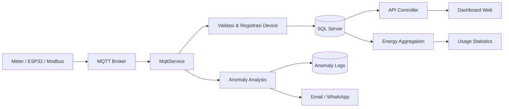

### 2.1 Urutan proses

1. Meter/perangkat mengirim payload ke topic MQTT.
2. `MqttService` menerima dan membaca JSON.
3. Payload divalidasi; payload tidak valid dicatat sebagai error.
4. Device baru dapat diregistrasikan ke registry.
5. Data terbaru disimpan; data lama dapat diarsipkan ke history.
6. Sistem memperbarui `LastSeen`, jumlah pesan, dan status konektivitas.
7. Service analisis memeriksa threshold, EMA, offline, dan anomali billing.
8. Anomali yang lolos validasi/deduplication disimpan dan dapat memicu notifikasi.
9. Background aggregation membentuk data hourly/daily/monthly/yearly.
10. Browser mengambil data melalui MVC/API dan memperbarui kartu, tabel, serta grafik.

### 2.2 Status panel

- **Online:** data terakhir masih dianggap baru berdasarkan interval sistem.
- **Offline:** tidak ada data baru dalam periode yang ditentukan.
- **NORMAL:** beban di bawah threshold normal.
- **MEDIUM:** melewati threshold normal tetapi belum threshold tinggi.
- **HIGH:** melewati threshold tinggi.

> HIGH dan OFFLINE adalah kondisi berbeda. Threshold dapat berbeda per perangkat.

---

## 3. Prasyarat dan Konfigurasi

### 3.1 Komponen

- Windows/Linux/macOS yang dapat menjalankan .NET Core 2.1.
- .NET Core SDK 2.1; project menggunakan `netcoreapp2.1`.
- SQL Server dan database aplikasi.
- MQTT broker yang dapat dijangkau aplikasi.
- SMTP bila email digunakan.
- Wablas bila WhatsApp digunakan.
- API key/model AI bila Asisten AI digunakan.

### 3.2 Lokasi project

```text
D:\File Project\Projects\KWHMonitoring -  .NET 2.1 - Final 5\KWHMonitoring -  .NET 2.1 - V7\KWHMonitoring
```

### 3.3 Environment variables

Jangan memasukkan secret produksi ke Git, dokumentasi, screenshot, atau `appsettings.json`.

| Variable | Kegunaan |
|---|---|
| `ConnectionStrings__DefaultConnection` | Koneksi SQL Server. |
| `Encryption__Key` | Kunci AES untuk data sensitif. |
| `Qwen__ApiKey` / `Qwen__Model` | Konfigurasi AI lama/kompatibel. |
| `Wablas__Token` / `Wablas__SecretKey` | Gateway WhatsApp. |
| `Admin__Email` / `Admin__Password` | Master Admin awal. |

Contoh PowerShell development:

```powershell
$env:ConnectionStrings__DefaultConnection = "Server=YOUR_SERVER,1433;Database=HaiwellElectrical;User Id=YOUR_USER;Password=YOUR_PASSWORD;TrustServerCertificate=True;"
$env:Encryption__Key = "YOUR_ENCRYPTION_KEY"
$env:Qwen__ApiKey = "YOUR_QWEN_API_KEY"
$env:Qwen__Model = "qwen-plus-2025-04-28"
$env:Wablas__Token = "YOUR_WABLAS_TOKEN"
$env:Wablas__SecretKey = "YOUR_WABLAS_SECRET_KEY"
$env:Admin__Email = "admin@example.com"
$env:Admin__Password = "YOUR_STRONG_PASSWORD"
```

---

## 4. Menjalankan Aplikasi

```powershell
Set-Location "D:\File Project\Projects\KWHMonitoring -  .NET 2.1 - Final 5\KWHMonitoring -  .NET 2.1 - V7\KWHMonitoring"
dotnet restore
dotnet build
dotnet run
```

Buka alamat HTTP/HTTPS yang ditampilkan Kestrel. Route default adalah `/Monitoring/Index`. Jika database tidak terjangkau, inisialisasi tertentu dapat dilewati; periksa log console.

### 4.1 Urutan startup

1. Konfigurasi dibaca.
2. Koneksi database diuji.
3. Migration/inisialisasi dijalankan bila database tersedia.
4. MQTT, cache, analisis, email, dan notifikasi didaftarkan.
5. HTTPS, static files, compression, authentication, security headers, dan MVC diaktifkan.
6. Dashboard siap dibuka.

---

## 5. Akun, Login, dan Hak Akses

| Role | Hak akses |
|---|---|
| **Pending/None** | Menunggu verifikasi dan approval; belum dapat memakai fitur terlindungi. |
| **Viewer** | Melihat Panel, Charts, Usage, Details, History, dan Anomaly. Tidak mengubah konfigurasi atau relay. |
| **Operator** | Hak Viewer, plus rescan panel, kontrol relay, dan penanganan operasional/anomali. |
| **Admin** | Hak Operator, plus Settings dan administrasi sistem. |
| **Master Admin** | Admin utama; kelola user, role/status, user non-master, dan penerima billing. |

### 5.1 Registrasi dan approval

1. Pada Login klik **Register/Daftar**.
2. Isi email, nama, dan password.
3. Klik daftar dan buka email verifikasi.
4. Klik link verifikasi.
5. Master Admin menerima/membuka approval request.
6. Master Admin memilih Viewer atau Operator lalu klik **Approve**.
7. Setelah aktif, user dapat login.

Untuk menolak, gunakan **Reject/Tolak** dari link approval. Token dapat kedaluwarsa atau hanya dapat digunakan sekali.

### 5.2 Login, reset, dan logout

1. Masukkan email dan password.
2. Centang **Remember Me** bila perlu.
3. Klik **Login/Masuk**.
4. **Forgot Password:** masukkan email, buka email reset, gunakan token sekitar 1 jam, lalu simpan password baru.
5. **Logout:** buka menu akun dan klik **Logout/Keluar**.

Tanpa Remember Me sesi sekitar 30 menit; dengan Remember Me cookie persisten sekitar 7 hari. Lima percobaan gagal dapat mengunci akun sekitar 15 menit.

---

## 6. Peta Navigasi

| Menu/tab | Route/action | Fungsi |
|---|---|---|
| **Panel** | `Monitoring/Index` | Kartu panel, status, nilai realtime, filter, kontrol perangkat. |
| **Charts** | `Monitoring/Charts` | Grafik power, voltage, dan current per panel. |
| **Usage** | `Monitoring/UsageStatistics` | Energi, biaya, tren, WBP/LWBP, budget, proyeksi. |
| **Anomaly** | `Monitoring/AnomalyLogs` | KPI, filter, tabel log, analisis, acknowledge, resolve. |
| **Settings** | `Monitoring/Settings` | Sistem, Perangkat, Asisten AI, dan Manajemen Pengguna. |
| **Details** | `Monitoring/Details` | Detail satu device dan statistiknya. |
| **History** | `Monitoring/History` | Data historis/arsip. |

Breadcrumb **Dashboard → halaman** menunjukkan posisi. Klik **Dashboard** untuk kembali ke Panel.

---

## 7. Komponen Global dan Tombol Umum

| Tombol | Fungsi | Hasil |
|---|---|---|
| **Refresh** | Meminta data terbaru dari API. | Kartu/grafik/tabel diperbarui. |
| **Rescan** | Membaca ulang daftar panel. | Daftar panel diperbarui; perlu Operator/Admin. |
| **Export** | Menyiapkan CSV monitoring. | Browser mengunduh CSV, umumnya maksimal 50.000 record terbaru. |
| **Settings** | Membuka konfigurasi. | Admin masuk Settings; role lain dapat Access Denied. |
| **Home/Dashboard** | Kembali ke Panel. | Membuka `Monitoring/Index`. |

Ikon notifikasi membuka feed aktivitas browser. **Refresh** mengambil aktivitas; **Clear/Reset** membersihkan feed lokal. Ini berbeda dari `AnomalyLogs` database. **Help** membuka modal bantuan. Tema/bahasa, bila tersedia, hanya mengubah UI/browser.

---

## 8. Panel Monitoring

### 8.1 Filter

Klik **Filter** untuk membuka filter.

| Kontrol | Fungsi |
|---|---|
| **Cari panel** | Mencari group name, device key, atau device ID. |
| **Status** | All, NORMAL, MEDIUM, HIGH, atau OFFLINE. |
| **Phase** | 1-phase atau 3-phase. |
| **Kategori** | Billboard/Videotron/kategori dari konfigurasi. |
| **Clear/Reset** | Mengembalikan semua filter ke awal. |

Counter **Menampilkan X/Y panel** menunjukkan hasil filter dibanding total panel.

### 8.2 Kartu panel dan Detail

Kartu menampilkan group/device, konektivitas, power, voltage, current, energy, power factor, persentase kapasitas, waktu terakhir, serta lokasi/kapasitas bila tersedia. Klik kartu atau **Detail/View** untuk halaman Details dan statistik satu device.

### 8.3 Kontrol relay

Kontrol hanya tampil untuk Operator/Admin dan dapat berupa **ON**, **OFF**, **Pulse**, atau **Toggle**.

1. Pastikan device benar dan online.
2. Klik aksi relay.
3. Baca modal konfirmasi device/aksi.
4. Klik **Confirm/Lanjutkan**.
5. Tunggu hasil dan verifikasi data realtime.

Endpoint dilindungi role; rate limit sekitar 10 perintah/60 detik/user. Aksi dicatat dan dapat mengirim notifikasi. Jangan klik berulang ketika request berjalan.

---

## 9. Charts

Klik **Filter**, lalu gunakan **Cari panel**, **Semua Kategori**, chip panel, atau **Reset filter (X)**. Pada setiap kartu pilih:

- **Power (W):** daya aktif.
- **Voltage (V):** tegangan per fase; 3-phase dapat menampilkan R/S/T.
- **Current (A):** arus per fase; 3-phase dapat menampilkan R/S/T.

Grafik power dapat menampilkan EMA dan threshold atas/bawah bila diaktifkan. Arahkan kursor ke titik untuk membaca timestamp/nilai. Lonjakan power perlu dibandingkan dengan beban normal; voltage tidak seimbang perlu pemeriksaan fase/instalasi.

---

## 10. Usage Statistics

Pilih periode hourly/daily/monthly/yearly, rentang tanggal/bulan/tahun, semua device atau satu device, kategori, dan search tabel.

Komponen utama: total energy/kWh, estimated cost, WBP/LWBP, budget vs realisasi, peak period, proyeksi, load factor, cost per unit, waste energy, anomaly impact, ranking, dan comparison.

- Sampai sekitar 80% budget: relatif aman.
- 80–100%: perlu dipantau.
- Di atas 100%: budget terlampaui.
- Waste di atas 5%: indikasi pemborosan.
- Load factor <30% rendah, 30–80% optimal, >80% risiko tinggi.

Prosedur laporan: pilih periode → pilih device → verifikasi tanggal/timezone/tarif/budget → **Refresh/Load** → baca ringkasan dan grafik → bandingkan periode → export/simpan.

> Jika tarif atau periode salah, hasil finansial juga salah walaupun kWh benar.

---

## 11. Anomaly Center

**Peran** menunjukkan role user. **Pembaruan Otomatis** mengambil log berkala bila dicentang. **Filter/Refresh** memilih periode, device, severity, status, dan jenis.

KPI: **Total Anomali**, **Hari Ini**, **Belum Diselesaikan**, **Kritis**, dan **Tinggi**.

| Tombol | Role | Fungsi |
|---|---|---|
| **View/Detail** | Semua role berakses | Membaca timestamp, device, nilai, severity, root cause/snapshot. |
| **Acknowledge** | Operator/Admin | Menandai sudah diketahui/ditangani. |
| **Resolve/Selesaikan** | Operator/Admin | Menutup setelah normal dan tindakan selesai. |
| **Delete** | Admin | Menghapus satu log setelah konfirmasi. |
| **Hapus Semua** | Admin/Master Admin sesuai tampilan | Menghapus seluruh log; tidak dapat dibatalkan. |

Prosedur: prioritaskan Kritis/Tinggi → buka Detail → catat device/waktu/power/threshold → **Acknowledge** → periksa Panel/Charts dan lakukan tindakan → **Resolve** setelah normal. Jangan menghapus log sebagai pengganti Resolve.

---

## 12. Settings

Settings memerlukan Admin; Manajemen Pengguna hanya Master Admin.

### 12.1 Sistem

**Koneksi MQTT:** broker, port, credential, topic, client ID, dan parameter yang tampil. **Test** menguji tanpa menyimpan; **Simpan** memvalidasi dan menyimpan.

**Refresh/chart/threshold/energi:** interval refresh, jumlah titik chart, EMA, threshold normal/medium/high, tarif per kWh, WBP/LWBP, dan parameter agregasi.

**Notifikasi:** SMTP, sender, penerima email, Wablas, nomor penerima, dan jenis notifikasi. Gunakan **Test Notification**. Field password/API key kosong biasanya mempertahankan nilai lama.

### 12.2 Perangkat

Atur per device: kategori, kapasitas, threshold, tarif, budget kWh/rupiah, mode kontrol, EMA/anomaly, dan parameter finansial. Pilih device → ubah field → **Simpan** → baca hasil → refresh Panel/Usage untuk verifikasi.

### 12.3 Asisten AI

Field: **Penyedia AI**, **API Key**, **Model AI**, dan URL custom bila tersedia. Provider dapat mencakup Qwen, OpenAI, Gemini, Claude, DeepSeek, Zhipu, Groq, OpenRouter, Together, SiliconFlow, Mistral, Cohere, dan custom. **Uji Koneksi** menguji provider; **Simpan** menyimpan konfigurasi terlindungi.

### 12.4 Manajemen Pengguna

Master Admin dapat mengubah role Viewer/Operator/Admin, mengaktifkan/nonaktifkan, menghapus user non-master, memilih penerima billing, dan transfer master bila tersedia. Master Admin tidak dapat dihapus/dinonaktifkan/diubah role melalui operasi normal.

---

## 13. Manajemen Pengguna dan Approval

User mendaftar → verifikasi email → Master Admin membuka approval link → memeriksa data → memilih Viewer/Operator → **Approve** → user menerima konfirmasi dan login. Gunakan **Reject** untuk menolak. Token dapat kedaluwarsa atau sekali pakai.

Rekomendasi: Viewer untuk baca saja, Operator untuk operasional/relay/anomali, Admin untuk konfigurasi, Master Admin untuk pengelolaan akses tertinggi.

---

## 14. Asisten AI

Buka widget → tulis pertanyaan → aplikasi mengambil snapshot realtime → pesan dikirim ke provider → jawaban tampil. AI bukan pengganti verifikasi angka di Panel/Usage. Jangan kirim password, token, API key, atau data sensitif. Jika gagal, cek provider/model/API key/base URL dan gunakan **Uji Koneksi**.

---

## 15. Alur Operasional

### 15.1 Operasi harian

Login → Panel **Refresh** → periksa online/offline → filter HIGH/MEDIUM/OFFLINE → Charts → Anomaly → acknowledge → tindakan sesuai SOP → verifikasi normal → resolve → review Usage.

### 15.2 Panel offline

Filter OFFLINE → Details → catat LastSeen → periksa MQTT broker/topic/jaringan/daya → pulihkan device → **Rescan** → pastikan Online dan timestamp bergerak.

### 15.3 Beban tinggi

Filter HIGH → lihat trend Power → bandingkan kapasitas/threshold → periksa voltage/current/power factor → Anomaly Center → kontrol relay bila aman/berwenang → dokumentasikan → Resolve.

### 15.4 Laporan bulanan

Usage → pilih bulan → pilih device → verifikasi tarif/budget → baca kWh/biaya/WBP/LWBP/peak/proyeksi/waste/anomaly impact → bandingkan periode → export/simpan.

---

## 16. Notifikasi, Audit, dan Keamanan

Peristiwa audit meliputi login, lockout, akses ditolak, perubahan role/status, relay ON/OFF/Pulse, perubahan Settings, dan tindakan anomaly.

Perlindungan meliputi cookie authentication, role authorization, antiforgery token, modal konfirmasi, rate limit relay sekitar 10 request/60 detik/user, token email hash/expiry, password hashing, AES untuk data sensitif, perlindungan Master Admin, HTTPS, dan security headers.

Aturan pengguna: jangan berbagi akun/secret, logout di komputer bersama, verifikasi device sebelum relay, gunakan Resolve bukan Delete, dan backup database sebelum migration/perubahan besar.

---

## 17. Troubleshooting

| Gejala | Kemungkinan | Tindakan |
|---|---|---|
| Tidak start | SDK/secret/port. | Cek `dotnet --info`, environment, dan log. |
| Dashboard kosong | Database/MQTT belum tersedia. | Cek SQL Server, connection string, broker, dan data masuk. |
| Semua offline | Broker/topic/network/device. | Uji MQTT dan LastSeen. |
| Login gagal | Password, verifikasi, status, lockout. | Reset, verifikasi, tunggu, atau hubungi admin. |
| Relay tidak tampil | Viewer atau mode kontrol. | Gunakan Operator/Admin dan cek Settings. |
| Relay gagal | Offline, MQTT, rate limit. | Tunggu, cek broker/status/audit. |
| Settings ditolak | Bukan Admin. | Hubungi Admin. |
| User management hilang | Bukan Master Admin. | Gunakan Master Admin. |
| Grafik tidak berubah | Data/interval/API. | Refresh, cek Network/Console, MQTT, interval. |
| Biaya salah | Tarif/periode/WBP/Wh-kWh. | Cek konfigurasi dan agregasi. |
| Anomali berulang | Kondisi belum normal/threshold. | Cek detail, threshold, EMA, cooldown, dedup. |
| Email gagal | SMTP/firewall/penerima. | Test notification dan log. |
| WhatsApp gagal | Token/secret/gateway. | Uji Wablas. |
| AI gagal | Provider/model/API key. | Settings → Asisten AI → Uji Koneksi. |
| Startup lambat saat DB mati | Retry koneksi. | Pulihkan SQL dan cek timeout/log. |

Pemeriksaan browser: `Ctrl+F5` → Developer Tools → Network → cari 401/403/500 → periksa Console → pastikan cookie/JavaScript aktif. Pemeriksaan server: baca log `dotnet run`, uji SQL/MQTT, pastikan environment variable tersedia pada proses, lalu restart setelah perubahan.

---

## 18. Checklist Operasional

### Deployment

- [ ] .NET Core 2.1 tersedia.
- [ ] Database dan migration siap.
- [ ] Connection string benar.
- [ ] Encryption key aman.
- [ ] MQTT broker terjangkau.
- [ ] SMTP/Wablas diuji bila digunakan.
- [ ] Master Admin dikonfigurasi.
- [ ] HTTPS/certificate siap.
- [ ] Backup database tersedia.
- [ ] Tidak ada secret di repository.

### Sebelum relay

- [ ] Role Operator/Admin.
- [ ] Device ID benar dan online.
- [ ] Kondisi listrik aman.
- [ ] Aksi dipahami.
- [ ] Modal menunjukkan device benar.
- [ ] Hasil diverifikasi realtime.

### Saat anomaly

- [ ] Severity dan detail dibaca.
- [ ] Device/timestamp dicatat.
- [ ] Acknowledge dilakukan saat ditangani.
- [ ] Tindakan koreksi dicatat.
- [ ] Kondisi normal diverifikasi.
- [ ] Resolve dilakukan, bukan langsung Delete.

---

## 19. Referensi

Source utama: `Views/Shared/_Layout.cshtml`, `Views/Shared/_DashboardHeader.cshtml`, seluruh view `Views/Monitoring`, `Controllers/MonitoringController.cs`, `AccountController.cs`, `UserManagementController.cs`, `AdminApprovalController.cs`, serta dokumentasi `Dokumentasi_Fitur_Lengkap.md`, `Flowchart_Sistem.md`, `ENVIRONMENT_SETUP.md`, dan `AFTER_CHANGE.md`.

Label/field dapat berubah sesuai konfigurasi database, role, provider AI, atau versi source. Jika teks tombol berbeda sedikit, gunakan ikon dan section yang sama sebagai acuan.

> Dokumen ini adalah user guide operasional dan bukan pengganti SOP keselamatan listrik, SOP jaringan, atau prosedur backup/restore database.

---

<!-- SOURCE: DOKUMENTASI_SISTEM_UTAMA.md | MODIFIED: 2026-10-26 14:23:48 -->

## Sumber: `DOKUMENTASI_SISTEM_UTAMA.md`

# Dokumentasi Sistem Utama KWH Monitoring

> **Cakupan:** Panel Monitoring, Details, Charts, Usage Statistics, Anomaly Center, dan Settings.  
> **Versi source:** KWH Monitoring .NET 2.1 — V7.  
> **Tanggal dokumentasi:** 26 Oktober 2026.

Dokumen ini hanya membahas enam modul utama aplikasi. Login, registrasi, approval user, user management, dan modul lain di luar area utama tidak menjadi fokus.

## Daftar Isi

1. [Ruang Lingkup dan Navigasi](#1-ruang-lingkup-dan-navigasi)
2. [Alur Data End-to-End](#2-alur-data-end-to-end)
3. [Panel Monitoring](#3-panel-monitoring)
4. [Details](#4-details)
5. [Charts](#5-charts)
6. [Usage Statistics](#6-usage-statistics)
7. [Anomaly Center](#7-anomaly-center)
8. [Settings](#8-settings)
9. [Matriks Tombol](#9-matriks-tombol)
10. [Flowchart Lengkap](#10-flowchart-lengkap)
11. [Prosedur Operasional](#11-prosedur-operasional)
12. [Catatan Implementasi](#12-catatan-implementasi)

---

## 1. Ruang Lingkup dan Navigasi

| Modul | Tujuan | Route |
|---|---|---|
| **Panel Monitoring** | Melihat kondisi terbaru seluruh panel, filter, dan kontrol perangkat. | `/Monitoring/Index` |
| **Details** | Melihat satu device secara mendalam, termasuk realtime, chart, usage, biaya, dan downtime. | `/Monitoring/Details?deviceKey={deviceKey}` |
| **Charts** | Membandingkan grafik power, voltage, dan current banyak panel. | `/Monitoring/Charts` |
| **Usage Statistics** | Menganalisis energi, biaya, budget, WBP/LWBP, ranking, comparison, dan proyeksi. | `/Monitoring/UsageStatistics` |
| **Anomaly Center** | Memantau, menganalisis, acknowledge, resolve, dan mengelola anomaly. | `/Monitoring/AnomalyLogs` |
| **Settings** | Mengatur MQTT, interval, threshold, notifikasi, dan device settings. | `/Monitoring/Settings` |

### 1.1 Navigasi header

Header berasal dari `_DashboardHeader.cshtml`.

| Elemen/tombol | Hasil ketika ditekan |
|---|---|
| **Dashboard/Home** | Mengarah ke `/Monitoring/Index`. |
| **Panel** | Mengarah ke `Monitoring/Index`. |
| **Charts** | Mengarah ke `Monitoring/Charts`. |
| **Usage** | Mengarah ke `Monitoring/UsageStatistics`. |
| **Anomaly** | Mengarah ke `Monitoring/AnomalyLogs`; badge menampilkan jumlah anomaly yang dimuat. |
| **Refresh** | Tetap di halaman aktif dan meminta data terbaru melalui API. |
| **Rescan** | Tetap di halaman aktif; mengambil ulang daftar panel. Memerlukan Operator/Admin. |
| **Export** | Mengunduh CSV; pada Details hanya untuk device yang sedang dibuka. |
| **Settings** | Mengarah ke `Monitoring/Settings`; memerlukan Admin. |

### 1.2 Hubungan modul

```mermaid
flowchart LR
    P[Panel Monitoring] -->|Klik kartu| D[Details]
    P -->|Tab Charts| C[Charts]
    P -->|Tab Usage| U[Usage Statistics]
    P -->|Tab Anomaly| A[Anomaly Center]
    P -->|Settings| S[Settings]
    D -->|Dashboard| P
    D -->|Export| CSV[File CSV Device]
    S --> DB[(Settings Database/Cache)]
    DB --> P
    DB --> C
    DB --> U
    DB --> A
```

---

## 2. Alur Data End-to-End

```mermaid
flowchart TD
    DEVICE[Meter / ESP32 / Modbus] --> MQTT[MQTT Broker]
    MQTT --> SERVICE[MqttService]
    SERVICE --> VALIDATE{Payload valid?}
    VALIDATE -->|Tidak| ERROR[Catat error aplikasi]
    VALIDATE -->|Ya| REGISTRY[Update Device Registry]
    VALIDATE --> KWH[(KWH Monitoring Data)]
    KWH --> HISTORY[(KWH History bila perlu archive)]
    KWH --> AGG[Energy Aggregation]
    AGG --> H[HourlyEnergy]
    AGG --> DA[DailyEnergy]
    AGG --> MO[MonthlyEnergy]
    AGG --> Y[YearlyEnergy]
    KWH --> ANALYSIS[EMA / Threshold / Offline Analysis]
    ANALYSIS -->|Confirmed anomaly| AL[(AnomalyLogs)]
    AL --> NOTIFY[Email / WhatsApp]
    KWH --> API[ApiController]
    H --> API
    DA --> API
    MO --> API
    Y --> API
    AL --> API
    API --> UI[Browser: Panel, Details, Charts, Usage, Anomaly]
    UI -->|Refresh, Filter, Save, Relay| API
```

### 2.1 Alur refresh realtime

1. Browser memanggil `GET /api/Api/data-version` secara berkala.
2. Endpoint mengembalikan token perubahan, bukan seluruh payload data.
3. Jika token berubah, halaman aktif mengambil data terbaru yang diperlukan.
4. Panel/Charts mengambil panel dan chart.
5. Usage mengambil agregat energi/biaya.
6. Anomaly mengambil summary/log.
7. Pada Panel Monitoring, data terbaru juga memperbarui kartu ringkasan di antara tab dan filter:
   - jumlah total panel;
   - jumlah panel online;
   - total daya terpasang dalam VA;
   - jumlah panel per kota.
8. Perubahan status dari event `deviceConnectivityChanged` langsung memperbarui nilai **PANEL ONLINE** tanpa menghapus atau merender ulang kartu panel.

---

## 3. Panel Monitoring

### 3.1 Fungsi

Panel Monitoring adalah halaman utama untuk melihat seluruh panel, status konektivitas, beban, pengukuran listrik terakhir, filter, navigasi Details, dan kontrol relay.

### 3.2 Data pada kartu panel

Kartu menggunakan `PanelViewModel` dan partial `_PanelCard.cshtml`.

| Data | Field | Fungsi |
|---|---|---|
| Device Key | `DeviceKey` | ID unik untuk query, chart, settings, dan URL Details. |
| Device ID | `DeviceId` | ID perangkat dari sumber data. |
| Nama grup | `GroupName` | Judul kartu panel. |
| Kategori | `DeviceCategory` | Kategori Billboard/Videotron/LED/Lainnya. |
| Mode kontrol | `ControlMode` | Menentukan tombol relay. |
| Kapasitas efektif | `MaxCapacity` | Dasar perhitungan persentase beban. |
| Kapasitas terpasang | `InstalledCapacityVA` | Kapasitas dari ERP sebelum konversi Watt. |
| Threshold beban | `LoadNormalThreshold`, `LoadMediumThreshold` | Batas NORMAL, MEDIUM, HIGH. |
| Waktu server | `Waktu_Server` | Waktu data terakhir diterima/disimpan. |
| Tegangan | `Volt_R`, `Volt_S`, `Volt_T` | Tegangan fase R/S/T. S/T dipakai pada 3-phase. |
| Arus | `Amp_R`, `Amp_S`, `Amp_T` | Arus fase R/S/T. |
| Faktor daya | `Cos_Phi` | Indikator efisiensi daya. |
| Daya aktif | `Daya_Watt` | Daya saat ini dalam Watt. |
| Energi | `TotalW1M_Wh`, `Energi_Aktif_Wh`, `Total_Energy_Wh` | Energi interval/aktif/kumulatif. |
| Frekuensi | `Frekuensi_Hz` | Frekuensi listrik. |
| Lokasi ERP | `KodeLokasi`, `Alamat`, `KotaProvinsi` | Informasi lokasi panel. |
| Pelanggan/catatan | `IDPelanggan`, `Catatan` | Identitas pelanggan dan catatan lokasi. |

### 3.2.1 Kartu ringkasan Panel Monitoring

Di antara tab navigasi dan bagian Filter terdapat baris kartu ringkasan tambahan. Kartu statistik lama yang masih berada di bagian atas `Index.cshtml` tidak dihapus; kartu ringkasan baru ditambahkan pada lokasi yang sama sesuai kebutuhan halaman.

| Kartu | Sumber/perhitungan | Keterangan |
|---|---|---|
| **TOTAL** | `allPanelData.length` | Jumlah seluruh panel yang tersedia pada data halaman/API. |
| **PANEL ONLINE** | `deviceConnectivityMap` | Menghitung device yang tidak memiliki status `false`; status diperbarui oleh event konektivitas realtime. |
| **DAYA TERPASANG** | `Σ installedCapacityVA` | Total kapasitas terpasang dari field `InstalledCapacityVA`/`DayaVA` ERP, bukan daya realtime Watt. Satuan: VA. |
| **Kota** | `KotaProvinsi` | Mengambil kata pertama dari `KotaProvinsi`, menormalkannya menjadi huruf kapital, lalu menghitung jumlah panel pada kota tersebut. |

#### Aturan kartu kota dinamis

1. Nilai `KotaProvinsi` berasal dari data master ERP melalui `TitikLokasiService`.
2. Kata pertama diambil setelah trimming dan pemisahan whitespace. Contoh: `Surabaya, Jawa Timur` menjadi `SURABAYA`.
3. Setiap kota unik dibuat sebagai kartu tersendiri secara otomatis; tidak ada daftar kota yang di-hardcode.
4. Jika kota baru muncul pada data API, kartu kota baru ditambahkan saat refresh.
5. Kartu kota menggunakan class `panel-summary-card` yang sama dengan kartu TOTAL, PANEL ONLINE, dan DAYA TERPASANG agar ukuran label, nilai, ikon, padding, tinggi, dan radius konsisten.
6. Layout memakai grid responsif dengan ukuran minimum kartu yang lebih ringkas dan proporsional, termasuk pada layar kecil.

Endpoint `GET /api/Api/panels` mengirim field `kotaProvinsi` bersama `installedCapacityVA` agar kartu ringkasan tetap akurat ketika data diperbarui melalui auto-refresh.

### 3.3 Status beban

```text
LoadPercent = min((Daya_Watt / MaxCapacity) × 100, 100)
```

| Kondisi | Status | Arti |
|---|---|---|
| Kapasitas `<= 0` | NORMAL/default | Kapasitas belum tersedia; persentase tidak dapat dihitung penuh. |
| Load `<= LoadNormalThreshold` | NORMAL | Beban normal. |
| Load di atas normal dan `<= LoadMediumThreshold` | MEDIUM | Beban perlu dipantau. |
| Load di atas `LoadMediumThreshold` | HIGH | Beban tinggi dan perlu investigasi. |
| Tidak ada data baru sesuai batas waktu | OFFLINE | Status konektivitas, bukan status beban. |

Kapasitas efektif ERP dihitung sebagai:

```text
MaxCapacityWatt = InstalledCapacityVA × Cos_Phi
```

### 3.4 Filter Panel

Klik **Filter** untuk membuka `#panelFilterCollapse`.

| Kontrol | ID | Fungsi |
|---|---|---|
| Cari panel | `panelSearch` | Mencari GroupName, DeviceKey, atau DeviceId. |
| Status | `panelStatusFilter` | All, NORMAL, MEDIUM, HIGH, OFFLINE. |
| Fase | `panelPhaseFilter` | All, 1-phase, 3-phase. |
| Kategori | `panelCategoryFilter` | Semua atau kategori tertentu. |
| Clear | `btnClearFilter` | Mengosongkan search dan mengembalikan dropdown ke All. |

Counter **Menampilkan X/Y panel** menunjukkan hasil filter terhadap total panel.

### 3.5 Tombol/klik Panel

| Aksi | Tujuan |
|---|---|
| **Filter** | Membuka/menutup filter; tetap di Panel. |
| **Clear Filter** | Mereset filter; tetap di Panel. |
| **Klik kartu** | Mengarah ke `/Monitoring/Details?deviceKey={DeviceKey}`. |
| **Expand/Collapse** | Membuka/menutup isi kartu; tidak berpindah halaman. |
| **Detail/View** | Membuka Details device. |
| **ON/OFF/Toggle/Pulse** | Modal konfirmasi → OTP bila diperlukan → API relay → MQTT. |
| **Refresh** | Mengambil data Panel terbaru; tetap di Panel. |
| **Rescan** | POST rescan panels; daftar diperbarui; Operator/Admin. |
| **Export** | Mengunduh CSV monitoring. |

### 3.6 Kontrol relay

| `ControlMode` | Kontrol |
|---|---|
| `OnOff` | ON dan OFF. |
| `Toggle` | Toggle perangkat. |
| `Pulse` | Pulse sesuai konfigurasi perangkat. |
| `Toggle2Relay` | R1 dan R2. |
| `ToggleAll` | ON ALL/semua relay. |

Alur: tombol ditekan → modal konfirmasi → OTP bila diperlukan → `POST /api/Api/publish-relay` → validasi role Operator/Admin dan rate limit → publish MQTT → update status/audit/notifikasi.

---

## 4. Details

### 4.1 Fungsi

Details menampilkan satu perangkat berdasarkan `deviceKey`. Halaman ini digunakan untuk pemeriksaan rinci tanpa bercampur dengan panel lain.

### 4.2 Data header

- Group Name.
- Device Key.
- Device ID.
- Jenis fase: `1Φ Single Phase` atau `3Φ Three Phase`.
- Ikon kategori.
- Indikator Online/Offline.
- Status pemeriksaan terakhir.

### 4.3 Tombol header Details

| Tombol | Hasil |
|---|---|
| **Refresh** | Memuat ulang data device dan komponen Details; tetap di Details. |
| **EMA/Settings** | Membuka konteks pengaturan/chart EMA sesuai implementasi halaman. |
| **Dashboard** | Mengarah ke `/Monitoring/Index`. |
| **Export** | Mengarah ke `Monitoring/ExportCSV?deviceKey={DeviceKey}` lalu mengunduh CSV device. |

### 4.4 Informasi downtime

Details menampilkan kategori, label waktu henti, status downtime, waktu downtime, dan indikator online. Downtime membedakan device yang memang dijadwalkan berhenti dari device yang berhenti tanpa jadwal.

### 4.5 Tab internal Details

| Tab | Data/fungsi |
|---|---|
| **Monitoring** | Voltage, current, power, energy, power factor, frequency, status, kapasitas, dan waktu data. |
| **Chart/Grafik** | Grafik power, voltage, current, EMA, dan threshold device. |
| **Usage/Financial** | kWh, biaya, WBP/LWBP, proyeksi, waste, load factor, dan cost per unit. |
| **Anomaly/Log** | Anomaly device dan snapshot bila tersedia. |
| **Device Settings** | Parameter device yang dapat diubah Admin. |

### 4.6 Data finansial Details

Komponen finansial dapat menampilkan konsumsi kWh, estimasi biaya, WBP/LWBP, rasio WBP, pemborosan, perubahan bulanan, perubahan tahunan, proyeksi tagihan, faktor beban, biaya per unit/luas/jam, dampak anomaly, dan top anomaly.

### 4.7 Reset Chart Data

Tombol **Atur Ulang Grafik/Reset Chart**:

1. Menampilkan konfirmasi.
2. Jika disetujui, memanggil `DELETE /api/Api/reset-chart-data/{deviceKey}`.
3. Menghapus data chart device.
4. Perhitungan SMA dimulai kembali dari data baru.
5. Aksi tidak dapat dibatalkan.

---

## 5. Charts

### 5.1 Fungsi

Charts menampilkan chart banyak panel agar perubahan power, voltage, dan current dapat dibandingkan tanpa membuka Details satu per satu.

### 5.2 Filter

| Kontrol | ID | Fungsi |
|---|---|---|
| Filter | `chartFilterCollapse` | Membuka/menutup filter chart. |
| Cari panel | `chartSearch` | Mencari nama/group/device. |
| Kategori | `chartCategoryFilter` | Memfilter kategori. |
| Reset | `btnClearChartFilter` | Menghapus filter. |
| Chip panel | `chartChipList` | Menampilkan pilihan panel hasil filter. |

### 5.3 Jenis data chart

| Selector | Data | Satuan |
|---|---|---|
| **Power** | Daya aktif. | W. |
| **Voltage** | Tegangan R/S/T. | V. |
| **Current** | Arus R/S/T. | A. |

Untuk 1-phase hanya fase yang tersedia. Untuk 3-phase dapat muncul seri R, S, dan T.

Power dapat menampilkan seri Power, EMA, upper threshold, dan lower threshold. Tooltip menunjukkan waktu dan nilai titik.

### 5.4 Tombol Charts

| Aksi | Hasil |
|---|---|
| **Filter** | Membuka filter; tetap di Charts. |
| **Reset filter** | Menampilkan kembali seluruh chart. |
| **Power/Voltage/Current** | Mengganti dataset chart pada kartu yang sama. |
| **Refresh** | Mengambil ulang chart; tetap di Charts. |
| **Klik titik/tooltip** | Menampilkan detail nilai; tidak bernavigasi. |
| **Tab Panel/Usage/Anomaly** | Berpindah ke modul terkait. |

Endpoint data chart: `GET /api/Api/panels/{deviceKey}/chart?points=N`.

---

## 6. Usage Statistics

### 6.1 Fungsi

Usage Statistics mengubah data pengukuran dan data agregasi menjadi informasi konsumsi, biaya, budget, perbandingan, proyeksi, efisiensi, dan dampak anomaly.

### 6.2 Sumber data

- `HourlyEnergy`.
- `DailyEnergy`.
- `MonthlyEnergy`.
- `YearlyEnergy`.
- Data kWh realtime.
- Tarif per device.
- Tarif WBP/LWBP.
- Budget kWh/Rupiah.
- Data billing ERP bila tersedia.
- Anomaly log dan dampak biaya.

### 6.3 Filter dan pilihan periode

- Hourly, daily, monthly, yearly.
- Tanggal mulai dan selesai.
- Semua panel atau satu device.
- Kategori perangkat.
- Search tabel.
- Preset ranking/comparison.
- Current, previous, two months ago, three months ago.

### 6.4 Data yang ditampilkan

| Komponen | Fungsi |
|---|---|
| **Total energy/kWh** | Mengetahui konsumsi pada periode aktif. |
| **Estimated cost** | Mengubah energi menjadi estimasi Rupiah. |
| **WBP/LWBP** | Melihat porsi konsumsi dan biaya puncak/non-puncak. |
| **Peak period** | Menemukan jam/hari/bulan konsumsi tertinggi. |
| **Budget vs actual** | Menilai penggunaan terhadap anggaran. |
| **Projection** | Memperkirakan energi/biaya akhir periode. |
| **Ranking** | Mengurutkan device berdasarkan kWh atau biaya. |
| **Comparison** | Membandingkan current dengan periode sebelumnya. |
| **Load factor** | Menilai pemanfaatan kapasitas. |
| **Waste energy** | Menilai pemborosan energi/biaya. |
| **Cost per unit** | Membandingkan biaya per luas, jam, atau unit. |
| **Anomaly impact** | Menilai dampak biaya anomaly. |

### 6.5 Rumus penting

```text
EstimatedCost = EnergyKWh × TariffPerKWh
WBP_Cost = WBP_KWh × TariffWBP
LWBP_Cost = LWBP_KWh × TariffLWBP
TotalCost = WBP_Cost + LWBP_Cost
WBP_Ratio = WBP_KWh / (WBP_KWh + LWBP_KWh) × 100
BudgetUsage = Actual / Budget × 100
LoadFactor = ActualEnergy / (Capacity × Hours) × 100
```

Load factor dibatasi maksimal 100% pada tampilan.

### 6.6 Interpretasi warna

- Sampai 80% budget: relatif aman.
- 80–100%: perlu dipantau.
- Di atas 100%: budget terlampaui.
- Waste di atas 5%: indikasi pemborosan.
- Load factor <30%: pemanfaatan rendah.
- 30–80%: optimal.
- >80%: risiko tinggi.

### 6.7 Tombol dan endpoint Usage

| Aksi | Hasil |
|---|---|
| Filter device/search/category | Memuat ulang dashboard Usage sesuai filter. |
| Preset periode | Mengubah periode ranking/comparison. |
| Current/Previous/T-2/T-3 | Mengubah periode tabel perbandingan. |
| Refresh/Load | Meminta statistik baru dan menggambar ulang komponen. |
| Ranking sort | Mengubah urutan ranking. |
| Export/report | Menghasilkan file/laporan jika tombol tersedia. |
| Tab Panel/Charts/Anomaly | Berpindah ke modul terkait. |

Endpoint utama:

- `POST /api/Api/usage-statistics` — semua panel/periode.
- `POST /api/Api/usage-statistics/{deviceKey}` — satu device.
- `POST /api/Api/usage-statistics/batch` — batch device.
- `POST /api/Api/usage-cost-comparison` — perbandingan biaya.
- `GET /api/Api/realtime-kwh` — kWh realtime.
- `GET /api/Api/energy-tables` — data tabel energi.
- `GET /api/Api/report-pdf` — laporan PDF dengan parameter valid.

---

## 7. Anomaly Center

### 7.1 Fungsi

Anomaly Center menampilkan jumlah anomaly, severity, status penyelesaian, detail kejadian, root cause, rekomendasi, snapshot, dan anomaly billing.

### 7.2 Kontrol dan KPI

| Komponen | Fungsi |
|---|---|
| Badge Peran | Menampilkan role user aktif. |
| Pembaruan Otomatis | Mengaktifkan pengambilan data anomaly berkala. |
| Filter | Membatasi device, waktu, severity, tipe, dan status. |
| Refresh | Memuat ulang summary, chart, dan grid. |
| Total Anomali | Jumlah seluruh log pada filter aktif. |
| Hari Ini | Jumlah anomaly tanggal berjalan. |
| Belum Diselesaikan | `IsResolved = false`. |
| Kritis | Severity paling tinggi. |
| Tinggi | Severity tinggi. |

### 7.3 Field record anomaly

| Field | Fungsi |
|---|---|
| `Id` | ID anomaly. |
| `DeviceKey`, `DeviceId` | Device terdampak. |
| `AnomalyType` | Jenis anomaly seperti overload/drop/device drop. |
| `PowerValue` | Daya saat kejadian. |
| `ThresholdValue` | Threshold yang dilanggar. |
| `Deviation` | Besar penyimpangan. |
| `DetectedTime` | Waktu deteksi. |
| `EMAValue`, `ThresholdMode` | Nilai dan mode analisis. |
| `Acknowledged`, `AcknowledgedTime`, `AcknowledgedBy` | Status dan pelaku acknowledge. |
| `IsResolved`, `ResolvedTime`, `ResolvedBy` | Status dan pelaku penyelesaian. |
| `OperatorAction`, `OperatorNotes` | Tindakan dan catatan. |
| `Severity` | Critical/High/Medium/Low. |
| `RootCause` | Perkiraan penyebab. |
| `RecommendedAction` | Rekomendasi tindakan. |
| `ChartSnapshot` | Snapshot grafik sekitar anomaly. |
| Billing fields | Estimated/actual billing, selisih, persentase, periode, dan ID ERP. |

### 7.4 Tombol anomaly

| Tombol | Role | Tujuan |
|---|---|---|
| **View/Detail** | Viewer/Operator/Admin | Membuka detail, analisis, root cause, rekomendasi, snapshot. |
| **Acknowledge** | Operator/Admin | Menyimpan bahwa anomaly telah diketahui/ditangani. |
| **Resolve** | Operator/Admin | Membuka modal tindakan maintenance dan menutup anomaly setelah validasi. |
| **Delete** | Admin | Menghapus satu log setelah konfirmasi. |
| **Hapus Semua** | Admin sesuai proteksi halaman | Menghapus seluruh log secara permanen. |
| **Billing action** | Admin/Master Admin sesuai implementasi | Konfirmasi/rescan/notifikasi anomaly billing. |

### 7.5 Resolve

Modal Resolve meminta jenis tindakan seperti periksa koneksi, restart device, ganti fuse/MCB, periksa relay, supply voltage, circuit breaker, grounding, sensor, ventilasi, UPS, firmware, atau komponen rusak. Catatan opsional dapat ditambahkan.

Alur: klik Resolve → pilih tindakan wajib → isi notes bila perlu → **Confirm Resolve** → API menyimpan user, waktu, action, notes, dan status resolved → refresh KPI/grid.

### 7.6 Proses deteksi anomaly

```mermaid
flowchart TD
    START[Background anomaly check] --> DEVICES[Ambil device]
    DEVICES --> CHART[Ambil chart per device]
    CHART --> VALID{Data valid dan timestamp baru?}
    VALID -->|Tidak| END[Selesai]
    VALID -->|Ya| EMA[Hitung EMA/baseline]
    EMA --> THRESH[Ambil threshold device/global]
    THRESH --> CHECK{Melewati upper/lower?}
    CHECK -->|Tidak| NORMAL[Reset counter/cooldown]
    NORMAL --> END
    CHECK -->|Ya| CONFIRM[Tambah counter konfirmasi]
    CONFIRM --> ENOUGH{Konfirmasi minimum?}
    ENOUGH -->|Belum| END
    ENOUGH -->|Ya| SNAPSHOT[Ambil chart snapshot]
    SNAPSHOT --> LOG[POST log-anomaly]
    LOG --> DEDUP[Cooldown dan deduplication]
    DEDUP --> END
```

Endpoint anomaly utama meliputi summary, log per device, analysis, log-anomaly, acknowledge, resolve, delete satu, clear-all, serta endpoint billing anomaly.

---

## 8. Settings

### 8.1 Fungsi

Settings mengendalikan parameter yang memengaruhi Panel, Details, Charts, Usage, dan Anomaly. Perubahan disimpan ke database dan dapat diperbarui ke cache runtime.

### 8.2 Tab Settings

| Tab | Target | Isi |
|---|---|---|
| **Sistem** | `#system` | MQTT, interval, email, WhatsApp, schedule, EMA, threshold global. |
| **Perangkat** | `#categories` | Kategori, tarif, kapasitas, budget, threshold, billing, downtime, kontrol per device. |
| **Asisten AI** | `#chatbot` | Provider/model/API key; bagian konfigurasi Settings. |
| **Manajemen Pengguna** | `#users` | Hanya Master Admin; bukan fokus dokumen ini. |

### 8.3 Sistem: MQTT

Field dapat meliputi host broker, port, username, password, topic, client ID, dan parameter reconnect.

| Tombol | ID | Hasil |
|---|---|---|
| **Test** | `btnTestConnection` | Menguji koneksi tanpa menyimpan. |
| **Simpan** | `btnSaveMqttSettings` | Menyimpan konfigurasi MQTT. |

### 8.4 Sistem: interval

Field aktual yang terlihat:

- `chartsInterval` — interval refresh Charts.
- `detailsInterval` — interval refresh Details.
- `anomalyInterval` — interval anomaly.
- `chartDataPoints` — jumlah titik chart.

| Tombol | ID | Hasil |
|---|---|---|
| **Sync Intervals** | `btnSyncIntervals` | Menyamakan interval antar modul. |
| **Simpan** | `btnSaveIntervalSettings` | Menyimpan interval dan jumlah titik chart. |

### 8.5 Sistem: email/WhatsApp

Email dapat mengatur SMTP, sender, recipient, dan tipe notifikasi. WhatsApp/Wablas dapat mengatur token, secret, nomor, dan status gateway.

| Tombol | Hasil |
|---|---|
| **Simpan Email** | Menyimpan email settings. |
| **Test Email** | Mengirim email uji. |
| **Simpan WhatsApp** | Menyimpan Wablas settings. |
| **Test Wablas** | Menguji koneksi/pengiriman Wablas. |
| **Check Wablas Device** | Memeriksa status gateway/device. |

### 8.6 Sistem: jadwal dan EMA

Jadwal meliputi instant alert, hourly report, daily report, dan monthly report. Parameter EMA dapat meliputi refresh interval, jumlah konfirmasi maksimum, upper/lower threshold, dan opsi garis EMA.

| Tombol | Hasil |
|---|---|
| **Simpan Jadwal** | Menyimpan jadwal notifikasi. |
| **Test Instant/Hourly/Daily/Monthly** | Menguji jenis notifikasi terkait. |
| **Simpan EMA** | Menyimpan konfigurasi EMA/anomaly global. |
| **Reset System Settings** | Mengembalikan form ke nilai awal/default sesuai implementasi. |
| **Simpan System Settings** | Menyimpan perubahan sistem setelah modal konfirmasi. |

### 8.7 Perangkat

Partial `_DeviceSettingsTab.cshtml` mengatur setiap device melalui kelompok:

**Perangkat dan tarif:** kategori, tarif Rp/kWh, tarif WBP, tarif LWBP.  
**Billing dan anggaran:** anggaran bulanan, sumber manual/trend, luas m², pendapatan per jam, cutoff PLN, tanggal cutoff.  
**Threshold billing:** nominal/persentase selisih tagihan, mode toleransi trend, toleransi nominal/persentase.  
**Threshold beban/EMA:** Normal, Medium, Upper Line, Lower Line.  
**Waktu dan kendali:** mulai/selesai downtime, mode ON/OFF, Toggle, Pulse, 2 Relay, All, downtime enable, invers relay.

| Tombol | Endpoint/hasil |
|---|---|
| **Simpan per device** | `POST /api/Api/device-settings/{deviceKey}`. |
| **Simpan Semua** | `POST /api/Api/device-settings/bulk`. |
| **Atur Ulang Grafik** | Konfirmasi → `DELETE /api/Api/reset-chart-data/{deviceKey}`. |

### 8.8 Konfirmasi simpan

Simpan penting menggunakan `#settingsConfirmModal`: tekan Simpan → modal → **Ya, Simpan** (`settingsConfirmOk`) atau Batal → request API → status sukses/error → cache/runtime diperbarui.

### 8.9 Endpoint Settings

- `GET /Monitoring/Settings` — membuka halaman.
- `POST /Monitoring/UpdateSettings` — menyimpan melalui MVC.
- `POST /api/Api/save-system-settings` — sistem.
- `POST /api/Api/save-notification-settings` — notifikasi.
- `GET/POST /api/Api/device-settings` — device settings.
- `GET/POST /api/Api/device-settings/{deviceKey}` — satu device.
- `POST /api/Api/device-settings/bulk` — bulk device.
- `DELETE /api/Api/reset-chart-data/{deviceKey}` — reset chart.

---

## 9. Matriks Tombol

| Modul | Tombol/aksi | Tujuan |
|---|---|---|
| Panel | Filter/Clear | Filter lokal dan reset filter. |
| Panel | Kartu/Detail | `/Monitoring/Details?deviceKey=...`. |
| Panel | Expand | Buka/tutup kartu. |
| Panel | Relay | Modal → OTP → publish relay MQTT. |
| Panel | Refresh/Rescan/Export | Refresh data, rescan panel, download CSV. |
| Details | Refresh | Muat ulang device. |
| Details | Dashboard | `/Monitoring/Index`. |
| Details | Export | CSV device. |
| Details | Tab internal | Ubah informasi tanpa meninggalkan Details. |
| Details | Reset Chart | Hapus chart device dan hitung ulang dari data baru. |
| Charts | Filter/Reset | Filter dan reset chart. |
| Charts | Power/Voltage/Current | Ubah dataset chart. |
| Charts | Refresh | Muat ulang chart. |
| Usage | Filter/Periode | Muat statistik sesuai parameter. |
| Usage | Ranking/Comparison | Ubah pengurutan dan periode pembanding. |
| Usage | Report/Export | Buat file laporan bila tersedia. |
| Anomaly | Auto Refresh | Aktif/nonaktif polling. |
| Anomaly | Detail | Detail/analysis/snapshot. |
| Anomaly | Acknowledge | Simpan status diketahui. |
| Anomaly | Resolve | Modal action → simpan resolved. |
| Anomaly | Delete/Clear All | Hapus log setelah konfirmasi. |
| Settings | Test | Uji koneksi tanpa simpan. |
| Settings | Simpan | Simpan section ke API/database. |
| Settings | Test Notification | Kirim notifikasi uji. |
| Settings | Reset | Kembalikan form. |
| Settings | Save Device/All | Simpan satu/banyak device. |

---

## 10. Flowchart Lengkap

### 10.1 Navigasi

```mermaid
flowchart TD
    START([User membuka sistem]) --> PANEL[Panel Monitoring]
    PANEL --> CHOICE{Pilih aksi}
    CHOICE -->|Kartu panel| DETAILS[Details device]
    CHOICE -->|Charts| CHARTS[Charts]
    CHOICE -->|Usage| USAGE[Usage Statistics]
    CHOICE -->|Anomaly| ANOM[Anomaly Center]
    CHOICE -->|Settings| SETTINGS[Settings]
    CHOICE -->|Refresh| RELOAD[Request data halaman aktif]
    RELOAD --> PANEL
    DETAILS --> DCHOICE{Aksi Details}
    DCHOICE -->|Dashboard| PANEL
    DCHOICE -->|Refresh| DETAILS
    DCHOICE -->|Export| CSV[Download CSV device]
    CHARTS -->|Filter/selector| CHARTS
    USAGE -->|Filter/periode| USAGE
    ANOM -->|Detail/ack/resolve| ANOM
    SETTINGS -->|Simpan/test| SETTINGS
```

### 10.2 Panel Monitoring

```mermaid
flowchart TD
    OPEN([Open Panel]) --> LOAD[MonitoringController.Index]
    LOAD --> QUERY[Query latest KWH per DeviceKey]
    QUERY --> CONFIG[Load system/device settings]
    CONFIG --> ERP[Load lokasi dan kapasitas ERP]
    ERP --> VM[Build PanelViewModel]
    VM --> CARDS[Render kartu panel]
    VM --> SUMMARY[Render kartu TOTAL/kota/online/daya terpasang]
    CARDS --> FILTER{Filter?}
    SUMMARY --> FILTER
    FILTER -->|Ya| SEARCH[Search Group/Key/ID]
    SEARCH --> STATUS[Status filter]
    STATUS --> PHASE[Phase filter]
    PHASE --> CATEGORY[Category filter]
    CATEGORY --> COUNT[Update X/Y]
    COUNT --> CARDS
    FILTER -->|Tidak| ACTION{Aksi kartu}
    ACTION -->|Klik kartu| DETAILS[/Monitoring/Details?deviceKey=...]
    ACTION -->|Expand| COLLAPSE[Buka/tutup kartu]
    ACTION -->|Relay| MODAL[Konfirmasi]
    MODAL -->|Batal| CARDS
    MODAL -->|Lanjut| OTP{Perlu OTP?}
    OTP -->|Ya| VERIFY[Validasi OTP]
    VERIFY -->|Gagal| CARDS
    VERIFY -->|Berhasil| RELAY[POST publish-relay]
    OTP -->|Tidak| RELAY
    RELAY --> AUTH{Operator/Admin?}
    AUTH -->|Tidak| DENY[403/ditolak]
    AUTH -->|Ya| RATE{Rate limit aman?}
    RATE -->|Tidak| LIMIT[Ditolak rate limit]
    RATE -->|Ya| MQTT[Publish command MQTT]
    MQTT --> UPDATE[Update status/audit/notifikasi]
    UPDATE --> CARDS
```

### 10.3 Details

```mermaid
flowchart TD
    CLICK([Klik kartu]) --> KEY[Ambil DeviceKey]
    KEY --> MVC[MonitoringController.Details]
    MVC --> DATA[Query data device]
    DATA --> SETTINGS[Load device settings]
    SETTINGS --> PAGE[Render Details]
    PAGE --> TAB{Pilih tab internal}
    TAB --> MON[Monitoring realtime]
    TAB --> CHART[Chart + EMA + threshold]
    TAB --> FIN[Usage/Financial device]
    TAB --> ANOM[Anomaly/snapshot device]
    TAB --> DEV[Device settings]
    PAGE --> ACTION{Aksi header}
    ACTION -->|Refresh| DATA
    ACTION -->|Dashboard| PANEL[Panel Monitoring]
    ACTION -->|Export| CSV[ExportCSV device]
    DEV --> RESET{Reset chart?}
    RESET -->|Ya| DELETE[DELETE reset-chart-data]
    DELETE --> RECALC[Chart/SMA mulai dari data baru]
```

### 10.4 Charts

```mermaid
flowchart TD
    OPEN([Open Charts]) --> LOAD[Load daftar panel]
    LOAD --> RENDER[Render chart card per device]
    RENDER --> FILTER{Filter}
    FILTER -->|Search| SEARCH[Filter nama/group/device]
    FILTER -->|Kategori| CAT[Filter kategori]
    FILTER -->|Reset| RESET[Hapus filter]
    SEARCH --> SELECT[Pilih jenis chart]
    CAT --> SELECT
    RESET --> SELECT
    SELECT --> API[GET panels/device/chart?points=N]
    API --> TYPE{Jenis}
    TYPE -->|Power| POWER[Power W + EMA + threshold]
    TYPE -->|Voltage| VOLT[Volt R/S/T]
    TYPE -->|Current| AMP[Amp R/S/T]
    POWER --> DRAW[Redraw chart]
    VOLT --> DRAW
    AMP --> DRAW
```

### 10.5 Usage Statistics

```mermaid
flowchart TD
    OPEN([Open Usage]) --> FILTER[Pilih periode/device/kategori]
    FILTER --> MODE{Mode query}
    MODE -->|Semua| ALL[POST usage-statistics/batch]
    MODE -->|Satu device| ONE[POST usage-statistics/deviceKey]
    MODE -->|Comparison| COMP[POST usage-cost-comparison]
    ALL --> DATA[Ambil energy aggregates + tarif]
    ONE --> DATA
    COMP --> DATA
    DATA --> CALC[Hitung kWh, biaya, WBP/LWBP, budget, proyeksi]
    CALC --> FIN[Hitung waste, load factor, cost/unit, anomaly impact]
    FIN --> RENDER[Render cards/chart/ranking/comparison]
    RENDER --> AGAIN{Filter berubah?}
    AGAIN -->|Ya| FILTER
    AGAIN -->|Tidak| WAIT[Menunggu aksi berikutnya]
```

### 10.6 Anomaly Center

```mermaid
flowchart TD
    OPEN([Open Anomaly]) --> SUMMARY[GET anomaly summary]
    SUMMARY --> KPI[Render KPI]
    KPI --> GRID[GET logs dan billing logs]
    GRID --> RENDER[Render charts/grid]
    RENDER --> ACTION{Aksi}
    ACTION -->|Detail| ANALYSIS[GET analysis/snapshot]
    ACTION -->|Acknowledge| ACK[POST acknowledge]
    ACTION -->|Resolve| MODAL[Modal action maintenance]
    MODAL --> RESOLVE[POST resolve]
    ACTION -->|Delete| DELETE[Konfirmasi lalu DELETE one]
    ACTION -->|Hapus Semua| CLEAR[Konfirmasi lalu DELETE clear-all]
    ACTION -->|Auto refresh| POLL[Polling berkala]
    ANALYSIS --> RENDER
    ACK --> SUMMARY
    RESOLVE --> SUMMARY
    DELETE --> SUMMARY
    CLEAR --> SUMMARY
    POLL --> SUMMARY
```

### 10.7 Settings

```mermaid
flowchart TD
    OPEN([Admin buka Settings]) --> AUTH{Admin?}
    AUTH -->|Tidak| DENY[Access Denied]
    AUTH -->|Ya| PAGE[Render Settings]
    PAGE --> TAB{Pilih tab}
    TAB -->|Sistem| SYSTEM[MQTT, interval, email, WA, EMA]
    TAB -->|Perangkat| DEVICE[Per-device settings]
    TAB -->|AI| AI[Provider/model/key]
    SYSTEM --> ACTION1{Test atau Simpan}
    ACTION1 -->|Test| TEST[Call test endpoint]
    ACTION1 -->|Simpan| CONFIRM[Modal konfirmasi]
    CONFIRM -->|Batal| SYSTEM
    CONFIRM -->|Ya| SAVE[POST save settings]
    DEVICE --> ACTION2{Aksi device}
    ACTION2 -->|Save satu| SAVE1[POST device-settings/device]
    ACTION2 -->|Save semua| SAVE2[POST device-settings/bulk]
    ACTION2 -->|Reset chart| RESET[DELETE reset chart data]
    AI --> SAVEAI[Save/test AI settings]
    TEST --> RESULT[Success/error]
    SAVE --> CACHE[Refresh cache/runtime]
    SAVE1 --> CACHE
    SAVE2 --> CACHE
    SAVEAI --> CACHE
    CACHE --> PAGE
```

### 10.8 End-to-end operasional

```mermaid
flowchart TD
    DEVICE[Device mengukur listrik] --> MQTT[Publish MQTT]
    MQTT --> INGEST[MqttService]
    INGEST --> VALID{Valid?}
    VALID -->|Tidak| ERROR[Catat error]
    VALID -->|Ya| SAVE[Save KWH]
    SAVE --> STATUS[Hitung LastSeen/status/load]
    SAVE --> AGG[Agregasi energi]
    SAVE --> DETECT[EMA/threshold anomaly]
    DETECT -->|Confirmed| LOG[Simpan AnomalyLog]
    LOG --> NOTIFY[Notifikasi]
    STATUS --> PANEL[Panel]
    STATUS --> DETAIL[Details]
    SAVE --> CHART[Charts]
    AGG --> USAGE[Usage]
    LOG --> ANOM[Anomaly Center]
    SET[Admin Settings] --> PARAM[Update DB/cache]
    PARAM --> STATUS
    PARAM --> DETECT
    PARAM --> CHART
    PARAM --> USAGE
    OP[Operator/Admin] --> RELAY[Relay command]
    RELAY --> MQTT
```

---

## 11. Prosedur Operasional

### 11.1 Pemeriksaan harian

1. Panel → Refresh.
2. Periksa Online/Offline.
3. Filter HIGH dan MEDIUM.
4. Buka Details panel bermasalah.
5. Lihat Charts untuk pola.
6. Periksa Anomaly Center.
7. Acknowledge anomaly yang ditangani.
8. Lakukan tindakan sesuai SOP.
9. Verifikasi normal lalu Resolve.
10. Periksa Usage untuk dampak energi/biaya.

### 11.2 Investigasi beban HIGH

Panel filter HIGH → catat DeviceKey/power/load/capacity → Details periksa voltage/current/Cos Phi/frequency → Charts lihat tren → Anomaly cari overload → Settings pastikan capacity/threshold → kontrol relay bila aman dan berwenang → Resolve → periksa Usage.

### 11.3 Investigasi offline

Filter OFFLINE → Details → catat LastSeen → periksa MQTT/topic/jaringan/daya → pulihkan device → Rescan → pastikan timestamp bergerak dan status Online.

---

## 12. Catatan Implementasi

1. Label/field dapat berubah jika source atau konfigurasi database berubah.
2. Statistik global lama di bagian atas `Index.cshtml` sebagian masih dikomentari; kartu ringkasan baru berada di antara tab dan filter dan tidak menghapus markup lama tersebut.
3. OFFLINE bergantung pada freshness/LastSeen dan interval aktif.
4. NORMAL saat kapasitas tidak tersedia berarti persentase beban tidak dapat dihitung penuh, bukan jaminan perangkat aman.
5. Data biaya bergantung pada tarif, WBP/LWBP, budget, dan periode yang benar.
6. Reset chart menghapus data chart device dan tidak dapat dibatalkan.
7. Delete anomaly berbeda dari Resolve: Delete menghapus jejak, Resolve menyimpan penyelesaian.
8. Relay dapat berdampak fisik; verifikasi DeviceKey dan SOP keselamatan sebelum melanjutkan.
9. Settings dapat memengaruhi runtime melalui database/cache; lakukan Refresh setelah menyimpan.
10. Flowchart menggunakan Mermaid dan dapat dirender pada editor Markdown yang mendukung Mermaid.
11. Ringkasan **PANEL ONLINE** menganggap device online selama `deviceConnectivityMap[deviceKey]` belum bernilai `false`; event konektivitas menjadi sumber perubahan offline/online di browser.
12. Ringkasan **DAYA TERPASANG** menjumlahkan kapasitas VA dari ERP. Nilai nol tetap dihitung sebagai nol dan tidak digantikan oleh `Daya_Watt` realtime.
13. Kartu kota bergantung pada ketersediaan `KotaProvinsi`; device tanpa kota tidak membuat kartu kota dan tetap masuk ke TOTAL serta DAYA TERPASANG.

## Referensi Source

- `Views/Shared/_DashboardHeader.cshtml`
- `Views/Monitoring/Index.cshtml`
- `Views/Monitoring/_PanelCard.cshtml`
- `Views/Monitoring/Details.cshtml`
- `Views/Monitoring/Charts.cshtml`
- `Views/Monitoring/UsageStatistics.cshtml`
- `Views/Monitoring/AnomalyLogs.cshtml`
- `Views/Monitoring/Settings.cshtml`
- `Views/Monitoring/_DeviceSettingsTab.cshtml`
- `Controllers/MonitoringController.cs`
- `Controllers/ApiController.cs`
- `wwwroot/css/site.css`
- `Models/PanelViewModel.cs`
- `Models/DeviceSettings.cs`
- `Models/AnomalyLog.cs`

---

