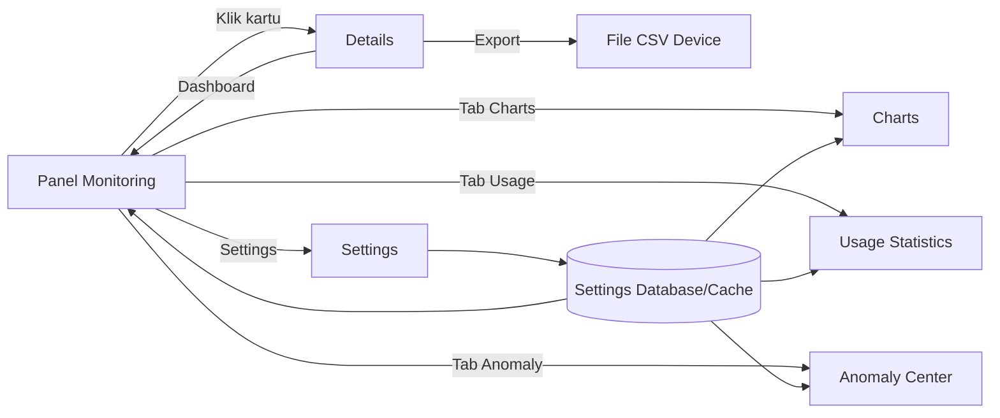
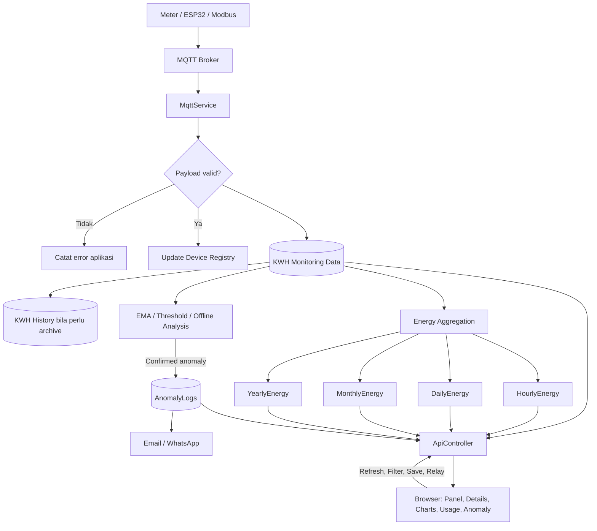
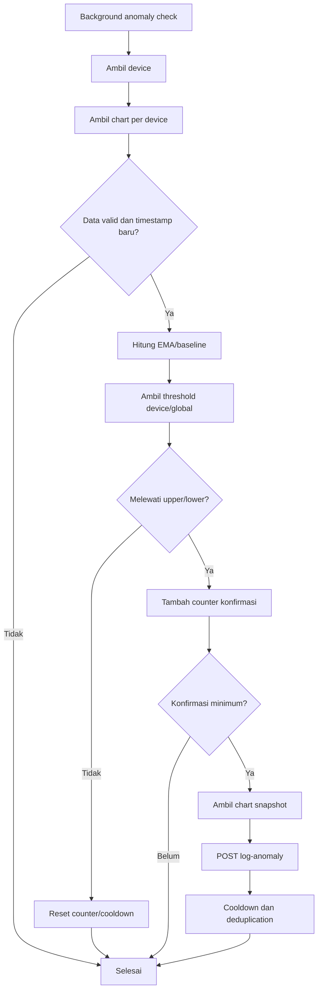
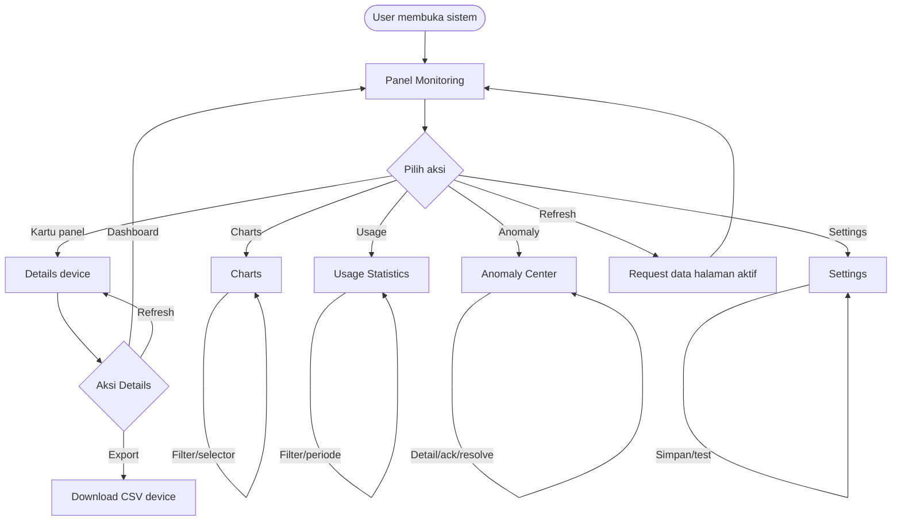
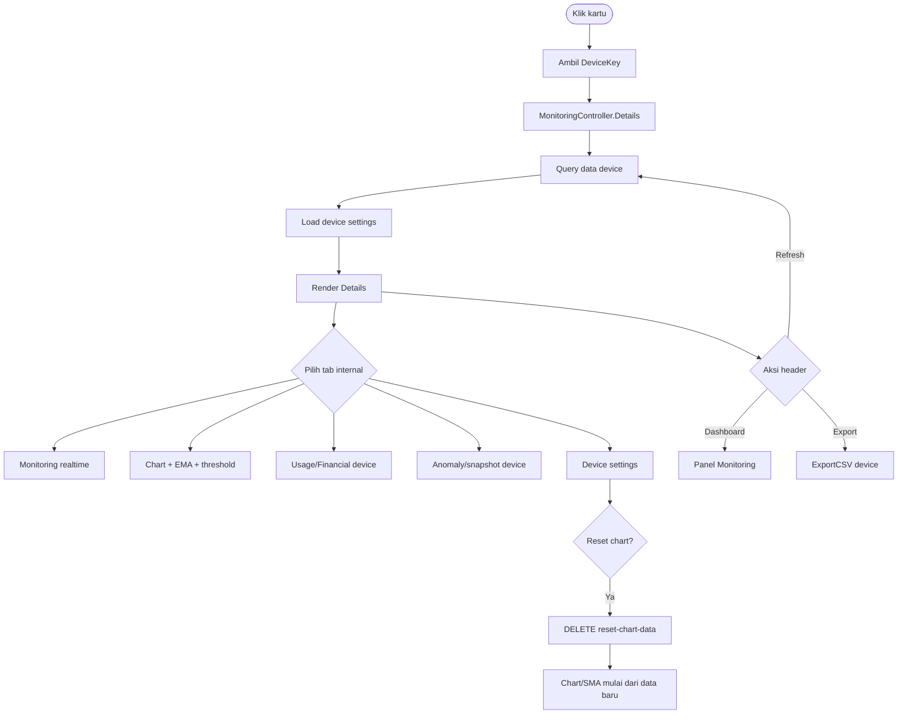
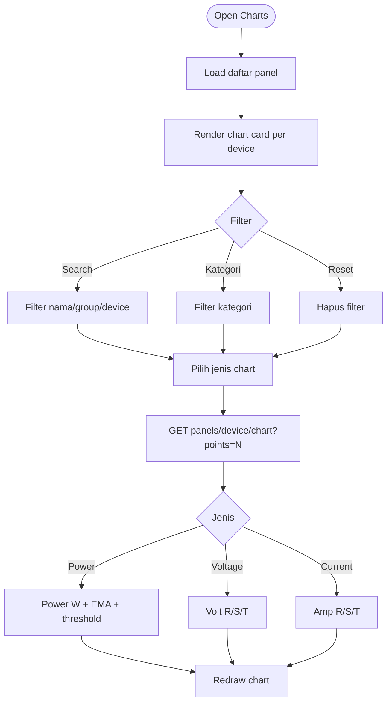
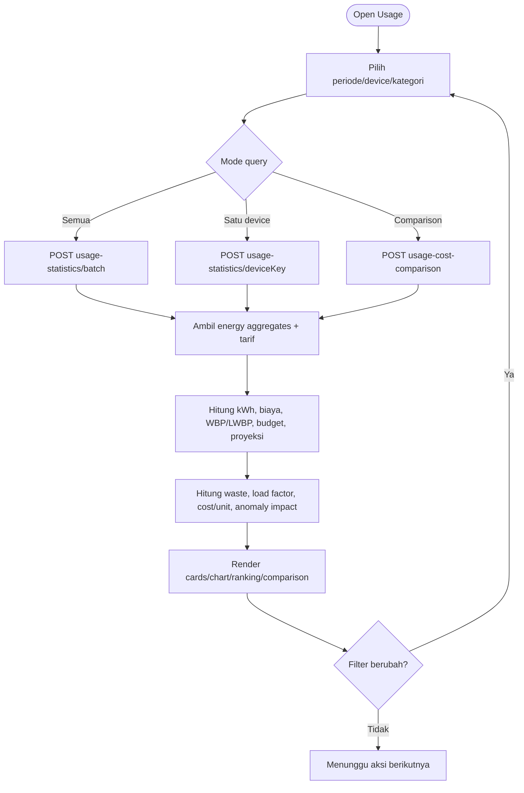
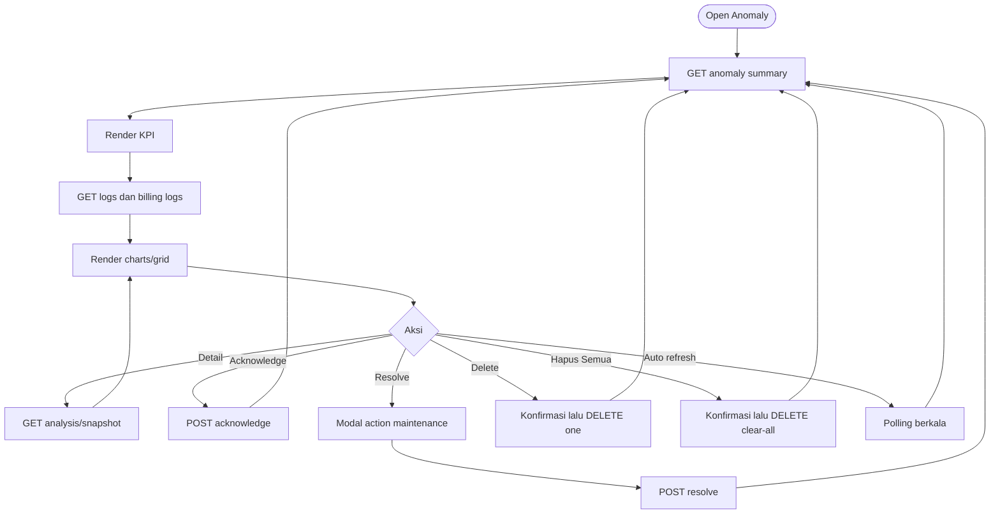
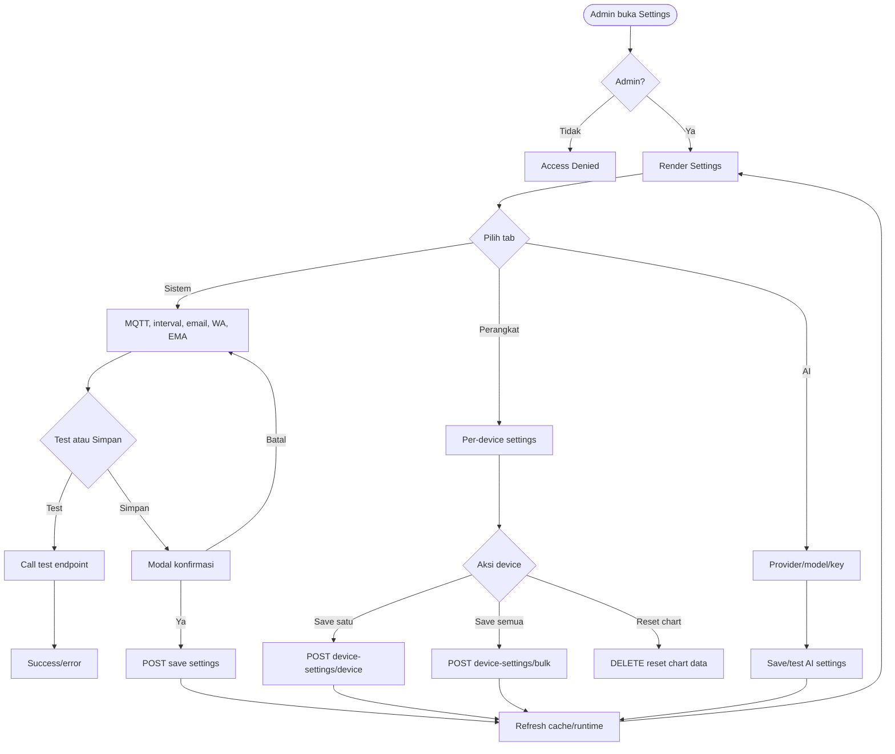
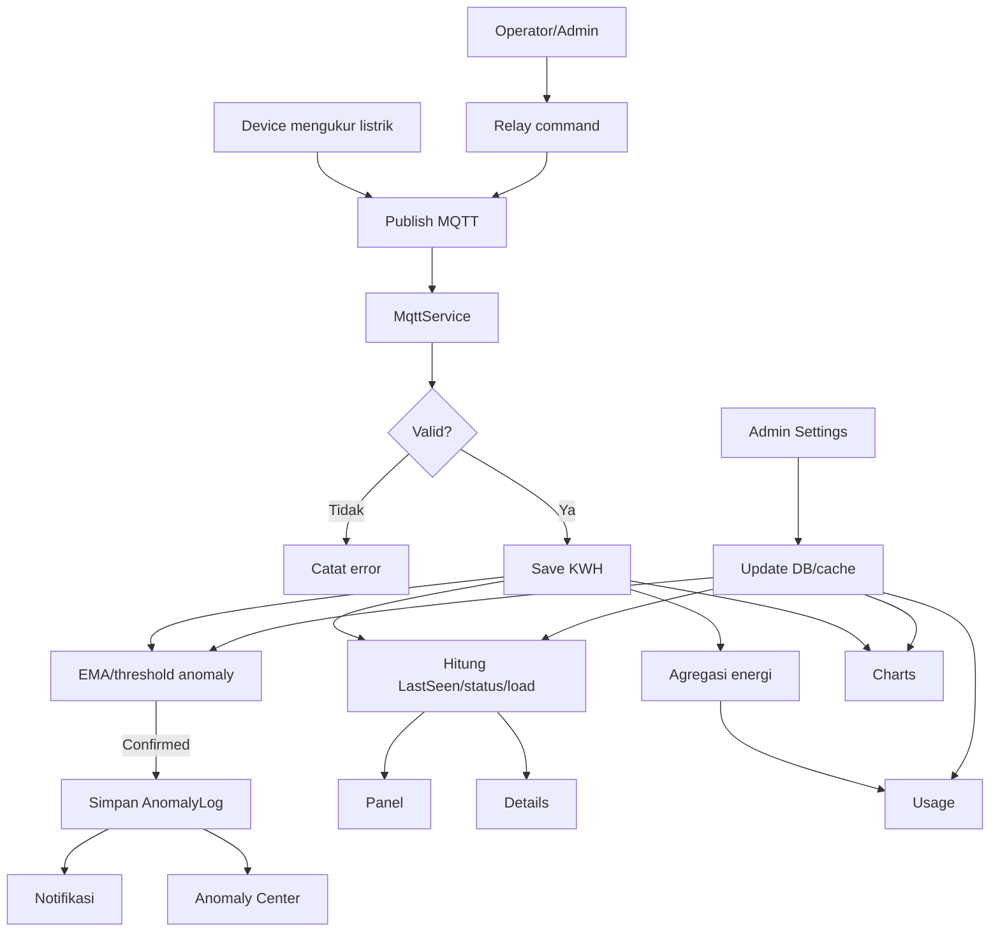

# Dokumentasi Sistem Utama KWH Monitoring

> **Cakupan:** Panel Monitoring, Details, Charts, Usage Statistics, Anomaly Center, dan Settings.  
> **Versi source:** KWH Monitoring .NET 2.1 — V7.  
> **Tanggal dokumentasi:** 23 Oktober 2026.

Dokumen ini hanya membahas enam modul utama aplikasi. Login, registrasi, approval user, user management, dan modul lain di luar area utama tidak menjadi fokus.

## Daftar Isi

1. [Ruang Lingkup dan Navigasi](#1-ruang-lingkup-dan-navigasi)
2. [Alur Data End-to-End](#2-alur-data-end-to-end)
3. [Panel Monitoring](#3-panel-monitoring)
4. [Details](#4-details)
5. [Charts](#5-charts)
6. [Usage Statistics](#6-usage-statistics)
7. [Anomaly Center](#7-anomaly-center)
8. [Settings](#8-settings)
9. [Matriks Tombol](#9-matriks-tombol)
10. [Flowchart Lengkap](#10-flowchart-lengkap)
11. [Prosedur Operasional](#11-prosedur-operasional)
12. [Catatan Implementasi](#12-catatan-implementasi)

---

## 1. Ruang Lingkup dan Navigasi

| Modul | Tujuan | Route |
|---|---|---|
| **Panel Monitoring** | Melihat kondisi terbaru seluruh panel, filter, dan kontrol perangkat. | `/Monitoring/Index` |
| **Details** | Melihat satu device secara mendalam, termasuk realtime, chart, usage, biaya, dan downtime. | `/Monitoring/Details?deviceKey={deviceKey}` |
| **Charts** | Membandingkan grafik power, voltage, dan current banyak panel. | `/Monitoring/Charts` |
| **Usage Statistics** | Menganalisis energi, biaya, budget, WBP/LWBP, ranking, comparison, dan proyeksi. | `/Monitoring/UsageStatistics` |
| **Anomaly Center** | Memantau, menganalisis, acknowledge, resolve, dan mengelola anomaly. | `/Monitoring/AnomalyLogs` |
| **Settings** | Mengatur MQTT, interval, threshold, notifikasi, dan device settings. | `/Monitoring/Settings` |

### 1.1 Navigasi header

Header berasal dari `_DashboardHeader.cshtml`.

| Elemen/tombol | Hasil ketika ditekan |
|---|---|
| **Dashboard/Home** | Mengarah ke `/Monitoring/Index`. |
| **Panel** | Mengarah ke `Monitoring/Index`. |
| **Charts** | Mengarah ke `Monitoring/Charts`. |
| **Usage** | Mengarah ke `Monitoring/UsageStatistics`. |
| **Anomaly** | Mengarah ke `Monitoring/AnomalyLogs`; badge menampilkan jumlah anomaly yang dimuat. |
| **Refresh** | Tetap di halaman aktif dan meminta data terbaru melalui API. |
| **Rescan** | Tetap di halaman aktif; mengambil ulang daftar panel. Memerlukan Operator/Admin. |
| **Export** | Mengunduh CSV; pada Details hanya untuk device yang sedang dibuka. |
| **Settings** | Mengarah ke `Monitoring/Settings`; memerlukan Admin. |

### 1.2 Hubungan modul



---

## 2. Alur Data End-to-End



### 2.1 Alur refresh realtime

1. Browser memanggil `GET /api/Api/data-version` secara berkala.
2. Endpoint mengembalikan token perubahan, bukan seluruh payload data.
3. Jika token berubah, halaman aktif mengambil data terbaru yang diperlukan.
4. Panel/Charts mengambil panel dan chart.
5. Usage mengambil agregat energi/biaya.
6. Anomaly mengambil summary/log.

---

## 3. Panel Monitoring

### 3.1 Fungsi

Panel Monitoring adalah halaman utama untuk melihat seluruh panel, status konektivitas, beban, pengukuran listrik terakhir, filter, navigasi Details, dan kontrol relay.

### 3.2 Data pada kartu panel

Kartu menggunakan `PanelViewModel` dan partial `_PanelCard.cshtml`.

| Data | Field | Fungsi |
|---|---|---|
| Device Key | `DeviceKey` | ID unik untuk query, chart, settings, dan URL Details. |
| Device ID | `DeviceId` | ID perangkat dari sumber data. |
| Nama grup | `GroupName` | Judul kartu panel. |
| Kategori | `DeviceCategory` | Kategori Billboard/Videotron/LED/Lainnya. |
| Mode kontrol | `ControlMode` | Menentukan tombol relay. |
| Kapasitas efektif | `MaxCapacity` | Dasar perhitungan persentase beban. |
| Kapasitas terpasang | `InstalledCapacityVA` | Kapasitas dari ERP sebelum konversi Watt. |
| Threshold beban | `LoadNormalThreshold`, `LoadMediumThreshold` | Batas NORMAL, MEDIUM, HIGH. |
| Waktu server | `Waktu_Server` | Waktu data terakhir diterima/disimpan. |
| Tegangan | `Volt_R`, `Volt_S`, `Volt_T` | Tegangan fase R/S/T. S/T dipakai pada 3-phase. |
| Arus | `Amp_R`, `Amp_S`, `Amp_T` | Arus fase R/S/T. |
| Faktor daya | `Cos_Phi` | Indikator efisiensi daya. |
| Daya aktif | `Daya_Watt` | Daya saat ini dalam Watt. |
| Energi | `TotalW1M_Wh`, `Energi_Aktif_Wh`, `Total_Energy_Wh` | Energi interval/aktif/kumulatif. |
| Frekuensi | `Frekuensi_Hz` | Frekuensi listrik. |
| Lokasi ERP | `KodeLokasi`, `Alamat`, `KotaProvinsi` | Informasi lokasi panel. |
| Pelanggan/catatan | `IDPelanggan`, `Catatan` | Identitas pelanggan dan catatan lokasi. |

### 3.3 Status beban

```text
LoadPercent = min((Daya_Watt / MaxCapacity) × 100, 100)
```

| Kondisi | Status | Arti |
|---|---|---|
| Kapasitas `<= 0` | NORMAL/default | Kapasitas belum tersedia; persentase tidak dapat dihitung penuh. |
| Load `<= LoadNormalThreshold` | NORMAL | Beban normal. |
| Load di atas normal dan `<= LoadMediumThreshold` | MEDIUM | Beban perlu dipantau. |
| Load di atas `LoadMediumThreshold` | HIGH | Beban tinggi dan perlu investigasi. |
| Tidak ada data baru sesuai batas waktu | OFFLINE | Status konektivitas, bukan status beban. |

Kapasitas efektif ERP dihitung sebagai:

```text
MaxCapacityWatt = InstalledCapacityVA × Cos_Phi
```

### 3.4 Filter Panel

Klik **Filter** untuk membuka `#panelFilterCollapse`.

| Kontrol | ID | Fungsi |
|---|---|---|
| Cari panel | `panelSearch` | Mencari GroupName, DeviceKey, atau DeviceId. |
| Status | `panelStatusFilter` | All, NORMAL, MEDIUM, HIGH, OFFLINE. |
| Fase | `panelPhaseFilter` | All, 1-phase, 3-phase. |
| Kategori | `panelCategoryFilter` | Semua atau kategori tertentu. |
| Clear | `btnClearFilter` | Mengosongkan search dan mengembalikan dropdown ke All. |

Counter **Menampilkan X/Y panel** menunjukkan hasil filter terhadap total panel.

### 3.5 Tombol/klik Panel

| Aksi | Tujuan |
|---|---|
| **Filter** | Membuka/menutup filter; tetap di Panel. |
| **Clear Filter** | Mereset filter; tetap di Panel. |
| **Klik kartu** | Mengarah ke `/Monitoring/Details?deviceKey={DeviceKey}`. |
| **Expand/Collapse** | Membuka/menutup isi kartu; tidak berpindah halaman. |
| **Detail/View** | Membuka Details device. |
| **ON/OFF/Toggle/Pulse** | Modal konfirmasi → OTP bila diperlukan → API relay → MQTT. |
| **Refresh** | Mengambil data Panel terbaru; tetap di Panel. |
| **Rescan** | POST rescan panels; daftar diperbarui; Operator/Admin. |
| **Export** | Mengunduh CSV monitoring. |

### 3.6 Kontrol relay

| `ControlMode` | Kontrol |
|---|---|
| `OnOff` | ON dan OFF. |
| `Toggle` | Toggle perangkat. |
| `Pulse` | Pulse sesuai konfigurasi perangkat. |
| `Toggle2Relay` | R1 dan R2. |
| `ToggleAll` | ON ALL/semua relay. |

Alur: tombol ditekan → modal konfirmasi → OTP bila diperlukan → `POST /api/Api/publish-relay` → validasi role Operator/Admin dan rate limit → publish MQTT → update status/audit/notifikasi.

---

## 4. Details

### 4.1 Fungsi

Details menampilkan satu perangkat berdasarkan `deviceKey`. Halaman ini digunakan untuk pemeriksaan rinci tanpa bercampur dengan panel lain.

### 4.2 Data header

- Group Name.
- Device Key.
- Device ID.
- Jenis fase: `1Φ Single Phase` atau `3Φ Three Phase`.
- Ikon kategori.
- Indikator Online/Offline.
- Status pemeriksaan terakhir.

### 4.3 Tombol header Details

| Tombol | Hasil |
|---|---|
| **Refresh** | Memuat ulang data device dan komponen Details; tetap di Details. |
| **EMA/Settings** | Membuka konteks pengaturan/chart EMA sesuai implementasi halaman. |
| **Dashboard** | Mengarah ke `/Monitoring/Index`. |
| **Export** | Mengarah ke `Monitoring/ExportCSV?deviceKey={DeviceKey}` lalu mengunduh CSV device. |

### 4.4 Informasi downtime

Details menampilkan kategori, label waktu henti, status downtime, waktu downtime, dan indikator online. Downtime membedakan device yang memang dijadwalkan berhenti dari device yang berhenti tanpa jadwal.

### 4.5 Tab internal Details

| Tab | Data/fungsi |
|---|---|
| **Monitoring** | Voltage, current, power, energy, power factor, frequency, status, kapasitas, dan waktu data. |
| **Chart/Grafik** | Grafik power, voltage, current, EMA, dan threshold device. |
| **Usage/Financial** | kWh, biaya, WBP/LWBP, proyeksi, waste, load factor, dan cost per unit. |
| **Anomaly/Log** | Anomaly device dan snapshot bila tersedia. |
| **Device Settings** | Parameter device yang dapat diubah Admin. |

### 4.6 Data finansial Details

Komponen finansial dapat menampilkan konsumsi kWh, estimasi biaya, WBP/LWBP, rasio WBP, pemborosan, perubahan bulanan, perubahan tahunan, proyeksi tagihan, faktor beban, biaya per unit/luas/jam, dampak anomaly, dan top anomaly.

### 4.7 Reset Chart Data

Tombol **Atur Ulang Grafik/Reset Chart**:

1. Menampilkan konfirmasi.
2. Jika disetujui, memanggil `DELETE /api/Api/reset-chart-data/{deviceKey}`.
3. Menghapus data chart device.
4. Perhitungan SMA dimulai kembali dari data baru.
5. Aksi tidak dapat dibatalkan.

---

## 5. Charts

### 5.1 Fungsi

Charts menampilkan chart banyak panel agar perubahan power, voltage, dan current dapat dibandingkan tanpa membuka Details satu per satu.

### 5.2 Filter

| Kontrol | ID | Fungsi |
|---|---|---|
| Filter | `chartFilterCollapse` | Membuka/menutup filter chart. |
| Cari panel | `chartSearch` | Mencari nama/group/device. |
| Kategori | `chartCategoryFilter` | Memfilter kategori. |
| Reset | `btnClearChartFilter` | Menghapus filter. |
| Chip panel | `chartChipList` | Menampilkan pilihan panel hasil filter. |

### 5.3 Jenis data chart

| Selector | Data | Satuan |
|---|---|---|
| **Power** | Daya aktif. | W. |
| **Voltage** | Tegangan R/S/T. | V. |
| **Current** | Arus R/S/T. | A. |

Untuk 1-phase hanya fase yang tersedia. Untuk 3-phase dapat muncul seri R, S, dan T.

Power dapat menampilkan seri Power, EMA, upper threshold, dan lower threshold. Tooltip menunjukkan waktu dan nilai titik.

### 5.4 Tombol Charts

| Aksi | Hasil |
|---|---|
| **Filter** | Membuka filter; tetap di Charts. |
| **Reset filter** | Menampilkan kembali seluruh chart. |
| **Power/Voltage/Current** | Mengganti dataset chart pada kartu yang sama. |
| **Refresh** | Mengambil ulang chart; tetap di Charts. |
| **Klik titik/tooltip** | Menampilkan detail nilai; tidak bernavigasi. |
| **Tab Panel/Usage/Anomaly** | Berpindah ke modul terkait. |

Endpoint data chart: `GET /api/Api/panels/{deviceKey}/chart?points=N`.

---

## 6. Usage Statistics

### 6.1 Fungsi

Usage Statistics mengubah data pengukuran dan data agregasi menjadi informasi konsumsi, biaya, budget, perbandingan, proyeksi, efisiensi, dan dampak anomaly.

### 6.2 Sumber data

- `HourlyEnergy`.
- `DailyEnergy`.
- `MonthlyEnergy`.
- `YearlyEnergy`.
- Data kWh realtime.
- Tarif per device.
- Tarif WBP/LWBP.
- Budget kWh/Rupiah.
- Data billing ERP bila tersedia.
- Anomaly log dan dampak biaya.

### 6.3 Filter dan pilihan periode

- Hourly, daily, monthly, yearly.
- Tanggal mulai dan selesai.
- Semua panel atau satu device.
- Kategori perangkat.
- Search tabel.
- Preset ranking/comparison.
- Current, previous, two months ago, three months ago.

### 6.4 Data yang ditampilkan

| Komponen | Fungsi |
|---|---|
| **Total energy/kWh** | Mengetahui konsumsi pada periode aktif. |
| **Estimated cost** | Mengubah energi menjadi estimasi Rupiah. |
| **WBP/LWBP** | Melihat porsi konsumsi dan biaya puncak/non-puncak. |
| **Peak period** | Menemukan jam/hari/bulan konsumsi tertinggi. |
| **Budget vs actual** | Menilai penggunaan terhadap anggaran. |
| **Projection** | Memperkirakan energi/biaya akhir periode. |
| **Ranking** | Mengurutkan device berdasarkan kWh atau biaya. |
| **Comparison** | Membandingkan current dengan periode sebelumnya. |
| **Load factor** | Menilai pemanfaatan kapasitas. |
| **Waste energy** | Menilai pemborosan energi/biaya. |
| **Cost per unit** | Membandingkan biaya per luas, jam, atau unit. |
| **Anomaly impact** | Menilai dampak biaya anomaly. |

### 6.5 Rumus penting

```text
EstimatedCost = EnergyKWh × TariffPerKWh
WBP_Cost = WBP_KWh × TariffWBP
LWBP_Cost = LWBP_KWh × TariffLWBP
TotalCost = WBP_Cost + LWBP_Cost
WBP_Ratio = WBP_KWh / (WBP_KWh + LWBP_KWh) × 100
BudgetUsage = Actual / Budget × 100
LoadFactor = ActualEnergy / (Capacity × Hours) × 100
```

Load factor dibatasi maksimal 100% pada tampilan.

### 6.6 Interpretasi warna

- Sampai 80% budget: relatif aman.
- 80–100%: perlu dipantau.
- Di atas 100%: budget terlampaui.
- Waste di atas 5%: indikasi pemborosan.
- Load factor <30%: pemanfaatan rendah.
- 30–80%: optimal.
- >80%: risiko tinggi.

### 6.7 Tombol dan endpoint Usage

| Aksi | Hasil |
|---|---|
| Filter device/search/category | Memuat ulang dashboard Usage sesuai filter. |
| Preset periode | Mengubah periode ranking/comparison. |
| Current/Previous/T-2/T-3 | Mengubah periode tabel perbandingan. |
| Refresh/Load | Meminta statistik baru dan menggambar ulang komponen. |
| Ranking sort | Mengubah urutan ranking. |
| Export/report | Menghasilkan file/laporan jika tombol tersedia. |
| Tab Panel/Charts/Anomaly | Berpindah ke modul terkait. |

Endpoint utama:

- `POST /api/Api/usage-statistics` — semua panel/periode.
- `POST /api/Api/usage-statistics/{deviceKey}` — satu device.
- `POST /api/Api/usage-statistics/batch` — batch device.
- `POST /api/Api/usage-cost-comparison` — perbandingan biaya.
- `GET /api/Api/realtime-kwh` — kWh realtime.
- `GET /api/Api/energy-tables` — data tabel energi.
- `GET /api/Api/report-pdf` — laporan PDF dengan parameter valid.

---

## 7. Anomaly Center

### 7.1 Fungsi

Anomaly Center menampilkan jumlah anomaly, severity, status penyelesaian, detail kejadian, root cause, rekomendasi, snapshot, dan anomaly billing.

### 7.2 Kontrol dan KPI

| Komponen | Fungsi |
|---|---|
| Badge Peran | Menampilkan role user aktif. |
| Pembaruan Otomatis | Mengaktifkan pengambilan data anomaly berkala. |
| Filter | Membatasi device, waktu, severity, tipe, dan status. |
| Refresh | Memuat ulang summary, chart, dan grid. |
| Total Anomali | Jumlah seluruh log pada filter aktif. |
| Hari Ini | Jumlah anomaly tanggal berjalan. |
| Belum Diselesaikan | `IsResolved = false`. |
| Kritis | Severity paling tinggi. |
| Tinggi | Severity tinggi. |

### 7.3 Field record anomaly

| Field | Fungsi |
|---|---|
| `Id` | ID anomaly. |
| `DeviceKey`, `DeviceId` | Device terdampak. |
| `AnomalyType` | Jenis anomaly seperti overload/drop/device drop. |
| `PowerValue` | Daya saat kejadian. |
| `ThresholdValue` | Threshold yang dilanggar. |
| `Deviation` | Besar penyimpangan. |
| `DetectedTime` | Waktu deteksi. |
| `EMAValue`, `ThresholdMode` | Nilai dan mode analisis. |
| `Acknowledged`, `AcknowledgedTime`, `AcknowledgedBy` | Status dan pelaku acknowledge. |
| `IsResolved`, `ResolvedTime`, `ResolvedBy` | Status dan pelaku penyelesaian. |
| `OperatorAction`, `OperatorNotes` | Tindakan dan catatan. |
| `Severity` | Critical/High/Medium/Low. |
| `RootCause` | Perkiraan penyebab. |
| `RecommendedAction` | Rekomendasi tindakan. |
| `ChartSnapshot` | Snapshot grafik sekitar anomaly. |
| Billing fields | Estimated/actual billing, selisih, persentase, periode, dan ID ERP. |

### 7.4 Tombol anomaly

| Tombol | Role | Tujuan |
|---|---|---|
| **View/Detail** | Viewer/Operator/Admin | Membuka detail, analisis, root cause, rekomendasi, snapshot. |
| **Acknowledge** | Operator/Admin | Menyimpan bahwa anomaly telah diketahui/ditangani. |
| **Resolve** | Operator/Admin | Membuka modal tindakan maintenance dan menutup anomaly setelah validasi. |
| **Delete** | Admin | Menghapus satu log setelah konfirmasi. |
| **Hapus Semua** | Admin sesuai proteksi halaman | Menghapus seluruh log secara permanen. |
| **Billing action** | Admin/Master Admin sesuai implementasi | Konfirmasi/rescan/notifikasi anomaly billing. |

### 7.5 Resolve

Modal Resolve meminta jenis tindakan seperti periksa koneksi, restart device, ganti fuse/MCB, periksa relay, supply voltage, circuit breaker, grounding, sensor, ventilasi, UPS, firmware, atau komponen rusak. Catatan opsional dapat ditambahkan.

Alur: klik Resolve → pilih tindakan wajib → isi notes bila perlu → **Confirm Resolve** → API menyimpan user, waktu, action, notes, dan status resolved → refresh KPI/grid.

### 7.6 Proses deteksi anomaly



Endpoint anomaly utama meliputi summary, log per device, analysis, log-anomaly, acknowledge, resolve, delete satu, clear-all, serta endpoint billing anomaly.

---

## 8. Settings

### 8.1 Fungsi

Settings mengendalikan parameter yang memengaruhi Panel, Details, Charts, Usage, dan Anomaly. Perubahan disimpan ke database dan dapat diperbarui ke cache runtime.

### 8.2 Tab Settings

| Tab | Target | Isi |
|---|---|---|
| **Sistem** | `#system` | MQTT, interval, email, WhatsApp, schedule, EMA, threshold global. |
| **Perangkat** | `#categories` | Kategori, tarif, kapasitas, budget, threshold, billing, downtime, kontrol per device. |
| **Asisten AI** | `#chatbot` | Provider/model/API key; bagian konfigurasi Settings. |
| **Manajemen Pengguna** | `#users` | Hanya Master Admin; bukan fokus dokumen ini. |

### 8.3 Sistem: MQTT

Field dapat meliputi host broker, port, username, password, topic, client ID, dan parameter reconnect.

| Tombol | ID | Hasil |
|---|---|---|
| **Test** | `btnTestConnection` | Menguji koneksi tanpa menyimpan. |
| **Simpan** | `btnSaveMqttSettings` | Menyimpan konfigurasi MQTT. |

### 8.4 Sistem: interval

Field aktual yang terlihat:

- `chartsInterval` — interval refresh Charts.
- `detailsInterval` — interval refresh Details.
- `anomalyInterval` — interval anomaly.
- `chartDataPoints` — jumlah titik chart.

| Tombol | ID | Hasil |
|---|---|---|
| **Sync Intervals** | `btnSyncIntervals` | Menyamakan interval antar modul. |
| **Simpan** | `btnSaveIntervalSettings` | Menyimpan interval dan jumlah titik chart. |

### 8.5 Sistem: email/WhatsApp

Email dapat mengatur SMTP, sender, recipient, dan tipe notifikasi. WhatsApp/Wablas dapat mengatur token, secret, nomor, dan status gateway.

| Tombol | Hasil |
|---|---|
| **Simpan Email** | Menyimpan email settings. |
| **Test Email** | Mengirim email uji. |
| **Simpan WhatsApp** | Menyimpan Wablas settings. |
| **Test Wablas** | Menguji koneksi/pengiriman Wablas. |
| **Check Wablas Device** | Memeriksa status gateway/device. |

### 8.6 Sistem: jadwal dan EMA

Jadwal meliputi instant alert, hourly report, daily report, dan monthly report. Parameter EMA dapat meliputi refresh interval, jumlah konfirmasi maksimum, upper/lower threshold, dan opsi garis EMA.

| Tombol | Hasil |
|---|---|
| **Simpan Jadwal** | Menyimpan jadwal notifikasi. |
| **Test Instant/Hourly/Daily/Monthly** | Menguji jenis notifikasi terkait. |
| **Simpan EMA** | Menyimpan konfigurasi EMA/anomaly global. |
| **Reset System Settings** | Mengembalikan form ke nilai awal/default sesuai implementasi. |
| **Simpan System Settings** | Menyimpan perubahan sistem setelah modal konfirmasi. |

### 8.7 Perangkat

Partial `_DeviceSettingsTab.cshtml` mengatur setiap device melalui kelompok:

**Perangkat dan tarif:** kategori, tarif Rp/kWh, tarif WBP, tarif LWBP.  
**Billing dan anggaran:** anggaran bulanan, sumber manual/trend, luas m², pendapatan per jam, cutoff PLN, tanggal cutoff.  
**Threshold billing:** nominal/persentase selisih tagihan, mode toleransi trend, toleransi nominal/persentase.  
**Threshold beban/EMA:** Normal, Medium, Upper Line, Lower Line.  
**Waktu dan kendali:** mulai/selesai downtime, mode ON/OFF, Toggle, Pulse, 2 Relay, All, downtime enable, invers relay.

| Tombol | Endpoint/hasil |
|---|---|
| **Simpan per device** | `POST /api/Api/device-settings/{deviceKey}`. |
| **Simpan Semua** | `POST /api/Api/device-settings/bulk`. |
| **Atur Ulang Grafik** | Konfirmasi → `DELETE /api/Api/reset-chart-data/{deviceKey}`. |

### 8.8 Konfirmasi simpan

Simpan penting menggunakan `#settingsConfirmModal`: tekan Simpan → modal → **Ya, Simpan** (`settingsConfirmOk`) atau Batal → request API → status sukses/error → cache/runtime diperbarui.

### 8.9 Endpoint Settings

- `GET /Monitoring/Settings` — membuka halaman.
- `POST /Monitoring/UpdateSettings` — menyimpan melalui MVC.
- `POST /api/Api/save-system-settings` — sistem.
- `POST /api/Api/save-notification-settings` — notifikasi.
- `GET/POST /api/Api/device-settings` — device settings.
- `GET/POST /api/Api/device-settings/{deviceKey}` — satu device.
- `POST /api/Api/device-settings/bulk` — bulk device.
- `DELETE /api/Api/reset-chart-data/{deviceKey}` — reset chart.

---

## 9. Matriks Tombol

| Modul | Tombol/aksi | Tujuan |
|---|---|---|
| Panel | Filter/Clear | Filter lokal dan reset filter. |
| Panel | Kartu/Detail | `/Monitoring/Details?deviceKey=...`. |
| Panel | Expand | Buka/tutup kartu. |
| Panel | Relay | Modal → OTP → publish relay MQTT. |
| Panel | Refresh/Rescan/Export | Refresh data, rescan panel, download CSV. |
| Details | Refresh | Muat ulang device. |
| Details | Dashboard | `/Monitoring/Index`. |
| Details | Export | CSV device. |
| Details | Tab internal | Ubah informasi tanpa meninggalkan Details. |
| Details | Reset Chart | Hapus chart device dan hitung ulang dari data baru. |
| Charts | Filter/Reset | Filter dan reset chart. |
| Charts | Power/Voltage/Current | Ubah dataset chart. |
| Charts | Refresh | Muat ulang chart. |
| Usage | Filter/Periode | Muat statistik sesuai parameter. |
| Usage | Ranking/Comparison | Ubah pengurutan dan periode pembanding. |
| Usage | Report/Export | Buat file laporan bila tersedia. |
| Anomaly | Auto Refresh | Aktif/nonaktif polling. |
| Anomaly | Detail | Detail/analysis/snapshot. |
| Anomaly | Acknowledge | Simpan status diketahui. |
| Anomaly | Resolve | Modal action → simpan resolved. |
| Anomaly | Delete/Clear All | Hapus log setelah konfirmasi. |
| Settings | Test | Uji koneksi tanpa simpan. |
| Settings | Simpan | Simpan section ke API/database. |
| Settings | Test Notification | Kirim notifikasi uji. |
| Settings | Reset | Kembalikan form. |
| Settings | Save Device/All | Simpan satu/banyak device. |

---

## 10. Flowchart Lengkap

### 10.1 Navigasi



### 10.2 Panel Monitoring

```mermaid
flowchart TD
    OPEN([Open Panel]) --> LOAD[MonitoringController.Index]
    LOAD --> QUERY[Query latest KWH per DeviceKey]
    QUERY --> CONFIG[Load system/device settings]
    CONFIG --> ERP[Load lokasi dan kapasitas ERP]
    ERP --> VM[Build PanelViewModel]
    VM --> CARDS[Render kartu panel]
    CARDS --> FILTER{Filter?}
    FILTER -->|Ya| SEARCH[Search Group/Key/ID]
    SEARCH --> STATUS[Status filter]
    STATUS --> PHASE[Phase filter]
    PHASE --> CATEGORY[Category filter]
    CATEGORY --> COUNT[Update X/Y]
    COUNT --> CARDS
    FILTER -->|Tidak| ACTION{Aksi kartu}
    ACTION -->|Klik kartu| DETAILS[/Monitoring/Details?deviceKey=...]
    ACTION -->|Expand| COLLAPSE[Buka/tutup kartu]
    ACTION -->|Relay| MODAL[Konfirmasi]
    MODAL -->|Batal| CARDS
    MODAL -->|Lanjut| OTP{Perlu OTP?}
    OTP -->|Ya| VERIFY[Validasi OTP]
    VERIFY -->|Gagal| CARDS
    VERIFY -->|Berhasil| RELAY[POST publish-relay]
    OTP -->|Tidak| RELAY
    RELAY --> AUTH{Operator/Admin?}
    AUTH -->|Tidak| DENY[403/ditolak]
    AUTH -->|Ya| RATE{Rate limit aman?}
    RATE -->|Tidak| LIMIT[Ditolak rate limit]
    RATE -->|Ya| MQTT[Publish command MQTT]
    MQTT --> UPDATE[Update status/audit/notifikasi]
    UPDATE --> CARDS
```

### 10.3 Details



### 10.4 Charts



### 10.5 Usage Statistics



### 10.6 Anomaly Center



### 10.7 Settings



### 10.8 End-to-end operasional



---

## 11. Prosedur Operasional

### 11.1 Pemeriksaan harian

1. Panel → Refresh.
2. Periksa Online/Offline.
3. Filter HIGH dan MEDIUM.
4. Buka Details panel bermasalah.
5. Lihat Charts untuk pola.
6. Periksa Anomaly Center.
7. Acknowledge anomaly yang ditangani.
8. Lakukan tindakan sesuai SOP.
9. Verifikasi normal lalu Resolve.
10. Periksa Usage untuk dampak energi/biaya.

### 11.2 Investigasi beban HIGH

Panel filter HIGH → catat DeviceKey/power/load/capacity → Details periksa voltage/current/Cos Phi/frequency → Charts lihat tren → Anomaly cari overload → Settings pastikan capacity/threshold → kontrol relay bila aman dan berwenang → Resolve → periksa Usage.

### 11.3 Investigasi offline

Filter OFFLINE → Details → catat LastSeen → periksa MQTT/topic/jaringan/daya → pulihkan device → Rescan → pastikan timestamp bergerak dan status Online.

---

## 12. Catatan Implementasi

1. Label/field dapat berubah jika source atau konfigurasi database berubah.
2. Statistik global di bagian atas `Index.cshtml` sebagian masih dikomentari; data utama tetap ditampilkan lewat kartu panel.
3. OFFLINE bergantung pada freshness/LastSeen dan interval aktif.
4. NORMAL saat kapasitas tidak tersedia berarti persentase beban tidak dapat dihitung penuh, bukan jaminan perangkat aman.
5. Data biaya bergantung pada tarif, WBP/LWBP, budget, dan periode yang benar.
6. Reset chart menghapus data chart device dan tidak dapat dibatalkan.
7. Delete anomaly berbeda dari Resolve: Delete menghapus jejak, Resolve menyimpan penyelesaian.
8. Relay dapat berdampak fisik; verifikasi DeviceKey dan SOP keselamatan sebelum melanjutkan.
9. Settings dapat memengaruhi runtime melalui database/cache; lakukan Refresh setelah menyimpan.
10. Flowchart menggunakan Mermaid dan dapat dirender pada editor Markdown yang mendukung Mermaid.

## Referensi Source

- `Views/Shared/_DashboardHeader.cshtml`
- `Views/Monitoring/Index.cshtml`
- `Views/Monitoring/_PanelCard.cshtml`
- `Views/Monitoring/Details.cshtml`
- `Views/Monitoring/Charts.cshtml`
- `Views/Monitoring/UsageStatistics.cshtml`
- `Views/Monitoring/AnomalyLogs.cshtml`
- `Views/Monitoring/Settings.cshtml`
- `Views/Monitoring/_DeviceSettingsTab.cshtml`
- `Controllers/MonitoringController.cs`
- `Controllers/ApiController.cs`
- `Models/PanelViewModel.cs`
- `Models/DeviceSettings.cs`
- `Models/AnomalyLog.cs`
