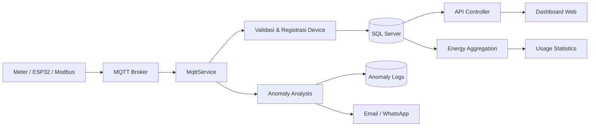

# User Guide Lengkap — KWH Monitoring System

> **Versi aplikasi:** KWH Monitoring .NET 2.1 — V7  
> **Tanggal dokumentasi:** 23 Oktober 2026  
> **Tujuan:** Panduan penggunaan end-to-end: menjalankan aplikasi, login, memahami navigasi, menggunakan setiap tab/tombol, menangani anomali, dan mengelola sistem.

## Daftar Isi

1. [Gambaran Umum](#1-gambaran-umum)
2. [Arsitektur dan Alur Data](#2-arsitektur-dan-alur-data)
3. [Prasyarat dan Konfigurasi](#3-prasyarat-dan-konfigurasi)
4. [Menjalankan Aplikasi](#4-menjalankan-aplikasi)
5. [Akun, Login, dan Hak Akses](#5-akun-login-dan-hak-akses)
6. [Peta Navigasi](#6-peta-navigasi)
7. [Komponen Global dan Tombol Umum](#7-komponen-global-dan-tombol-umum)
8. [Panel Monitoring](#8-panel-monitoring)
9. [Charts](#9-charts)
10. [Usage Statistics](#10-usage-statistics)
11. [Anomaly Center](#11-anomaly-center)
12. [Settings](#12-settings)
13. [Manajemen Pengguna dan Approval](#13-manajemen-pengguna-dan-approval)
14. [Asisten AI](#14-asisten-ai)
15. [Alur Operasional](#15-alur-operasional)
16. [Notifikasi, Audit, dan Keamanan](#16-notifikasi-audit-dan-keamanan)
17. [Troubleshooting](#17-troubleshooting)
18. [Checklist Operasional](#18-checklist-operasional)
19. [Referensi](#19-referensi)

---

## 1. Gambaran Umum

KWH Monitoring adalah aplikasi web untuk memonitor konsumsi listrik dari panel/perangkat yang mengirimkan data pengukuran melalui MQTT. Aplikasi menampilkan data terbaru perangkat, grafik realtime/historis, statistik energi dan biaya, log anomali, kontrol relay, konfigurasi perangkat, notifikasi, serta manajemen user.

### 1.1 Fungsi utama

- Menerima voltage, current, power, energy, power factor, status relay, dan informasi perangkat.
- Menampilkan kondisi setiap panel secara realtime.
- Mengelompokkan perangkat berdasarkan kategori dan fase.
- Menghitung energi per jam, hari, bulan, dan tahun.
- Menghitung estimasi biaya berdasarkan tarif per kWh dan WBP/LWBP bila tersedia.
- Mendeteksi beban berlebih, penurunan daya, perangkat offline, dan anomali billing.
- Mengirim notifikasi email/WhatsApp sesuai konfigurasi.
- Mengontrol relay untuk user Operator/Admin.
- Mengamankan fungsi sensitif dengan role, token, antiforgery, rate limit, audit log, dan modal konfirmasi.

### 1.2 Istilah

| Istilah | Arti |
|---|---|
| **Device/Panel** | Perangkat meter/panel yang mengirim data. |
| **Device Key** | Identitas unik perangkat di aplikasi. |
| **Group Name** | Nama kelompok/lokasi/perangkat pada kartu/grafik. |
| **kWh** | Energi listrik; data mentah dapat disimpan dalam Wh. |
| **Power** | Daya aktif, umumnya Watt. |
| **Voltage/Current** | Tegangan Volt dan arus Ampere. |
| **Power Factor/Cos Phi** | Faktor efisiensi pemakaian listrik. |
| **WBP/LWBP** | Waktu Beban Puncak/Luar Waktu Beban Puncak. |
| **Anomaly** | Data/kejadian yang menyimpang dari kondisi normal. |
| **Acknowledge** | Menandai anomali sudah diketahui/diambil alih. |
| **Resolve** | Menandai anomali sudah ditangani. |
| **Master Admin** | Admin utama yang dapat mengelola user dan penerima notifikasi. |

---

## 2. Arsitektur dan Alur Data



### 2.1 Urutan proses

1. Meter/perangkat mengirim payload ke topic MQTT.
2. `MqttService` menerima dan membaca JSON.
3. Payload divalidasi; payload tidak valid dicatat sebagai error.
4. Device baru dapat diregistrasikan ke registry.
5. Data terbaru disimpan; data lama dapat diarsipkan ke history.
6. Sistem memperbarui `LastSeen`, jumlah pesan, dan status konektivitas.
7. Service analisis memeriksa threshold, EMA, offline, dan anomali billing.
8. Anomali yang lolos validasi/deduplication disimpan dan dapat memicu notifikasi.
9. Background aggregation membentuk data hourly/daily/monthly/yearly.
10. Browser mengambil data melalui MVC/API dan memperbarui kartu, tabel, serta grafik.

### 2.2 Status panel

- **Online:** data terakhir masih dianggap baru berdasarkan interval sistem.
- **Offline:** tidak ada data baru dalam periode yang ditentukan.
- **NORMAL:** beban di bawah threshold normal.
- **MEDIUM:** melewati threshold normal tetapi belum threshold tinggi.
- **HIGH:** melewati threshold tinggi.

> HIGH dan OFFLINE adalah kondisi berbeda. Threshold dapat berbeda per perangkat.

---

## 3. Prasyarat dan Konfigurasi

### 3.1 Komponen

- Windows/Linux/macOS yang dapat menjalankan .NET Core 2.1.
- .NET Core SDK 2.1; project menggunakan `netcoreapp2.1`.
- SQL Server dan database aplikasi.
- MQTT broker yang dapat dijangkau aplikasi.
- SMTP bila email digunakan.
- Wablas bila WhatsApp digunakan.
- API key/model AI bila Asisten AI digunakan.

### 3.2 Lokasi project

```text
D:\File Project\Projects\KWHMonitoring -  .NET 2.1 - Final 5\KWHMonitoring -  .NET 2.1 - V7\KWHMonitoring
```

### 3.3 Environment variables

Jangan memasukkan secret produksi ke Git, dokumentasi, screenshot, atau `appsettings.json`.

| Variable | Kegunaan |
|---|---|
| `ConnectionStrings__DefaultConnection` | Koneksi SQL Server. |
| `Encryption__Key` | Kunci AES untuk data sensitif. |
| `Qwen__ApiKey` / `Qwen__Model` | Konfigurasi AI lama/kompatibel. |
| `Wablas__Token` / `Wablas__SecretKey` | Gateway WhatsApp. |
| `Admin__Email` / `Admin__Password` | Master Admin awal. |

Contoh PowerShell development:

```powershell
$env:ConnectionStrings__DefaultConnection = "Server=YOUR_SERVER,1433;Database=HaiwellElectrical;User Id=YOUR_USER;Password=YOUR_PASSWORD;TrustServerCertificate=True;"
$env:Encryption__Key = "YOUR_ENCRYPTION_KEY"
$env:Qwen__ApiKey = "YOUR_QWEN_API_KEY"
$env:Qwen__Model = "qwen-plus-2025-04-28"
$env:Wablas__Token = "YOUR_WABLAS_TOKEN"
$env:Wablas__SecretKey = "YOUR_WABLAS_SECRET_KEY"
$env:Admin__Email = "admin@example.com"
$env:Admin__Password = "YOUR_STRONG_PASSWORD"
```

---

## 4. Menjalankan Aplikasi

```powershell
Set-Location "D:\File Project\Projects\KWHMonitoring -  .NET 2.1 - Final 5\KWHMonitoring -  .NET 2.1 - V7\KWHMonitoring"
dotnet restore
dotnet build
dotnet run
```

Buka alamat HTTP/HTTPS yang ditampilkan Kestrel. Route default adalah `/Monitoring/Index`. Jika database tidak terjangkau, inisialisasi tertentu dapat dilewati; periksa log console.

### 4.1 Urutan startup

1. Konfigurasi dibaca.
2. Koneksi database diuji.
3. Migration/inisialisasi dijalankan bila database tersedia.
4. MQTT, cache, analisis, email, dan notifikasi didaftarkan.
5. HTTPS, static files, compression, authentication, security headers, dan MVC diaktifkan.
6. Dashboard siap dibuka.

---

## 5. Akun, Login, dan Hak Akses

| Role | Hak akses |
|---|---|
| **Pending/None** | Menunggu verifikasi dan approval; belum dapat memakai fitur terlindungi. |
| **Viewer** | Melihat Panel, Charts, Usage, Details, History, dan Anomaly. Tidak mengubah konfigurasi atau relay. |
| **Operator** | Hak Viewer, plus rescan panel, kontrol relay, dan penanganan operasional/anomali. |
| **Admin** | Hak Operator, plus Settings dan administrasi sistem. |
| **Master Admin** | Admin utama; kelola user, role/status, user non-master, dan penerima billing. |

### 5.1 Registrasi dan approval

1. Pada Login klik **Register/Daftar**.
2. Isi email, nama, dan password.
3. Klik daftar dan buka email verifikasi.
4. Klik link verifikasi.
5. Master Admin menerima/membuka approval request.
6. Master Admin memilih Viewer atau Operator lalu klik **Approve**.
7. Setelah aktif, user dapat login.

Untuk menolak, gunakan **Reject/Tolak** dari link approval. Token dapat kedaluwarsa atau hanya dapat digunakan sekali.

### 5.2 Login, reset, dan logout

1. Masukkan email dan password.
2. Centang **Remember Me** bila perlu.
3. Klik **Login/Masuk**.
4. **Forgot Password:** masukkan email, buka email reset, gunakan token sekitar 1 jam, lalu simpan password baru.
5. **Logout:** buka menu akun dan klik **Logout/Keluar**.

Tanpa Remember Me sesi sekitar 30 menit; dengan Remember Me cookie persisten sekitar 7 hari. Lima percobaan gagal dapat mengunci akun sekitar 15 menit.

---

## 6. Peta Navigasi

| Menu/tab | Route/action | Fungsi |
|---|---|---|
| **Panel** | `Monitoring/Index` | Kartu panel, status, nilai realtime, filter, kontrol perangkat. |
| **Charts** | `Monitoring/Charts` | Grafik power, voltage, dan current per panel. |
| **Usage** | `Monitoring/UsageStatistics` | Energi, biaya, tren, WBP/LWBP, budget, proyeksi. |
| **Anomaly** | `Monitoring/AnomalyLogs` | KPI, filter, tabel log, analisis, acknowledge, resolve. |
| **Settings** | `Monitoring/Settings` | Sistem, Perangkat, Asisten AI, dan Manajemen Pengguna. |
| **Details** | `Monitoring/Details` | Detail satu device dan statistiknya. |
| **History** | `Monitoring/History` | Data historis/arsip. |

Breadcrumb **Dashboard → halaman** menunjukkan posisi. Klik **Dashboard** untuk kembali ke Panel.

---

## 7. Komponen Global dan Tombol Umum

| Tombol | Fungsi | Hasil |
|---|---|---|
| **Refresh** | Meminta data terbaru dari API. | Kartu/grafik/tabel diperbarui. |
| **Rescan** | Membaca ulang daftar panel. | Daftar panel diperbarui; perlu Operator/Admin. |
| **Export** | Menyiapkan CSV monitoring. | Browser mengunduh CSV, umumnya maksimal 50.000 record terbaru. |
| **Settings** | Membuka konfigurasi. | Admin masuk Settings; role lain dapat Access Denied. |
| **Home/Dashboard** | Kembali ke Panel. | Membuka `Monitoring/Index`. |

Ikon notifikasi membuka feed aktivitas browser. **Refresh** mengambil aktivitas; **Clear/Reset** membersihkan feed lokal. Ini berbeda dari `AnomalyLogs` database. **Help** membuka modal bantuan. Tema/bahasa, bila tersedia, hanya mengubah UI/browser.

---

## 8. Panel Monitoring

### 8.1 Filter

Klik **Filter** untuk membuka filter.

| Kontrol | Fungsi |
|---|---|
| **Cari panel** | Mencari group name, device key, atau device ID. |
| **Status** | All, NORMAL, MEDIUM, HIGH, atau OFFLINE. |
| **Phase** | 1-phase atau 3-phase. |
| **Kategori** | Billboard/Videotron/kategori dari konfigurasi. |
| **Clear/Reset** | Mengembalikan semua filter ke awal. |

Counter **Menampilkan X/Y panel** menunjukkan hasil filter dibanding total panel.

### 8.2 Kartu panel dan Detail

Kartu menampilkan group/device, konektivitas, power, voltage, current, energy, power factor, persentase kapasitas, waktu terakhir, serta lokasi/kapasitas bila tersedia. Klik kartu atau **Detail/View** untuk halaman Details dan statistik satu device.

### 8.3 Kontrol relay

Kontrol hanya tampil untuk Operator/Admin dan dapat berupa **ON**, **OFF**, **Pulse**, atau **Toggle**.

1. Pastikan device benar dan online.
2. Klik aksi relay.
3. Baca modal konfirmasi device/aksi.
4. Klik **Confirm/Lanjutkan**.
5. Tunggu hasil dan verifikasi data realtime.

Endpoint dilindungi role; rate limit sekitar 10 perintah/60 detik/user. Aksi dicatat dan dapat mengirim notifikasi. Jangan klik berulang ketika request berjalan.

---

## 9. Charts

Klik **Filter**, lalu gunakan **Cari panel**, **Semua Kategori**, chip panel, atau **Reset filter (X)**. Pada setiap kartu pilih:

- **Power (W):** daya aktif.
- **Voltage (V):** tegangan per fase; 3-phase dapat menampilkan R/S/T.
- **Current (A):** arus per fase; 3-phase dapat menampilkan R/S/T.

Grafik power dapat menampilkan EMA dan threshold atas/bawah bila diaktifkan. Arahkan kursor ke titik untuk membaca timestamp/nilai. Lonjakan power perlu dibandingkan dengan beban normal; voltage tidak seimbang perlu pemeriksaan fase/instalasi.

---

## 10. Usage Statistics

Pilih periode hourly/daily/monthly/yearly, rentang tanggal/bulan/tahun, semua device atau satu device, kategori, dan search tabel.

Komponen utama: total energy/kWh, estimated cost, WBP/LWBP, budget vs realisasi, peak period, proyeksi, load factor, cost per unit, waste energy, anomaly impact, ranking, dan comparison.

- Sampai sekitar 80% budget: relatif aman.
- 80–100%: perlu dipantau.
- Di atas 100%: budget terlampaui.
- Waste di atas 5%: indikasi pemborosan.
- Load factor <30% rendah, 30–80% optimal, >80% risiko tinggi.

Prosedur laporan: pilih periode → pilih device → verifikasi tanggal/timezone/tarif/budget → **Refresh/Load** → baca ringkasan dan grafik → bandingkan periode → export/simpan.

> Jika tarif atau periode salah, hasil finansial juga salah walaupun kWh benar.

---

## 11. Anomaly Center

**Peran** menunjukkan role user. **Pembaruan Otomatis** mengambil log berkala bila dicentang. **Filter/Refresh** memilih periode, device, severity, status, dan jenis.

KPI: **Total Anomali**, **Hari Ini**, **Belum Diselesaikan**, **Kritis**, dan **Tinggi**.

| Tombol | Role | Fungsi |
|---|---|---|
| **View/Detail** | Semua role berakses | Membaca timestamp, device, nilai, severity, root cause/snapshot. |
| **Acknowledge** | Operator/Admin | Menandai sudah diketahui/ditangani. |
| **Resolve/Selesaikan** | Operator/Admin | Menutup setelah normal dan tindakan selesai. |
| **Delete** | Admin | Menghapus satu log setelah konfirmasi. |
| **Hapus Semua** | Admin/Master Admin sesuai tampilan | Menghapus seluruh log; tidak dapat dibatalkan. |

Prosedur: prioritaskan Kritis/Tinggi → buka Detail → catat device/waktu/power/threshold → **Acknowledge** → periksa Panel/Charts dan lakukan tindakan → **Resolve** setelah normal. Jangan menghapus log sebagai pengganti Resolve.

---

## 12. Settings

Settings memerlukan Admin; Manajemen Pengguna hanya Master Admin.

### 12.1 Sistem

**Koneksi MQTT:** broker, port, credential, topic, client ID, dan parameter yang tampil. **Test** menguji tanpa menyimpan; **Simpan** memvalidasi dan menyimpan.

**Refresh/chart/threshold/energi:** interval refresh, jumlah titik chart, EMA, threshold normal/medium/high, tarif per kWh, WBP/LWBP, dan parameter agregasi.

**Notifikasi:** SMTP, sender, penerima email, Wablas, nomor penerima, dan jenis notifikasi. Gunakan **Test Notification**. Field password/API key kosong biasanya mempertahankan nilai lama.

### 12.2 Perangkat

Atur per device: kategori, kapasitas, threshold, tarif, budget kWh/rupiah, mode kontrol, EMA/anomaly, dan parameter finansial. Pilih device → ubah field → **Simpan** → baca hasil → refresh Panel/Usage untuk verifikasi.

### 12.3 Asisten AI

Field: **Penyedia AI**, **API Key**, **Model AI**, dan URL custom bila tersedia. Provider dapat mencakup Qwen, OpenAI, Gemini, Claude, DeepSeek, Zhipu, Groq, OpenRouter, Together, SiliconFlow, Mistral, Cohere, dan custom. **Uji Koneksi** menguji provider; **Simpan** menyimpan konfigurasi terlindungi.

### 12.4 Manajemen Pengguna

Master Admin dapat mengubah role Viewer/Operator/Admin, mengaktifkan/nonaktifkan, menghapus user non-master, memilih penerima billing, dan transfer master bila tersedia. Master Admin tidak dapat dihapus/dinonaktifkan/diubah role melalui operasi normal.

---

## 13. Manajemen Pengguna dan Approval

User mendaftar → verifikasi email → Master Admin membuka approval link → memeriksa data → memilih Viewer/Operator → **Approve** → user menerima konfirmasi dan login. Gunakan **Reject** untuk menolak. Token dapat kedaluwarsa atau sekali pakai.

Rekomendasi: Viewer untuk baca saja, Operator untuk operasional/relay/anomali, Admin untuk konfigurasi, Master Admin untuk pengelolaan akses tertinggi.

---

## 14. Asisten AI

Buka widget → tulis pertanyaan → aplikasi mengambil snapshot realtime → pesan dikirim ke provider → jawaban tampil. AI bukan pengganti verifikasi angka di Panel/Usage. Jangan kirim password, token, API key, atau data sensitif. Jika gagal, cek provider/model/API key/base URL dan gunakan **Uji Koneksi**.

---

## 15. Alur Operasional

### 15.1 Operasi harian

Login → Panel **Refresh** → periksa online/offline → filter HIGH/MEDIUM/OFFLINE → Charts → Anomaly → acknowledge → tindakan sesuai SOP → verifikasi normal → resolve → review Usage.

### 15.2 Panel offline

Filter OFFLINE → Details → catat LastSeen → periksa MQTT broker/topic/jaringan/daya → pulihkan device → **Rescan** → pastikan Online dan timestamp bergerak.

### 15.3 Beban tinggi

Filter HIGH → lihat trend Power → bandingkan kapasitas/threshold → periksa voltage/current/power factor → Anomaly Center → kontrol relay bila aman/berwenang → dokumentasikan → Resolve.

### 15.4 Laporan bulanan

Usage → pilih bulan → pilih device → verifikasi tarif/budget → baca kWh/biaya/WBP/LWBP/peak/proyeksi/waste/anomaly impact → bandingkan periode → export/simpan.

---

## 16. Notifikasi, Audit, dan Keamanan

Peristiwa audit meliputi login, lockout, akses ditolak, perubahan role/status, relay ON/OFF/Pulse, perubahan Settings, dan tindakan anomaly.

Perlindungan meliputi cookie authentication, role authorization, antiforgery token, modal konfirmasi, rate limit relay sekitar 10 request/60 detik/user, token email hash/expiry, password hashing, AES untuk data sensitif, perlindungan Master Admin, HTTPS, dan security headers.

Aturan pengguna: jangan berbagi akun/secret, logout di komputer bersama, verifikasi device sebelum relay, gunakan Resolve bukan Delete, dan backup database sebelum migration/perubahan besar.

---

## 17. Troubleshooting

| Gejala | Kemungkinan | Tindakan |
|---|---|---|
| Tidak start | SDK/secret/port. | Cek `dotnet --info`, environment, dan log. |
| Dashboard kosong | Database/MQTT belum tersedia. | Cek SQL Server, connection string, broker, dan data masuk. |
| Semua offline | Broker/topic/network/device. | Uji MQTT dan LastSeen. |
| Login gagal | Password, verifikasi, status, lockout. | Reset, verifikasi, tunggu, atau hubungi admin. |
| Relay tidak tampil | Viewer atau mode kontrol. | Gunakan Operator/Admin dan cek Settings. |
| Relay gagal | Offline, MQTT, rate limit. | Tunggu, cek broker/status/audit. |
| Settings ditolak | Bukan Admin. | Hubungi Admin. |
| User management hilang | Bukan Master Admin. | Gunakan Master Admin. |
| Grafik tidak berubah | Data/interval/API. | Refresh, cek Network/Console, MQTT, interval. |
| Biaya salah | Tarif/periode/WBP/Wh-kWh. | Cek konfigurasi dan agregasi. |
| Anomali berulang | Kondisi belum normal/threshold. | Cek detail, threshold, EMA, cooldown, dedup. |
| Email gagal | SMTP/firewall/penerima. | Test notification dan log. |
| WhatsApp gagal | Token/secret/gateway. | Uji Wablas. |
| AI gagal | Provider/model/API key. | Settings → Asisten AI → Uji Koneksi. |
| Startup lambat saat DB mati | Retry koneksi. | Pulihkan SQL dan cek timeout/log. |

Pemeriksaan browser: `Ctrl+F5` → Developer Tools → Network → cari 401/403/500 → periksa Console → pastikan cookie/JavaScript aktif. Pemeriksaan server: baca log `dotnet run`, uji SQL/MQTT, pastikan environment variable tersedia pada proses, lalu restart setelah perubahan.

---

## 18. Checklist Operasional

### Deployment

- [ ] .NET Core 2.1 tersedia.
- [ ] Database dan migration siap.
- [ ] Connection string benar.
- [ ] Encryption key aman.
- [ ] MQTT broker terjangkau.
- [ ] SMTP/Wablas diuji bila digunakan.
- [ ] Master Admin dikonfigurasi.
- [ ] HTTPS/certificate siap.
- [ ] Backup database tersedia.
- [ ] Tidak ada secret di repository.

### Sebelum relay

- [ ] Role Operator/Admin.
- [ ] Device ID benar dan online.
- [ ] Kondisi listrik aman.
- [ ] Aksi dipahami.
- [ ] Modal menunjukkan device benar.
- [ ] Hasil diverifikasi realtime.

### Saat anomaly

- [ ] Severity dan detail dibaca.
- [ ] Device/timestamp dicatat.
- [ ] Acknowledge dilakukan saat ditangani.
- [ ] Tindakan koreksi dicatat.
- [ ] Kondisi normal diverifikasi.
- [ ] Resolve dilakukan, bukan langsung Delete.

---

## 19. Referensi

Source utama: `Views/Shared/_Layout.cshtml`, `Views/Shared/_DashboardHeader.cshtml`, seluruh view `Views/Monitoring`, `Controllers/MonitoringController.cs`, `AccountController.cs`, `UserManagementController.cs`, `AdminApprovalController.cs`, serta dokumentasi `Dokumentasi_Fitur_Lengkap.md`, `Flowchart_Sistem.md`, `ENVIRONMENT_SETUP.md`, dan `AFTER_CHANGE.md`.

Label/field dapat berubah sesuai konfigurasi database, role, provider AI, atau versi source. Jika teks tombol berbeda sedikit, gunakan ikon dan section yang sama sebagai acuan.

> Dokumen ini adalah user guide operasional dan bukan pengganti SOP keselamatan listrik, SOP jaringan, atau prosedur backup/restore database.